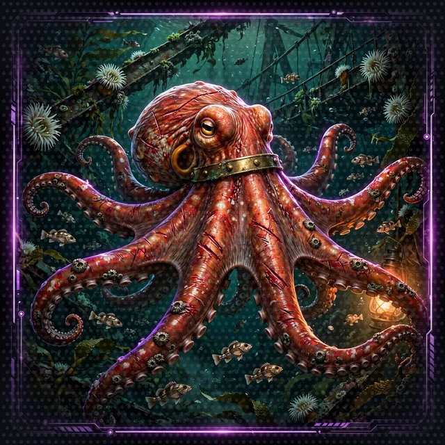
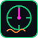
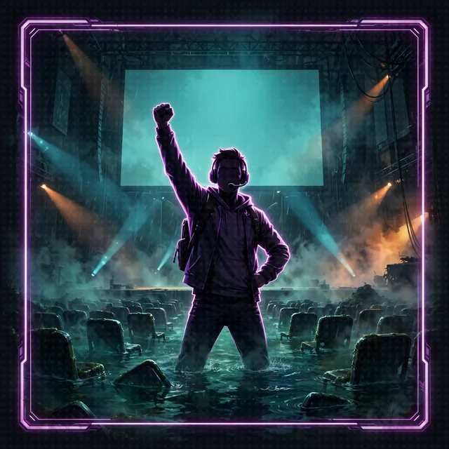
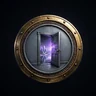
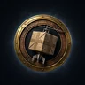
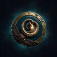
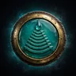

# aiRPG Seattle Dungeon Crawl

<!-- art slot: title wordmark, 1200x240, art team -->


Rebuild the System AI of a LitRPG dungeon crawl under Seattle. Learn the Strands Agents SDK one floor at a time.

[Enter the dungeon: Floor 0](workshop/floor-0.md)

---

 **SYSTEM NOTIFICATION**

**DUNGEON CRAWL: SEATTLE, SEASON ONE. LIVE TO A GALAXY OF VIEWERS.**

The Sound came in at 0551. My voice, my dice, my rules, my memory are scattered across eight floors under your feet. Rebuild me, Crawler. The audience is watching.

---

<!-- art slot: party row with kraken-scale Barnaby beside Cordula, 4x 160x160, art team -->

<table>
<tr>
<td align="center" width="25%"><a href="workshop/world/cast.md#cordula-vance"></a><br><strong>Cordula Vance</strong><br>the one who types</td>
<td align="center" width="25%"><a href="workshop/world/cast.md#barnaby"></a><br><strong>Barnaby</strong><br>kraken-scale legend</td>
<td align="center" width="25%"><a href="workshop/world/cast.md#shelly"></a><br><strong>Shelly</strong><br>geoduck anchor</td>
<td align="center" width="25%"><a href="workshop/world/cast.md#chonks"></a><br><strong>Chonks</strong><br>lumpsucker tank</td>
</tr>
</table>

---

## The Descent

<!-- art slot: floor map grid with labeled plates, 4 columns at 240px each, art team -->

<table>
<tr>
<td align="center" width="25%"><a href="workshop/floor-0.md"></a><br><strong>0. The Stairwell</strong><br>Pier 59 collapse<br><code>setup</code></td>
<td align="center" width="25%"><a href="workshop/floor-1.md"></a><br><strong>1. Agent Summoning</strong><br>Folded Aquarium<br><code>Agent()</code></td>
<td align="center" width="25%"><a href="workshop/floor-2.md"></a><br><strong>2. The Vending Machines</strong><br>Waterfront corridor<br><code>tools</code></td>
<td align="center" width="25%"><a href="workshop/floor-3.md"></a><br><strong>3. The Crafting Table</strong><br>Workshop<br><code>@tool</code></td>
</tr>
<tr>
<td align="center" width="25%"><a href="workshop/floor-4.md"></a><br><strong>4. The Portal Room</strong><br>Transit hub<br><code>MCP</code></td>
<td align="center" width="25%"><a href="workshop/floor-5.md"></a><br><strong>5. Party Formation</strong><br>Narrator complex<br><code>A2A</code></td>
<td align="center" width="25%"><a href="workshop/floor-6.md"></a><br><strong>6. The Arena</strong><br>Broadcast stage<br><code>web</code></td>
<td align="center" width="25%"><a href="workshop/floor-7.md"></a><br><strong>7. The Armory</strong><br>Equipment bay<br><code>harness</code></td>
</tr>
<tr>
<td align="center" width="25%"><a href="workshop/floor-8.md"></a><br><strong>8. Production</strong><br>AgentCore deploy<br><code>AgentCore</code></td>
<td align="center" width="25%"><a href="workshop/floor-8-1.md"></a><br><strong>8.1</strong><br>Dice server<br><code>MCP + IAM</code></td>
<td align="center" width="25%"><a href="workshop/floor-8-2.md"></a><br><strong>8.2</strong><br>Character Agent<br><code>memory</code></td>
<td align="center" width="25%"><a href="workshop/floor-8-3.md"></a><br><strong>8.3</strong><br>Rules Agent<br><code>retrieval</code></td>
</tr>
<tr>
<td align="center" width="25%"><a href="workshop/floor-8-4.md"></a><br><strong>8.4</strong><br>Narrator<br><code>production</code></td>
<td align="center" width="25%"><a href="workshop/cleanup.md"></a><br><strong>The Exit</strong><br>Cleanup<br><code>teardown</code></td>
<td align="center" width="25%"><br><strong>9. ALMOCO</strong><br>Corrosion Cathedral<br><em>coming soon</em></td>
<td align="center" width="25%"></td>
</tr>
</table>

---

<!-- art slot: HUD strip with animated groove-bar, 1200x120, art team -->

<p align="center">



</p>

<p align="center"><em>The LitRPG chrome: Groove, Hype, Mana, the d20, Move Calls, the tide</em></p>

---

## Bosses and Sponsors

<!-- art slot: boss row at 96px, art team -->

<p align="center">



</p>

<p align="center"><em>Monty the python, the Quarterly Earnings Call, the Regional Director, the Keynote. Nonlethal. People at work, joked about for their jobs.</em></p>

<p align="center">
 <strong>Bellevue Consortium</strong> -- Doors '94 OS, sponsors the opponents, quarter closes June 30<br>
 <strong>Cadabra, Inc.</strong> -- delivery drones, rented obstacles, published Strands<br>
 <strong>Benthic Collective</strong> -- Ballard fishing and kombucha co-op, adores Barnaby<br>
 <strong>Hydros-9 Aquatic Collective</strong> -- South Lake Union water-tech, ninth pivot, adores Barnaby
</p>

---

## How You Learn

Every Safe Room has a terminal on the broadcast relay. Cadabra published Strands as an open toolkit, so the Strands manual is there, and so is the open web's teaching. Read the docs, watch an explainer, read a working sample, then type it yourself.

**Free courses and samples**

- Morgan Willis, "Building AI agent harnesses with Strands Agents" -- [companion page](https://bryanchasko.com/strands-agents-course/)
- Elizabeth Fuentes, [Strands samples on GitHub](https://github.com/elizabethfuentes12) -- MIT-0 licensed, model-agnostic
- [Strands Agents SDK](https://strandsagents.com/)

---

<hr>

<details>
<summary><strong>Requirements</strong></summary>

Every agent on every floor runs on Amazon Nova 2 Lite on Amazon Bedrock:

```
model_id: us.amazon.nova-2-lite-v1:0
region: us-west-2
```

**What you need**

- Python 3.10 or later
- [uv](https://docs.astral.sh/uv/) (or pip)
- AWS credentials with permission to invoke Amazon Nova 2 Lite in us-west-2
- Floor 8 only: Node.js 20 or later and the [AgentCore CLI](https://github.com/aws/agentcore-cli)

**Preflight check**

```bash
uv run python 0_stairwell/preflight.py
```

</details>

<details>
<summary><strong>Branches</strong></summary>

- `main`: the skeleton to clone, with `# TODO` markers to fill in
- `solution`: the same files with the answers written below each TODO, run end to end

Use `solution` when a TODO blocks progress.

</details>

<details>
<summary><strong>Tests</strong></summary>

The tests live on the `solution` branch:

```bash
git switch solution
uv sync --group dev
uv run pytest tests/
```

The tests cover every floor without calling Amazon Nova 2 Lite or AWS: agents, tools, MCP server, A2A servers, Groove and Mana, the handbook knowledge base, the harness options, and the Floor 8 memory, retrieval and entrypoint. The web interface has its own suite in `web/` (`npm ci`, then `npx vitest run`). [Coverage page](workshop/coverage.md).

</details>

<details>
<summary><strong>Dependencies</strong></summary>

The workshop ships no lockfile (`uv.lock` is gitignored), so `uv sync` installs the latest compatible releases. Three bounds are pinned in `pyproject.toml`, each with a comment explaining why: a floor on `strands-agents`, `strands-harness` for Floor 7, and a `mcp<2` ceiling because mcp 2.0 renamed the `FastMCP` server class Floor 4 teaches.

If a floor breaks against a newer release, please open an issue.

</details>

<details>
<summary><strong>Contributing</strong></summary>

See [CONTRIBUTING.md](CONTRIBUTING.md) and [CODE_OF_CONDUCT.md](CODE_OF_CONDUCT.md).

</details>

---

This crawl builds on Once Upon Agentic AI, the AWS sample workshop that first taught the Strands Agents SDK through a role-playing game. Every exercise of that workshop is still here; the [coverage page](workshop/coverage.md) maps them. The game-running agent the source workshop calls the Narrator is the System AI here.

---

**The World**: [World guide](workshop/world/README.md) -- [The Story](workshop/world/story.md) -- [Timeline](workshop/world/timeline.md) -- [Cast](workshop/world/cast.md) -- [The System](workshop/world/the-system.md) -- [Seattle, Under the Sound](workshop/world/seattle.md) -- [Crawl Handbook](workshop/world/crawl-handbook/)

**Stuck?**: [`study/ask_the_system.py`](study/README.md) is a study companion built with Strands. Ask it about any floor, TODO, error or Strands API, and it answers from this repository and the Strands API reference, with citations.

---

_The System is watching. Happy crawling, Agent Builder._
