# Art placements

Generated by `tools/publish_art.py` from the plans in `images/plans/`. Do not edit by hand: change the plan's `place` field and rerun.

Every image is in the repo at the path in the snippet, and on S3 at `s3://bryanchasko.com/<key>`, served at `https://bryanchasko.com/<key>`. Pages in this repo link the repo path (it renders on GitHub); the site and other pages can use the URL.

Status: `ready to place` means the page owner adds the snippet at the spot named; `placed` means the page shows it; `replaces` means a re-roll overwrote a file the pages already use.

## 2026-11-08-batch-01-04

| image | page and spot | status |
|---|---|---|
| [`cast-barnaby-presence-640x640.webp`](https://bryanchasko.com/airpg-art/cards/cast-barnaby-presence-640x640.webp) | `workshop/world/cast.md`: Barnaby section, after the ability kit diagram | placed |
| [`cast-barnaby-stealth-640x640.webp`](https://bryanchasko.com/airpg-art/cards/cast-barnaby-stealth-640x640.webp) | `workshop/world/cast.md`: Barnaby section, beside Chromatophore Stealth | placed |
| [`cast-chonks-buckler-640x640.webp`](https://bryanchasko.com/airpg-art/cards/cast-chonks-buckler-640x640.webp) | `workshop/world/cast.md`: Chonks section, after the Buckler ability | placed |
| [`cast-cordula-benched-640x640.webp`](https://bryanchasko.com/airpg-art/cards/cast-cordula-benched-640x640.webp) | `workshop/world/cast.md`: Cordula section, after the stats table | placed |
| [`cast-cordula-drill-640x640.webp`](https://bryanchasko.com/airpg-art/cards/cast-cordula-drill-640x640.webp) | `workshop/world/cast.md`: Cordula section, after the stats table | placed |
| [`opponent-accountant-offbeat-640x640.webp`](https://bryanchasko.com/airpg-art/cards/opponent-accountant-offbeat-640x640.webp) | `workshop/floor-5.md`: Part 4, after Cordula's dance-off result | placed |
| [`opponent-banker-offbeat-640x640.webp`](https://bryanchasko.com/airpg-art/cards/opponent-banker-offbeat-640x640.webp) | `workshop/encounters/quarterly-earnings-call.md`: after the closing log in What It Costs | placed |
| [`opponent-founder-offbeat-640x640.webp`](https://bryanchasko.com/airpg-art/cards/opponent-founder-offbeat-640x640.webp) | `workshop/floor-6.md`: next to Cordula's note that the founder ran out of slides | ready to place |
| [`bellevue-lobby-1200x675.webp`](https://bryanchasko.com/airpg-art/floors/bellevue-lobby-1200x675.webp) | `workshop/floor-8.md`: under Boss Battle: The Quarterly Earnings Call | placed |
| [`bluffs-cliff-1200x675.webp`](https://bryanchasko.com/airpg-art/floors/bluffs-cliff-1200x675.webp) | `workshop/floor-7.md`: the opponent section, before the dance-off | placed |
| [`eelgrass-nursery-1200x675.webp`](https://bryanchasko.com/airpg-art/floors/eelgrass-nursery-1200x675.webp) | `workshop/floor-2.md`: The Arsenal: Vended Tools, above the eelgrass callout | placed |
| [`estuary-dancefloor-1200x675.webp`](https://bryanchasko.com/airpg-art/floors/estuary-dancefloor-1200x675.webp) | `workshop/floor-5.md`: under the floor header | placed |
| [`estuary-flooded-1200x675.webp`](https://bryanchasko.com/airpg-art/floors/estuary-flooded-1200x675.webp) | `workshop/floor-5.md`: after the tide-turn line | placed |
| [`kelp-cathedral-bulbs-1200x675.webp`](https://bryanchasko.com/airpg-art/floors/kelp-cathedral-bulbs-1200x675.webp) | `workshop/floor-3.md`: Step 4, before Lady Luck's table | placed |
| [`safe-room-1200x675.webp`](https://bryanchasko.com/airpg-art/floors/safe-room-1200x675.webp) | `workshop/floor-7.md`: under the floor header | placed |
| [`underground-troll-1200x675.webp`](https://bryanchasko.com/airpg-art/floors/underground-troll-1200x675.webp) | `workshop/floor-6.md`: after the Underground and Fremont Troll prompt block | placed |
| [`ferry-token-96x96.webp`](https://bryanchasko.com/airpg-art/icons/ferry-token-96x96.webp) | `workshop/world/the-system.md`: section 5 icon row | placed |
| [`loot-bronze-96x96.webp`](https://bryanchasko.com/airpg-art/icons/loot-bronze-96x96.webp) | `workshop/world/the-system.md`: section 5 icon row | placed |
| [`loot-silver-96x96.webp`](https://bryanchasko.com/airpg-art/icons/loot-silver-96x96.webp) | `workshop/world/the-system.md`: section 5 icon row | placed |
| [`loot-gold-96x96.webp`](https://bryanchasko.com/airpg-art/icons/loot-gold-96x96.webp) | `workshop/world/the-system.md`: section 5 icon row | placed |
| [`loot-desperation-96x96.webp`](https://bryanchasko.com/airpg-art/icons/loot-desperation-96x96.webp) | `workshop/world/the-system.md`: section 5 icon row | placed |

### `opponent-founder-offbeat-640x640.webp` on `workshop/floor-6.md`

Where: next to Cordula's note that the founder ran out of slides.

S3: `s3://bryanchasko.com/airpg-art/cards/opponent-founder-offbeat-640x640.webp`

```markdown
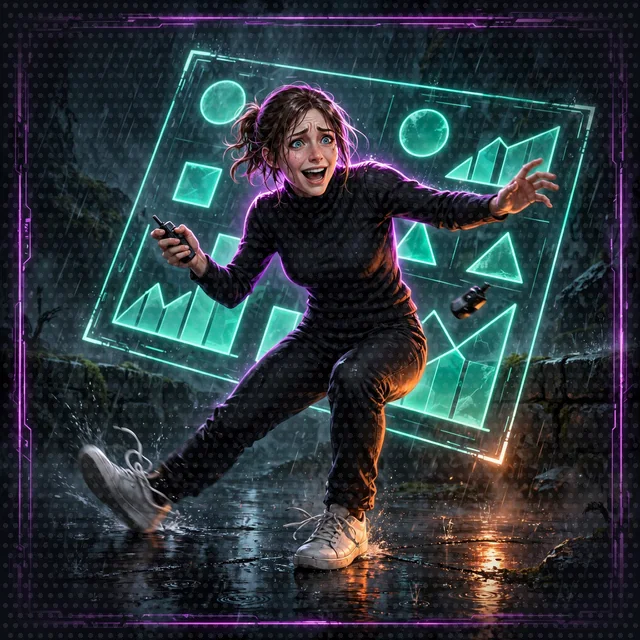
```

## 2026-11-08-batch-05

| image | page and spot | status |
|---|---|---|
| [`cast-shelly-anchor-640x640.webp`](https://bryanchasko.com/airpg-art/cards/cast-shelly-anchor-640x640.webp) | `workshop/world/cast.md`: Shelly section, beside the Anchor ability | replaces the file in place; no page edit |
| [`cast-shelly-bunker-640x640.webp`](https://bryanchasko.com/airpg-art/cards/cast-shelly-bunker-640x640.webp) | `workshop/world/cast.md`: Shelly section, beside the Shell Bunker ability | replaces the file in place; no page edit |
| [`cast-chonks-latch-640x640.webp`](https://bryanchasko.com/airpg-art/cards/cast-chonks-latch-640x640.webp) | `workshop/world/cast.md`: Chonks section, beside the Suction Latch ability | replaces the file in place; no page edit |
| [`cast-barnaby-legend-640x640.webp`](https://bryanchasko.com/airpg-art/cards/cast-barnaby-legend-640x640.webp) | `workshop/world/cast.md`: Barnaby section, first image under the heading, before the stats table | ready to place |
| [`gertie-wreck-den-1200x675.webp`](https://bryanchasko.com/airpg-art/floors/gertie-wreck-den-1200x675.webp) | `workshop/cleanup.md`: after the closing log where Barnaby goes home to the Sound | ready to place |
| [`opponent-tourist-pod-offbeat-640x640.webp`](https://bryanchasko.com/airpg-art/cards/opponent-tourist-pod-offbeat-640x640.webp) | `workshop/floor-1.md`: where the tourist pod leaves the tide pools (the Floor 1 opponent result) | ready to place |
| [`opponent-devrel-swarm-offbeat-640x640.webp`](https://bryanchasko.com/airpg-art/cards/opponent-devrel-swarm-offbeat-640x640.webp) | `workshop/encounters/developer-advocate-swarm.md`: beside the passage where the party wins the boss battle | ready to place |
| [`opponent-ferry-commuters-offbeat-640x640.webp`](https://bryanchasko.com/airpg-art/cards/opponent-ferry-commuters-offbeat-640x640.webp) | `workshop/floor-7.md`: after the dance-off result against the Ferry-Line Commuter Horde | ready to place |
| [`opponent-kiro-scripter-640x640.webp`](https://bryanchasko.com/airpg-art/cards/opponent-kiro-scripter-640x640.webp) | `workshop/floor-2.md`: where Kiro offers to run any command (the HumanInTheLoop bonus) | ready to place |
| [`opponent-lady-luck-640x640.webp`](https://bryanchasko.com/airpg-art/cards/opponent-lady-luck-640x640.webp) | `workshop/floor-3.md`: where the page introduces Lady Luck and her table | ready to place |
| [`opponent-cadabra-drones-640x640.webp`](https://bryanchasko.com/airpg-art/cards/opponent-cadabra-drones-640x640.webp) | `workshop/world/the-system.md`: section 5, beside the Loot boxes bullet (Cadabra drones deliver every box) | ready to place |
| [`sponsor-bellevue-96x96.webp`](https://bryanchasko.com/airpg-art/icons/sponsor-bellevue-96x96.webp) | `workshop/world/the-system.md`: section 5 icon row, after sponsor-benthic | replaces the file in place; no page edit |
| [`sponsor-hydros9-96x96.webp`](https://bryanchasko.com/airpg-art/icons/sponsor-hydros9-96x96.webp) | `workshop/world/the-system.md`: section 5 icon row, after sponsor-bellevue | ready to place |
| [`sponsor-benthic-96x96.webp`](https://bryanchasko.com/airpg-art/icons/sponsor-benthic-96x96.webp) | `workshop/world/the-system.md`: section 5 icon row (already placed) | replaces the file in place; no page edit |
| [`sponsor-cadabra-96x96.webp`](https://bryanchasko.com/airpg-art/icons/sponsor-cadabra-96x96.webp) | `workshop/world/the-system.md`: section 5 icon row, last | ready to place |
| [`welcome-shelly-1200x675.webp`](https://bryanchasko.com/airpg-art/floors/welcome-shelly-1200x675.webp) | `workshop/floor-2.md`: right before Shelly's welcome log (Day 2, 1400 low water) | ready to place |
| [`welcome-chonks-1200x675.webp`](https://bryanchasko.com/airpg-art/floors/welcome-chonks-1200x675.webp) | `workshop/floor-3.md`: right before Chonks's welcome paragraph (after Step 4) | ready to place |
| [`safe-room-dawn-1200x675.webp`](https://bryanchasko.com/airpg-art/floors/safe-room-dawn-1200x675.webp) | `workshop/floor-7.md`: where the party wakes on Day 10 and the session comes back | ready to place |

### `cast-barnaby-legend-640x640.webp` on `workshop/world/cast.md`

Where: Barnaby section, first image under the heading, before the stats table.

S3: `s3://bryanchasko.com/airpg-art/cards/cast-barnaby-legend-640x640.webp`

```markdown

```

### `gertie-wreck-den-1200x675.webp` on `workshop/cleanup.md`

Where: after the closing log where Barnaby goes home to the Sound.

S3: `s3://bryanchasko.com/airpg-art/floors/gertie-wreck-den-1200x675.webp`

```markdown
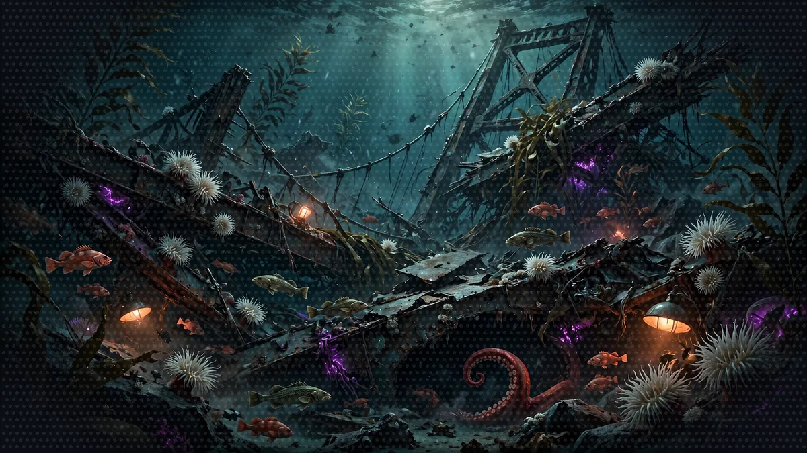
```

### `opponent-tourist-pod-offbeat-640x640.webp` on `workshop/floor-1.md`

Where: where the tourist pod leaves the tide pools (the Floor 1 opponent result).

S3: `s3://bryanchasko.com/airpg-art/cards/opponent-tourist-pod-offbeat-640x640.webp`

```markdown
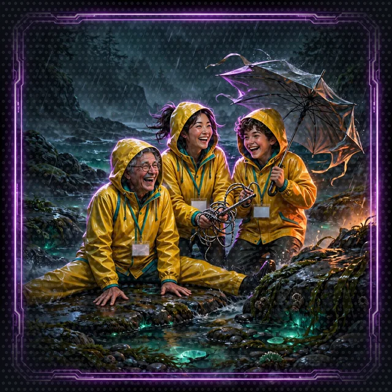
```

### `opponent-devrel-swarm-offbeat-640x640.webp` on `workshop/encounters/developer-advocate-swarm.md`

Where: beside the passage where the party wins the boss battle.

S3: `s3://bryanchasko.com/airpg-art/cards/opponent-devrel-swarm-offbeat-640x640.webp`

```markdown

```

### `opponent-ferry-commuters-offbeat-640x640.webp` on `workshop/floor-7.md`

Where: after the dance-off result against the Ferry-Line Commuter Horde.

S3: `s3://bryanchasko.com/airpg-art/cards/opponent-ferry-commuters-offbeat-640x640.webp`

```markdown
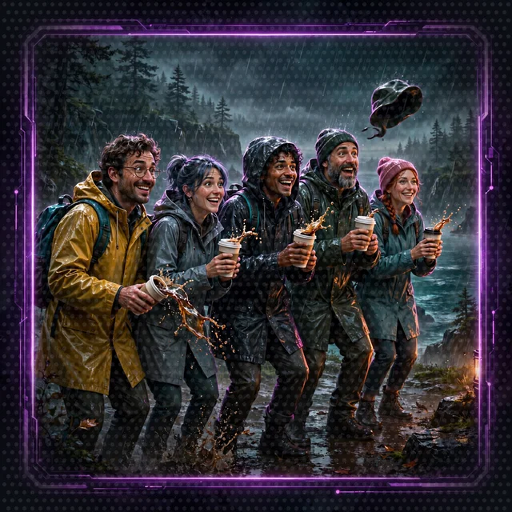
```

### `opponent-kiro-scripter-640x640.webp` on `workshop/floor-2.md`

Where: where Kiro offers to run any command (the HumanInTheLoop bonus).

S3: `s3://bryanchasko.com/airpg-art/cards/opponent-kiro-scripter-640x640.webp`

```markdown
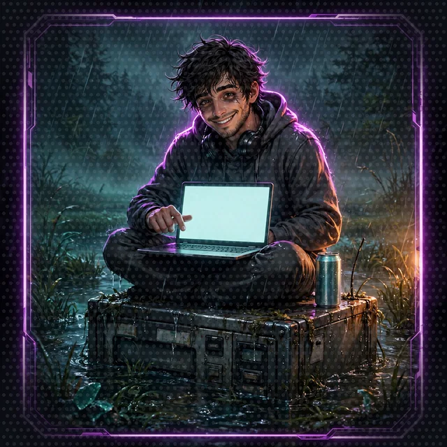
```

### `opponent-lady-luck-640x640.webp` on `workshop/floor-3.md`

Where: where the page introduces Lady Luck and her table.

S3: `s3://bryanchasko.com/airpg-art/cards/opponent-lady-luck-640x640.webp`

```markdown
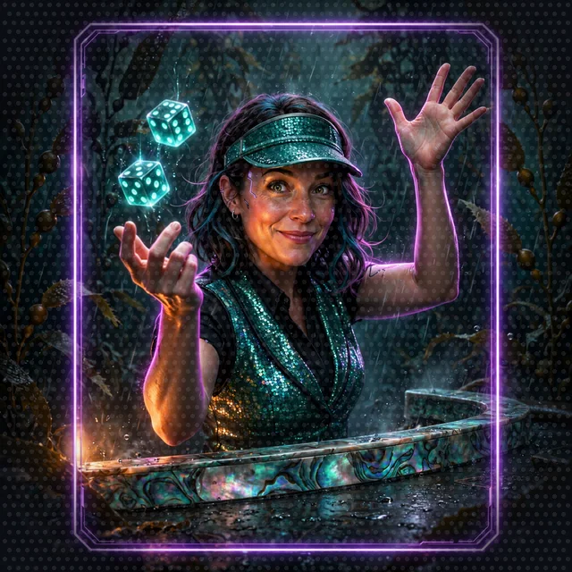
```

### `opponent-cadabra-drones-640x640.webp` on `workshop/world/the-system.md`

Where: section 5, beside the Loot boxes bullet (Cadabra drones deliver every box).

S3: `s3://bryanchasko.com/airpg-art/cards/opponent-cadabra-drones-640x640.webp`

```markdown

```

### `sponsor-hydros9-96x96.webp` on `workshop/world/the-system.md`

Where: section 5 icon row, after sponsor-bellevue.

S3: `s3://bryanchasko.com/airpg-art/icons/sponsor-hydros9-96x96.webp`

```markdown

```

### `sponsor-cadabra-96x96.webp` on `workshop/world/the-system.md`

Where: section 5 icon row, last.

S3: `s3://bryanchasko.com/airpg-art/icons/sponsor-cadabra-96x96.webp`

```markdown

```

### `welcome-shelly-1200x675.webp` on `workshop/floor-2.md`

Where: right before Shelly's welcome log (Day 2, 1400 low water).

S3: `s3://bryanchasko.com/airpg-art/floors/welcome-shelly-1200x675.webp`

```markdown
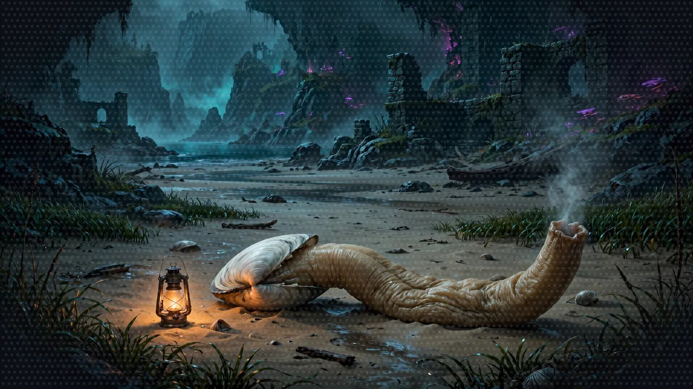
```

### `welcome-chonks-1200x675.webp` on `workshop/floor-3.md`

Where: right before Chonks's welcome paragraph (after Step 4).

S3: `s3://bryanchasko.com/airpg-art/floors/welcome-chonks-1200x675.webp`

```markdown
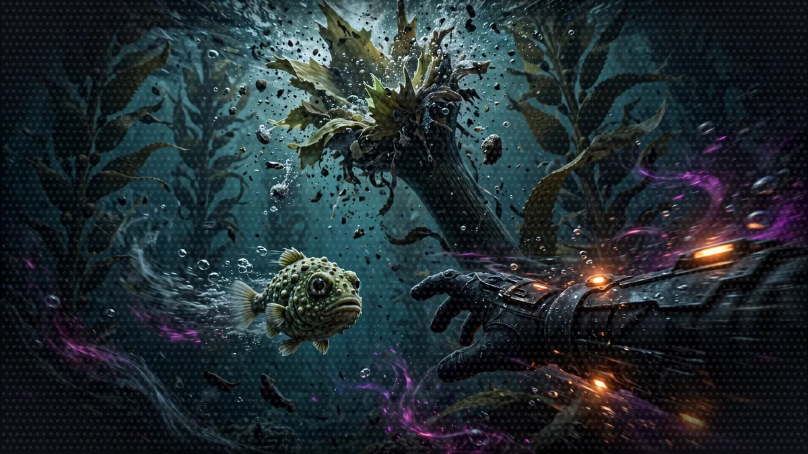
```

### `safe-room-dawn-1200x675.webp` on `workshop/floor-7.md`

Where: where the party wakes on Day 10 and the session comes back.

S3: `s3://bryanchasko.com/airpg-art/floors/safe-room-dawn-1200x675.webp`

```markdown
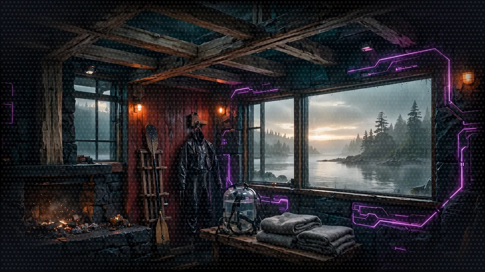
```

## 2026-11-09-batch-06

| image | page and spot | status |
|---|---|---|
| [`banner-1680x720.webp`](https://bryanchasko.com/airpg-art/images/banner-1680x720.webp) | `README.md`: hero slot at the top (the Gertie wreck plate stands in until this lands) | replaces the file in place; no page edit |
| [`cast-cordula-640x640.webp`](https://bryanchasko.com/airpg-art/cards/cast-cordula-640x640.webp) | `workshop/world/cast.md`: party table and Cordula section speaker card | replaces the file in place; no page edit |
| [`cast-cordula-drill-640x640.webp`](https://bryanchasko.com/airpg-art/cards/cast-cordula-drill-640x640.webp) | `workshop/world/cast.md`: Cordula section, beside the drill image | replaces the file in place; no page edit |
| [`cast-cordula-benched-640x640.webp`](https://bryanchasko.com/airpg-art/cards/cast-cordula-benched-640x640.webp) | `workshop/world/cast.md`: Cordula section, beside the benched image | replaces the file in place; no page edit |
| [`cast-barnaby-640x640.webp`](https://bryanchasko.com/airpg-art/cards/cast-barnaby-640x640.webp) | `workshop/world/cast.md`: party table and Barnaby speaker card | replaces the file in place; no page edit |
| [`cast-shelly-640x640.webp`](https://bryanchasko.com/airpg-art/cards/cast-shelly-640x640.webp) | `workshop/world/cast.md`: party table and Shelly section base card | replaces the file in place; no page edit |

## 2026-11-09-batch-06b

| image | page and spot | status |
|---|---|---|
| [`banner-1680x720.webp`](https://bryanchasko.com/airpg-art/images/banner-1680x720.webp) | `README.md`: hero slot at the top (the Gertie wreck plate stands in until this lands) | replaces the file in place; no page edit |

## 2026-11-09-batch-06c

| image | page and spot | status |
|---|---|---|
| [`banner-1680x720.webp`](https://bryanchasko.com/airpg-art/images/banner-1680x720.webp) | `README.md`: hero slot at the top (the Gertie wreck plate stands in until this lands) | replaces the file in place; no page edit |

## 2026-11-09-batch-07

| image | page and spot | status |
|---|---|---|
| [`floor-9-1200x675.webp`](https://bryanchasko.com/airpg-art/floors/floor-9-1200x675.webp) | `workshop/floor-9.md`: floor plate at the top (page lands with the Floor 9 build) | ready to place |
| [`almoco-nave-1200x675.webp`](https://bryanchasko.com/airpg-art/floors/almoco-nave-1200x675.webp) | `workshop/floor-9.md`: zone plate for the Nave section (optional slot) | ready to place |
| [`opp-shift-foreman-640x640.webp`](https://bryanchasko.com/airpg-art/cards/opp-shift-foreman-640x640.webp) | `workshop/floor-9.md`: opponent card, shift foreman dance-off | ready to place |
| [`opp-crane-operator-640x640.webp`](https://bryanchasko.com/airpg-art/cards/opp-crane-operator-640x640.webp) | `workshop/floor-9.md`: opponent card, crane operator dance-off | ready to place |
| [`opp-haul-truck-driver-640x640.webp`](https://bryanchasko.com/airpg-art/cards/opp-haul-truck-driver-640x640.webp) | `workshop/floor-9.md`: opponent card, haul truck driver dance-off | ready to place |
| [`opp-public-relations-man-640x640.webp`](https://bryanchasko.com/airpg-art/cards/opp-public-relations-man-640x640.webp) | `workshop/floor-9.md`: opponent card, public relations man dance-off | ready to place |
| [`fog-index-96x96.webp`](https://bryanchasko.com/airpg-art/icons/fog-index-96x96.webp) | `workshop/floor-9.md`: Fog Index mechanic icon | ready to place |

### `floor-9-1200x675.webp` on `workshop/floor-9.md`

Where: floor plate at the top (page lands with the Floor 9 build).

S3: `s3://bryanchasko.com/airpg-art/floors/floor-9-1200x675.webp`

```markdown
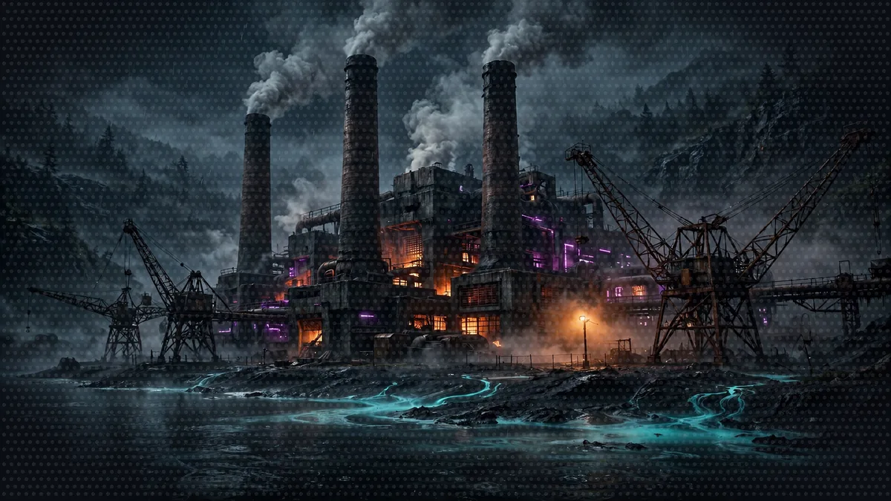
```

### `almoco-nave-1200x675.webp` on `workshop/floor-9.md`

Where: zone plate for the Nave section (optional slot).

S3: `s3://bryanchasko.com/airpg-art/floors/almoco-nave-1200x675.webp`

```markdown
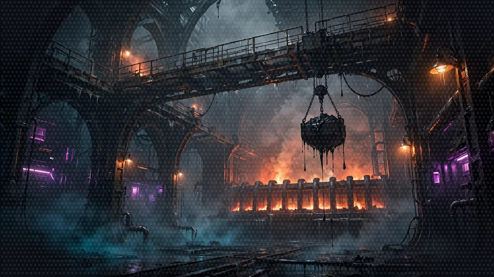
```

### `opp-shift-foreman-640x640.webp` on `workshop/floor-9.md`

Where: opponent card, shift foreman dance-off.

S3: `s3://bryanchasko.com/airpg-art/cards/opp-shift-foreman-640x640.webp`

```markdown
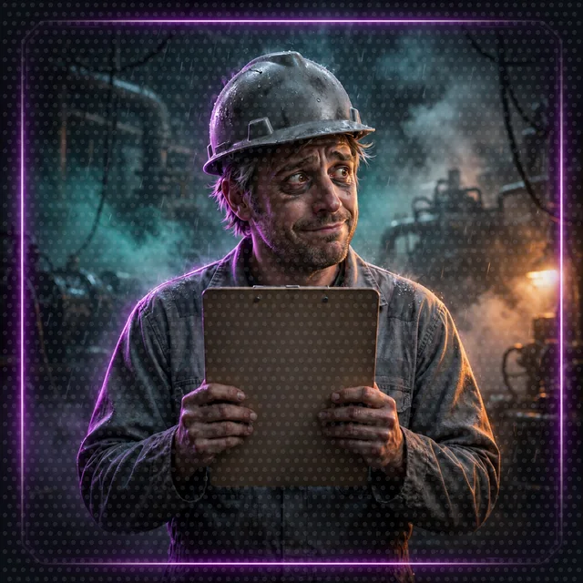
```

### `opp-crane-operator-640x640.webp` on `workshop/floor-9.md`

Where: opponent card, crane operator dance-off.

S3: `s3://bryanchasko.com/airpg-art/cards/opp-crane-operator-640x640.webp`

```markdown
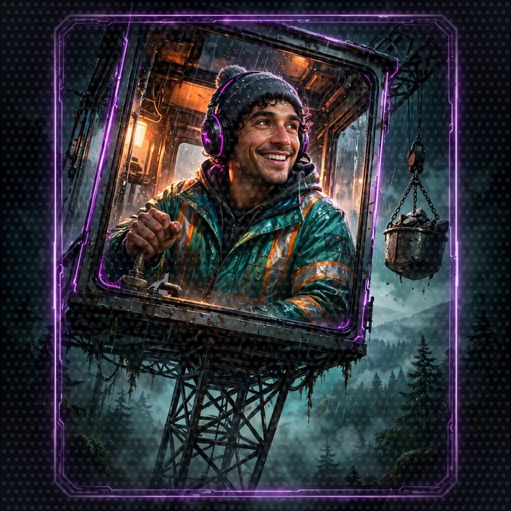
```

### `opp-haul-truck-driver-640x640.webp` on `workshop/floor-9.md`

Where: opponent card, haul truck driver dance-off.

S3: `s3://bryanchasko.com/airpg-art/cards/opp-haul-truck-driver-640x640.webp`

```markdown
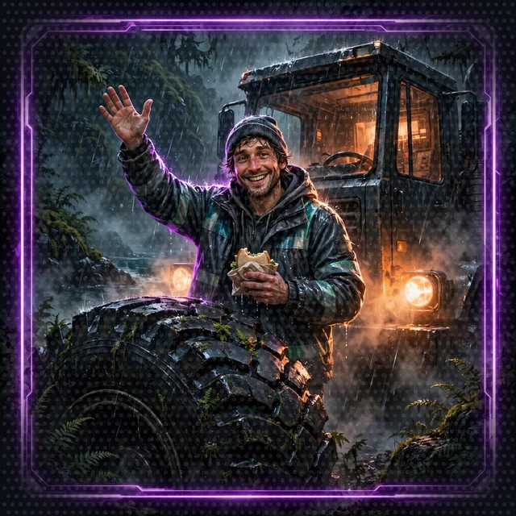
```

### `opp-public-relations-man-640x640.webp` on `workshop/floor-9.md`

Where: opponent card, public relations man dance-off.

S3: `s3://bryanchasko.com/airpg-art/cards/opp-public-relations-man-640x640.webp`

```markdown

```

### `fog-index-96x96.webp` on `workshop/floor-9.md`

Where: Fog Index mechanic icon.

S3: `s3://bryanchasko.com/airpg-art/icons/fog-index-96x96.webp`

```markdown
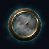
```

## 2026-11-09-batch-08

| image | page and spot | status |
|---|---|---|
| [`system-eye-96x96.webp`](https://bryanchasko.com/airpg-art/icons/system-eye-96x96.webp) | `docs/image-reuse-audit.md`: System AI speaker variant for watching and judging lines | placed |
| [`system-signal-96x96.webp`](https://bryanchasko.com/airpg-art/icons/system-signal-96x96.webp) | `docs/image-reuse-audit.md`: System AI speaker variant for announcements and notifications | placed |

## motion

| image | page and spot | status |
|---|---|---|
| [`opponent-accountant-offbeat.webp`](https://bryanchasko.com/airpg-art/motion/opponent-accountant-offbeat.webp) | `workshop/world/the-system.md`: section 6, beside the Off-Beat status in the dance-off description | ready to place |
| [`opponent-banker-offbeat.webp`](https://bryanchasko.com/airpg-art/motion/opponent-banker-offbeat.webp) | `workshop/encounters/quarterly-earnings-call.md`: replace the still banker card after the closing log | ready to place |
| [`opponent-founder-offbeat.webp`](https://bryanchasko.com/airpg-art/motion/opponent-founder-offbeat.webp) | `workshop/floor-6.md`: next to Cordula's note that the founder ran out of slides | ready to place |
| [`cast-cordula-drill-benched.webp`](https://bryanchasko.com/airpg-art/motion/cast-cordula-drill-benched.webp) | `workshop/world/the-system.md`: section 7, beside the Benched bullet, in place of the still Benched card | ready to place |
| [`cast-barnaby-presence-ink.webp`](https://bryanchasko.com/airpg-art/motion/cast-barnaby-presence-ink.webp) | `workshop/world/cast.md`: Barnaby section, beside the Ink Cloud ability | ready to place |
| [`loot-bronze-loot-pop.webp`](https://bryanchasko.com/airpg-art/motion/loot-bronze-loot-pop.webp) | `workshop/_snippets.md`: Achievement toast, as the optional animated icon | ready to place |
| [`loot-silver-loot-pop.webp`](https://bryanchasko.com/airpg-art/motion/loot-silver-loot-pop.webp) | `workshop/world/the-system.md`: section 5, loot boxes | ready to place |
| [`loot-gold-loot-pop.webp`](https://bryanchasko.com/airpg-art/motion/loot-gold-loot-pop.webp) | `workshop/world/the-system.md`: section 5, loot boxes | ready to place |
| [`loot-desperation-loot-pop.webp`](https://bryanchasko.com/airpg-art/motion/loot-desperation-loot-pop.webp) | `workshop/world/the-system.md`: section 5, loot boxes | ready to place |
| [`ferry-token-loot-pop.webp`](https://bryanchasko.com/airpg-art/motion/ferry-token-loot-pop.webp) | `workshop/world/the-system.md`: section 5, Currency bullet | ready to place |

### `opponent-accountant-offbeat.webp` on `workshop/world/the-system.md`

Where: section 6, beside the Off-Beat status in the dance-off description.

S3: `s3://bryanchasko.com/airpg-art/motion/opponent-accountant-offbeat.webp`

```markdown
<picture><source srcset="../../images/motion/opponent-accountant-offbeat-still.webp" media="(prefers-reduced-motion: reduce)"></picture>
```

### `opponent-banker-offbeat.webp` on `workshop/encounters/quarterly-earnings-call.md`

Where: replace the still banker card after the closing log.

S3: `s3://bryanchasko.com/airpg-art/motion/opponent-banker-offbeat.webp`

```markdown
<picture><source srcset="../../images/motion/opponent-banker-offbeat-still.webp" media="(prefers-reduced-motion: reduce)"></picture>
```

### `opponent-founder-offbeat.webp` on `workshop/floor-6.md`

Where: next to Cordula's note that the founder ran out of slides.

S3: `s3://bryanchasko.com/airpg-art/motion/opponent-founder-offbeat.webp`

```markdown
<picture><source srcset="../images/motion/opponent-founder-offbeat-still.webp" media="(prefers-reduced-motion: reduce)">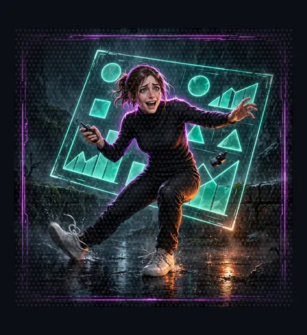</picture>
```

### `cast-cordula-drill-benched.webp` on `workshop/world/the-system.md`

Where: section 7, beside the Benched bullet, in place of the still Benched card.

S3: `s3://bryanchasko.com/airpg-art/motion/cast-cordula-drill-benched.webp`

```markdown
<picture><source srcset="../../images/motion/cast-cordula-drill-benched-still.webp" media="(prefers-reduced-motion: reduce)"></picture>
```

### `cast-barnaby-presence-ink.webp` on `workshop/world/cast.md`

Where: Barnaby section, beside the Ink Cloud ability.

S3: `s3://bryanchasko.com/airpg-art/motion/cast-barnaby-presence-ink.webp`

```markdown
<picture><source srcset="../../images/motion/cast-barnaby-presence-ink-still.webp" media="(prefers-reduced-motion: reduce)"></picture>
```

### `loot-bronze-loot-pop.webp` on `workshop/_snippets.md`

Where: Achievement toast, as the optional animated icon.

S3: `s3://bryanchasko.com/airpg-art/motion/loot-bronze-loot-pop.webp`

```markdown
<picture><source srcset="../images/motion/loot-bronze-loot-pop-still.webp" media="(prefers-reduced-motion: reduce)">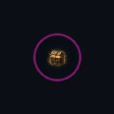</picture>
```

### `loot-silver-loot-pop.webp` on `workshop/world/the-system.md`

Where: section 5, loot boxes.

S3: `s3://bryanchasko.com/airpg-art/motion/loot-silver-loot-pop.webp`

```markdown
<picture><source srcset="../../images/motion/loot-silver-loot-pop-still.webp" media="(prefers-reduced-motion: reduce)"></picture>
```

### `loot-gold-loot-pop.webp` on `workshop/world/the-system.md`

Where: section 5, loot boxes.

S3: `s3://bryanchasko.com/airpg-art/motion/loot-gold-loot-pop.webp`

```markdown
<picture><source srcset="../../images/motion/loot-gold-loot-pop-still.webp" media="(prefers-reduced-motion: reduce)"></picture>
```

### `loot-desperation-loot-pop.webp` on `workshop/world/the-system.md`

Where: section 5, loot boxes.

S3: `s3://bryanchasko.com/airpg-art/motion/loot-desperation-loot-pop.webp`

```markdown
<picture><source srcset="../../images/motion/loot-desperation-loot-pop-still.webp" media="(prefers-reduced-motion: reduce)"></picture>
```

### `ferry-token-loot-pop.webp` on `workshop/world/the-system.md`

Where: section 5, Currency bullet.

S3: `s3://bryanchasko.com/airpg-art/motion/ferry-token-loot-pop.webp`

```markdown
<picture><source srcset="../../images/motion/ferry-token-loot-pop-still.webp" media="(prefers-reduced-motion: reduce)"></picture>
```

## Art backlog (requests for the art team, 2026-11-09)

Requests only. Nothing below exists yet unless the status column says so.
Each row needs a plan in `images/plans/` rendered with
`tools/airpg_render.py`; writers place the file when it lands and move the
row into a batch section above. Spoiler rule applies to every row: no Shelly
before Floor 2, no Chonks before Floor 3, in image, caption or alt text.

| Slot | Size | Subject | Status |
|---|---|---|---|
| `README.md` cover hero, replacing `images/banner-1680x720.webp` in place | banner 1680x720 webp | Cliffhanger tease only: the Galloping Gertie wreck in dark water, one huge octopus arm curling out of a girder den, a shadow bigger than the wreck, one eye catching sodium light. Cordula small at the edge with her paddle, looking in. No full Barnaby, no dance, no crimson-white flash: the reveal is earned later. Nobody else from the party in frame. | requested; current banner shows the full dance and spends the reveal |
| `workshop/floor-9.md` floor plate at the top | floor 1200x675 webp | Already rendered: `images/floors/floor-9-1200x675.webp` (batch-07 above). No new render needed. The page does not exist yet, so the plate is unplaced until the Floor 9 build lands; the almoco-nave plate and the four Floor 9 opponent cards in batch-07 wait with it. | art done, waiting on the page |
| `web/index.html` social share image (`og:image`) | 1200x630 webp | The cover cliffhanger above, cropped for a share card: wreck, one arm, one eye, wordmark space left dark at the top. No party members beyond the tease, no text baked in. The site head has no `og:image` tag yet; the web lane adds the tag when this file lands. | requested |
| `web/public/favicon.ico` plus an SVG favicon | 32x32 ico, scalable SVG | One small glyph that reads at tab size: a brass-rimmed violet System frame corner, or a single octopus arm curl. `web/index.html` already links `/favicon.ico` and `web/public/` has no such file, so the tab icon 404s today. Dark background `#0B0E14`, no text. | requested |
| `README.md` cover, small Barnaby tease for narrow screens | card 640x640 webp | Square crop-safe companion to the cliffhanger banner: anemone-covered girder, one arm, one eye, darkness doing the rest. Lets the cover keep the tease when the wide banner crops badly. Same ban: no full body, no dance. | requested, only if the cover lane needs it after seeing the banner crop |

## Cover backlog (hand notes, not generated)

- Wordmark: `images/wordmark-1200x240.webp` still carries the old name baked in. Recompose with the title "Seattle Strands Dungeon Crawl" and the line "A Visual Lit aiRPG Workshop", then update the cover alt text in `README.md` to match the new image. Art team owns `images/` and the composing tool.
- Cover tease: `images/floors/gertie-wreck-den-1200x675.webp` (wreck, den, one arm) now also serves as the `README.md` cover sighting. It is still listed above as ready to place on `workshop/cleanup.md`. Art team to confirm dual use, or render a dedicated cover fold-moment tease (Pier 59 folds at 0551, shadow, one arm or one eye only, no full body, no dance) and swap the cover.

## Requested (web lane, hand-appended below the generated list)

Everything above this heading is generated. This section is the web lane's ask
list: new image needs found while building the play page. Nothing here exists
yet; the art team owns every render and every binary. Spoiler rule for every
entry surface: later-floor companions are never shown or named before they
join, and Barnaby on an entry surface is a tease only (wreck, shadow, one
arm, one eye), never the full dance reveal. Conflict is dance-offs; nobody
is hurt.

| request | format | slot | notes |
|---|---|---|---|
| Favicon set from one SVG source | svg + 32x32 png, 180x180 apple-touch, 192/512 maskable png | web/public/ (today the page points at the existing dice/d20.svg as a stopgap) | System AI eye or d20 glyph in the HUD line style, single accent on #0B0E14, legible at 16px |
| Wordmark as true SVG (outlined paths) | svg, horizontal about 1200x240 and compact stacked about 480x240 | README header and web site header (today the header is text; the repo wordmark is raster only) | MedievalSharp/Cinzel display lettering; must read on obsidian #0B0E14; light variant welcome |
| Social share crop | webp 1200x630 (same art at 1280x640 for the repo social preview upload) | web/index.html og:image and twitter:image, plus repo settings (absent today) | Spoiler-safe tease composition; keep one side darker for the wordmark lockup |
| Web-sized lead portraits | webp, one per Crawler, sized for web/public | Play-as picker and character panel (today both leads share web/public/avatar-placeholder.jpeg) | Source cards already exist in images/cards/ on main; the art lane cuts the web copies so no binary is hand-copied |
| Generic Crawler avatar | webp 96x96 | Replaces web/public/avatar-placeholder.jpeg (a JPEG, outside the format plan) | Hooded silhouette, rim light, no face, not any cast member |
| Spoiler-safe landing backdrop plate | webp 1200x675 | Optional landing page backdrop | Stairwell and Sound mood only; no later-floor companions; Barnaby tease grammar only |
| Descent map | inline-friendly svg, viewBox about 1200x675, no scripts | Optional: beside the labelled floor grid, which stays the accessible text version | Stairwell cross-section, floor nodes, one route line; no companion figures at early depths |
