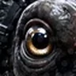
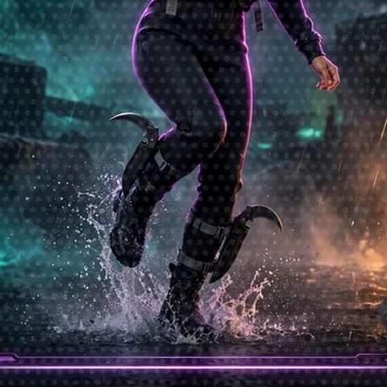

# Image reuse audit: thumbnails and comic panels

Scan and findings, 2026-11-09 (art lane). Method: every `` and `` reference in
`README.md`, `workshop/` and `docs/` (72 markdown files), counted by file name, page spread
and display width. Rerun any time with the snippet under "Method" at the bottom.

## The problem in numbers

660 image references total. 494 of them (75 percent) display at width 28: the speaker-icon
slot. And the images filling that slot are almost all full 640x640 character cards shrunk to
28px, where a full body turns to mush and every speaker line wears the same tiny smudge.

| image | uses | files | mostly shown at |
|---|---:|---:|---|
| `cast-cordula-640x640.webp` | 223 | 53 | 28px speaker icon (221 of the uses) |
| `system-ai-96x96.webp` | 128 | 59 | 28px speaker icon |
| `achievement-96x96.webp` | 56 | 49 | 28px achievement marker |
| `cast-barnaby-640x640.webp` | 34 | 21 | 28px speaker icon |
| `warning-96x96.webp` | 32 | 15 | 28px warning marker |

Meanwhile the expressive cards sit nearly unused: Cordula drill (1 use), Cordula benched (2),
Barnaby presence (1), Barnaby stealth (1), all of Shelly's and Chonks's ability cards (1 to 2).
The cast has range; the pages are not using it.

## The rule going forward

- A speaker icon is a headshot, never a full card. If it does not read at 28px, it is not an icon.
- Rotate by beat, like a comic: the same character gets a different crop for a different kind
  of line. Anything shown more than about 20 times needs variants.
- Close shots are panels, not new renders: crop them from art that already passed the model
  sheet (`art/panel_crops.py`), so variety can never drift off-model.

## New assets (2026-11-09)

Speaker headshots, 96x96, cut to survive 28px. Swap them in for the card-on-speaker-duty:
the path change is the whole edit, `alt=""` and the 28x28 size stay.

| file | use it for |
|---|---|
| `images/icons/speaker-cordula-face-96x96.webp` | Cordula default lines (replaces the card in the speaker slot) |
| `images/icons/speaker-cordula-drill-96x96.webp` | action, dance and drill lines (paddle overhead) |
| `images/icons/speaker-cordula-benched-96x96.webp` | post-round, tired and "what it costs" lines |
| `images/icons/speaker-barnaby-head-96x96.webp` | Barnaby default lines |
| `images/icons/speaker-barnaby-eye-96x96.webp` | Barnaby's dry one-liners and judgments |
| `images/icons/speaker-chonks-face-96x96.webp` | Chonks whenever he gets a line or a beat |
| `images/icons/speaker-shelly-siphon-96x96.webp` | Shelly beats (the siphon is the part that reads small) |
| `images/icons/system-eye-96x96.webp` | System AI watching and judging lines |
| `images/icons/system-signal-96x96.webp` | System AI announcements and notifications |

Square action panels, 480x480, for inline story beats where a full card is too much and a
plate is too wide (display at width 240 to 320):

| file | beat it fits |
|---|---|
| `images/panels/panel-barnaby-tentacle-480x480.webp` | Barnaby holds a door, a line, an opponent's attention |
| `images/panels/panel-barnaby-suckers-480x480.webp` | grip, stealth, holding on |
| `images/panels/panel-cordula-karambits-480x480.webp` | cutting something free, gear talk, the 0551 beat |
| `images/panels/panel-paddle-twirl-480x480.webp` | a dance move lands; the object-thrown beat |
| `images/panels/panel-dance-cordula-480x480.webp` | dance-offs from Cordula's side |
| `images/panels/panel-dance-barnaby-480x480.webp` | dance-offs from Barnaby's side, chromatophores lit |
| `images/panels/panel-chonks-pool-480x480.webp` | Chonks reacting from the water, Barnaby's lit arm at frame edge |

Snippet pattern (workshop root depth; add one more `../` from `workshop/encounters/` and
`workshop/world/`):

```html
 **BARNABY:** ...

```

## Recommended swaps, in order

1. Everywhere: `cast-cordula-640x640.webp` at 28px becomes `speaker-cordula-face-96x96.webp`;
   same for `cast-barnaby-640x640.webp` to `speaker-barnaby-head-96x96.webp`. Mechanical,
   semantics unchanged, instant legibility gain (257 spots). Page owners can then season
   individual lines with the drill/benched/eye variants in context.
2. System AI lines: keep `system-ai-96x96.webp` as the default; use `system-eye` for judging
   and `system-signal` for announcements so the marker itself carries tone.
3. Shelly and Chonks beats currently ride along in Cordula or System lines; give them the
   siphon and face icons wherever the text names them acting.
4. When a floor or encounter has a signature physical beat, prefer a panel over a third
   full plate; add crops to `art/panel_crops.py` JOBS instead of rendering new art.

## Method

```python
import re, collections, pathlib
files = [pathlib.Path("README.md")] + sorted(pathlib.Path("workshop").rglob("*.md")) \
      + sorted(pathlib.Path("docs").rglob("*.md"))
count, where = collections.Counter(), collections.defaultdict(set)
for f in files:
    for src in re.findall(r'(?:!\[[^\]]*\]\(|]+src=")([^")\s]+)', f.read_text()):
        count[src.split("/")[-1]] += 1; where[src.split("/")[-1]].add(str(f))
for name, c in count.most_common(20): print(c, len(where[name]), name)
```
