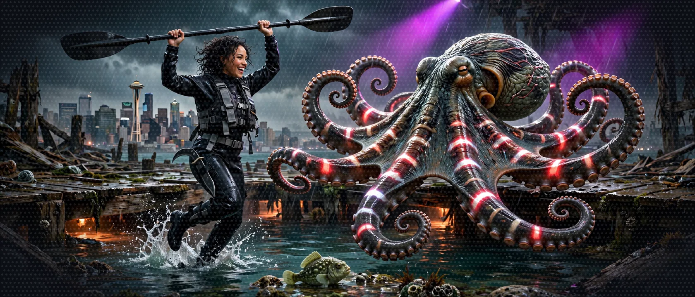

# Seattle Strands Dungeon Crawl: A Visual Lit aiRPG Workshop

A Visual Lit aiRPG: a LitRPG you can see, run by one System AI, built one floor at a time with the Strands Agents SDK on Amazon Nova 2 Lite. Conflict is a dance-off. Nobody gets hurt.

<!-- art slot: hero, 1600x600, art team -->

"Roll for Initiative... in Python!"

>  **System AI:** "Welcome, Crawlers, to the dungeon under Seattle. Pier 59 collapsed this morning, the Salish Sea came in, and you came with it: soaked, short one kayak, armed with a bare-bones terminal and a dream of building autonomous multi-agent systems before the next floor floods. Every script you run drops an achievement box. Write a clean loop and earn a Bronze Box. Burn through your token limit with an accidental infinite loop and earn a Desperation Box. The review board is watching. Try to be interesting."

## Who I Am

>  **CORDULA:** I am Cordula Vance. Core, to anyone who has shared a boat with me. Marine Corps Reserve, amphibious crew chief, and before work I sweep debris off the Sound in a kayak. On Wednesday, June 17, I tied up under Pier 59, and at 0551 the pier folded into Elliott Bay with the octopus and me under it.
>
> He fights beside me now, a kraken-scale octopus who refuses to confirm or deny the King Octopus legend. His name is Barnaby. Eight arms, a doctorate's worth of opinions, and, since the System AI clamped a collar on him, a British accent.
>
> The thing that folded the pier is the System AI. It runs this dungeon: the floors, the tides, the opponents, the dice, the rules. The flood broke it. Its voice, its dice, its rule book and its memory washed out across eight floors under the Sound. The System AI survived in the broadcast relay and the collar, and it wants its pieces back. The only way out is to rebuild it, one piece per floor. Every piece I rebuild passes through Barnaby's collar first, and he wakes up a little more. I build every piece with the Strands Agents SDK: the first floor is one agent and one call, the last is the whole game running on Amazon Bedrock AgentCore. I write all of it.
>
> Nobody gets hurt down here. A fight is a dance-off, the opponents are accountants, bankers and developer advocates at work, and the worst that happens is I get Benched and wake up in a Safe Room. I keep a log. The log is what happened. The steps are what I type next.

What the Narrator, the party and the rules are made of:

- [World guide](world/README.md): everything the agents say about the world comes from these pages
- [The Story](world/story.md): the log, floor by floor; every floor's obstacle is its Strands lesson
- [The Timeline](world/timeline.md): the fourteen days of the crawl, with the tides
- [The System](world/the-system.md): the LitRPG design, one layer per workshop floor
- [The Cast](world/cast.md) and [Seattle, Under the Sound](world/seattle.md)
- [The Crawl Handbook](world/crawl-handbook/): the rules, and the Rules Agent's knowledge base

Every floor ends its main exercise with a **SYSTEM DESIGN** callout: the LitRPG layer that the Strands concept you just learned makes possible.

## The Dungeon Map

The dungeon has nine floors and an exit. Each floor builds on the one above it - clear them in order or the stairs will not open. Floor 7 is optional: Floor 8 starts again from the Floor 5 code.

### [Floor 0: The Stairwell](floor-0.md)
Clone the repo, install uv and Python, run uv sync

### [Floor 1: Agent Summoning](floor-1.md)
Create and call your first agent

- Build an agent with `Agent(system_prompt=...)` and invoke it with a single call
- Enable DEBUG logs on the strands logger to watch the requests sent to Amazon Nova 2 Lite

### [Floor 2: The Vending Machines](floor-2.md)
Give the agent tools that ship with the SDK

- Add a vended tool, `http_request`, and let the agent look up a giant octopus on the Open5e API
- See the agent decide on its own when a tool is needed
- Bonus: `shell` and `file_editor`, each call gated by a `HumanInTheLoop` approval prompt

### [Floor 3: The Crafting Table](floor-3.md)
Write your own tool

- Turn a Python function into a tool with `@tool`
- Write the docstring Amazon Nova 2 Lite reads to know when and how to call the tool
- Watch the agent roll a 4d6-drop-lowest character in four calls, because the docstring told the agent how

### [Floor 4: The Portal Room (MCP)](floor-4.md)
Serve a tool over MCP and consume it

- Expose the same `roll_dice` with FastMCP over streamable HTTP
- Connect an agent to the dice server with `MCPClient`

### [Floor 5: Party Formation (A2A)](floor-5.md)
Make agents talk to each other, one part per sitting

- [Floor 5.1](floor-5-1.md): give the Rules Agent a ChromaDB knowledge base built from the Crawl Handbook, expose it with `A2AServer` and an `agent_factory`
- [Floor 5.2](floor-5-2.md): expose the Character Agent the same way, on its own port
- [Floor 5.3](floor-5-3.md): orchestrate both with the `a2a_client` tool and the MCP dice server, return typed JSON with `structured_output_model`, and run a dance-off

### [Floor 6: The Arena (Web Interface)](floor-6.md)
Play with your Narrator in the browser

- Connect the web UI to your orchestrator on http://127.0.0.1:8009
- Follow each tool call in the terminal

### [Floor 7 (Optional): The Armory (Strands harness)](floor-7.md)
Rebuild the Narrator in a few lines with Strands harness

- Assemble it with `create_harness()`: instructions, mcp_servers, tools, builtin_tools
- Resume a campaign across restarts with a named session
- Know when to pick the harness and when to stay on the SDK

### [Floor 8: Production (AgentCore)](floor-8.md)
Deploy the whole party to Amazon Bedrock AgentCore, one brick at a time

- Deploy the dice server, the Character Agent and the Rules Agent to AgentCore Runtime with the `agentcore` CLI
- Call the dice server, Character Agent and Rules Agent from the Narrator with IAM-signed clients: `aws_iam_streamablehttp_client` for MCP, `SigV4HTTPXAuth` for A2A
- Keep the characters and the conversation in AgentCore Memory (`AgentCoreMemorySessionManager`), the rules in a managed knowledge base
- Serve the Narrator with `BedrockAgentCoreApp` and follow one turn across runtimes in the traces
- Runs in a personal AWS account

### [The Exit: Final Cleanup](cleanup.md)
Stop your services, remove the Floor 8 AWS resources and delete the harness state in `.agent/`

### [Side Passages: Optional Encounters](encounters/README.md)
Deeper into the SDK, off the main corridor, each encounter starting where the matching floor ends: 34 sidequests, dance-offs and boss battles

- Floor 1: [The Commentary Booth](encounters/commentary-booth.md), [Read the Receipt](encounters/read-the-receipt.md), boss battle [The Reasoning Dial](encounters/reasoning-dial.md)
- Floor 2: [The Tide Table](encounters/tide-table.md), [The Sandbox Tide Pool](encounters/sandbox-tide-pool.md), boss battle [The Policy Gatekeeper](encounters/policy-gatekeeper.md), [Ask the Player](encounters/ask-the-player.md)
- Floor 3: dance-off [The Concurrent Shuffle](encounters/concurrent-shuffle.md), [The Living Workbench](encounters/living-workbench.md)
- Floor 4: [The Locks Turnstile](encounters/locks-turnstile.md), [Trace the Portal](encounters/trace-the-portal.md), [The Warehouse Automation Grid](encounters/warehouse-automation-grid.md)
- Floor 5: [The Paper Trail](encounters/paper-trail.md), boss battle [The Developer Advocate Swarm](encounters/developer-advocate-swarm.md), [Barnaby Takes the Call](encounters/barnaby-takes-the-call.md), dance-off [Read the Room, Typed](encounters/read-the-room-typed.md), [Subcontract the Paperwork](encounters/subcontract-the-paperwork.md), [The Delivery Drone Horde](encounters/delivery-drone-horde.md)
- Floor 6: [The Hype Meter](encounters/hype-meter.md), [Sponsor Interrupt](encounters/sponsor-interrupt.md), [Launch Commit Criteria](encounters/launch-commit-criteria.md)
- Floor 7: boss battle [The Context Flood](encounters/context-flood.md), [The System AI Holds Grudges](encounters/system-holds-grudges.md), dance-off [Keyword versus Vector](encounters/keyword-versus-vector.md), [Save Points](encounters/save-points.md), [Static Fire on the Pad](encounters/static-fire.md)
- Floor 8: boss battle [The Quarterly Earnings Call](encounters/quarterly-earnings-call.md), [The Ferry Manifest](encounters/ferry-manifest.md), [The Grudge Ledger in the Cloud](encounters/grudge-ledger.md), [The Broadcast Booth](encounters/broadcast-booth.md), boss battle [House Rules as Guardrails](encounters/house-rules-guardrails.md), [Mid-Song Save](encounters/mid-song-save.md), [Pad Explosion Aftermath](encounters/pad-explosion-aftermath.md), boss battle [Range Safety Officer Protocol](encounters/range-safety-officer.md)

## Preparing for the Crawl

Floor 0 covers the installs: Python, uv and the repository. Bring basic Python knowledge, a terminal, and a sense of adventure.

## How to Survive the Crawl

### The Rules of the Crawl

- The Narrator: the game AI that runs the dungeon, the floors, the tides, the opponents, the dice and every ruling. It is broken, and the Crawlers rebuild it. It does the job the source workshop gives the agent that runs the game
- The System AI: the same AI, in its role as the omniscient, slightly unhinged host that talks to the Crawlers, tracking each Crawler's code output, syntax errors and desperate attempts to pass `uv sync`, and paying out achievements and insults
- The Crawlers: Cordula, with Barnaby beside her running the party. Companions join on the way down. The party enters soaked, short one kayak, with a bare-bones terminal and a dream of building autonomous multi-agent systems before the next floor floods
- The Loot Boxes: every cleared floor drops an achievement box. A clean loop earns a Bronze Box. Burning the token limit on an accidental infinite loop earns a Desperation Box
- The Review Board: a Consortium review board watching. The board is not on the Crawlers' side. Neither are the sponsors, who are local: tech monoliths, waterfront penthouse money, coffee oligarchs and passive-aggressive email culture

### Clear the Floors in Order

>  **SYSTEM WARNING:** Complete the floors in order. Each builds upon the previous one's knowledge and skills.

- Start with Floor 0 - Set up the environment (Python, uv, the repository)
- Progress through each floor - don't skip ahead, each floor introduces one new Strands concept
- Complete all TODOs - each floor has guided exercises that build its Strands concept
- Test each floor: run the agent and read the output
- Experiment and explore - try variations of each prompt, tool and system prompt

### Workshop Structure

Each floor follows the same pattern:

- README Guide: complete instructions and background lore
- TODO Exercises: hands-on coding challenges to complete
- Testing Instructions: how to confirm the agent runs
- Solution Reference: completed exercises on the `solution` branch of the repository

### Getting Help

- Strands Documentation: [Official Strands Docs](https://strandsagents.com/)
- Solution Branch: reference implementations for every floor, when a TODO blocks progress
- Experiment Freely: the best way to learn is to change code and run it

## What is Strands?

Strands is a framework for creating AI agents: Strands is the toolkit Cordula uses to rebuild the Narrator. Strands provides:

- Agent Creation: an agent is Amazon Nova 2 Lite, a system prompt and a list of tools
- Tool Integration: vended tools and custom `@tool` functions
- Model Flexibility: support for multiple providers (this crawl runs on Amazon Nova 2 Lite)
- External Connections: integration with services through MCP
- Multi-Agent Systems: coordinate multiple agents working together

### The System Glossary

- Agent: Amazon Nova 2 Lite wrapped with a system prompt and tools, able to reason, decide and call tools
- Tools: functions that agents can invoke to do one job each, such as rolling dice
- System Prompt: the character sheet defining an agent's personality and behavior
- Model Provider: the source of intelligence (this crawl uses Amazon Nova 2 Lite on Amazon Bedrock)
- MCP: Model Context Protocol for connecting to external services
- A2A: Agent-to-Agent communication for multi-agent systems
- LitRPG: fiction where the story runs on a visible game System: stats, levels, loot and notifications. *Dungeon Crawler Carl* is the inspiration for this crawl's tone

## Learning Objectives

This workshop teaches:

- Agent Fundamentals: create, configure, and deploy AI agents
- Tool Craft: use vended tools and write custom tools
- External Integration: connect agents to external services via MCP
- Multi-Agent Systems: build a Narrator, Character Agent and Rules Agent that cooperate
- Strands harness: rebuild the Narrator in a few lines with the pre-assembled agent
- Production with AgentCore: deploy the agents, their tools and their memory to Amazon Bedrock AgentCore
- Real-World Applications: ship agent systems to production
- LitRPG System design: the interface, stats, conflict loop, economy and consequences of a game, each one built by the agent capability that makes it possible

## Ready to Begin?

The stairwell is open. Start with [Floor 0: The Stairwell](floor-0.md) and begin the descent under the Sound.

## Additional Resources

- [Strands Framework Documentation](https://strandsagents.com/) - complete reference and guides
- [Kiro Agentic IDE](https://kiro.dev/) - professional IDE for agent development
- [Strands GitHub Repository](https://github.com/strands-agents) - source code and community
