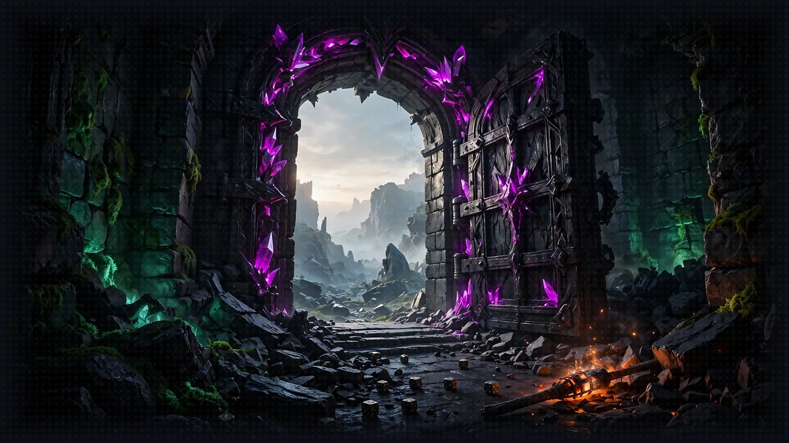

# The Exit: Final Cleanup

[Previous: Floor 8.4](floor-8-4.md) | [Dungeon map](README.md) <!-- floor-nav -->



<!-- cordula-log -->
>  **CORDULA'S LOG, DAY 14, TUESDAY, JUNE 30, THE EXIT.** We came up on the beach at Alki at sunrise, 0515, the skyline across the bay and the rain finally easing off. I packed out everything we brought in, as on any patrol: every deployment, every log, every file. The Sound was right there. He had come from the wreck at the Narrows, where the King Octopus legend lives, and the Sound would take him back whenever he was ready. I told him it was open and the choice was his. Barnaby looked at the water for a long time. Then he looked at me.
<!-- /cordula-log -->

>  **System AI:** "The crawl is over and the quarter closes at midnight. Stop the servers, tear down the stack, delete the bucket and the log groups. Any resource left running keeps billing the account, and I do not forgive invoices."

>  **SAFE ROOM READING:** [Video 13: Evaluating Agents](https://www.youtube.com/watch?v=S_ZRZFDJ6wE) by Morgan Willis. "How do you know your agent actually works? And more importantly, how do you measure whether a prompt change, model swap, tool update, or harness modification made things better or worse?"
>  **CORDULA:** The course asked the question I should have asked before the first server started. Next time I will ask it before the deploy, not after.

## Floor Objective

Leave no trace behind: stop the local services, remove the AWS resources of Floor 8 and tidy up the files the workshop generated.

Good news first: Floors 0 to 7 create no AWS resource. Every floor runs on the local machine and calls Amazon Nova 2 Lite through Amazon Bedrock; the calls are billed per call and cost nothing once the servers stop. Floor 8 is different: Floor 8 deploys the game to the AWS account, and the Floor 8 resources stay until removed. This page is the last stop: every stop or delete step for each completed floor is listed here.

What keeps billing, and which step removes it (the rates are on [What Floor 8 Costs](floor-8.md#what-floor-8-costs)):

| left behind | bills while it exists | removed by |
|---|---|---|
| the four runtimes and their IAM roles | nothing without a session; per second during one | Step 2, with the stack |
| the `characters` and `conversations` memories | records and events, by the month | Step 2, with the stack |
| the `rules` knowledge base | its index, by the month | Step 2, with the stack |
| the `gameprod-rules-<account id>` bucket | storage, by the month | Step 3 |
| the runtime log groups in CloudWatch | storage, by the month, forever: they never expire | Step 4 |
| the `CDKToolkit` stack and its bucket | next to nothing | see the note after Step 4 |

Each left-behind resource costs cents a month at workshop size, and a whole year of those resources adds up to well under a dollar. Clean up anyway: an account that is understood is cheaper than one that needs an audit later.

>  **CORDULA:** Pack out what we pack in. That is the first rule of every patrol I have ever run, and the Sound does not care that the trash is digital. I made the list before I touched anything, the way a patrol counts gear before leaving a beach: every runtime, every memory, every bucket, every log.

## Amazon Bedrock

The workshop calls Amazon Nova 2 Lite through Amazon Bedrock, so there is nothing to delete on the Amazon Bedrock side. Note:

- Model usage: charges are based on usage (input and output tokens). Nothing accrues once the agents stop calling Amazon Nova 2 Lite.
- Model access: the model access enabled for Amazon Nova 2 Lite stays active but costs nothing without calls.

## Local services

Press Ctrl+C in the terminal of every running server: the dice MCP server, the Rules Agent, the Character Agent, the Narrator orchestrator (Floor 5, 7 or 8), and the UI proxy of 8.4.

## Floor 8: AgentCore Resources

>  **System AI:** "The AgentCore CLI has no destroy command. Empty the project, then deploy the emptiness. The System finds the sequence poetic."

Skip this section without Floor 8. Otherwise run the commands from the project folder, with the same credentials and region as in Floor 8:

```bash
cd aiRPG-seattle-dungeon-crawl/dungeon/8_agentcore_production/gameprod
export AWS_DEFAULT_REGION=us-west-2
```

### Step 1: Empty the Project

```bash
agentcore remove all -y
```

The AgentCore CLI has no destroy command: remove the resources from the project, then deploy the empty project. The `agentcore remove all -y` command only resets `agentcore/agentcore.json`; the Floor 8 code stays unmodified and nothing is deleted in AWS yet.

### Step 2: Deploy the Empty Project

>  **SYSTEM WARNING:** Run `agentcore deploy -y` from the root of the `gameprod` folder, as with `agentcore remove all -y`. The CLI looks for `agentcore/agentcore.json` in the current folder and its parents: from `8_agentcore_production` or a brick folder, the CLI stops with `No agentcore project found`, and nothing is deleted.

```bash
agentcore deploy -y
```

For an empty project, the CLI deletes the `AgentCore-gameprod-default` stack: the deployment ends with `Tear down stack`. The teardown removes everything the project declared:

- the four runtimes (`diceserver`, `characteragent`, `rulesagent`, `narrator`) and their IAM roles
- the two memories, with their content: the characters of 8.2 and the conversations of 8.4
- the rules knowledge base and its data source

Check that the stack is gone:

```bash
aws cloudformation describe-stacks --stack-name AgentCore-gameprod-default
```

The output should read `Stack with id AgentCore-gameprod-default does not exist`.

>  **CORDULA:** Tearing down the stack took less time than building one brick of it. Barnaby watched the four runtimes go one by one and did not say anything. The dice, the desk, the clerk, the voice. Then the records office, with his folder in it. I asked if he was all right. "It was a good office, Sergeant. I do not need it anymore."

### Step 3: Delete the Rules Bucket

The Floor 8 page had a manual S3 bucket step, so the stack does not delete the bucket. Remove the bucket with the handbook files it holds:

```bash
aws s3 rb s3://gameprod-rules-$(aws sts get-caller-identity --query Account --output text) --force
```

Check: the command ends with `remove_bucket: gameprod-rules-...`. If it says `NoSuchBucket`, the bucket is already gone, or the bucket name carries a suffix added on the Floor 8 page: use that bucket name.

### Step 4: Delete the Runtime Logs

>  **System AI:** "The runtime log groups never expire. They will outlive the Crawler. Delete the log groups."

AgentCore Runtime writes the logs of each runtime in a CloudWatch log group that outlives the runtime and never expires. Delete the project's log groups:

```bash
for group in $(aws logs describe-log-groups \
    --log-group-name-prefix /aws/bedrock-agentcore/runtimes/gameprod_ \
    --query 'logGroups[].logGroupName' --output text); do
  aws logs delete-log-group --log-group-name "$group"
done
```

Once the stack is gone, delete the `gameprod/` folder too.

Check: the `describe-log-groups` command below now prints nothing.

```bash
aws logs describe-log-groups --log-group-name-prefix /aws/bedrock-agentcore/runtimes/gameprod_ \
  --query 'logGroups[].logGroupName' --output text
```

The CDK bootstrap stack: on the first deployment, the CLI bootstrapped the region for CDK, unless the region was already bootstrapped, with a stack named `CDKToolkit` and its S3 bucket. Every CDK application of the account and region shares the stack, and the stack costs next to nothing: delete `CDKToolkit` only after confirming no other CDK application uses it.

## Local files

>  **System AI:** "Delete the knowledge base and .agent/, and restore characters.json to its shipped state. The party will re-register. The party always comes back."

Every item below is generated during the workshop and gitignored, delete freely:

- `5_a2a_integration/utils/rules_knowledge_base/`: the ChromaDB knowledge base built from the Crawl Handbook
- `7_strands_harness/.agent/`: the Strands harness sessions and memory
- `.venv/` at the repository root, if the Python environment is no longer needed

[`5_a2a_integration/agents/character_agent/characters.json`](../5_a2a_integration/agents/character_agent/characters.json) ships with the repository, empty. Restore the file to clear the party's Floor 5 registration:

```bash
git checkout -- dungeon/5_a2a_integration/agents/character_agent/characters.json
```

>  **CORDULA:** Last, the local gear: the knowledge base folder, the harness sessions, the registry file restored to the shipped state. I zipped the dry bag shut on an empty laptop. Then I carried Barnaby down to the waterline at Alki and set the bag on the wet sand.

## The Last Log

>  **CORDULA'S LOG, DAY 14, TUESDAY, JUNE 30, ALKI, 0515.** High water had come at 0442, an hour and a quarter earlier than on the morning the pier fell, and the sun was up at 0515. I told him the truth: the System AI was rebuilt, the collar would keep working, and the Sound was open, whenever he wanted it. He did not have to be carried to be the party leader. He never did. I held out the open water and told him it was his call. He looked at the Sound for a long time. Then he poured himself across the sand and into the shallows, charcoal going to crimson going to white, moving fast the way a real octopus can for a stretch, and was gone. I sat on the sand for a while. Shelly dug in next to my boot. Chonks stuck himself to my forearm guard. At 0631 the collar pinged in my earpiece. "Sergeant. The Narrows. Next Tuesday. Bring the kayak." That is the end of the crawl. It is not the end of the patrol.

## Floor Clear

Floor cleared, Crawler. You finished every Strands workshop floor, from your first agent to orchestrating a complete multi-agent system with a web interface.

Loot kept:

- Creating AI agents and equipping them with vended and custom tools
- Connecting agents to external services with MCP
- Orchestrating multiple specialized agents with A2A
- Testing the complete system through a web interface
- Rebuilding the same Narrator in a few lines with the Strands harness
- Deploying the party to Amazon Bedrock AgentCore, with the characters, the rules and the conversation in managed services
- Designing a LitRPG System layer by layer: voice, outside knowledge, math, fair dice, rules, the dance-off loop, the HUD, consequence and a persistent world

Build a crawl of your own: the fundamentals are covered. Fork the [world guide](world/README.md), move the dungeon to your own city, and let the city's people and plants set the rules.


>  **NEW ACHIEVEMENT UNLOCKED!**
>
> **[LEFT THE STOVE ON]**
>
> Reward: a [Desperation Box]. Inside: an empty gameprod project and a CloudFormation stack that no longer exists. Check the account anyway.

>  **System AI:** "You survived the crawl. The review board has adjourned. Go build a crawl of your own."
