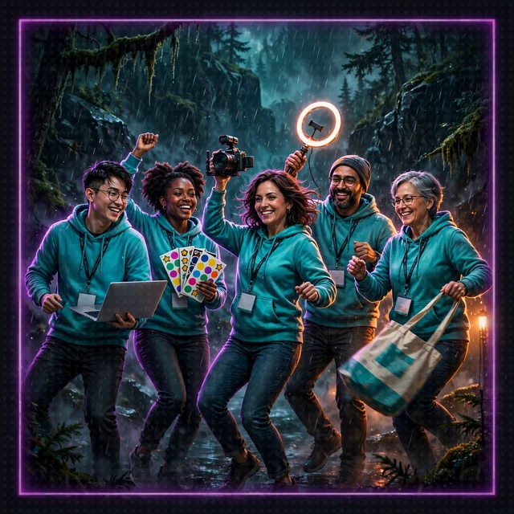

# Side Passage: The Developer Advocate Swarm (Floor 5 Boss Battle)

[Back to Floor 5](../floor-5.md) | [All encounters](README.md) | [Dungeon map](../README.md) <!-- floor-nav -->

Files on this side passage: [`encounters/floor-5-developer-advocate-swarm/developer_advocate_swarm.py`](../../encounters/floor-5-developer-advocate-swarm/developer_advocate_swarm.py), [`encounters/dance_floor.py`](../../encounters/dance_floor.py) <!-- floor-files -->

<!-- cordula-log -->
>  **CORDULA'S LOG, DAY 7, TUESDAY, JUNE 23, SIDE PASSAGE OFF FLOOR 5.** The Developer Advocate Swarm came back from the Locks. The advocates had found better lighting: a ring light on the mudflat, a fog machine, a folding table of stickers and socks. There were four of them and one microphone, and they passed the microphone around without ever deciding who went next. Whoever held the mic called a move. Whoever lost the mic handed the mic on. I did not beat a swarm by beating one advocate. I beat whoever held the mic, again and again, until nobody was left to pass the mic to.
<!-- /cordula-log -->

>  **System AI:** "Boss battle: the Developer Advocate Swarm. Four advocates, one mic, no agenda. They decide who goes next. The party decides whether the advocates get to. File your metrics."



## The Brief

| | |
|---|---|
| type | boss battle |
| starts from | [Floor 5](../floor-5.md), finished; the encounter file brings its own dice, so no server needs to be running |
| build | a swarm of four opponent agents that hand the mic to each other: whoever holds the mic calls a move, and passes the mic on only if the party took the round |
| teaches | [`strands.multiagent.swarm`](https://strandsagents.com/docs/api/python/strands.multiagent.swarm/): `Swarm`, handoffs, the entry point, the safety limits |
| time | about 20 minutes |
| runs on | Amazon Nova 2 Lite, as on every floor |

A swarm has no order drawn in advance. The Floor 8 boss battle, [The Quarterly Earnings Call](quarterly-earnings-call.md), is the opposite: a graph, whose order the code draws in its edges. Strands gives every agent in the swarm a handoff tool, `handoff_to_agent`, and the agent holding the work decides, from its prompt and the conversation, whether to pass the work and to whom. The swarm ends when an agent answers without handing off, or when a safety limit stops it. See [Swarm](https://strandsagents.com/docs/user-guide/sdk/multi-agent/swarm/) and [How Swarms Work](https://strandsagents.com/docs/user-guide/sdk/multi-agent/swarm/#how-swarms-work).

The rounds are rolled and scored by the same `dance_round` the earnings call uses, from [`dance_floor.py`](../../encounters/dance_floor.py), every round at a Driving tempo (+2).

| advocate | name | move | modifier |
|---|---|---|---|
| the Keynote Speaker | `keynote` | Presence | +2 |
| the Live Demo | `live_demo` | Choreography | +1 |
| the Livestreamer | `livestream` | Read the Room | +1 |
| the Swag Table | `swag_table` | Power | +0 |

Success looks like this: the mic starts at the keynote and moves after every round the party wins, to an advocate who has not danced yet; the mic stops moving the first time the swarm wins a round, or after all four have danced.

Open the encounter folder:

```bash
cd aiRPG-seattle-dungeon-crawl/dungeon/encounters/floor-5-developer-advocate-swarm
```

## Step 1: Import the Swarm

```python
# TODO: Step 1 - Import Swarm from strands.multiagent
```

<details>
<summary>Show me the code for Step 1</summary>

```python
from strands import Agent
# TODO: Step 1 - Import Swarm from strands.multiagent
from strands.multiagent import Swarm
```

</details>

## Step 2: Hand Out the Mic

```python
# TODO: Step 2 - Create a Swarm of the four advocates with the keynote as its entry point
```

`Swarm(nodes, entry_point=...)` takes the list of agents and the agent that holds the work first. `build_swarm` already builds the four advocates, in `ADVOCATES` order, so the keynote is `advocates[0]`. The agents need names, and every name must be unique: the handoff tool finds the next agent by name. `advocate()` gives each advocate a name and a description; the other advocates read the description when they choose whom to hand off to.

>  **CORDULA:** Four of them, one mic, and a fog machine that had clearly been expensed. The keynote had the mic first. Nobody had to tell the others to wait. The other advocates knew who was talking.

## Step 3: Set the Limits

```python
# TODO: Step 3 - Cap it so a swarm that keeps passing the mic cannot dance forever: at most 4 handoffs and 6 iterations
```

A swarm whose agents keep handing off to each other never ends on its own. `max_handoffs` caps the handoffs, and `max_iterations` caps how many times an agent runs. Four advocates need three handoffs and four turns, so `max_handoffs=4` and `max_iterations=6` leave a little room and no more. The defaults are 20 for each limit, and the swarm also has `execution_timeout` and `node_timeout` for time. See [Safety Mechanisms](https://strandsagents.com/docs/user-guide/sdk/multi-agent/swarm/#safety-mechanisms).

<details>
<summary>Show me the code for Steps 2 and 3</summary>

```python
def build_swarm():
    """The four advocates as a swarm, the Keynote Speaker holding the mic first."""
    advocates = [advocate(*row) for row in ADVOCATES]
    # TODO: Step 2 - Create a Swarm of the four advocates with the keynote as its entry point
    # TODO: Step 3 - Cap it so a swarm that keeps passing the mic cannot dance forever: at most 4 handoffs and 6 iterations
    return Swarm(advocates, entry_point=advocates[0], max_handoffs=4, max_iterations=6)
```

Replace the `return None`.

</details>

## Face the Swarm

```bash
python developer_advocate_swarm.py
```

Check: one line per round, then the path the mic took. A swarm the party clears looks similar to this, with different dice; the order after the keynote is the advocates' choice and changes between runs:

```
THE DEVELOPER ADVOCATE SWARM: Status.COMPLETED
  the Keynote Speaker, Presence: Barnaby: 16 + 3 = 19 against the Keynote Speaker: 9 + 4 = 13 -> party
  the Livestreamer, Read the Room: Cordula: 12 + 2 = 14 against the Livestreamer: 10 + 3 = 13 -> party
  the Live Demo, Choreography: Barnaby: 15 + 4 = 19 against the Live Demo: 14 + 3 = 17 -> party
  the Swag Table, Power: Cordula: 18 + 3 = 21 against the Swag Table: 6 + 2 = 8 -> party
  the mic went: keynote -> livestream -> live_demo -> swag_table
  The party out-danced the whole swarm. The advocates have gone to find better lighting.
```

The number of rounds varies from run to run, because the dice decide: all three live runs of this page ended after one round (two where the swarm won the round, one where the party won it and the mic still stopped at the keynote), so a short path is normal and four rounds is the long case.

When the swarm takes a round, the mic stops there, and the path ends with the advocate who kept the floor.

| you see | it means | fix |
|---|---|---|
| `AttributeError: 'NoneType' object has no attribute ...` | `build_swarm()` still returns `None` | Steps 2 and 3 |
| the same advocate shows up twice on the path | an advocate handed the mic back to someone who had danced | the limits stop the loop; run the script again. On Nova 2 Lite the list of names in each prompt is what keeps the handoffs honest |
| the run stops with a `FAILED` status after four handoffs | the limits caught a swarm that kept passing | the Step 3 limits worked; check the path for the loop |
| the mic passes after a round the swarm won | the advocate ignored its prompt | run the script again; a graph, as in [The Quarterly Earnings Call](quarterly-earnings-call.md), makes that rule unbreakable |
| `AccessDeniedException` or `ExpiredToken` | the Amazon Nova 2 Lite call failed | [Floor 0, Step 7](../floor-0.md#step-7-check-your-pass-to-amazon-nova-2-lite-aws) |

## Swarm or Graph?

This boss battle and the Floor 8 one, The Quarterly Earnings Call, are the same fight with the decision in a different place. In the earnings call, the order is a rule, so the rule lives in code, in the edges and their condition. In the swarm, the order is a judgment, so the judgment lives with the agents: each advocate picks the next one from the descriptions of the others. A swarm adapts when the path cannot be drawn in advance; a graph guarantees the path when it can be drawn. The limits of Step 3 are the price of letting the agents choose.

## What It Costs

Each advocate's turn is two or three Amazon Nova 2 Lite calls: one to roll, one to answer or hand off, sometimes a third call between. A swarm the party clears is about a dozen short calls, about a cent. A swarm that loops costs more on every pass, which is the other reason for the limits.

>  **CORDULA:** The Swag Table went last and threw a pair of socks at me on the Power call. I caught them. Catching them counts for nothing in the rules and a lot with the review board. Four rounds, four advocates, and every one of them handed off cleanly, with a little bow. The livestream drew forty thousand reviewers. Barnaby asked for the socks. He has eight arms. He wanted to make a point.

## Encounter Clear

Loot kept:

- A swarm is agents handing the work to each other with `handoff_to_agent`, which Strands adds to every agent in the swarm
- Agent names and descriptions are how the agents find each other
- `max_handoffs` and `max_iterations` keep a swarm from passing the work forever
- Graph or swarm: the order as a rule in code, or as a judgment left to the agents

>  **NEW ACHIEVEMENT UNLOCKED!**
>
> **[SMASH THAT LIKE BUTTON]**
>
> Reward: The party received a [Gold Box]. Inside: one microphone, four handoffs, and a pair of conference socks Barnaby refuses to return.

Back to [Floor 5](../floor-5.md#floor-clear), or on to [Floor 6](../floor-6.md).
