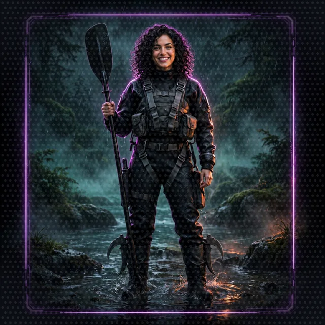
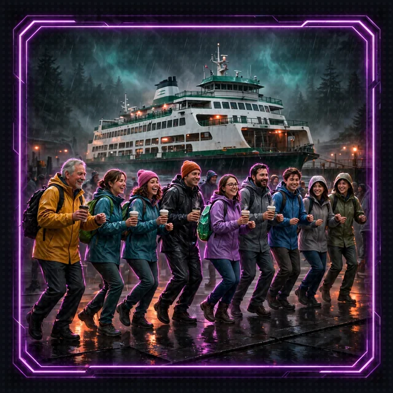
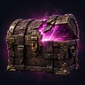

# Side Passage: Keyword versus Vector (Floor 7 Dance-Off)

[Back to Floor 7](../floor-7.md) | [All encounters](README.md) | [Dungeon map](../README.md) <!-- floor-nav -->

Files on this side passage: [`encounters/floor-7-keyword-versus-vector/keyword_versus_vector.py`](../../encounters/floor-7-keyword-versus-vector/keyword_versus_vector.py) <!-- floor-files -->

<!-- cordula-log -->
>  **CORDULA'S LOG, DAY 10, FRIDAY, JUNE 26, SIDE PASSAGE OFF FLOOR 7.** The Ferry-Line Commuter Horde caught us at dawn on the ramp below the bluffs, in rain shells, holding coffee, and they did not want to fight. They wanted to board. They hold a strict view of the line: a passenger boards if every word on the ticket matches the manifest, and not otherwise. Barnaby has a view too. He thinks the manifest should be read for what it means. Neither of us had the Handbook page open, and the tie came up in round one, and nobody could find the tie rule fast. So we turned the argument into a dance-off and let the Handbook judge. Two searchers, one question each round, one right answer to find: the Final Beat.
<!-- /cordula-log -->

>  **System AI:** "Dance-off: the Ferry-Line Commuter Horde against the meaning of words. Five rounds. Each searcher gets five passages to show me where the Final Beat is. Lower number wins. A miss loses to anything. Level ranks are a draw. The System AI does not break ties by hand, only by the Handbook."



## The Brief

| | |
|---|---|
| type | dance-off |
| starts from | [Floor 5](../floor-5.md), finished: the script reuses Floor 5's passage cutter and builds the same kind of ChromaDB collection Floor 5 builds. keyword_versus_vector.py is a plain script with no `Agent`, so no server needs to be running |
| build | two searchers over the same Crawl Handbook passages, and a scoreboard that finds the Final Beat in each searcher's results |
| teaches | [`strands.storage.search.bm25`](https://strandsagents.com/docs/api/python/strands.storage.search.bm25/), [`strands.storage.local_file_storage`](https://strandsagents.com/docs/api/python/strands.storage.local_file_storage/), and a local ChromaDB collection |
| time | about 20 minutes |
| model | none: the script never calls Amazon Nova 2 Lite, so it costs nothing |

Keyword search finds passages that contain the query's words. Vector search finds passages that sit near your question in meaning. Strands has a search strategy for keyword search: `Bm25SearchStrategy`, a SQLite full-text index that ranks passages by how rare and how frequent the query's words are in each passage. Pass it to a `LocalFileStorage` as its `search_strategy`, and every file written there is indexed. See [Search Strategies](https://strandsagents.com/docs/user-guide/sdk/storage/search-strategies/) and [Storage](https://strandsagents.com/docs/user-guide/sdk/storage/).

The vector side is the Floor 5 kind: a ChromaDB collection, embedded on the local machine by Chroma's built-in embedder. Strands also ships vector strategies that use an embedding service in the cloud, and this encounter does not use them: the crawl runs one model, Amazon Nova 2 Lite, and a cloud embedding model would be a second model. Chroma's built-in embedder is a local library that downloads once, the first time the script runs, as on Floor 5.

The scoreboard is code, not Amazon Nova 2 Lite, and it does not roll dice: the Handbook's [Dance-Offs](../world/crawl-handbook/03-dance-offs.md) and [The Final Beat](../world/crawl-handbook/04-final-beat.md) are the reading material, and the right answer is in The Final Beat page. The `rank_of` function finds the first passage that came from `04-final-beat.md` in a searcher's list and returns that passage's place, 1 for first. The searcher with the lower rank takes the round; a miss loses to anything; level ranks are a draw.

Success looks like this: the script prints five rounds, each with two ranks and a winner, and a total. The question "what happens when we tie?" is round one, and the keyword searcher misses it.

Go to the encounter folder:

```bash
cd aiRPG-seattle-dungeon-crawl/dungeon/encounters/floor-7-keyword-versus-vector
```

## Step 1: Import the Strategy

```python
# TODO: Step 1 - Import Bm25SearchStrategy from strands.storage.search.bm25
```

`LocalFileStorage` is already imported from `strands.storage`. The BM25 strategy lives one module down, in `strands.storage.search.bm25`. The strategy needs no install: SQLite ships with Python.

<details>
<summary>Show me the code for Step 1</summary>

```python
from strands.storage import LocalFileStorage
# TODO: Step 1 - Import Bm25SearchStrategy from strands.storage.search.bm25
from strands.storage.search.bm25 import Bm25SearchStrategy
```

</details>

## Step 2: Open the Keyword Lane

```python
# TODO: Step 2 - Create a LocalFileStorage at folder whose search_strategy is a Bm25SearchStrategy()
```

`LocalFileStorage(folder, search_strategy=...)`. The provided code under the TODO writes each Handbook passage into the folder as a file, and writing a file is what indexes it: BM25 only indexes files written through the LocalFileStorage. The index itself is a SQLite file the strategy keeps beside the folder.

>  **CORDULA:** I filed twenty passages into the lane and the clerk indexed them as they landed. Fast. The first time I asked the clerk a question, the clerk asked me back every word I had said. Every one. A commuter with a ticket and no patience.

<details>
<summary>Show me the code for Step 2</summary>

```python
def keyword_arena(folder: str, chunks: list[dict]) -> LocalFileStorage:
    # TODO: Step 2 - Create a LocalFileStorage at folder whose search_strategy is a Bm25SearchStrategy()
    storage = LocalFileStorage(folder, search_strategy=Bm25SearchStrategy())
```

Replace the `storage = None`. The rest of the function stays.

</details>

## Step 3: Ask the Keyword Lane

```python
# TODO: Step 3 - Run storage.search(query) with asyncio.run and return the key of each of the first TOP results, in order
```

`storage.search(query)` is a coroutine: it returns a list of results, best first, each with a `key` (the file name, which names the passage) and a `score`. Run the call with `asyncio.run(...)`, cut the list to the first `TOP`, and return the keys.

Watch this: BM25 drops filler words ("what", "when", "we"), then needs every word that is left to start a word in the passage. "what happens when we tie?" leaves `happens` and `tie`, and no Handbook passage says "happens", so nothing comes back. And "tiebreaker" is one word, while the Handbook spells it "tie-breaker".

<details>
<summary>Show me the code for Step 3</summary>

```python
def keyword_search(storage: LocalFileStorage, query: str) -> list[str]:
    # TODO: Step 3 - Run storage.search(query) with asyncio.run and return the key of each of the first TOP results, in order
    return [result.key for result in asyncio.run(storage.search(query))[:TOP]]
```

Replace the `return []`.

</details>

## Step 4: Ask the Vector Lane

```python
# TODO: Step 4 - Query the collection with query_texts=[query] and n_results=TOP, and return the first list under "ids"
```

`vector_arena` is provided: it puts the same passages in an in-memory ChromaDB collection and has Chroma embed the passages. A query is `collection.query(query_texts=[...], n_results=...)`. Chroma accepts a list of queries and answers with a list of lists, so a result for one query is the first list under `"ids"`. The ids are the same ones BM25 used for its file names, minus the `.md`, and `section_of` maps both id forms to a section.

<details>
<summary>Show me the code for Step 4</summary>

```python
def vector_search(collection, query: str) -> list[str]:
    # TODO: Step 4 - Query the collection with query_texts=[query] and n_results=TOP, and return the first list under "ids"
    return collection.query(query_texts=[query], n_results=TOP)["ids"][0]
```

Replace the `return []`. The trap: a vector search always returns `TOP` passages, nearest first, even when none of them is a good answer. A vector search never comes back empty, which is why the scoreboard asks for the rank of the right passage and not only whether the list has any passage in it.

</details>

>  **CORDULA:** Round one, the Horde put the question to their lane and got nothing back. The ramp went quiet. Barnaby's lane answered with five passages and the right one was near the top. He did not gloat. He tapped the Handbook with an arm tip, once, and the Horde filed onto the ferry to think about it. The Horde leaves the floor the moment the ferry docks. The Handbook says so.

## Run the Dance-Off

```bash
python keyword_versus_vector.py
```

Check: five rounds and a total. The keyword column is what BM25 does with these five questions. The vector column is an example: ranks may differ by a place or two. The first run downloads Chroma's embedder:

```
20 passages from the Crawl Handbook, the Final Beat is in 04-final-beat

ROUND 1: 'what happens when we tie?'
  keyword put the Final Beat: missed    vector put the Final Beat: 1    -> vector
ROUND 2: 'tie'
  keyword put the Final Beat: 1    vector put the Final Beat: 2    -> keyword
ROUND 3: 'tiebreaker'
  keyword put the Final Beat: missed    vector put the Final Beat: 1    -> vector
ROUND 4: 'closest to 20 without going over'
  keyword put the Final Beat: 1    vector put the Final Beat: 1    -> draw
ROUND 5: 'who wins when it is level'
  keyword put the Final Beat: 1    vector put the Final Beat: 1    -> draw

keyword 1, vector 2, draws 2
```

| you see | meaning | fix |
|---|---|---|
| `AttributeError: 'NoneType' object has no attribute 'write'` | Step 2 is missing | Step 2 |
| `NameError: name 'Bm25SearchStrategy' is not defined` | Step 1 is missing | Step 1 |
| every round says `missed` for keyword, even "tie" | `keyword_search` still returns `[]` | Step 3 |
| every vector rank is `missed` | `vector_search` still returns `[]` | Step 4 |
| a long pause, then a progress bar, on the first run | Chroma is downloading its local embedder | wait; Chroma downloads once |
| `ModuleNotFoundError: No module named 'create_knowledge_base'` | the command ran outside the repository | `cd` to the encounter folder, shown above |

## Keyword or Vector?

The bout crowns no single searcher, and it should not. In the example above, keyword search is exact where the words match: rounds 4 and 5 were draws, and on the single word of round 2 keyword search won. Keyword search cannot bridge a hyphen or a synonym, and answers with nothing when one word is missing. Vector search finds the passage when the query lacks the passage's exact word, and the price is that vector search always answers, so a wrong question gets a confident wrong list. Teams that need both run both and merge the lists. Floor 5's Rules Agent uses the vector side, and the memory store in [The System AI Holds Grudges](system-holds-grudges.md) uses keyword matching; the next question to ask of any retrieval is which words the players will type.

## What It Costs

Nothing. Amazon Nova 2 Lite is not called, nothing goes to the cloud, and Chroma's embedder runs on the local machine. The cost is the one-time download and a few seconds of compute.

## Encounter Clear

Loot kept:

- BM25 is a Strands search strategy: give a `LocalFileStorage` a `Bm25SearchStrategy` and every file written is indexed
- Keyword search needs the words to match; vector search needs only the meaning to be near
- A retrieval can be scored in code: the rank of the one passage known to be right
- A vector search never comes back empty, and that is the reason to score it

>  **NEW ACHIEVEMENT UNLOCKED!**
>
> **[THE FINAL BEAT, FOUND]**
>
> Reward: [Bronze Box] received. Inside: one ferry timetable, a coffee-stained scoreboard, and the rule for ties, with the page number.

Back to [Floor 7](../floor-7.md#floor-clear), or on to [Save Points](save-points.md).
