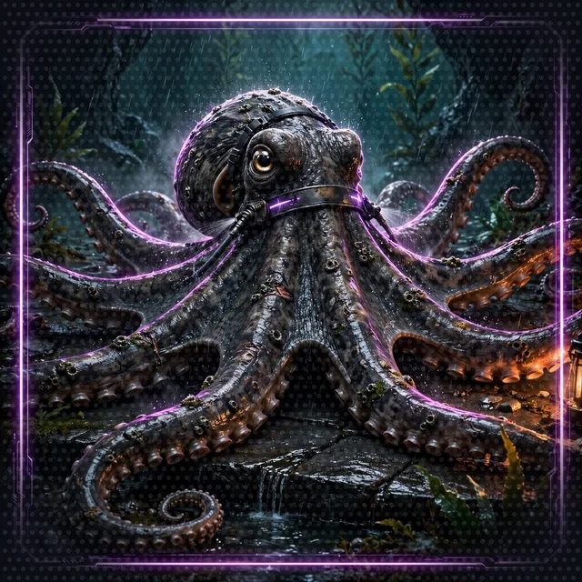

# Side Passage: Mid-Song Save (Floor 8 Sidequest)

[Back to Floor 8.4](../floor-8-4.md) | [All encounters](README.md) | [Dungeon map](../README.md) <!-- floor-nav -->

Files on this side passage: [`encounters/floor-8-mid-song-save/mid_song_save.py`](../../encounters/floor-8-mid-song-save/mid_song_save.py), [`encounters/dance_floor.py`](../../encounters/dance_floor.py) <!-- floor-files -->

<!-- cordula-log -->
>  **CORDULA'S LOG, DAY 13, MONDAY, JUNE 29, SIDE PASSAGE OFF FLOOR 8.** We were two beats into a round against the Bonus-Season Investment Banker when the floor lights went out. Not a fight. A deployment. Somebody in Bellevue had pushed a new version, and AgentCore swaps a runtime out from under a session the way a ferry crew swaps a shift: no ceremony, no handoff note. The music stopped. The Banker froze mid-spin with one sunglass arm in his mouth. When the lights came back, the System AI had no idea where we were. "Round... one?" the System AI read off the card. I know the feeling. I have lost a radio net mid-transmission. The fix is not to shout louder. The fix is to write down where you were before the net drops.
<!-- /cordula-log -->

>  **System AI:** "Sidequest: Mid-Song Save. A deployment is not an excuse. The song resumes from the last checkpoint, and not one die is thrown twice. The System checks the scoreboard. The System AI is always checking the scoreboard."

## The Brief

| | |
|---|---|
| type | sidequest |
| starts from | [Floor 8.4](../floor-8-4.md), finished: the runtime restarts of Floor 8.4 are the reason for this sidequest. `mid_song_save.py` runs on this machine and brings its own dice, and a folder on disk stands in for the cloud, so nothing needs to be deployed |
| build | a dance-off round that pauses twice, in the middle of the round, saves where it stopped, and resumes in a brand new process without throwing a die twice |
| teaches | [`strands.experimental.checkpoint.checkpoint`](https://strandsagents.com/docs/api/python/strands.experimental.checkpoint.checkpoint/): `Checkpoint`, plus the `checkpointing=True` setting of [`Agent`](https://strandsagents.com/docs/api/python/strands.agent.agent/) and [`FileSessionManager`](https://strandsagents.com/docs/api/python/strands.session.file_session_manager/) |
| time | about 20 minutes |
| model | Amazon Nova 2 Lite, as on every floor |

A turn of an agent is a loop: Amazon Nova 2 Lite answers, asks for tools, the tools run, Amazon Nova 2 Lite reads their results, and the loop repeats until Amazon Nova 2 Lite answers without a tool. An agent built with `checkpointing=True` pauses at two points of each trip around that loop and returns a `Checkpoint`: `after_model`, when Amazon Nova 2 Lite has asked for a tool and the tool has not run, and `after_tools`, when the tools have run and Amazon Nova 2 Lite has not read their results. The result has `stop_reason == "checkpoint"` and a `checkpoint` on it. To go on, call the agent again with `{"checkpointResume": {"checkpoint": ...}}` in place of a prompt. See [`strands.experimental.checkpoint.checkpoint`](https://strandsagents.com/docs/api/python/strands.experimental.checkpoint.checkpoint/) and [The Agent Loop](https://strandsagents.com/docs/user-guide/sdk/agents/agent-loop/).

A checkpoint is a marker, not a memory: a checkpoint holds a position and a cycle number, and none of the conversation. A session manager keeps the conversation, like the `AgentCoreMemorySessionManager` of [8.4](../floor-8-4.md), which keeps the Narrator's messages in AgentCore Memory. Here a `FileSessionManager` keeps the messages in a folder that stands in for AgentCore Memory. The checkpoint and session manager together survive a restart: the session restores the messages, and the checkpoint says where in the loop to go on. See [Session Management](https://strandsagents.com/docs/user-guide/sdk/agents/session-management/). `strands.experimental.checkpoint` is experimental: names can change between releases.

The round is one dance-off round against the Bonus-Season Investment Banker (Presence, Driving tempo), rolled by `dance_round` from [`dance_floor.py`](../../encounters/dance_floor.py). The round takes three runs of `mid_song_save.py`, and each run is a fresh process, which is how a restarted runtime looks from the inside:

| run | what happens | where it stops |
|---|---|---|
| 1 | Lady Luck announces the round and asks for `dance_round` | `after_model`: the dice have not been thrown |
| 2 | a new process loads the session and the checkpoint; the tool runs | `after_tools`: the dice are on the table, nobody has called the round |
| 3 | another new process; Amazon Nova 2 Lite reads the result and calls the round | done, and the save is deleted |

Check the result: run 2 throws the dice, run 3 throws none, and the call in run 3 quotes the totals that run 2 rolled.

Go to the encounter folder:

```bash
cd aiRPG-seattle-dungeon-crawl/dungeon/encounters/floor-8-mid-song-save
```

## Step 1: Fetch the Checkpoint Class

```python
# TODO: Step 1 - Import Checkpoint from strands.experimental.checkpoint.checkpoint
```

`Checkpoint` is a small frozen dataclass: `position`, `cycle_index` and a `schema_version`. `to_dict()` converts it to a dictionary that `json.dumps` writes as JSON, and `Checkpoint.from_dict(...)` reads the checkpoint back, refusing a checkpoint from an incompatible schema version with a `CheckpointException`.

<details>
<summary>Show me the code for Step 1</summary>

```python
# TODO: Step 1 - Import Checkpoint from strands.experimental.checkpoint.checkpoint
from strands.experimental.checkpoint.checkpoint import Checkpoint
```

</details>

## Step 2: Turn Checkpointing On

```python
        # TODO: Step 2 - Turn on checkpointing so the loop pauses at its cycle boundaries and returns a checkpoint
```

`make_band` is given: it builds Lady Luck, a fresh one on every run, with `dance_round` and a `FileSessionManager` whose session id is always `mid-song-save`: a new agent with the same session id starts with the saved messages. The TODO sits inside the `Agent(...)` call. Checkpointing is off by default; without it the agent never pauses, and a `checkpointResume` block is refused with a `ValueError`.

<details>
<summary>Show me the code for Step 2</summary>

```python
        # TODO: Step 2 - Turn on checkpointing so the loop pauses at its cycle boundaries and returns a checkpoint
        checkpointing=True,
```

</details>

>  **CORDULA:** Lady Luck announced round one, asked for the dice, and froze with her hand open over the table. Nothing thrown. A pause at the exact second before the commit. I have held that position on a ramp with a load strap in each hand. I did not drop anything. I noted the time and waited for the word.

## Step 3: Write the Save

```python
def save_checkpoint(result) -> None:
    """Write the checkpoint of a paused result where the next run will find it."""
    # TODO: Step 3 - Write result.checkpoint.to_dict() to CHECKPOINT_FILE as JSON
    pass
```

A paused result carries `result.checkpoint`. Convert the checkpoint to a dictionary with `to_dict()` and write it with `json.dumps`. `CHECKPOINT_FILE` sits next to the session in a hidden folder, `.mid-song-save/`, that the `FileSessionManager` creates on its first write. On AgentCore, return the dictionary to the caller, or store it in the same AgentCore Memory as the conversation.

<details>
<summary>Show me the code for Step 3</summary>

```python
def save_checkpoint(result) -> None:
    """Write the checkpoint of a paused result where the next run will find it."""
    # TODO: Step 3 - Write result.checkpoint.to_dict() to CHECKPOINT_FILE as JSON
    CHECKPOINT_FILE.write_text(json.dumps(result.checkpoint.to_dict()))
```

Replace the `pass`.

</details>

## Step 4: Resume the Song

```python
def resume(band: Agent):
    """Pick the song up where the last run left it."""
    # TODO: Step 4 - Read CHECKPOINT_FILE, check it with Checkpoint.from_dict, and call the band with a {"checkpointResume": {"checkpoint": ...}} block
    return None
```

Read `CHECKPOINT_FILE`, build a `Checkpoint` from its contents to check the schema, and call the agent with the resume block in place of a prompt: the value under `"checkpoint"` is the dictionary form, so use `checkpoint.to_dict()`. The agent does not ask Amazon Nova 2 Lite again after `after_model`: the last saved message is the request from Amazon Nova 2 Lite for a tool, so the agent runs the tool. After `after_tools` the agent goes straight to Amazon Nova 2 Lite, which reads the tool result from the saved conversation.

<details>
<summary>Show me the code for Step 4</summary>

```python
def resume(band: Agent):
    """Pick the song up where the last run left it."""
    # TODO: Step 4 - Read CHECKPOINT_FILE, check it with Checkpoint.from_dict, and call the band with a {"checkpointResume": {"checkpoint": ...}} block
    checkpoint = Checkpoint.from_dict(json.loads(CHECKPOINT_FILE.read_text()))
    return band({"checkpointResume": {"checkpoint": checkpoint.to_dict()}})
```

Replace the `return None`. The trap: a resume call carries no prompt, so a new agent without the session manager has no messages to continue, and Amazon Nova 2 Lite sees an empty conversation. The checkpoint and session travel together.

</details>

>  **CORDULA:** Run two. The lights were back, the Banker was still holding his sunglasses, and Lady Luck picked her hand up off the table exactly where it had been and threw. Presence, Barnaby, a twelve and a three, fifteen against the Banker's eleven. The System AI said it had never been so grateful to a clipboard.  **BARNABY:** "It is not a clipboard. It is a protocol."

## Play the Song

Run the same command three times, in three separate terminals or one after another. Each run is a new process:

```bash
python mid_song_save.py
```

Check: three runs, three different lines. Dice and wording differ per run:

```
MID-SONG SAVE: paused after_model, cycle 0
  dice thrown in this run: 0
```

```
MID-SONG SAVE: paused after_tools, cycle 0
  dice thrown in this run: 1
```

```
MID-SONG SAVE: round called: Barnaby danced Presence for a 15 against the Banker's 11, and the party took the round. The Banker is still holding his sunglasses.
  dice thrown in this run: 0
```

The last line is the proof: run 3 threw no dice, and the call still quotes the totals, because the totals came back from the saved conversation. To discard the save and start over, run `python mid_song_save.py --reset`.

| symptom | cause | fix |
|---|---|---|
| `NameError: name 'Checkpoint' is not defined` | Step 1 is missing | add the import |
| the first run ends with `round called` and never pauses | checkpointing is off, or Amazon Nova 2 Lite answered without calling the tool | Step 2: `checkpointing=True`; run `--reset` and try again |
| `AttributeError: 'NoneType' object has no attribute 'stop_reason'` | `resume` still returns `None` | Step 4 |
| `FileNotFoundError` on `checkpoint.json` after a pause | `save_checkpoint` does nothing yet | Step 3 |
| `CheckpointException` | the file holds a checkpoint from another schema version | run `--reset` |
| run 2 throws the dice again, or run 3 does | the session was not found, so the loop started over | run the script from this folder, and do not delete `.mid-song-save/` between runs |
| `AccessDeniedException` or `ExpiredToken` | the call to Amazon Nova 2 Lite failed | [Floor 0, Step 7](../floor-0.md#step-7-check-your-pass-to-amazon-nova-2-lite-aws) |

## Checkpoint or Session Alone?

[8.4](../floor-8-4.md) already saves the Narrator's conversation, and a session manager alone brings an agent back after a restart. A session manager cannot restore the agent in the middle of a turn: a restart between the request from Amazon Nova 2 Lite and the tool's result leaves the conversation ending on a tool call with no answer. The next prompt receives a placeholder result for that call, the tool never ran, and Amazon Nova 2 Lite has to ask again. Use a checkpoint when redoing the step causes harm: a tool that rolls a die, charges a card or writes a record. A checkpoint fires only on trips around the loop that use a tool; a turn without a tool call emits no checkpoint.

## What It Costs

No new AWS resource: the save is a folder on disk. The calls to Amazon Nova 2 Lite are the same as in an ordinary round: one when Lady Luck asks for the tool in run 1, none in run 2 because the request is already saved, one in run 3 when she calls the round. Two calls of a short prompt, about 1,200 input tokens and 100 output tokens in all (an estimate): 1,200 x $0.30 / 1,000,000 + 100 x $2.50 / 1,000,000 = $0.00036 + $0.00025, under a tenth of a cent ([Floor 1](../floor-1.md#what-a-turn-costs)). A resumed run never repeats a call to Amazon Nova 2 Lite.

On AgentCore the conversation lives in the `conversations` memory of 8.4, which bills as on the [What Floor 8 Costs](../floor-8.md#what-floor-8-costs) page: half a cent for 400 events. Nothing to delete in AWS for this page; remove the local save:

```bash
rm -rf .mid-song-save
```

>  **CORDULA:** Run three. The Banker took his sunglasses out of his mouth for the call. The System AI read the totals, and they were the totals from the run before, the same twelve, the same three. Not rolled again. Called.  **BARNABY:** "That is the whole point of a checklist. Stop in the middle, do not start over."

## Encounter Clear

Loot kept:

- `checkpointing=True` makes an agent pause at `after_model` and `after_tools` and return a `Checkpoint`
- A checkpoint is a position, not a conversation: pair the checkpoint with a session manager, and resume with a `checkpointResume` block
- Resuming after `after_model` runs the saved tool request, and resuming after `after_tools` goes straight to Amazon Nova 2 Lite, so no step runs twice
- A restarted runtime is a new process: whatever must survive goes to disk, or to AgentCore Memory

>  **NEW ACHIEVEMENT UNLOCKED!**
>
> **[ONE TAKE, THREE RUNS]**
>
> Reward: You received a [Silver Box]. Inside: a save file, a roll of tape for the floor where the party stopped, and the right to be insufferable about idempotence.

Back to [Floor 8.4](../floor-8-4.md#floor-clear), or on to [The Ferry Manifest](ferry-manifest.md).
