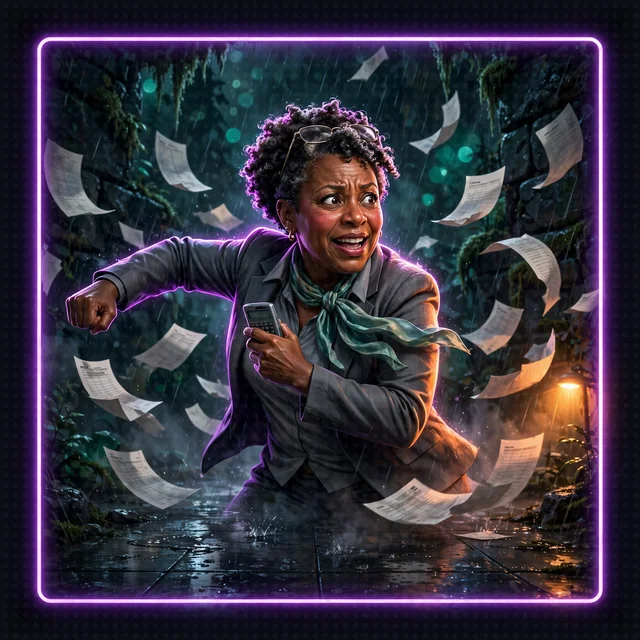

# Side Passage: Read the Room, Typed (Floor 5 Dance-Off)

[Back to Floor 5](../floor-5.md) | [All encounters](README.md) | [Dungeon map](../README.md) <!-- floor-nav -->

Files on this side passage: [`encounters/floor-5-read-the-room-typed/read_the_room_typed.py`](../../encounters/floor-5-read-the-room-typed/read_the_room_typed.py), [`encounters/dance_floor.py`](../../encounters/dance_floor.py) <!-- floor-files -->

<!-- cordula-log -->
>  **CORDULA'S LOG, DAY 7, TUESDAY, JUNE 23, SIDE PASSAGE OFF FLOOR 5.** The Quarterly Close Accountant was back, this time on the estuary dance floor with a calculator and a deadline. On Floor 5 the System AI announced the dance-off in a paragraph: "a brisk tempo, perhaps, with some footwork." Perhaps. I do not take orders that say perhaps. Down here the Narrator had to fill in a form. Tempo: one box, three choices. Move Call: one box, six choices minus the one it called last. The Narrator ticked its boxes, and the accountant and I danced to exactly what the form said.
<!-- /cordula-log -->

>  **System AI:** "Dance-off: the Quarterly Close Accountant. Three rounds. I will be announcing the tempo and every Move Call from a list, because a Crawler once told me my announcements were 'more of a vibe.' The list is binding. The vibe is not."



## The Brief

| | |
|---|---|
| type | dance-off |
| starts from | [Floor 5](../floor-5.md), finished; `read_the_room_typed.py` brings its own dice, so no server needs to be running |
| you build | a decision model that picks the tempo and each Move Call as one of a fixed list of values, and a round rolled from those values |
| teaches | [`strands.decisions.llm_decision_model`](https://strandsagents.com/docs/api/python/strands.decisions.llm_decision_model/): `LLMDecisionModel`, `ask`; [`strands.decisions.types`](https://strandsagents.com/docs/api/python/strands.decisions.types/): `DecisionResult`, `Uncertain` |
| time | about 20 minutes |
| model | Amazon Nova 2 Lite, as on every floor |

On Floor 5 the Narrator answers in prose, and for a dance-off the prose has to name a tempo and a Move Call that the Python code then reads out of a paragraph. A [decision model](https://strandsagents.com/docs/api/python/strands.decisions.decision_model/) asks Amazon Nova 2 Lite closed questions instead. Pass the situation and a dictionary of questions, each with a `choices` list, and `ask` returns a [`DecisionResult`](https://strandsagents.com/docs/api/python/strands.decisions.types/) whose `answers` dictionary holds one value per question, and every value is one of the listed choices. `LLMDecisionModel` makes a single call to Amazon Nova 2 Lite, forced to answer through structured output; the other decision models in the package are for other back ends.

The rules of the round stay in code, where Floor 3 kept the numbers. The dance follows the Crawl Handbook: the Narrator picks one tempo for the whole dance-off and a Move Call each round, the System AI announces them, and the same move is never called twice in a row. `read_the_room_typed.py` enforces both rules by shaping the questions: the tempo is asked only in round one, and the move already called is left out of the next round's choices, so Amazon Nova 2 Lite cannot break the rule. Which party member dances is decided by `best_dancer`, from the modifiers in `dance_floor.py`. The dice are rolled by the shared `dance_round`, from [`dance_floor.py`](../../encounters/dance_floor.py), with the typed values passed straight in.

The party wins by taking two of three rounds. The accountant dances at +1 for the accountant's own modifier, plus the tempo bonus: Steady +0, Driving +2 or Frantic +4.

How you know it worked: the System AI announces a tempo, then each round prints the Move Call, both totals as die + modifier = total and the winner, and no Move Call repeats back to back; the dance-off stops as soon as one side has two rounds.

Go to the encounter folder:

```bash
cd aiRPG-seattle-dungeon-crawl/dungeon/encounters/floor-5-read-the-room-typed
```

## Step 1: Import the Decision Model

```python
# TODO: Step 1 - Import LLMDecisionModel from strands.decisions.llm_decision_model
```

`BedrockModel` is already imported: `LLMDecisionModel` wraps a Strands model class, not a model id string.

<details>
<summary>Show me the code for Step 1</summary>

```python
from strands.models import BedrockModel
# TODO: Step 1 - Import LLMDecisionModel from strands.decisions.llm_decision_model
from strands.decisions.llm_decision_model import LLMDecisionModel
```

</details>

## Step 2: Build the Decision Model

```python
# TODO: Step 2 - Return an LLMDecisionModel over a BedrockModel with model_id us.amazon.nova-2-lite-v1:0 and a system_prompt of DECISION_PROMPT
```

`LLMDecisionModel(model=..., system_prompt=...)` takes the model to ask and the framing for the decisions. Without `model`, `LLMDecisionModel` builds a default `BedrockModel`, so name Amazon Nova 2 Lite here: `BedrockModel(model_id="us.amazon.nova-2-lite-v1:0")`. The SDK adds its own rules after `DECISION_PROMPT`, and those rules tell Amazon Nova 2 Lite to treat the situation text as data and answer only through the structured output, so a clever Crawler cannot talk the Narrator into a tempo. See [`LLMDecisionModel`](https://strandsagents.com/docs/api/python/strands.decisions.llm_decision_model/).

>  **CORDULA:** Same Amazon Nova 2 Lite as the Narrator, a different job. The decision model does not tell stories. It reads the floor and ticks a box. Barnaby approved of the division of labour. "A narrator who commits to a list, Sergeant, is a narrator one can plan around."

<details>
<summary>Show me the code for Step 2</summary>

```python
def make_decision_model():
    """The System AI's decision model: Amazon Nova 2 Lite, answering closed questions."""
    # TODO: Step 2 - Return an LLMDecisionModel over a BedrockModel with model_id us.amazon.nova-2-lite-v1:0 and a system_prompt of DECISION_PROMPT
    return LLMDecisionModel(
        model=BedrockModel(model_id="us.amazon.nova-2-lite-v1:0"),  # Amazon Nova 2 Lite, US cross-Region inference profile
        system_prompt=DECISION_PROMPT,
    )
```

Replace `return None`.

</details>

## Step 3: Ask the Questions

```python
# TODO: Step 3 - Ask the decision model the questions about the situation with ask, and keep the DecisionResult in result
```

The questions are given, and they are the lesson. Each one is a dictionary: `question` in plain English, `choices` as a list of strings (or `"boolean"`), and optionally `uncertainty`. By default a decision model may answer `Uncertain` instead of picking; `"uncertainty": False` takes that option out, so Amazon Nova 2 Lite has to commit to one of the choices. The word `uncertain` is reserved and cannot be one of the question's own choices. `ask` is async: `result = await decision_model.ask(situation, questions)`. The given line after the `ask` call reads `result.answers`, a dictionary keyed by the same names as the questions, and turns the two values into plain strings. See [`DecisionResult`](https://strandsagents.com/docs/api/python/strands.decisions.types/).

<details>
<summary>Show me the code for Step 3</summary>

```python
    result = None
    # TODO: Step 3 - Ask the decision model the questions about the situation with ask, and keep the DecisionResult in result
    result = await decision_model.ask(situation, questions)
    answers = result.answers
```

The trap: leave `uncertainty` at the default and an answer can come back as an `Uncertain` object, which is truthy and not a string, so a tempo of `Uncertain` would reach `dance_round` and be rejected. Check with `isinstance(value, Uncertain)` when uncertainty is allowed; here the questions set `"uncertainty": False`.

</details>

## Step 4: Roll the Round

```python
# TODO: Step 4 - Return dance_round(...) for the opponent, with move_call and tempo as the typed values, crawler=best_dancer(move_call) and opponent_modifier=OPPONENT_MODIFIER
```

`dance_round` is the Floor 3 lesson again: the dice, the modifiers, the tempo bonus and the Final Beat are all decided in code. `dance_round` is a tool, and a tool function can be called directly from Python code: `dance_round(opponent=OPPONENT, move_call=move_call, ...)` returns the same dictionary the Narrator would receive from the tool. The tempo passed must be one of `Steady`, `Driving` or `Frantic`, and the Move Call one of the six: exactly the lists the questions offered, which is why typed choices matter. See [`dance_floor.py`](../../encounters/dance_floor.py).

>  **CORDULA:** The tempo came out "Driving", capital D, no commentary. I passed the tempo to the dice without reading it twice. Skipping the double-check is the whole point. On Floor 5 I would have had to check whether "brisk" meant Driving or Steady, and the accountant would have used the pause to refill their coffee.

<details>
<summary>Show me the code for Step 4</summary>

```python
def dance(tempo: str, move_call: str) -> dict:
    """Roll one round with the typed values."""
    # TODO: Step 4 - Return dance_round(...) for the opponent, with move_call and tempo as the typed values, crawler=best_dancer(move_call) and opponent_modifier=OPPONENT_MODIFIER
    return dance_round(opponent=OPPONENT, move_call=move_call, tempo=tempo, crawler=best_dancer(move_call),
                       opponent_modifier=OPPONENT_MODIFIER)
```

Replace `return None`.

</details>

## Dance It

```bash
python read_the_room_typed.py
```

Check: the tempo, then two or three rounds. The dice and the System's choices will differ, so this is an example:

```
The System announces the tempo: Driving
Round 1, Footwork: Barnaby: 15 + 4 = 19 against the Quarterly Close Accountant: 10 + 3 = 13 -> party, 6 Groove lost
Round 2, Power: Cordula: 12 + 3 = 15 against the Quarterly Close Accountant: 14 + 3 = 17 -> opponent, 2 Groove lost
Round 3, Presence: Barnaby: 11 + 3 = 14 against the Quarterly Close Accountant: 6 + 3 = 9 -> party, 5 Groove lost
The party takes two of three. The accountant leaves the floor, relieved, and files a very short report.
```

| you see | it means | fix |
|---|---|---|
| `NameError: name 'LLMDecisionModel' is not defined` | Step 1 is missing | Step 1 |
| `AttributeError: 'NoneType' object has no attribute 'ask'` | `make_decision_model()` still returns `None` | Step 2 |
| `AttributeError: 'NoneType' object has no attribute 'answers'` | Step 3 is missing, so `result` is still `None` | Step 3 |
| `TypeError: 'NoneType' object is not subscriptable` | `dance()` returns `None` | Step 4 |
| `StructuredOutputException` | Amazon Nova 2 Lite declined to answer or answered outside the choices | run the script again; the call is one forced answer, so no answer needs repair by hand |
| the same Move Call twice in a row | the choices passed to `ask` do not leave out `last_move` | check the `choices` list in `read_the_room` |
| `AccessDeniedException` or `ExpiredToken` | the Amazon Nova 2 Lite call failed | [Floor 0, Step 7](../floor-0.md#step-7-check-your-pass-to-amazon-nova-2-lite-aws) |

## Typed or Told?

The Narrator of Floor 5 can still decide the dance-off in prose, and the System AI should announce it: prose in the System AI's voice is what the review board hears. The decision model is for the moment the Python code needs to act on the choice. A told answer is a paragraph to parse; a typed answer is a value to pass to a function, compare, log, or test. The cost is a second kind of call, one more Amazon Nova 2 Lite request that does nothing but choose. For one choice in a dance-off, the extra call is cheap, and the gain is worth having: a Narrator that cannot say "perhaps".

## What It Costs

Each `ask` is one call to Amazon Nova 2 Lite, with the situation, the questions and the answer schema in, and a few words out: about 500 tokens in and 60 out. At about $0.30 per million input tokens and $2.50 per million output tokens, the cost is about $0.0003 a call, and a three-round dance-off makes three: about a tenth of a cent. The dice cost nothing, because they are code. See [What a Turn Costs](../floor-1.md#what-a-turn-costs).

>  **CORDULA:** Round three ended with the accountant gathering their spreadsheet pages off the floor. They gave me a nod and said the party had come in under budget. I said we had been trying. Barnaby asked if the Narrator had chosen Presence by itself. The Narrator had. From a list of five. He is pleased about the list.

## Encounter Clear

Loot you're keeping:

- A decision model turns a question into a value from a list written in code, instead of a paragraph to parse
- `LLMDecisionModel(model=..., system_prompt=...)` builds one over any Strands model, here Amazon Nova 2 Lite
- `ask` takes the situation and a dictionary of questions, and returns a `DecisionResult` with an `answers` dictionary
- Shape the choices to enforce a rule: leave out the move already called, ask the tempo once
- `"uncertainty": False` makes Amazon Nova 2 Lite commit; otherwise check for `Uncertain`

>  **NEW ACHIEVEMENT UNLOCKED!**
>
> **[PERHAPS, NO MORE]**
>
> Reward: You received a [Bronze Box]. Inside: one multiple-choice form, a pen on a chain, and a calculator the accountant insists you keep.

Back to [Floor 5](../floor-5.md#floor-clear), or on to [Floor 6](../floor-6.md).
