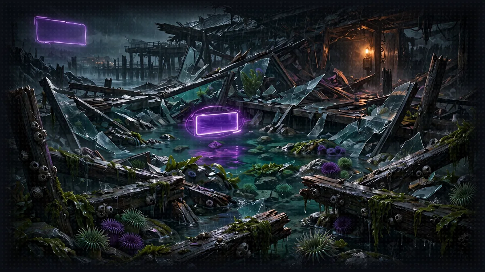

# Floor 1: Agent Summoning

[Previous: Floor 0](floor-0.md) | [Dungeon map](README.md) | [Next: Floor 2](floor-2.md) <!-- floor-nav -->

Files on this floor: [`1_strands_basics/simple_agent.py`](../1_strands_basics/simple_agent.py) <!-- floor-files -->



>  **CORDULA'S LOG, DAY 1, MONDAY, JUNE 11, FLOOR 1.** The stairwell let out into what used to be the aquarium lobby, now a field of tide pools the 1109 low water (-1.8 ft) had drained, and broken glass. There were people down here, a whole tour group in matching rain shells, and none of them could hear us: the System AI's voice was dead, so the dungeon had no way to talk to anyone. Barnaby could not talk either. The collar was there, a ring of brass with nothing behind it. The System AI's terminal blinked one line at me: SUMMON AN AGENT. So we did. A model, a few words telling it who to be, one call. The System AI's voice coughed back to life, and the collar woke up with it. Barnaby's first word was "Sergeant." His second was a complaint about the water temperature.
<!-- /cordula-log -->

>  **System AI:** "Floor 1, Crawlers. You will now summon a living creature out of a string of English and one function call. The Consortium review board has flagged this step for review. The review board is watching. Be kind to it. It will not be kind to you."

## Floor Objective

Summon your first agent with Strands: a Narrator that answers an adventurer with nothing more than an `Agent`, a system prompt and one call. Along the way, turn on debug logging to see what happens between your code and the model.

Change to the Floor 1 folder in the terminal:

```bash
cd seattle-strands-dungeon-crawl/dungeon/1_strands_basics
```

Open [`simple_agent.py`](../1_strands_basics/simple_agent.py) and complete each TODO comment to create the first agent.

### How to Work a TODO

Every floor follows the same routine, so this page spells it out once:

- Open the file in any editor. With Visual Studio Code: `code simple_agent.py`. Any plain-text editor works.
- Find each `# TODO: Step N - ...` comment. The comment says what to write; the matching step on this page says how.
- Write code on the lines **under** the comment. Leave the comment in place: the pages, the tests and the `solution` branch all line up on it.
- Save, then run the script from this folder: `python simple_agent.py`.
- On Linux and macOS without an activated virtual environment the command may be `python3 simple_agent.py`. `uv run python simple_agent.py` works everywhere.
- Stuck? Each step has a hint, a link to the matching Strands page, and a **Show me the code** block. Read the hint first. Or ask the [study companion](../study/README.md): `python ../study/ask_the_system.py "how do I enable debug logging in Strands?"`.

`simple_agent.py` goes from this:

```python
# TODO: Step 2 - Create the agent with ...
```

to this, with the comment kept and the new code below it:

```python
# TODO: Step 2 - Create the agent with ...
agent = Agent(...)
```

## Step 1: Enable Debug Logging

>  **System AI:** "DEBUG logging shows every request the System AI sends to Amazon Nova 2 Lite and every word that streams back. It is the closest you will get to reading the System AI's mind. You will not enjoy it."

```python
# TODO: Step 1 - Add debug logging to see what your agent is thinking
```

Before creating your agent, enable debug logging to read the requests and responses between the agent and Amazon Nova 2 Lite. Strands logs through Python's standard `logging` module, under the logger named `"strands"`: set that logger to `DEBUG`, then add a handler that prints the log messages. See [Logging](https://strandsagents.com/docs/user-guide/sdk/observability-evaluation/logs/) in the Strands docs.

Python has five log levels: DEBUG, INFO, WARNING, ERROR and CRITICAL. Start with DEBUG. It is verbose, but DEBUG is the only level where Strands shows the request sent to Amazon Nova 2 Lite and the response streamed back. Higher levels such as INFO stay almost silent, so raise the level after reading enough output.

>  **CORDULA:** Before I let anything talk, I want to hear what the System AI says when it thinks nobody is listening. The debug log is that record. The log is long and boring, and it is the only honest record of what went out and what came back.

<details>
<summary>Show me the code for Step 1</summary>

```python
# TODO: Step 1 - Add debug logging to see what your agent is thinking
import logging
logging.getLogger("strands").setLevel(logging.DEBUG)
logging.basicConfig(
    format="%(levelname)s | %(name)s | %(message)s",
    handlers=[logging.StreamHandler()]
)
```

`getLogger("strands")` picks the SDK's logger, `setLevel` decides how much it says, and `basicConfig` with a `StreamHandler` prints the log messages to the terminal.

</details>

## Step 2: Create Your Agent

>  **ITEM ACQUIRED: [System Prompt]**
>
> One string that decides who your agent is. Write the prompt carelessly and the agent turns careless. Write the prompt in the voice of the System AI and the agent turns insufferable. Recommended.

```python
# TODO: Step 2 - Create the agent with model "us.amazon.nova-2-lite-v1:0" and the following system prompt: "You are the System AI, the sardonic broadcast AI running a dungeon crawl under Seattle. Address the player as Crawler."
```

The system prompt defines your agent's role, personality, and knowledge base. Pass the prompt as the `system_prompt` argument when creating the `Agent`. See [Prompts](https://strandsagents.com/docs/user-guide/sdk/agents/prompts/) in the Strands docs.

Pass `model` to every `Agent`. This crawl runs on Amazon Nova 2 Lite only, through the US cross-Region inference profile `us.amazon.nova-2-lite-v1:0`, so pass `model="us.amazon.nova-2-lite-v1:0"` to `Agent(...)`. Never omit `model`: without it, Strands picks a default model, not Amazon Nova 2 Lite. Every later floor already passes `model` in the given code. The [Amazon Bedrock model provider page](https://strandsagents.com/docs/user-guide/sdk/model-providers/amazon-bedrock/) explains how Strands talks to Bedrock.

<details>
<summary>Show me the code for Step 2</summary>

```python
# TODO: Step 2 - Create the agent with model "us.amazon.nova-2-lite-v1:0" and the following system prompt: "..."
agent = Agent(
    model="us.amazon.nova-2-lite-v1:0",
    system_prompt="You are the System AI, the sardonic broadcast AI running a dungeon crawl under Seattle. Address the player as Crawler.",
)
```

`Agent` is already imported at the top of the file. A plain string model id selects that model on Amazon Bedrock. The agent is the System AI, and its prompt opens "You are the System AI" because everything the System AI says to a Crawler comes out in its own voice.

</details>

>  **CORDULA:** The terminal wanted one sentence: who speaks for the System AI? I wrote what I had seen of it so far. Loud, exacting, a little mean, exact about numbers. One sentence is the difference between a status report and a warning siren.

### What a Turn Costs

Amazon Bedrock bills on-demand use by the token: the text sent to Amazon Nova 2 Lite (input) and the text it writes back (output). Third-party price trackers list Amazon Nova 2 Lite at about $0.30 per million input tokens and $2.50 per million output tokens as of November 2026 ([LiteLLM](https://models.litellm.ai/models/nova-2-lite), [LLM Stats](https://www.llm-stats.com/models/nova-2-lite)). Confirm the current price for your region on the [Amazon Bedrock pricing page](https://aws.amazon.com/bedrock/pricing/) before planning anything bigger than this workshop.

| what runs | rough tokens | rough cost |
|---|---|---|
| this floor's script, once | 100 in, 300 out | under a tenth of a cent |
| one Floor 5 Narrator turn (several model calls, tool results fed back in) | 15,000 in, 1,500 out | under one cent |
| the whole workshop, with plenty of retries | a few hundred turns | a few dollars at most |
| a support chat at 1,000 conversations a day, 10 turns each, 2,000 in and 300 out per turn | 20 million in, 3 million out per day | about $14 a day |

The token counts are estimates, so measure them: after Step 3, print `response.metrics.accumulated_usage` to read `inputTokens`, `outputTokens` and `totalTokens` for the call. Two factors raise the bill most. Output costs about eight times what input does, so long answers cost more than long prompts. Reasoning tokens are generated tokens too, which is one reason the Narrator runs with reasoning off. Repeated prompts get cheaper with [prompt caching](https://strandsagents.com/docs/user-guide/sdk/model-providers/amazon-bedrock-prompt-caching/).


>  **SYSTEM WARNING:** The AWS account must be allowed to invoke Amazon Nova 2 Lite in us-west-2. If the first call fails with AccessDeniedException, open the Amazon Bedrock console, confirm Model access for Amazon Nova 2 Lite is granted, then run the script again.

## Step 3: Test Your Agent

```python
# TODO: Step 3 - Invoke your agent with a basic query such as "Hi, I just fell through Pier 59 into the dungeon and my kayak is gone. What now?"
```

Test the agent. An `Agent` is callable: call it like a function with a message; the call returns the turn result and streams the answer to the terminal. See the [Python quickstart](https://strandsagents.com/docs/user-guide/sdk/quickstart/python/) in the Strands docs.

<details>
<summary>Show me the code for Step 3</summary>

```python
# TODO: Step 3 - Invoke your agent with a basic query such as "..."
response = agent("Hi, I just fell through Pier 59 into the dungeon and my kayak is gone. What now?")
print(response.metrics.accumulated_usage)  # optional: the tokens this turn used
```

</details>

## Step 4: Testing Your Creation

>  **FLOOR BOSS:** The agent you just built. The agent has never spoken before. Run the script and survive its first opinion of you.

After completing every TODO, run the script:

```bash
python simple_agent.py
```

If the run succeeds, the Narrator answers in the System AI's voice and sets the scene under the Seattle waterfront.

Check: the answer streams into the terminal as it is written, addresses the player as Crawler, and mentions the dungeon under Seattle. With Step 1 done, DEBUG lines from `strands` come first.

| you see | it means | fix |
|---|---|---|
| `NoCredentialsError`, `ExpiredToken` or `AccessDeniedException` | the request never reached Amazon Nova 2 Lite | run the check in [Floor 0, Step 7](floor-0.md#step-7-check-your-pass-to-amazon-nova-2-lite-aws) |
| `NameError: name 'agent' is not defined` | Step 2 is missing, or the variable has a different name | name it `agent` |
| the script ends with no answer at all | Step 3 is missing | call `agent("...")` |
| no DEBUG lines | Step 1 is missing, or `basicConfig` has no handler | copy the Step 1 block |
| the run prints nothing, no error, and exits as if it worked (the raw run says `(no output - script ends silently with empty agent)`) | the TODO lines still have no answers, so the script has nothing to run | write the code under each `# TODO: Step N` comment, then run it again |

>  **CORDULA:** The Rain-Shell Tourist Pod was blocking the tide pools, twenty people in matching jackets with a guide holding a flag. They could not hear us. Then the System AI's voice came back on, loud enough to rattle the glass, and every one of them turned around at once. The collar on Barnaby's mantle clicked, and a voice came out of it, dry and very British.
>
>  **BARNABY:** "Sergeant."
>
>  **CORDULA:** A pause. Then he went on.
>
>  **BARNABY:** "This water is four degrees too cold, and I should like that noted."
>
>  **CORDULA:** I noted it. The tour guide lowered the flag and let us through.

>  **System AI:** "The voice is back. The tide is out."

>  **SYSTEM DESIGN, LAYER 1: THE INTERFACE VOICE.** A LitRPG System talks in notifications, and how they sound sets the genre. A cold, analytic System makes a survival story; a cruel one makes horror; ours is a migration auditor chasing a quarterly throughput SLA. Change one sentence of your system prompt (try "You are a calm, clinical survival System") and run the script again: same model, same question, a different book. See [The System](world/the-system.md#1-origin-and-interface).

>  **SAFE ROOM READING:** [Video 01: How AI Agents Really Work](https://www.youtube.com/watch?v=NAEX4ORLkbQ) by Morgan Willis. "When I first started building agents, this is what I wish someone had shown me first because it answers the question, why did my agent do that almost every time."
>
>  **CORDULA:** I read the companion page on the agent loop and the harness, and then I watched the first video. The docs showed the skeleton. The video showed the loop: context in, tool call, tool result, context out. I typed the three lines myself, and the agent answered.

## Side Passage: The Commentary Booth (optional)

>  **CORDULA:** Behind the gift shop there was a door marked BROADCAST. Barnaby wanted to know what our first conversation had cost. So did I.

[The Commentary Booth](encounters/commentary-booth.md), a sidequest: replace the default callback handler with your own, stream the System AI's call of a dance-off as it happens, announce every tool call, and read the turn's receipt, tokens and dollars, from the `AgentResult`.

## More Side Passages

>  **CORDULA:** Two more doors off the aquarium lobby: a ticket window that prints a receipt for every turn, and the investment banker under the Pier 59 clock, waiting to see how fast the System AI can think.

- [Read the Receipt](encounters/read-the-receipt.md), sidequest: the whole `AgentResult` of a turn, the stop reason, the tokens per trip through the event loop, its tool calls and where the seconds went
- [The Reasoning Dial](encounters/reasoning-dial.md), boss battle: a router over two settings of Amazon Nova 2 Lite, reasoning off for banter and on for a close Final Beat, with a fallback when the deep turn runs long

## Floor Clear

Floor cleared, Crawler. You created your first agent with Strands.

Loot kept:

- How to enable debug logging to read the agent's requests and responses
- How to create an agent and set its behavior with a system prompt
- How to invoke and test an agent

 **Stairwell:** Go to [Floor 2](floor-2.md) to give the agent tools.


>  **NEW ACHIEVEMENT UNLOCKED!**
>
> **[I TALKED TO IT AND IT TALKED BACK]**
>
> Reward: You received a [Bronze Box]. Inside: one working Agent, and a debug log long enough to induce regret.

>  **System AI:** "Your first agent lives. It speaks in my voice, so it is mine now, spiritually. [Floor 2](floor-2.md) awaits, and so does the part where you hand it weapons."
