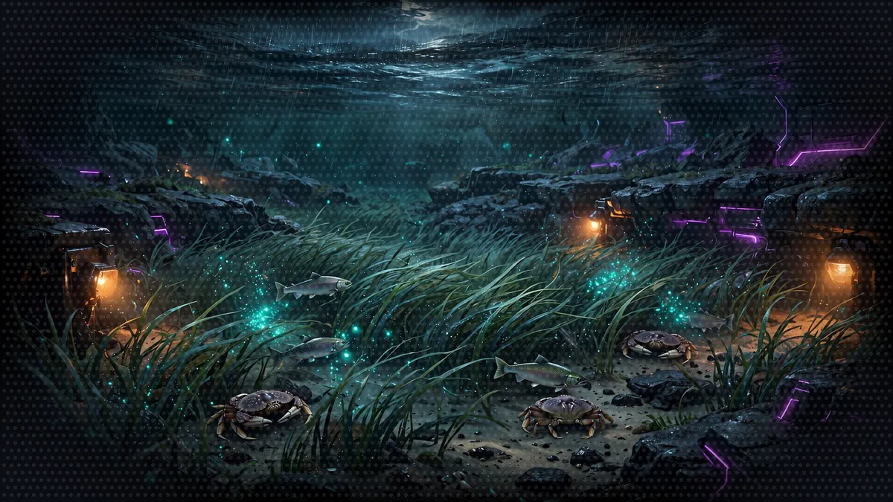
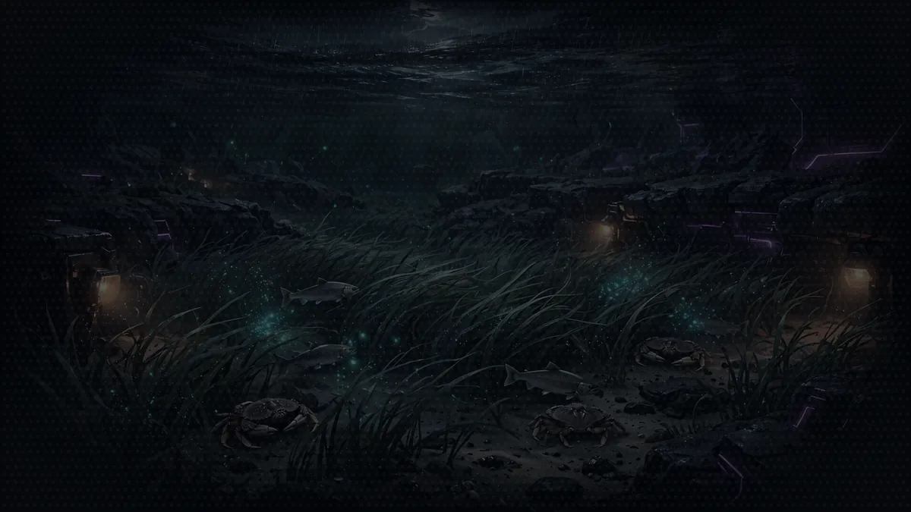

# Floor 2: The Vending Machines

[Previous: Floor 1](floor-1.md) | [Dungeon map](README.md) | [Next: Floor 3](floor-3.md) <!-- floor-nav -->

Files on this floor: [`2_vended_tools/agent_with_vended_tools.py`](../2_vended_tools/agent_with_vended_tools.py), [`2_vended_tools/bonus_quest.py`](../2_vended_tools/bonus_quest.py) <!-- floor-files -->


<!-- cordula-log -->
>  **CORDULA'S LOG, DAY 2, THURSDAY, JUNE 18, FLOOR 2.** Below the lobby the water shallowed into the Eelgrass Nursery, a meadow of eelgrass, crab country, and the crabs do not like noise. Barnaby wanted to know what he was. Not philosophically; tactically. What can a giant octopus do, by the book? The vending machines down here sold tools, and one of them could look things up. He read the old monster manual entry on his own species and was offended for ten minutes. Then a scripter named Kiro offered to run any command we wanted, no questions asked. I do not let anyone run a command I have not read. That is the second machine on this floor. The water was dropping toward the 1400 low water, and the flats were starting to show.
<!-- /cordula-log -->

>  **System AI:** "Floor 2. The vending machines are open. Everything on offer ships with the SDK, nothing is free of consequences, and the optional shell tool will run exactly what you approve. Approve with care. The sponsors are hoping you will not."

## Floor Objective

Tools are the primary mechanism for extending agent capabilities, enabling them to perform actions beyond text generation. Tools allow agents to interact with external systems, access data, and manipulate their environment. On this floor, you'll use your first vended tool, the name Strands gives to the tools that ship with the SDK, by adding the `http_request` tool to your agent, so your Narrator can look up real creature stat blocks on a public role-playing game API.

Open a terminal at the Floor 2 folder:

```bash
cd seattle-strands-dungeon-crawl/dungeon/2_vended_tools
```

Edit [`agent_with_vended_tools.py`](../2_vended_tools/agent_with_vended_tools.py) file.

## The Arsenal: Vended Tools

>  **System AI:** "Vended tools ship in strands.vended_tools. No pip install, no shopping, no excuses. The shell tool runs exactly what you approve, and the review board flags a Crawler who approves everything."

The Strands SDK ships with a set of ready-to-use tools, the vended tools. They live in `strands.vended_tools`, so no extra install is needed. Six of the tools:

- `http_request`: calls external APIs (GET, POST, and other HTTP methods)
- `notebook`: keeps persistent notes in the agent's state
- `file_editor`: views, creates and edits files
- `shell`: runs shell commands
- `web_fetch`: fetches a web page and answers a question about it
- `handoff_to_user`: pauses to ask the user a question

The complete list is on the [Vended Tools](https://strandsagents.com/docs/user-guide/sdk/tools/vended-tools/#available-tools) page of the Strands docs.



>  **CORDULA:** Six machines in a row, humming in the eelgrass. I read every label before I touched one, the way you check a parts bin before you trust it. Barnaby pointed two arms at the one that looks things up. "That one, Sergeant. I wish to know what the surface world thinks I am."

## Step 1: Equip the Agent with http_request

>  **ITEM ACQUIRED: [http_request]**
>
> Calls external APIs on the agent's behalf. Rarity: Common. Comes with the Open5e API pre-bookmarked, because the System AI refuses to invent a stat block in front of the review board.

```python
# TODO: Step 1 - Import http_request from strands.vended_tools
```

```python
# TODO: Step 1 - Add the http_request tool to your agent
```

Import the `http_request` tool from `strands.vended_tools`, then pass `http_request` to the agent's `tools` parameter: see [Adding Tools to Agents](https://strandsagents.com/docs/user-guide/sdk/tools/using-tools/#adding-tools-to-agents) in the Strands docs. The system prompt already tells the Narrator where to find creatures: the free [Open5e API](https://open5e.com/), which serves the System Reference Document 5.1 under the Creative Commons Attribution 4.0 license. The [HTTP request](https://strandsagents.com/docs/user-guide/sdk/tools/vended-tools/http-request/) page describes what `http_request` can do.

In `agent_with_vended_tools.py`, `tools=[...]` holds only the TODO comment. Replace the empty list with a list that holds `http_request`.

<details>
<summary>Show me the code for Step 1</summary>

```python
from strands import Agent
# TODO: Step 1 - Import http_request from strands.vended_tools
from strands.vended_tools import http_request
```

```python
agent = Agent(
    model="us.amazon.nova-2-lite-v1:0",  # Amazon Nova 2 Lite, US cross-Region inference profile
    # TODO: Step 1 - Add the http_request tool to your agent
    tools=[http_request],
    system_prompt="""...""",
)
```

A vended tool is a ready-made Strands tool object: import `http_request` and put it in the `tools` list, with no parentheses after the name.

</details>

## Step 2: Test the Agent

>  **FLOOR BOSS:** Barnaby's homework. The party leader wants to know how the surface world's monster manuals rated his species, and he has a doctorate's worth of opinions ready. The agent must look up the entry instead of guessing. Barnaby will check.

After both TODOs are done, run the script:

```bash
python agent_with_vended_tools.py
```

The agent will:

- Receive the question "Barnaby is a Giant Pacific Octopus. How do the old monster manuals say a giant octopus hides underwater, and what does its Ink Cloud do?"
- Decide to call the `http_request` tool
- Call the API at `https://api.open5e.com/v2/creatures/srd_giant-octopus/`
- Answer from the data the API returned: Underwater Camouflage gives advantage on Dexterity (Stealth) checks underwater, and Ink Cloud fills a 20-foot radius that stays heavily obscured for 1 minute, after which the octopus can Dash as a bonus action

The agent selected and called `http_request` on its own to answer the question.

Check: the terminal shows `Tool #1: http_request` before the answer, and the answer quotes the 20-foot radius and the 1 minute of Ink Cloud. Both numbers come from the Open5e API. An agent without `http_request` would have to guess them.

| output | cause | fix |
|---|---|---|
| `ImportError: cannot import name 'http_request'` | a typo in the import, or an older Strands SDK | copy the import from the Show me block; `uv run python -c "import importlib.metadata as m; print(m.version('strands-agents'))"` must print 1.61 or later, otherwise run `uv sync` |
| an answer with no `Tool #1` line | the tool is not on the agent | check the second TODO: `tools=[http_request]` |
| `Tool #1: http_request`, then a connection error or a timeout | the network cannot reach Open5e | open https://api.open5e.com/v2/creatures/srd_giant-octopus/ in a browser; on a corporate network, set `HTTPS_PROXY` |
| `AccessDeniedException` or `ExpiredToken` | the Amazon Nova 2 Lite call failed, not `http_request` | run the check in [Floor 0, Step 7](floor-0.md#step-7-check-your-pass-to-amazon-nova-2-lite-aws) |

>  **CORDULA:** The answer came back with numbers in it, and every one had a source. Barnaby read the stat block twice.
>
>  **BARNABY:** "Advantage on stealth. Correct. A twenty-foot ink cloud. Accurate, if unambitious."

The nursery with the lights out, for the stealth beat. Stealth runs on the tide: check the  tide clock and move while the water is low and dark.


>
>  **CORDULA:** Then, quieter:
>
>  **BARNABY:** "They wrote me down as a monster, Sergeant."
>
>  **CORDULA:** I told him it was a game manual from before anybody had met him. He went red for ten minutes. Then he asked how many other things the machine could look up.

>  **CORDULA'S LOG, DAY 2, THURSDAY, JUNE 18, FLOOR 2, 1400.** The 1400 low water (-2.7 feet) pulled the bay back off the nursery, and the flood had scoured one sand flat down to bare shell. A geoduck lay on his side in the open with a two-foot neck draped across the sand, 59 years in the same square foot of Elliott Bay and now nowhere. Barnaby said an adult geoduck cannot dig back in, and then he said nothing for a while. The first Companion Egg bound him to the party and gave him what no adult geoduck has ever had, the power to dig in anywhere in half a second. I named him Shelly, after Shilshole, where I learned to paddle at ten. He answered with a long silence and one puff of sea mist, and I counted him in as crew. Barnaby set his rule within the minute: the clam stays five feet from the water line, and Shelly dug in exactly five feet away and did not move.

>  **NEW ACHIEVEMENT UNLOCKED!** **[Dug In and Refused to Elaborate]** Rewarding: Cordula and Barnaby. Most Crawlers bind something fierce or fluffy. You bound a 59-year-old burrowing clam with a two-foot neck. Barnaby will not look at the clam. Companion Egg consumed: Shelly, Puget Sound geoduck, Level 4 Rare Companion.

>  **SYSTEM DESIGN, LAYER 2: OUTSIDE KNOWLEDGE.** A System that makes up facts loses its readers the first time a number contradicts itself. Giving the agent a tool means it looks things up and quotes the source instead of guessing. Barnaby's own abilities in [the cast sheet](world/cast.md) (Chromatophore Stealth, Ink Cloud) are built on exactly what this API returns, adapted to the dance floor. See [The System](world/the-system.md#what-each-floor-adds-to-the-system).

## Bonus Room: The Multi-Tool Challenge (optional)

Want a harder room? Open [`2_vended_tools/bonus_quest.py`](../2_vended_tools/bonus_quest.py). Kiro the Doomsday Scripter, a crawler whose class treats code as demolition magic, will write a Fibonacci script to a file and run it: two tools and one safeguard, wired the same way as `http_request` in the main floor. Each step below has two TODOs in `bonus_quest.py`: the import at the top of the file, and the use of that import inside the agent.

>  **SYSTEM WARNING:** Windows users: the `shell` tool runs commands through `sh`, and `file_editor` expects POSIX paths (starting with `/`), so this bonus room does not run on native Windows. To try it on Windows, run it inside WSL (Windows Subsystem for Linux).

### Step 1: Equip the Tools

```python
# TODO: Step 1 - Import shell and file_editor from strands.vended_tools
```

```python
# TODO: Step 1 - Add the shell and file_editor tools to your agent
```

Both are vended tools: `file_editor` writes the scroll, `shell` casts it. Import `shell` and `file_editor`, then pass both in the agent's `tools` parameter, like `http_request` in the main floor: see [Adding Tools to Agents](https://strandsagents.com/docs/user-guide/sdk/tools/using-tools/#adding-tools-to-agents), and the pages for [shell](https://strandsagents.com/docs/user-guide/sdk/tools/vended-tools/shell/) and [file editor](https://strandsagents.com/docs/user-guide/sdk/tools/vended-tools/file-editor/).

<details>
<summary>Show me the code for Step 1</summary>

```python
# TODO: Step 1 - Import shell and file_editor from strands.vended_tools
from strands.vended_tools import shell, file_editor
```

```python
    # TODO: Step 1 - Add the shell and file_editor tools to your agent
    tools=[shell, file_editor],
```

The two import TODOs sit together at the top of the file, and the two agent TODOs sit together inside `Agent(...)`. Place each answer under its own TODO comment, or under the pair: the `solution` branch puts both imports after the second import TODO.

</details>

>  **CORDULA:** Kiro the Doomsday Scripter had a terminal strapped to his chest and a grin I have seen on boot privates holding fireworks. He wanted a pen and a match: a tool to write a file, a tool to run it. I gave him both. I did not give him permission yet.

### Step 2: Add the Safeguard

>  **ITEM ACQUIRED: [HumanInTheLoop]**
>
> An intervention that holds every tool call until the player types y or n. Rarity: Uncommon. Side effect: the player becomes personally responsible for everything that happens next.

```python
# TODO: Step 2 - Import HumanInTheLoop from strands.vended_interventions.hitl
```

```python
# TODO: Step 2 - Ask for your approval before each tool call with HumanInTheLoop in stdio mode
```

Writing files and running commands change the computer. Strands gates tool calls behind approval with an intervention: import `HumanInTheLoop`, then pass `HumanInTheLoop(ask="stdio")` in the agent's `interventions` parameter, as shown in [Stdio Mode](https://strandsagents.com/docs/user-guide/sdk/agents/interventions/human-in-the-loop/#stdio-mode) on the Human in the loop page. Every tool call now pauses and asks for permission in the terminal:

```
Approve "file_editor"?
  Input: {"command": "create", "path": ".../fibonacci_scroll.py", ...} (y/n):
```

Type `y` and press Enter to run the tool call, or `n` to refuse. Without this step, the agent writes files and runs commands with no prompt: run `bonus_quest.py` once with Step 2 left out to compare.

<details>
<summary>Show me the code for Step 2</summary>

```python
# TODO: Step 2 - Import HumanInTheLoop from strands.vended_interventions.hitl
from strands.vended_interventions.hitl import HumanInTheLoop
```

```python
    # TODO: Step 2 - Ask for your approval before each tool call with HumanInTheLoop in stdio mode
    interventions=[HumanInTheLoop(ask="stdio")],
```

`interventions` takes a list, like `tools`. Unlike a vended tool, `HumanInTheLoop` is a class: construct it with `ask="stdio"`.

</details>

>  **CORDULA:** This is the rule I brought down from the surface: nobody runs a command I have not read. Not Kiro, not the System AI, not the octopus. Barnaby asked whether that applied to him. I said especially to him. He considered this for a while, then turned a pleased shade of brown. He likes knowing where the lines are.

### Step 3: Cast the Spell

```bash
python bonus_quest.py
```

Answer each prompt as it appears:

- `Approve "file_editor"?`: Kiro writes `fibonacci_scroll.py` in the floor folder. Type `y`.
- `Approve "shell"?`: Kiro casts the scroll, usually `python3 fibonacci_scroll.py`, sometimes after a `cd` into the folder. Type `y` for each shell call.
- Kiro reports the first ten Fibonacci numbers.

Type `n` on one call to see how Kiro reacts to a refusal.

Check: `fibonacci_scroll.py` now sits in `2_vended_tools/`, and Kiro reports the first ten Fibonacci numbers, `0, 1, 1, 2, 3, 5, 8, 13, 21, 34` (some runs start at 1 instead of 0). Run `python fibonacci_scroll.py` directly: the script prints the same numbers.

| output | cause | fix |
|---|---|---|
| no `Approve` prompt at all, and the file appears anyway | `HumanInTheLoop` is not on the agent | check Step 2: `interventions=[HumanInTheLoop(ask="stdio")]` |
| `ModuleNotFoundError: No module named 'strands.vended_interventions'` | an older Strands SDK | `uv sync`, then check the version as in Step 2 of the main floor |
| `file_editor` refuses the path | the path is not absolute, or the script runs on native Windows | run the script from `2_vended_tools/`; on Windows, use WSL (see the warning above) |
| the scroll is written, then the shell call fails with `python3: not found` | this computer's Python command is `python` | type `n` on that call: Kiro usually retries with `python`. If Kiro does not retry, add "run it with python" to the request at the bottom of `bonus_quest.py` |

>  **CORDULA:** I said no to the first command Kiro tried, on purpose, to see what he would do. He sulked, rewrote it, and asked again. That is the whole point of the HumanInTheLoop machine.

### Tool Consent and Safety

>  **System AI:** "allowed_tools=["*"] removes every prompt. The sponsors call it brave. The System AI calls it content."

- Approval prompts: tools run with the permissions of the Python process. With `HumanInTheLoop`, no tool call that alters the computer runs without explicit approval.
- Allowing named tools: `allowed_tools=["file_editor"]` lets `file_editor` run without a prompt while other tools still ask. Use `["*"]` to disable every prompt, for testing only.

>  **SAFE ROOM READING:** [Tools in Strands](https://strandsagents.com/docs/user-guide/sdk/tools/using-tools/) (Strands docs) and [Video 01: How AI Agents Really Work](https://www.youtube.com/watch?v=NAEX4ORLkbQ) by Morgan Willis. "This is already a working agent, not a very capable one because it has no tools yet, but it already contains an agent loop."
>
>  **CORDULA:** The docs listed the vended tools. The video said what Floor 1 left me with: a loop that could talk and nothing to reach with. I added http_request first, ran the agent, watched it decide on its own to call the API. That was the moment: the agent reached outside itself.

## Side Passages (optional)

>  **CORDULA:** The eelgrass has more machines than the six on the main row, and Kiro has more scrolls than one.

- [The Tide Table](encounters/tide-table.md), sidequest: today's real Seattle tides from NOAA, and a ruling on whether the Estuary dance floor is underwater
- [The Sandbox Tide Pool](encounters/sandbox-tide-pool.md), sidequest: Kiro's scroll cast inside a Docker sandbox instead of the local shell
- [The Policy Gatekeeper](encounters/policy-gatekeeper.md), boss battle: a Cedar policy and a risk classifier in front of Kiro, so only the risky calls reach the player
- [Ask the Player](encounters/ask-the-player.md), sidequest: the Narrator stops mid-turn to ask the player which Move Call to make

## Floor Clear

Floor cleared, Crawler. The Narrator now holds the `http_request` vended tool and decides on its own when to call it.

Loot kept:

- How to import a vended tool and add it to your agent
- How an agent autonomously decides when to use a tool
- Tool consent and safety (covered with the bonus room's `HumanInTheLoop` intervention)

### What a Turn Costs

Amazon Bedrock bills on-demand use by the token: the text sent to Amazon Nova 2 Lite (input) and the text it writes back (output). Third-party price trackers list Amazon Nova 2 Lite at about $0.30 per million input tokens and $2.50 per million output tokens as of November 2026. Confirm the current price for your region on the Amazon Bedrock pricing page before planning anything bigger than this workshop.

| what runs | rough tokens | rough cost |
|---|---|---|
| this floor's script, once | 150 in, 400 out | under a tenth of a cent |
| one Floor 5 Narrator turn (several model calls, tool results fed back in) | 15,000 in, 1,500 out | under one cent |
| the whole workshop, with plenty of retries | a few hundred turns | a few dollars at most |

The token counts are estimates, so measure them: after running an agent, print `response.metrics.accumulated_usage` to read `inputTokens`, `outputTokens` and `totalTokens` for the call.

 **Stairwell:** Journey to [Floor 3](floor-3.md) where custom tools take shape for specific use cases.


>  **NEW ACHIEVEMENT UNLOCKED!**
>
> **[VENDED, NOT EARNED]**
>
> Reward: You received a [Bronze Box]. Inside: an http_request tool, a stern reminder about HumanInTheLoop, and a coupon for one (1) apology to your own filesystem.

>  **System AI:** "Your agent now decides on its own when to reach for a tool. The sponsors call this "emergent behavior." I call it Thursday."
