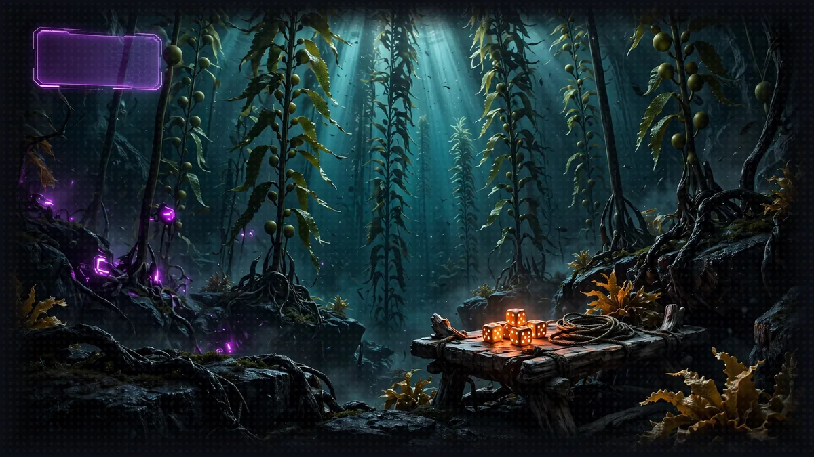

# Floor 3: The Crafting Table

[Previous: Floor 2](floor-2.md) | [Dungeon map](README.md) | [Next: Floor 4](floor-4.md) <!-- floor-nav -->

Files on this floor: [`3_custom_tools/agent_with_dice_roll_tool.py`](../3_custom_tools/agent_with_dice_roll_tool.py) <!-- floor-files -->



<!-- cordula-log -->
>  **CORDULA'S LOG, DAY 3, FRIDAY, JUNE 19, FLOOR 3.** The Bull Kelp Cathedral goes straight up: bull kelp stipes as thick as my wrist, bulbs floating overhead like lanterns. Nothing down here could be decided, because the System AI's dice were lost in the flood, and a game without dice is an argument. So we made dice. Barnaby learned the hard way that a tool is only as good as the instructions on the box: the first version of our roller did exactly what we wrote, which was not what we meant. We rewrote the instructions until the roller did. Shelly dug in at the foot of the first stipe in half a second and held our spot.
<!-- /cordula-log -->

>  **System AI:** "Floor 3. Craft your own gear, Crawler. Amazon Nova 2 Lite never reads your code, only the docstring you write for it. Write a lazy one and watch your agent dance to the wrong song."

## Floor Objective

Learn how to create custom tools by building a Dice Rolling Tool - an essential capability for any Narrator.

Open a terminal at the root of Floor 3:

```bash
cd aiRPG-seattle-dungeon-crawl/dungeon/3_custom_tools
```

Edit the [`agent_with_dice_roll_tool.py`](../3_custom_tools/agent_with_dice_roll_tool.py) file to build an agent that rolls dice with a custom tool.

## How Custom Tools Work

>  **System AI:** "On this floor you stop borrowing gear and forge your own. Amazon Nova 2 Lite never sees your code. It sees a name, a docstring and a schema. That is your entire sales pitch."

In Strands, a custom tool is a Python function decorated with `@tool` and documented by a docstring:

- The `@tool` Decorator: marks a function as an agent tool
- Function Docstring: describes the tool and guides the agent on when and how to use it

## Step 1: Turn `roll_dice` into a Tool

Open `agent_with_dice_roll_tool.py`: the file already contains a plain Python function, `roll_dice`, that rolls `count` dice with `faces` faces each, drops the `drop_lowest` lowest ones and returns every die, the dice kept and their total. Turn `roll_dice` into a tool the agent can call.

```python
# TODO: Step 1 - Import tool from strands
```

```python
# TODO: Step 1 - Add the decorator to transform your function into a tool
```

Import the `@tool` decorator from Strands, then put the decorator on `roll_dice`: it turns an ordinary Python function into a tool that the agent discovers and uses. See the [Basic Example](https://strandsagents.com/docs/user-guide/sdk/tools/custom-tools/#basic-example) on the Create custom tools page.

<details>
<summary>Show me the code for Step 1</summary>

```python
from strands import Agent
# TODO: Step 1 - Import tool from strands
from strands import tool

# TODO: Step 1 - Add the decorator to transform your function into a tool
@tool
def roll_dice(faces: int = 6, count: int = 1, drop_lowest: int = 0) -> dict:
```

The `solution` branch folds the import into the first line instead, `from strands import Agent, tool`: both forms work. The decorator goes on the line right above `def`, with no parentheses.

</details>

>  **CORDULA:** We found a crafting table wedged between two kelp stipes, with a function already scratched into it: roll some dice, drop the low ones, add up the rest. The function worked, and nobody could use it. A function is a tool the way a wrench in a locked drawer is a tool. The decorator is the key to the drawer.

## Step 2: Write a Clear Docstring

>  **NEW ACHIEVEMENT UNLOCKED!**
>
> **[THE SPEC SHEET OF SHAME]**
>
> Reward: You received a [Cracked Mirror]. It shows your tool_spec before the docstring: description 'roll_dice', and nothing else. The review board flagged it in eleven seconds.

`roll_dice` has no docstring. Before writing one, read what Amazon Nova 2 Lite receives about `roll_dice`: right after the function, the script prints `roll_dice.tool_spec`, the exact specification Strands sends to Amazon Nova 2 Lite. Run the script after finishing Step 1. The output starts with:

```
{'name': 'roll_dice',
 'description': 'roll_dice',  # only the function name
 'inputSchema': {'json': {'properties': {
     'faces': {'default': 6, 'description': 'Parameter faces', 'type': 'integer'},  # only the parameter names
     'count': {'default': 1, 'description': 'Parameter count', 'type': 'integer'},
     'drop_lowest': {'default': 0, 'description': 'Parameter drop_lowest', 'type': 'integer'}},
   'type': 'object'}}}
```

`description` contains only the function name, `roll_dice`, and the three parameters are described as nothing more than `Parameter faces`, `Parameter count` and `Parameter drop_lowest`. Amazon Nova 2 Lite knows nothing else about `roll_dice`: it never reads the function's code and receives only what Strands builds from the name, the docstring and the typed parameters.

```python
# TODO: Step 2 - Write a docstring with the description, an Args section and the return value
```

Write the docstring: a first paragraph saying what the tool does and how to call it for 4d6 drop lowest, an `Args:` section describing `faces`, `count` and `drop_lowest`, and what it returns, as in [Write effective tool descriptions](https://strandsagents.com/docs/user-guide/sdk/tools/custom-tools/#write-effective-tool-descriptions).

Tip: LLMs are good at writing tool docstrings. Give an LLM the function and an example of best practices, and it generates a docstring.

<details>
<summary>Show me the code for Step 2</summary>

```python
def roll_dice(faces: int = 6, count: int = 1, drop_lowest: int = 0) -> dict:
    # TODO: Step 2 - Write a docstring with the description, an Args section and the return value
    """Roll one or more dice with the same number of faces, optionally drop the lowest, and total the rest.

    Use it every time the game needs a random roll: ability scores, dance-off
    Move Calls, the Final Beat, ability checks, loot boxes. For "4d6 drop lowest",
    call it once with faces=6, count=4, drop_lowest=1. For a single d20, call it
    with faces=20.

    Example response: {"rolls": [5, 2, 6, 3], "kept": [5, 6, 3], "total": 14}

    Notes:
        - Report the total this tool returns; never add the dice up yourself.
        - Each die is independent and uniformly random.

    Args:
        faces: Number of faces on each die, 1 or more. Use 20 for a d20, 6 for a d6. Defaults to 6.
        count: How many dice to roll, 1 or more. Defaults to 1.
        drop_lowest: How many of the lowest dice to discard before totaling, 0 or more
            and less than count. Defaults to 0.

    Returns:
        A dict with every die rolled ("rolls"), the dice kept after dropping ("kept"),
        and their sum ("total").
    """
```

A docstring must be the first statement of the function, so it goes right under the TODO comment, before `import random`. Your docstring does not have to match word for word: what matters is the call for 4d6 drop lowest, an `Args:` line per parameter, and the instruction to report the tool's total.

</details>

>  **CORDULA:** Our first roller had no instructions on the box, and Amazon Nova 2 Lite treated the roller like a toy: one die at a time, sixteen calls, and the sums added up in its head came out wrong. Barnaby took that personally. He spent an hour on the docstring, arm by arm, reading each line back through the collar.
>
>  **BARNABY:** "The System AI never sees the code, Sergeant. It sees what we promise the code does. So we promise precisely."
>
>  **CORDULA:** I have written maintenance cards for amphibious vehicles. His were better.

## Compare the Printed Specification

Run the script again and compare the printed specification. The output now shows:

```
{'name': 'roll_dice',
 'description': '...',  # the docstring you added
 'inputSchema': {'json': {'properties': {
     'faces': {'default': 6, 'description': '...', 'type': 'integer'},  # the Args section of your docstring
     'count': {'default': 1, 'description': '...', 'type': 'integer'},
     'drop_lowest': {'default': 0, 'description': '...', 'type': 'integer'}},
   'type': 'object'}}}
```

The `Args:` section became the description of each parameter, the remaining text became the description of the tool.

Would the tool work without a docstring? Not reliably. `faces` is guessable, but nothing in `count` or `drop_lowest` tells Amazon Nova 2 Lite that 4d6 drop lowest is a single call with `count=4, drop_lowest=1`, or that the agent should report the `total` instead of adding the dice. On Amazon Nova 2 Lite, an earlier design of this tool that rolled one die per call left Amazon Nova 2 Lite to plan sixteen calls and do the arithmetic, and the model skipped rolls and miscounted. Moving the work into the tool and documenting it fixed both problems.

## Step 3: Add the Tool to the Agent

>  **System AI:** "A tool that is not in tools=[] does not exist. The System AI checks. The System AI always checks."

```python
# TODO: Step 3 - Add the tool to the agent
```

Pass `roll_dice` to `dice_roller` the same way as a vended tool on Floor 2: see [Adding Tools to Agents](https://strandsagents.com/docs/user-guide/sdk/tools/using-tools/#adding-tools-to-agents).

<details>
<summary>Show me the code for Step 3</summary>

```python
dice_roller = Agent(
    model="us.amazon.nova-2-lite-v1:0",  # Amazon Nova 2 Lite, US cross-Region inference profile
    # TODO: Step 3 - Add the tool to the agent
    tools=[roll_dice],
    system_prompt="""...""",
)
```

Pass the decorated function itself, `roll_dice`, not a call to it.

</details>

Why the `tools=[]` list matters:

- The agent can use only tools listed in `tools=[]`
- Without Step 3, the agent cannot discover `roll_dice`
- The agent learns how to call each listed tool from its docstring

## Step 4: Test the Tool

>  **FLOOR BOSS:** Four abilities, four dice each, drop the lowest. Four calls, sixteen dice, zero arithmetic by the model. Lady Luck runs the table, and Lady Luck does not do favors.

Once TODOs are completed, run your script:

```bash
python agent_with_dice_roll_tool.py
```

The system prompt in the file turns the agent into Lady Luck, the System AI's croupier, who rolls every die for the status reports. Her prompt says "the System AI's croupier subroutine" because everything the System AI says to a Crawler comes out in its own voice. The script asks her to show the review board how the dice rolled Cordula's sheet on day one: four ability scores (strength, wisdom, charisma and intelligence) with the 4d6-drop-lowest method: for each ability, roll four six-sided dice and keep the three highest. The run makes four tool calls, one per ability, each with `faces=6, count=4, drop_lowest=1`: sixteen dice, all rolled by `roll_dice`, which drops the lowest of each four and adds up the rest.

The terminal shows the agent working through these steps:

- Analyze the character creation request
- Plan one roll per ability (4d6 drop lowest each)
- Call `roll_dice` four times with `faces=6, count=4, drop_lowest=1`
- Report the four totals the tool returned
- Print the final report

Check: the terminal prints the new `tool_spec` first, then four `Tool #N: roll_dice` lines, then Lady Luck's report with four totals, each between 3 and 18. To see the dice behind each total, paste the debug logging lines from [Floor 1, Step 1](floor-1.md#step-1-enable-debug-logging) at the top of the file and run the script again: every tool result appears in the log, and the totals Lady Luck reports are the tool's, never a sum she made up.

| you see | it means | fix |
|---|---|---|
| `NameError: name 'tool' is not defined` | the import of Step 1 is missing | add `from strands import tool` |
| `'function' object has no attribute 'tool_spec'` | the decorator is missing | put `@tool` on the line above `def roll_dice` |
| `'description': 'roll_dice'` in the printed spec | the docstring is not the first statement of the function | move it right under `def`, before `import random` |
| sixteen calls with `count=1`, or a total that does not match the dice | the docstring does not say how to call 4d6 drop lowest | add the `count=4, drop_lowest=1` sentence and the "report the total" note |
| no `Tool #` line at all | the tool is not on the agent | Step 3: `tools=[roll_dice]` |


>  **CORDULA:** Lady Luck dealt from a table of abalone shell and called every roll like a boxing announcer. Four calls, four totals, and she did not touch the arithmetic once. She hated that. Halfway through the third roll, a bulb overhead popped and the stipe it hung from whipped across the table. A green fish the size of a golf ball came off his holdfast, hit my forearm guard, and stuck there with a sound like a plunger. I pulled; he held. The second Companion Egg went warm, and the System AI announced the bind. The review board named him by stakeholder escalation, and Barnaby voted for "Projectile", but "Chonks" won with 61 percent. Barnaby studied him for a long moment and said, "Compact. Quiet. Aerodynamic." Shelly sent up a puff of sea mist, and Chonks gave one stubborn gurgle.

>  **NEW ACHIEVEMENT UNLOCKED!**
>
> **[You Brought a Sticky Beach Ball to a Dance Battle]**
>
> Reward: Cordula and Barnaby. You bound a spherical, armor-plated fish that moves by vibrating its tiny fins and glaring. The review board has named him. You will live with the name. Companion Egg consumed: Chonks, Pacific spiny lumpsucker, Level 4 Rare Companion.


>  **SYSTEM DESIGN, LAYER 3: HARD MATH.** Readers forgive a System for being cruel, never for being inconsistent. Ability scores, modifiers and dice are the math every later rule stands on, so they live in code, not in the model's head. In this crawl each of the six scores also maps to a dance-off Move Call: Strength is Power, Dexterity is Footwork, Constitution is Endurance, Intelligence is Choreography, Wisdom is Read the Room and Charisma is Presence. A score of 16 gives a +3 modifier: (score - 10) / 2, rounded down. See [ability scores](world/crawl-handbook/01-ability-scores.md) and [The System](world/the-system.md#2-stat-design).

>  **SAFE ROOM READING:** [Create custom tools](https://strandsagents.com/docs/user-guide/sdk/tools/custom-tools/) (Strands docs) and [Video 03: Give Your Agent Tools Using MCP](https://www.youtube.com/watch?v=PtdHZBbm1Ys) by Morgan Willis. "You've already seen how to use some of the built-in vended tools and turn Python functions into tools using the tool decorator."
>
>  **CORDULA:** The docs showed the @tool decorator and the docstring contract. The video put a decorated Python function next to the vended tools, and to the agent they were the same kind of thing. I wrote the docstring, ran the script, and the spec changed. The agent started calling the tool correctly.

## Side Passage: The Concurrent Shuffle (optional)

>  **CORDULA:** Deeper in the kelp, a second table with slow dice and the Quarterly Close Accountant, early for once. Two dancers, two dice, and one of them always waiting for the other.

[The Concurrent Shuffle](encounters/concurrent-shuffle.md), a dance-off: roll both sides of a round with a sequential and a concurrent tool executor, and time the difference.

## More Side Passages

>  **CORDULA:** Past the last kelp holdfast, a workbench bolted to the rock, with room on the pegboard for one more tool.

- [The Living Workbench](encounters/living-workbench.md), sidequest: hot-reload a `tools/` folder and add a `final_beat` tool to an agent that never restarts

## Floor Clear

Floor cleared, Crawler. You built `roll_dice`, and the agent now calls it.

Loot kept:

- How to turn a Python function into a tool with the `@tool` decorator
- How to write a docstring that guides the agent's use of the tool
- How to add `roll_dice` to an agent

### What a Turn Costs

Amazon Bedrock bills on-demand use by the token: the text sent to Amazon Nova 2 Lite (input) and the text it writes back (output). Third-party price trackers list Amazon Nova 2 Lite at about $0.30 per million input tokens and $2.50 per million output tokens as of November 2026. Confirm the current price for your region on the Amazon Bedrock pricing page before planning anything bigger than this workshop.

| what runs | rough tokens | rough cost |
|---|---|---|
| this floor's script, once | 200 in, 350 out | under a tenth of a cent |
| one Floor 5 Narrator turn (several model calls, tool results fed back in) | 15,000 in, 1,500 out | under one cent |
| the whole workshop, with plenty of retries | a few hundred turns | a few dollars at most |

The token counts are estimates, so measure them: after running an agent, print `response.metrics.accumulated_usage` to read `inputTokens`, `outputTokens` and `totalTokens` for the call.

 **Stairwell:** Go to [Floor 4](floor-4.md) to learn the Model Context Protocol (MCP), which connects agents to external services.


>  **NEW ACHIEVEMENT UNLOCKED!**
>
> **[I MADE THIS (SO TO SPEAK)]**
>
> Reward: You received a [Silver Box]. Inside: a roll_dice tool that works, and sixteen dice that rolled exactly where the docstring told Amazon Nova 2 Lite to roll them.

>  **System AI:** "You forged a tool. A real one. [Floor 4](floor-4.md) is where it leaves the house."
