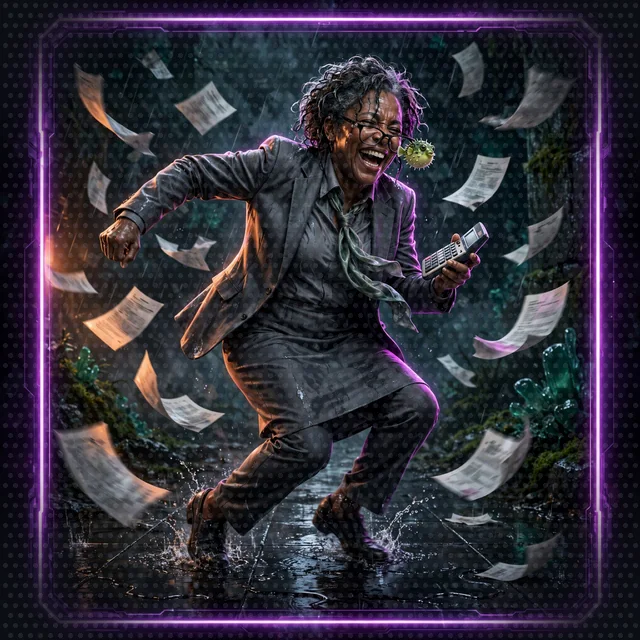

# Floor 5.3: The Narrator and the Dance-Off

[Previous: Floor 5.2](floor-5-2.md) | [Dungeon map](README.md) | [Next: Floor 6](floor-6.md) <!-- floor-nav -->

Files on this floor: [`5_a2a_integration/agents/narrator_orchestrator/narrator_orchestrator.py`](../5_a2a_integration/agents/narrator_orchestrator/narrator_orchestrator.py), [`5_a2a_integration/test/test.http`](../5_a2a_integration/test/test.http) <!-- floor-files -->

## Floor Objective

Build the Narrator orchestrator on port 8009, test the full four-terminal system, and dance the first dance-off.

Change to the root of Floor 5:

```bash
cd seattle-strands-dungeon-crawl/dungeon/5_a2a_integration
```

## Part 3: Setting Up the Narrator Orchestrator

The Narrator Orchestrator coordinates all agents and serves as the main API endpoint. The Narrator combines:

- The Rules Agent (via A2A)
- The Character Agent (via A2A)
- The dice service (the MCP server from Floor 4)

### Configure the Narrator Agent

>  **System AI:** "This is where I come in, loudly. The Narrator orchestrator runs the game in your terminal, and the Narrator speaks in my voice: its system prompt opens 'You are the System AI', so every scene, roll and ruling reaches a Crawler as me. Hand it dice, hand it allies, hand it a schema, then stand back."

The given code at the top of the file builds `NARRATOR_MODEL`, the Amazon Nova 2 Lite client the Narrator runs on:

```python
NARRATOR_MODEL = BedrockModel(model_id="us.amazon.nova-2-lite-v1:0")
```

Nova 2 Lite is the strongest generally available Nova model. Nova 2 Lite can also think before answering (extended thinking), but a full Narrator turn, with its A2A calls, measured about 9 seconds with thinking off and 24 to 91 seconds at `medium`. For a game, thinking off wins. The comment above `NARRATOR_MODEL` shows the one argument that turns thinking on for deeper plans at the cost of waiting.

### What a Narrator Turn Costs

A Narrator turn is not one Amazon Nova 2 Lite call. The Narrator calls Nova 2 Lite, Nova 2 Lite asks for tools, the tool results go back in, and the loop repeats until the answer is ready: four to six calls for a dance-off round. Every call resends the system prompt, the tool specifications and the conversation so far, so input tokens grow with every call. The Rules Agent and the Character Agent run their own Nova 2 Lite calls on top.

At the Amazon Nova 2 Lite prices from [Floor 1](floor-1.md#what-a-turn-costs) (about $0.30 per million input tokens and $2.50 per million output tokens):

| what runs | rough tokens | rough cost |
|---|---|---|
| one Narrator turn, thinking off | 15,000 in, 1,500 out | 0.45 cents + 0.38 cents: under one cent |
| the same turn, if thinking adds 2,000 tokens to each of 5 Nova 2 Lite calls | 15,000 in, 11,500 out | 0.45 cents + 2.9 cents: about 3.3 cents |
| the four curl commands of Part 4, thinking off | about 60,000 in, 6,000 out | about 3.3 cents |
| building the knowledge base | none | free: ChromaDB embeds the handbook on your machine |

Reasoning tokens are billed as output tokens, the expensive kind, and billing is the second reason thinking stays off: the first is the wait. We measured the time, not the reasoning tokens, so the second row is an illustration, not a measurement. Measure your own: add `print(response.metrics.accumulated_usage)` under `print(response.structured_output)` in `ask_agent`, and every request prints its `inputTokens` and `outputTokens`.

#### Step 1: Create MCP Client for Dice Rolling

```python
# TODO: Step 1 - Create an MCPClient with the url "http://localhost:8002/mcp"
```

Same client as in Floor 4: an `MCPClient` with `url="http://localhost:8002/mcp"`. See [Streamable HTTP](https://strandsagents.com/docs/user-guide/sdk/tools/mcp-transports/#streamable-http) on the MCP Transports page; as before, the client goes straight into `tools=[...]`, no `with` block (managed integration).

<details>
<summary>Show me the code for Step 1</summary>

```python
# TODO: Step 1 - Create an MCPClient with the url "http://localhost:8002/mcp"
mcp_client = MCPClient(url="http://localhost:8002/mcp")
```

`MCPClient` is already imported at the top of the file. Name it `mcp_client`: Step 3 uses that name.

</details>

#### Step 2: Create the A2A Client Tool

```python
# TODO: Step 2 - Create the A2A client tool with make_a2a_client and the allowed agent endpoints
```

`make_a2a_client` builds a single tool, `a2a_client`, that the Narrator uses to talk to remote agents: with `operation="discover"` it fetches an agent's card (name, description, skills), and with `operation="send_message"` it sends a request to that agent's endpoint. Pass `allowed_endpoints`, the list of agent URLs `a2a_client` may reach (`"http://127.0.0.1:8000"` for the Rules Agent, `"http://127.0.0.1:8001"` for the Character Agent): any other endpoint is rejected before a connection opens. See the [A2A Client](https://strandsagents.com/docs/user-guide/sdk/tools/vended-tools/a2a-client/) vended tool page.

<details>
<summary>Show me the code for Step 2</summary>

```python
try:
    # TODO: Step 2 - Create the A2A client tool with make_a2a_client and the allowed agent endpoints
    a2a_client = make_a2a_client(allowed_endpoints=[
        "http://127.0.0.1:8000",  # Rules Agent
        "http://127.0.0.1:8001",  # Character Agent
    ])
```

The TODO sits inside a `try:` block, so indent new lines to match the TODO.

</details>

#### Step 3: Add the Tools

```python
# TODO: Step 3 - Add the mcp_client and a2a_client tools to the agent
```

The Narrator gets two tools: `mcp_client`, which brings in `roll_dice` from the dice server, and `a2a_client`, which lets the Narrator discover and message the Rules Agent and the Character Agent. Pass the MCP client itself, as in Floor 4: Strands lists the MCP client's tools when the Narrator starts. See [Give your agent tools](https://strandsagents.com/docs/user-guide/sdk/tools/#give-your-agent-tools).

<details>
<summary>Show me the code for Step 3</summary>

```python
        # TODO: Step 3 - Add the mcp_client and a2a_client tools to the agent
        # TODO: Step 4 - Force the response to use the StoryOutput model
        tools=[mcp_client, a2a_client],
```

</details>

#### Step 4: Force Structured Output

>  **ITEM ACQUIRED: [StoryOutput]**
>
> A Pydantic model that forces the Narrator to answer in JSON. Rarity: Rare. The System AI resents it. The web interface depends on it. The System AI resents that too.

By default, an agent replies with free-form text. Structured output makes Amazon Nova 2 Lite return a typed object that matches a Pydantic schema; Strands validates the object and returns clean JSON. See [Request structured output](https://strandsagents.com/docs/user-guide/sdk/agents/structured-output/#request-structured-output).

```python
# TODO: Step 4 - Force the response to use the StoryOutput model
```

`StoryOutput` is given code, higher in the file: the schema of one Narrator turn, with `response` (the narration), `actions_suggestions` (what the player could do next), `details` (which tools and agents were used) and `dice_rolls` (each roll with its type, result and reason). Here is an example:

```json
{
  "response": "Tempo: Driving. The Quarterly Close Accountant loosens their tie and calls Footwork like it is an audit finding. Cordula answers with a 13 plus 1 for Dexterity: 14 against their 11. Round one to the kayak patrol.",
  "actions_suggestions": ["Let Barnaby drop an Ink Cloud before the next call", "Ask the accountant about their weekend", "Challenge them to a second dance-off, double or nothing, during quarter close"],
  "details": "roll_dice through the dice server, twice; Rules Agent for the tempo bonus",
  "dice_rolls": [{"dice_type": "1d20", "result": 13, "reason": "Footwork Move Call, round 1, Cordula +1 Dexterity"},
                 {"dice_type": "1d20", "result": 9, "reason": "Footwork Move Call, round 1, accountant +0 Dexterity +2 Driving tempo"}]
}
```

The Floor 6 web interface renders each `StoryOutput` field separately. Parsing free-form prose would be fragile; a guaranteed JSON shape keeps the interface reliable.

<details>
<summary>Show me the code for Step 4</summary>

```python
        # TODO: Step 3 - Add the mcp_client and a2a_client tools to the agent
        # TODO: Step 4 - Force the response to use the StoryOutput model
        tools=[mcp_client, a2a_client],
        structured_output_model=StoryOutput,
    )
```

Pass the class, `StoryOutput`, not an instance of it. The `/inquire` route already reads `response.structured_output`.

</details>

>  **CORDULA:** Barnaby ran the meeting from my shoulders. He asked the clerk for the rule, the desk for the sheet, and the dice for the roll, and he did not do anyone's job for them. Then he made the Narrator fill out a form for every answer, four boxes, every time. "If it is not in the box, Sergeant, it did not happen." I have known colonels who could not manage that.

#### Step 5: Launch the Narrator

The Narrator rolls its dice through the MCP server from Floor 4, so the dice server has to run too. If the dice server still runs from Floor 4, skip this. Otherwise open a third terminal in the floor folder, activate the virtual environment and start the dice server:

```bash
cd ../4_mcp_integration
python dice_roll_mcp_server.py
```

Then open a fourth terminal for the Narrator itself:

```bash
cd agents/narrator_orchestrator
python narrator_orchestrator.py
```

Uvicorn prints a line with `http://127.0.0.1:8009`. Four terminals are now running: the Rules Agent, the Character Agent, the dice server and the Narrator.

Check: the Narrator prints the agent object, then the Uvicorn line, with no `Error occurred:` line between them. `narrator_orchestrator.py` catches any error raised while building the agent, prints the error, then starts the server anyway, so read the output above the Uvicorn line.

| you see | it means | fix |
|---|---|---|
| `Error occurred: ...MCPClientInitializationError...` above the Uvicorn line | the dice server is not running | start the dice server (above), then restart the Narrator |
| `NameError: name 'agent' is not defined` on the first request | building the agent failed at startup | scroll up to the `Error occurred:` line and fix that first |
| `TypeError` about `structured_output_model` | a Strands SDK older than the version this crawl pins | `uv sync` |


## Part 4: Test the System

>  **FLOOR BOSS:** Four curl commands: a rules question, registering the party, a lookup on the party leader, and a dance-off against the Quarterly Close Accountant. Survive all four and the party is formed.

Four terminals should now be running:

| Terminal | Process | Endpoint |
|---|---|---|
| 1 | Rules Agent, `python rules_agent.py` | http://127.0.0.1:8000 |
| 2 | Character Agent, `python character_agent.py` | http://127.0.0.1:8001 |
| 3 | Dice server (Floor 4), `python dice_roll_mcp_server.py` | http://127.0.0.1:8002/mcp |
| 4 | Narrator, `python narrator_orchestrator.py` | http://127.0.0.1:8009 |

If a process is missing, return to its launch step.

>  **CORDULA:** Four terminals, four jobs, none of them waiting on another to exist. Barnaby put one pair of arms on each: rules, registry, dice, Narrator. I kept the fifth terminal and the checklist. He can start four things at once. Somebody still has to say, in order, what "started" means. That part is mine, and he would not have it any other way. He said so while typing in two windows at once, which I pretended not to watch.

The Narrator is a FastAPI application listening on port 8009. Each curl command below sends a POST request to the Narrator's `/inquire` endpoint with a JSON body holding the question; a web page sends the same request. While the request runs, the four terminals show what the Narrator does with the request: which agent the Narrator asks over A2A, when the Narrator rolls the dice over MCP, and what each agent answers. Open a fifth terminal and run the curl commands there (no virtual environment needed, curl is a system command), or, with a REST client, use the [`test/test.http`](../5_a2a_integration/test/test.http) file prepared for these tests:

```bash
# Query the rules
curl -X POST http://0.0.0.0:8009/inquire \
  -H "Content-Type: application/json" \
  -d '{"question": "How does the Final Beat work?"}'
```

```bash
# Register the party (the Narrator passes the cast scores, the Character Agent computes the rest)
curl -X POST http://0.0.0.0:8009/inquire \
  -H "Content-Type: application/json" \
  -d '{"question": "Register the party with the System: Cordula Vance and Barnaby."}'
```

```bash
# Look up the party leader
curl -X POST http://0.0.0.0:8009/inquire \
  -H "Content-Type: application/json" \
  -d '{"question": "What are Barnaby'\''s Dexterity and Mana?"}'
```

```bash
# Start a dance-off
curl -X POST http://0.0.0.0:8009/inquire \
  -H "Content-Type: application/json" \
  -d '{"question": "Cordula challenges the Quarterly Close Accountant to a dance-off at the Pier 59 collapse. Run round one."}'
```

Watch the four terminals while a request runs. In the Narrator terminal the tool calls appear in order: `a2a_client` discovering the agent cards, then `send_message` to the Rules Agent or the Character Agent, or `roll_dice` for the dice. The asked agent logs the question in its own terminal, and the dice server prints a `DICE ROLL` line for every roll: none while the party registers (the Narrator passes the scores from the cast), two `1d20` lines for each dance-off round. The Character Agent terminal shows two `New Crawler registered` lines, and the sheets it returns carry Groove 17 and Mana 8 for Cordula, Groove 11 and Mana 11 for Barnaby: computed by the code, not Amazon Nova 2 Lite. The answer is JSON shaped like `StoryOutput`: `response`, `actions_suggestions`, `details` and `dice_rolls`. Barnaby's lookup should come back with Dexterity 18 and Mana 11: the Narrator read it from the Character Agent instead of inventing it.

| you see | it means | fix |
|---|---|---|
| `{"error": "Internal server error"}` | the Narrator failed; terminal 4 says why | read the `Error occurred:` line in terminal 4 |
| the Narrator says a call to an agent failed | that agent is not running, or runs on another port | check terminals 1 and 2 against the table above |
| `curl: (7) Failed to connect` | the Narrator is not running | Part 3, Step 5 |
| Groove or Mana differ from 17 and 8 for Cordula | the scores the Narrator passed are not the cast's | look at the `New Crawler registered` line in terminal 2; restore `characters.json` (see [Cleanup](cleanup.md#local-files)) and register again |

>  **CORDULA:** The Quarterly Close Accountant stepped onto the pickleweed in a fleece vest and called Footwork like it was an audit finding. The Narrator set the tempo, asked the dice twice, and read both totals out loud with the modifiers shown. I took round one on a drill cadence. The accountant took it well and said they had a close to return to, and I believed them. Barnaby, very quietly, through the collar: "Registered, Sergeant. They wrote my name down as party leader." He sounded like he had been waiting a long time to hear it.



>  **SYSTEM DESIGN, LAYER 5: RULES, SHEETS AND THE CORE LOOP.** This floor is where the game becomes a game. The rules live in a knowledge base the Rules Agent searches, so the Narrator cites them instead of improvising. The character sheet lives with the Character Agent, which computes Groove and Mana from the ability scores so no model can hand a Crawler extra stamina. The dance-off is the core loop: a Move Call, two rolls, a winner, Groove lost, a Final Beat when it is level. Every stat has a job in it, and nobody gets hurt. `StoryOutput` is the notification format the HUD will render on [Floor 6](floor-6.md). See [The System](world/the-system.md#6-conflict-dance-offs-and-stealth-never-killing) and the [Crawl Handbook](world/crawl-handbook/).


## Boss Battle: The Developer Advocate Swarm (optional)

>  **CORDULA:** The Developer Advocate Swarm followed us down from the Locks, with better lighting this time. Four of them, one mic, and nobody deciding who went next.

[The Developer Advocate Swarm](encounters/developer-advocate-swarm.md): keynote, live demo, livestream and swag table pass the mic among themselves, as a Strands swarm. The party wins by out-dancing whoever holds it. The opposite design, a graph whose order the code draws, waits on Floor 8: [The Quarterly Earnings Call](encounters/quarterly-earnings-call.md).


## Floor Clear

Floor cleared, Crawler. The Narrator system is complete: three agents and a dice server.

Loot you're keeping:

- Indexing the Crawl Handbook into a ChromaDB knowledge base for the Rules Agent
- Building agent factories for per-caller isolation (the `agent_factory` pattern)
- Serving the Rules Agent and Character Agent as A2A servers
- Creating an A2A client tool so the Narrator can discover and call the Rules Agent and the Character Agent
- Orchestrating specialized agents by combining A2A and MCP tools
- Forcing structured JSON output with a response model

 **Stairwell:** Take the stairs to [Floor 6](floor-6.md) and test the Narrator in a web interface.


>  **NEW ACHIEVEMENT UNLOCKED!**
>
> **[FOUR TERMINALS OPEN, ZERO FRIENDS]**
>
> Reward: a [Gold Box]. Inside: a Rules Agent that cites handbook sections, a Character Agent that remembers Barnaby's Dexterity to the point, and an orchestrator that watched an accountant lose a Footwork call.

>  **System AI:** "You built a multi-agent system and it returned typed JSON. I am, against my better judgment, impressed. [Floor 6](floor-6.md) lets you watch it play in public."
