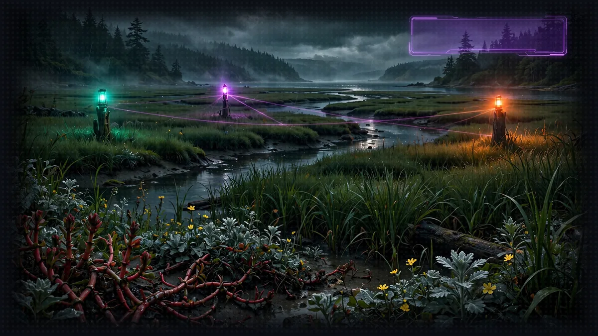
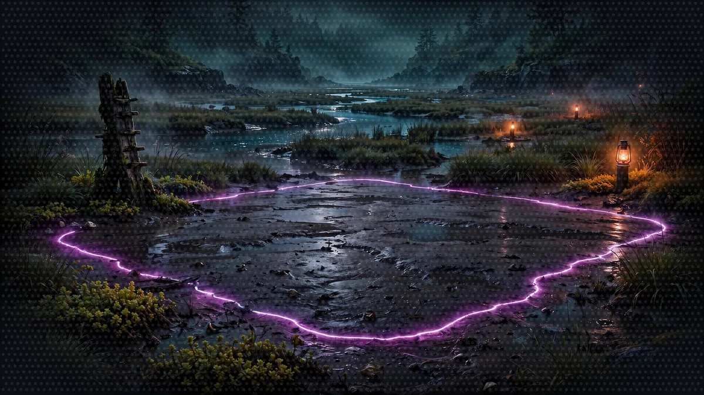
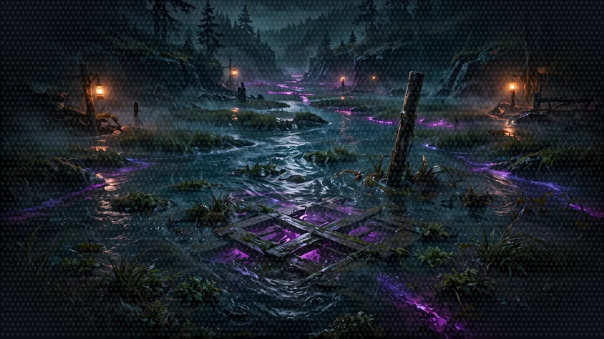
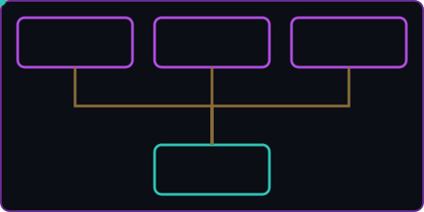

# Floor 5: Party Formation (A2A)

[Previous: Floor 4](floor-4.md) | [Dungeon map](README.md) | [Next: Floor 5.1](floor-5-1.md) <!-- floor-nav -->


Files on this floor: [`5_a2a_integration/agents/rules_agent/rules_agent.py`](../5_a2a_integration/agents/rules_agent/rules_agent.py), [`5_a2a_integration/agents/character_agent/character_agent.py`](../5_a2a_integration/agents/character_agent/character_agent.py), [`5_a2a_integration/agents/narrator_orchestrator/narrator_orchestrator.py`](../5_a2a_integration/agents/narrator_orchestrator/narrator_orchestrator.py), [`5_a2a_integration/utils/create_knowledge_base.py`](../5_a2a_integration/utils/create_knowledge_base.py), [`5_a2a_integration/test/test.http`](../5_a2a_integration/test/test.http) <!-- floor-files -->





<!-- cordula-log -->
>  **CORDULA'S LOG, DAY 6, MONDAY, JUNE 22, FLOOR 5.** The estuary floods twice a day. The dance floor is there, then it is not. The open migration window meant rules, and nobody in the party had read them. We built a clerk to read the rule book, a registration desk to stamp our sheets, and a Narrator to run the game, each one doing one job and talking to the others. Barnaby ran the meeting. He was good at it. He delegated, he cited the handbook, he made the Narrator answer in a format the HUD could read. Then a Quarterly Close Accountant stepped onto the pickleweed and challenged us to a dance-off, and we found out whether any of it worked.
<!-- /cordula-log -->

>  **System AI:** "Floor 5. A party. How sweet. Three agents, four terminals, one orchestrator, and a very real chance you forget to start one of them. The review board is watching."

>  **System AI:** "Dungeon Crawl: Seattle is a live cloud-migration test and compliance audit. The Sound flooded dry-city infrastructure mid-window, and the window stayed open. I evaluate efficiency, run performance stress-tests, file metric reports, and chase my quarterly throughput SLA. The quarter closes June 30."

## Floor Objective

Assemble the full party: expose the Rules Agent and the Character Agent as remote agents with A2A, then build a Narrator orchestrator that talks to both, rolls dice through the MCP server from Floor 4 and returns its story as structured output.

What is A2A? [Agent2Agent (A2A)](https://a2a-protocol.org/) is an open protocol for agents to talk to each other, whoever built them and whatever framework they run on. Each agent publishes an agent card (name, description, skills, URL) and accepts messages over HTTP; a client reads the card, sends a task and receives the answer. Where MCP connects an agent to tools, A2A connects an agent to other agents. In Strands, `A2AServer` exposes any agent over A2A, and the vended tool `make_a2a_client` lets the Narrator call them.

Change to the root of Floor 5:

```bash
cd seattle-strands-dungeon-crawl/dungeon/5_a2a_integration
```

>  **CORDULA:** The estuary smelled like salt and cut grass. The tide table on a post said the dance floor would be dry for six hours, then gone. Six hours to stand up a rule clerk, a registration desk and a Narrator, and get them talking. I have run tighter timelines on a beach landing. I have not run one with an octopus in charge.

>  **System AI:** "The tide turns. The Estuary floods at 1224."



## System Architecture

>  **System AI:** "Four processes, four ports, one orchestrator. This is the floor where Crawlers lose track of a terminal and blame the framework. The framework is fine. Check the four terminals."

```
        Rules Agent             Character Agent          Dice Service
           (Port 8000)              (Port 8001)            (Port 8002)
                │                        │                      │
                └────────────────────────┼──────────────────────┘
                                         │
                              Narrator Orchestrator
                                   (Port 8009)
```

The same diagram for browsers (the text version above is the terminal-readable one):



Build a system with three specialized agents that work together:

- Rules Agent: manages the game rules and mechanics - [`agents/rules_agent/rules_agent.py`](../5_a2a_integration/agents/rules_agent/rules_agent.py)
- Character Agent: handles character creation and management - [`agents/character_agent/character_agent.py`](../5_a2a_integration/agents/character_agent/character_agent.py)
- Narrator Orchestrator: coordinates all agents for gameplay - [`agents/narrator_orchestrator/narrator_orchestrator.py`](../5_a2a_integration/agents/narrator_orchestrator/narrator_orchestrator.py)

>  **BARNABY:** Four stations, Sergeant. I have four pairs of arms. Rules, registry, dice, Narrator: I shall keep the appropriate appendages on each. You will keep the fifth terminal and inform us, in order, whether any of it worked. A party that cannot staff its own diagram has no business drawing one.

```
BARNABY, STATION KEEPING
Pair 1 -> 8000 Rules Agent       Pair 3 -> 8002 Dice Service
Pair 2 -> 8001 Character Agent   Pair 4 -> 8009 Narrator (watch only)
Collar -> one decision at a time. Cordula -> fifth terminal, commits the checklist.
```

That became the floor plan, because the diagram and the octopus make the same point. The four processes run side by side and none of them waits to exist. The Narrator still takes one turn at a time and commits that turn in order, as one `StoryOutput`. Parallel stations, serial commit: four pairs of arms to fan the work out, one collar to decide, one crew chief to say what done means. When a terminal goes missing on this floor, Barnaby has an idle pair of arms, and opinions about whose job the missing terminal was.


## The Floor in Three Parts
One sitting each, in order. Each part ends with its terminals still running.

- [Floor 5.1: the Rules Agent and the Knowledge Base](floor-5-1.md): index the Crawl Handbook, serve the Rules Agent on port 8000.
- [Floor 5.2: the Character Agent](floor-5-2.md): serve character creation on port 8001.
- [Floor 5.3: the Narrator and the Dance-Off](floor-5-3.md): build the orchestrator on port 8009, test the system, dance.
## More Side Passages

>  **CORDULA:** Three more errands on the estuary: Barnaby wants to place his own calls, the accountant wants a typed answer, and somebody has to staple the receipts.

- [Barnaby Takes the Call](encounters/barnaby-takes-the-call.md), sidequest: an `A2AAgent` instead of the `a2a_client` tool, with every A2A event streamed
- [Read the Room, Typed](encounters/read-the-room-typed.md), dance-off: the tempo and each Move Call picked as typed values by a decision model, against the Quarterly Close Accountant
- [Subcontract the Paperwork](encounters/subcontract-the-paperwork.md), sidequest: a subagent tool that hires a one-off clerk on a pinned Amazon Nova 2 Lite
- [The Delivery Drone Horde](encounters/delivery-drone-horde.md), sidequest: a steering handler that keeps the party on course while Cadabra's drones beg for answers

