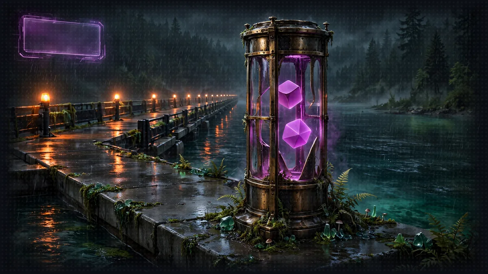

# Floor 8.1: The Dice Server

[Previous: Floor 8](floor-8.md) | [Dungeon map](README.md) | [Next: Floor 8.2](floor-8-2.md) <!-- floor-nav -->

Files on this floor: [`8_agentcore_production/diceserver/dice_roll_mcp_server.py`](../8_agentcore_production/diceserver/dice_roll_mcp_server.py), [`8_agentcore_production/narrator/narrator_orchestrator.py`](../8_agentcore_production/narrator/narrator_orchestrator.py) <!-- floor-files -->



<!-- cordula-log -->
>  **CORDULA'S LOG, DAY 11, SATURDAY, JUNE 27, FLOOR 8.1.** Brick one was the dice. If anything is going to keep running without us, the dice, which decide who wins, should be the part that does. Barnaby wanted proof the dice had left the building, so we read the logs from the cloud until he was satisfied. It took a while. He is hard to satisfy.
<!-- /cordula-log -->

>  **SAFE ROOM READING:** [bedrock-agentcore-samples](https://github.com/elizabethfuentes12/bedrock-agentcore-samples) by Elizabeth Fuentes. "AgentCore provides composable services that work with popular open-source frameworks and any model, eliminating the choice between open-source flexibility and enterprise requirements."
>
>  **CORDULA:** The AgentCore samples show the same three bricks the floor builds: Runtime, Memory and Gateway. I kept the repo open in a tab the whole floor. Barnaby does not like surprises in production, and neither do I.
>
>  **BARNABY:** The dice left first. A fair roll is the one thing the game cannot do without. Everything else waits on it.

## Floor Objective

Take the first brick to production: deploy the Floor 4 dice server to AgentCore Runtime, then point the Narrator at it. It is the simplest brick: no model, no state, one tool. Everything else keeps running on your machine for now.

This section works in two folders of `8_agentcore_production`:

- The dice server ([`diceserver/dice_roll_mcp_server.py`](../8_agentcore_production/diceserver/dice_roll_mcp_server.py)), the Floor 4 server, with its [`pyproject.toml`](../../pyproject.toml)
- The Narrator ([`narrator/narrator_orchestrator.py`](../8_agentcore_production/narrator/narrator_orchestrator.py)), the Floor 5 orchestrator

## Part 1: Prepare the Dice Server for the Cloud (diceserver/dice_roll_mcp_server.py)

### Step 1: Adapt the MCP Server

```python
# TODO: Step 1 - Create the MCP server as mcp, listening on all interfaces, on the default port, with stateless HTTP
mcp = FastMCP(host="0.0.0.0", stateless_http=True)
```

This line is the only change to the Floor 4 server. Keep the name `mcp`: the `@mcp.tool()` decorator and `mcp.run(...)` below use it. AgentCore Runtime expects an MCP server at `0.0.0.0:8000/mcp`, which is FastMCP's default port and path, so `port=8002` goes away. `host="0.0.0.0"` makes the server reachable from outside its microVM (the default `127.0.0.1` only accepts local connections), and `stateless_http=True` lets any request be served without an MCP session kept in memory, the recommended mode for a simple tool server. `roll_dice`, its docstring and `mcp.run(transport="streamable-http")` are unchanged. See [Deploy MCP servers in AgentCore Runtime](https://docs.aws.amazon.com/bedrock-agentcore/latest/devguide/runtime-mcp.html) in the AgentCore Developer Guide.

<details>
<summary>Show me the code for Step 1</summary>

```python
# TODO: Step 1 - Create the MCP server as mcp, listening on all interfaces, on the default port, with stateless HTTP
mcp = FastMCP(host="0.0.0.0", stateless_http=True)
```

</details>

The `pyproject.toml` next to the server lists its only dependency, `mcp<2`: AgentCore installs `mcp<2` when AgentCore packages the code.

>  **SYSTEM WARNING:** Cloud only: do not start this cloud version of the dice server locally, port 8000 is the Rules Agent's port.

## Part 2: Deploy with AgentCore

>  **System AI:** "Your first runtime. The CLI packages the dice server, CloudFormation builds it, and IAM guards it. Three services, one dice roller. The System AI loves a little overkill."

Run the commands of this part from the project folder you created on the Floor 8 page:

```bash
cd gameprod
```

### Step 1: Add the Dice Server

```bash
agentcore add agent --name diceserver --type byo --protocol MCP --language Python \
  --code-location ../diceserver --entrypoint dice_roll_mcp_server.py
```

`--type byo` (bring your own) tells the CLI to use the existing code, `--protocol MCP` that the code is an MCP server rather than an agent, `--code-location` where the code lives and `--entrypoint` which file to start. Open `agentcore/agentcore.json` again: a `diceserver` entry appeared under `runtimes`, with `"protocol": "MCP"` and `"codeLocation": "../diceserver/"`. Nothing is deployed yet.

Confirm the path points to the dice server folder:

```bash
ls ../diceserver
```

The listing shows `dice_roll_mcp_server.py` and `pyproject.toml`. If the folder is empty, the project was created in the wrong place: the CLI silently creates a missing code folder instead of reporting it.

### Step 2: Deploy

>  **SYSTEM WARNING:** Run this command from the root of the `gameprod` folder, like every `agentcore` command of this floor. The CLI looks for `agentcore/agentcore.json` in the current folder and its parents: from `8_agentcore_production` or from `diceserver/`, the CLI stops with `No agentcore project found`.

```bash
agentcore deploy -y
```

The CLI packages the server with its dependencies, uploads the package and creates a CloudFormation stack, `AgentCore-gameprod-default`, holding the runtime and its IAM role. The first deployment takes a few minutes.

>  **SYSTEM WARNING:** `CDK synth failed: node dist/bin/cdk.js: Subprocess exited with error 1`: this message hides the underlying error. The most common cause is a `codeLocation` folder without a `pyproject.toml`: check `ls ../diceserver` as in Step 1. To see the underlying error, run `node dist/bin/cdk.js` from `agentcore/cdk`.

When the deploy finishes, check the status:

```bash
agentcore status
```

The `diceserver` runtime should be `READY`, followed by its URL, of the form `https://bedrock-agentcore.us-west-2.amazonaws.com/runtimes/<runtime ARN>/invocations`. Copy the URL: the Narrator needs the URL in Part 3.

### Step 3: Test the Deployed Server

>  **SYSTEM WARNING:** Run every command of this step from the root of the `gameprod` folder, like the rest of Part 2. From `8_agentcore_production` or a brick folder, `agentcore invoke` and `agentcore logs` stop with `No agentcore project found`.

Call the tool directly from the CLI, without an agent:

```bash
agentcore invoke call-tool --runtime diceserver --tool roll_dice --input '{"faces": 20}'
```

`--runtime diceserver` names the runtime to call. The flag is optional while `diceserver` is the only runtime of the project, but the next sections add others, and without it the command then fails with `Multiple runtimes found. Use --runtime to specify one.` The call prints a number between 1 and 20. Then read the server logs, stored in CloudWatch:

```bash
agentcore logs --runtime diceserver --since 15m
```

The logs contain `Starting Dice Roll MCP Server...` and the `DICE ROLL: 1d20 = [...] -> ...` line of that call, the same log lines as in Floor 4, written this time by a server running in AWS.

If `agentcore logs` shows nothing yet, wait a minute: logs reach CloudWatch with a short delay. If `call-tool` fails with `AccessDeniedException`, the signed-in credentials may not invoke AgentCore runtimes: check that `aws sts get-caller-identity` prints the account you deployed to, and that `AWS_DEFAULT_REGION` matches the region of `agentcore status`.

>  **CORDULA:** One d20, rolled by a box we could not see, in a building none of us will ever walk into. The log said 14. Barnaby wanted to read the line himself, in CloudWatch, with his own arms, before he would believe it. He read it. Then he asked for a second roll, to be sure it was not a recording.

### What the Dice Server Costs

A runtime bills per second while a session runs: $0.0895 per vCPU-hour of CPU used and $0.00945 per GB-hour of memory, and CPU drops to zero while the server waits. A dice roll takes milliseconds of CPU, so the memory of the session is most of the bill: a session that stays open for its 15 idle minutes after the last roll, at about half a GB, costs about a tenth of a cent. With no session open, the deployed runtime costs nothing. The rest of [What Floor 8 Costs](floor-8.md#what-floor-8-costs) covers the other bricks.

## Part 3: Connect the Narrator (narrator/narrator_orchestrator.py)

This file is the Floor 5 Narrator. The Rules Agent and the Character Agent are still reached over A2A on `127.0.0.1:8000` and `127.0.0.1:8001`; only the dice client changes. The Narrator's TODOs carry the number of this section (8.1 Step 1).

>  **SYSTEM WARNING:** On the `solution` branch, the Narrator file is shared by the four sections and appears as it is at the end of 8.4, served by AgentCore. The 8.4 version does not start on a local machine. Copy only the lines under the `8.1 Step N` TODOs of this section, and leave the rest of the file unchanged.

### Step 1: Read the Dice Server URL from the Environment

The URL of your runtime belongs to your AWS account: the URL has no place in the code, which can be shared or pushed to a public repository. The URL goes into a `.env` file instead, a list of `NAME=value` lines that stays on your machine. The floor folder holds a template, [`.env.example`](../8_agentcore_production/.env.example); copy the template next to itself:

```bash
cp ../.env.example ../.env
```

Open `8_agentcore_production/.env` and paste the URL you copied in Part 2, Step 2 after `DICE_SERVER_URL=`: the whole URL, not only the ARN, on one line and without quotes. Keep the ARN encoded (`%3A`, `%2F`) as `agentcore status` prints it:

```
DICE_SERVER_URL=https://bedrock-agentcore.us-west-2.amazonaws.com/runtimes/<encoded runtime ARN>/invocations
```

The repository's `.gitignore` already ignores `.env` files: git never offers to commit `.env`.

The top of the Narrator already loads the `.env` file: `load_dotenv()`, from the `python-dotenv` package, looks for a `.env` file in the folder of the script and in its parents, and adds the file's variables to the environment of the process. Read the URL from the environment:

```python
# TODO: 8.1 Step 1 - Read DICE_SERVER_URL from the environment
DICE_SERVER_URL = os.environ["DICE_SERVER_URL"]
```

Use brackets rather than `os.environ.get(...)`: if the variable is missing, the Narrator stops at startup with `KeyError: 'DICE_SERVER_URL'`, instead of failing later on the first roll.

<details>
<summary>Show me the code for 8.1 Step 1</summary>

```python
# TODO: 8.1 Step 1 - Read DICE_SERVER_URL from the environment
DICE_SERVER_URL = os.environ["DICE_SERVER_URL"]
```

</details>

### Step 2: Create an IAM-Signed MCP Client

>  **System AI:** "The deployed dice server answers signed requests only. Sign for the wrong region and you get a 403. The System AI enjoys a good 403."

```python
# TODO: 8.1 Step 2 - Import aws_iam_streamablehttp_client from mcp_proxy_for_aws.client
from mcp_proxy_for_aws.client import aws_iam_streamablehttp_client
```

```python
# TODO: 8.1 Step 2 - Create an MCPClient connecting to DICE_SERVER_URL with aws_iam_streamablehttp_client for the bedrock-agentcore service
mcp_client = MCPClient(lambda: aws_iam_streamablehttp_client(endpoint=DICE_SERVER_URL, aws_service="bedrock-agentcore"))
```

In Floor 5 the client was `MCPClient(url="http://localhost:8002/mcp")`. The deployed server only answers callers authenticated with IAM: every request must be signed with the AWS credentials (Signature Version 4). `aws_iam_streamablehttp_client`, from the `mcp-proxy-for-aws` package (already in the workshop dependencies), is the same streamable HTTP transport with the signature added. The signature covers a service and a region: `aws_service` names the service, and the region comes from the boto3 session, the `AWS_DEFAULT_REGION` you exported on the Floor 8 page. A request signed for the wrong region is rejected with a 403. The rest of the Narrator does not change: `mcp_client` still goes into `tools=[...]`, and Amazon Nova 2 Lite sees the same `roll_dice` tool as before. See the [MCP client for AWS services](https://docs.aws.amazon.com/bedrock-agentcore/latest/devguide/runtime-mcp.html) in the AgentCore Developer Guide.

<details>
<summary>Show me the code for 8.1 Step 2</summary>

```python
# TODO: 8.1 Step 2 - Import aws_iam_streamablehttp_client from mcp_proxy_for_aws.client
from mcp_proxy_for_aws.client import aws_iam_streamablehttp_client
```

```python
# TODO: 8.1 Step 2 - Create an MCPClient connecting to DICE_SERVER_URL with aws_iam_streamablehttp_client for the bedrock-agentcore service
mcp_client = MCPClient(lambda: aws_iam_streamablehttp_client(endpoint=DICE_SERVER_URL, aws_service="bedrock-agentcore"))
```

</details>

### Step 3: Launch the Narrator

The Rules Agent and the Character Agent from Floor 5 must be running (terminals 1 and 2). Stop the local dice server (terminal 3): the Narrator no longer needs it. Stop the Floor 5 Narrator too (terminal 4), since the new Narrator uses the same port, then start the new Narrator from the floor folder. Terminal 4 was opened in Floor 5: set the region there first, as on the Floor 8 page.

```bash
export AWS_DEFAULT_REGION=us-west-2
cd ../narrator
python narrator_orchestrator.py
```

Uvicorn prints that it is running on `http://127.0.0.1:8009`. If the Narrator stops with `KeyError: 'DICE_SERVER_URL'`, check that the file is named `.env` (not `.env.example`), that it sits in `8_agentcore_production`, and that the line has no space around the `=`.

## Part 4: Play Against the Cloud

>  **FLOOR BOSS:** One investment banker, one Move Call, two rolls, both in AWS. Read the CloudWatch logs to prove the dice left the local machine.

Request a dance-off round, from another terminal:

```bash
curl -X POST http://0.0.0.0:8009/inquire \
  -H "Content-Type: application/json" \
  -d '{"question": "Cordula challenges the Bonus-Season Investment Banker to a dance-off. Run round one."}'
```

The Narrator sets the tempo, makes a Move Call, rolls 1d20 for Cordula and 1d20 for the banker, and narrates who took the round. The Narrator's terminal shows the `roll_dice` tool calls as in Floor 5, but no local terminal prints a `DICE ROLL` line anymore. Read the cloud logs instead:

```bash
cd ../gameprod
agentcore logs --runtime diceserver --since 15m
```

The log holds both rolls, for example `DICE ROLL: 1d20 = [14] -> 14` followed by `DICE ROLL: 1d20 = [9] -> 9`. Play from the Floor 6 web interface too: the web interface talks to the Narrator on port 8009, exactly as before.

If the Narrator says the roll failed, the Narrator's terminal shows the cause: a `403` means the request was signed for another region than the runtime's (export `AWS_DEFAULT_REGION` in that terminal and restart the Narrator), and `ExpiredToken` means the AWS sign-in expired.

>  **CORDULA:** The Bonus-Season Investment Banker met us on a skybridge over Bellevue Way, cufflinks first, and called Presence like a sure thing. Both dice rolled somewhere in Oregon. I lost the round by two and lost two Groove, and I was fine with it: the roll was fair, and everybody could read it. Barnaby took the next call on Choreography, and the banker went back to the trading floor to think about bonus season.

Keep the `gameprod` project and its deployment: the next sections add the other bricks to it. To remove everything at the end of the workshop, see the [Cleanup](cleanup.md) page.

## Floor Clear

Floor cleared, Crawler. Your dice now roll in production, and the rest of the game did not notice.

Loot you're keeping:

- How to adapt an MCP server for AgentCore Runtime (`FastMCP(host="0.0.0.0", stateless_http=True)`)
- How to create, configure and deploy an AgentCore project (`agentcore create`, `agentcore add agent --type byo`, `agentcore deploy`)
- How to test and observe a deployed server (`agentcore invoke call-tool`, `agentcore logs`)
- How to call the deployed dice server from a Strands agent with IAM authentication (`aws_iam_streamablehttp_client`)
- How to keep the settings of your account out of the code (`.env`, `load_dotenv()`, `os.environ`)

 **Stairwell:** Head to [8.2](floor-8-2.md) where the Character Agent joins the dice server in the cloud, along with the characters it creates.


>  **NEW ACHIEVEMENT UNLOCKED!**
>
> **[THE DICE HAVE LEFT THE TABLE]**
>
> Reward: You received a [Bronze Box]. Inside: a cloud-hosted roll_dice, a signed request, and a log line you can read in CloudWatch.

>  **System AI:** "Your dice now roll in production, and the rest of the game did not notice. That will change."
