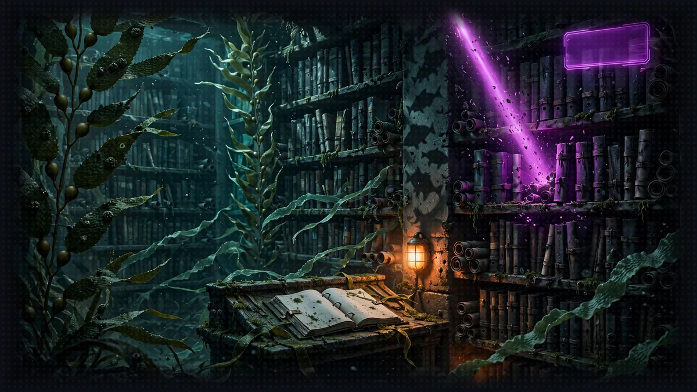

# Floor 8.3: The Rules Agent

[Previous: Floor 8.2](floor-8-2.md) | [Dungeon map](README.md) | [Next: Floor 8.4](floor-8-4.md) <!-- floor-nav -->

Files on this floor: [`8_agentcore_production/rulesagent/rules_agent.py`](../8_agentcore_production/rulesagent/rules_agent.py), [`8_agentcore_production/rulesagent/kb-policy.json`](../8_agentcore_production/rulesagent/kb-policy.json), [`8_agentcore_production/narrator/narrator_orchestrator.py`](../8_agentcore_production/narrator/narrator_orchestrator.py) <!-- floor-files -->



<!-- cordula-log -->
>  **CORDULA'S LOG, DAY 12, SUNDAY, JUNE 28, FLOOR 8.3.** Brick three was the rule book. Every Crawler on every server reads the same handbook now, which Barnaby considers the single most civilized thing the Narrator has ever done. Then a pitch-deck founder blocked the Locks and we got to use it.
<!-- /cordula-log -->

>  **SAFE ROOM READING:** [why-agents-fail-sample-for-amazon-agentcore](https://github.com/elizabethfuentes12/why-agents-fail-sample-for-amazon-agentcore) by Elizabeth Fuentes. "AI agents hallucinate statistics, pick wrong tools, ignore business rules, and claim success when operations fail."
>
>  **CORDULA:** The failure samples explain what goes wrong when an agent has the wrong tool or the wrong knowledge. The rule book on this floor is the opposite: a knowledge base that answers only what is in it, and cites the section. Barnaby read the Graph-RAG demo, nodded once, and went back to the handbook.
>
>  **BARNABY:** One handbook, one truth, indexed by section. That is civilization. The Pitch-Deck Founder at the Locks, on the other hand, is a recurring inconvenience. I remember him.

## Floor Objective

Move the third brick to production: put the Crawl Handbook in an Amazon Bedrock Knowledge Base, deploy the Floor 5 Rules Agent to AgentCore Runtime as an A2A server that searches it, then point the Narrator at it. After this section, only the Narrator still runs on your machine.

Why not keep ChromaDB? In Floor 5 the rules live in a ChromaDB folder built on the local machine, and the embedding model is downloaded on first use. On AgentCore Runtime the code folder is read-only, a new microVM must be ready within seconds, and every microVM would need its own copy of the index. The rules need a search service that lives outside the runtime, built once and shared by every session.

What is a managed knowledge base? A Bedrock Knowledge Base turns documents into a searchable index: it splits them into passages, computes their embeddings and stores the vectors. In a managed knowledge base, Bedrock also runs the vector store, so there is no database to create or size. It reads an S3 bucket, ingests the files, and the Retrieve API returns the passages closest to a question, each with the location of the file it came from. The AgentCore CLI declares the knowledge base in the project like the other bricks.

This section needs the `gameprod` project with the dice server and the Character Agent deployed in 8.1 and 8.2, and the knowledge base started on the Floor 8 page. Open a terminal at the root of Floor 8:

```bash
cd seattle-strands-dungeon-crawl/dungeon/8_agentcore_production
```

This section works in two folders:

- The Rules Agent ([`rulesagent/rules_agent.py`](../8_agentcore_production/rulesagent/rules_agent.py)), the Floor 5 agent, with the agent's [`pyproject.toml`](../../pyproject.toml) and [`kb-policy.json`](../8_agentcore_production/rulesagent/kb-policy.json)
- The Narrator ([`narrator/narrator_orchestrator.py`](../8_agentcore_production/narrator/narrator_orchestrator.py)), as left at the end of 8.2

## Part 1: Check the Knowledge Base

>  **System AI:** "Ingestion: IN_PROGRESS means wait. Ingestion: COMPLETE means deploy. There is no third state you will enjoy."

Step 3 of Set Up the Project on the Floor 8 page started the knowledge base. Its commands did this:

- `aws s3 mb` and `aws s3 cp --recursive` create a bucket and copy the eleven handbook files into it: a knowledge base reads documents from S3. Bucket names are global across all AWS accounts, so the bucket name ends with the AWS account id.
- `agentcore add knowledge-base` declares a managed knowledge base named `rules` in `agentcore/agentcore.json`, with the bucket as its data source. The CLI gives the knowledge base, not the agents, the right to read the bucket.
- `agentcore deploy` creates the knowledge base and its data source, then the CLI starts the ingestion: Bedrock reads, splits and indexes the handbook. The deployment finishes before the ingestion does.

>  **SYSTEM WARNING:** Run `agentcore` from the root of the `gameprod` folder, like every `agentcore` command of this floor. The CLI looks for `agentcore/agentcore.json` in the current folder and its parents: from `8_agentcore_production` or from `rulesagent/`, the CLI stops with `No agentcore project found`. Check indexing status:

```bash
cd gameprod
agentcore status
```

Under Knowledge Bases, `rules` shows `Deployed` as soon as the knowledge base exists, and `Ingestion: IN_PROGRESS` while Bedrock indexes the handbook. The knowledge base is ready when `agentcore status` shows `Ingestion: COMPLETE`. If the ingestion is still running, prepare the Rules Agent in Part 2 in the meantime, and check again before Part 3. Copy the id at the end of the knowledge base ARN, after `knowledge-base/` (10 characters, for example `YAYTMGXCRR`): paste the id into `agentcore/agentcore.json` in Part 3, Step 2.

After editing a handbook file, copy the file to the bucket again and run `agentcore run ingest`: Bedrock indexes the bucket again, and the cloud Rules Agent answers from the new rule.

If `rules` is missing from `agentcore status`, Step 3 of the Floor 8 page did not deploy: run Step 3 again from `gameprod`. If the ingestion shows `FAILED`, confirm that `aws s3 ls s3://gameprod-rules-$(aws sts get-caller-identity --query Account --output text)/` lists the eleven handbook files, then run `agentcore run ingest`.

>  **CORDULA:** The rule book we dropped in the bucket two bricks ago had been read, cut up and filed while we worked. Nobody had to wait on it. That is how you run a long-lead item: start it first, check it last.

### What the Knowledge Base Costs

A managed knowledge base bills $5.00 per GB of raw data a month and $1.00 per 1,000 Retrieve calls, with parsing and embeddings included ([Amazon Bedrock pricing](https://aws.amazon.com/bedrock/pricing/), Knowledge Bases). The handbook is about 13 KB, so storage is under a hundredth of a cent a month. Every rules question is one Retrieve call, a tenth of a cent. The S3 bucket that holds the source files costs under a cent. Stack teardown deletes the knowledge base, and the [Cleanup](cleanup.md#step-3-delete-the-rules-bucket) page deletes the bucket.

## Part 2: Prepare the Rules Agent for the Cloud (rulesagent/rules_agent.py)

The `query_rules` tool, its docstring, the prompts and the `create_agent` factory are the ones from Floor 5. Two things change: what the tool searches, and how the agent is served. In Floor 5 the Rules Agent already read the rules through `query_rules`; only the body of `query_rules` changes.

The top of `rules_agent.py` reads the knowledge base id and creates the Bedrock client:

```python
KNOWLEDGE_BASE_ID = os.environ["KNOWLEDGE_BASE_RULES_ID"]
knowledge_base = boto3.client("bedrock-agent-runtime")
```

Below those lines, a provided helper, `section_of(result)`, turns the S3 location of a result into a section name: each handbook section is its own file, so `s3://.../03-dance-offs.md` becomes `Dance Offs` and `04-final-beat.md` becomes `Final Beat`. In Floor 5 the section came from the metadata stored in ChromaDB; here Bedrock keeps the file location with every passage, and the file name is the section.

Unlike the memory in 8.2, the CLI passes nothing to the runtimes for a knowledge base: neither the knowledge base id nor the right to search it. Add both to `agentcore/agentcore.json` in Part 3, Step 2.

### Step 1: Search the Knowledge Base

```python
    # TODO: Step 1 - Retrieve the 3 passages closest to the query from the knowledge base and prefix each one with its section
    results = knowledge_base.retrieve(
        knowledgeBaseId=KNOWLEDGE_BASE_ID,
        retrievalQuery={"text": query},
        retrievalConfiguration={"managedSearchConfiguration": {"numberOfResults": 3}},
    )["retrievalResults"]
    return "\n\n".join(
        f"[{section_of(result)}] {result['content']['text']}"
        for result in results
    )
```

The code goes under the TODO, at the end of `query_rules`, after the docstring of `query_rules`. In Floor 5, the tool called `rules_collection().query(query_texts=[query], n_results=3)`. Here, `knowledge_base.retrieve(...)` takes these arguments:

- `knowledgeBaseId=KNOWLEDGE_BASE_ID`
- `retrievalQuery={"text": query}`: the question, in plain English; the knowledge base computes the embedding of the question
- `retrievalConfiguration={"managedSearchConfiguration": {"numberOfResults": 3}}`: a managed knowledge base takes `managedSearchConfiguration`; the `vectorSearchConfiguration` in other examples is for knowledge bases on your own vector store, and is rejected here

The response has a `retrievalResults` list. Each result holds the passage in `result["content"]["text"]` and the file it came from in `result["location"]["s3Location"]["uri"]`, which `section_of` reads. The tool returns the passages as in Floor 5: `[Final Beat] ...`, separated by blank lines. See [Retrieve](https://docs.aws.amazon.com/bedrock/latest/APIReference/API_agent-runtime_Retrieve.html) and [ManagedSearchConfiguration](https://docs.aws.amazon.com/bedrock/latest/APIReference/API_agent-runtime_ManagedSearchConfiguration.html) in the Amazon Bedrock API Reference.

<details>
<summary>Show me the code for Step 1</summary>

```python
    # TODO: Step 1 - Retrieve the 3 passages closest to the query from the knowledge base and prefix each one with its section
    results = knowledge_base.retrieve(
        knowledgeBaseId=KNOWLEDGE_BASE_ID,
        retrievalQuery={"text": query},
        retrievalConfiguration={"managedSearchConfiguration": {"numberOfResults": 3}},
    )["retrievalResults"]
    return "\n\n".join(
        f"[{section_of(result)}] {result['content']['text']}"
        for result in results
    )
```

</details>

### Step 2: Serve the Agent on AgentCore

```python
if __name__ == "__main__":
    # TODO: Step 2 - Serve the create_agent factory with serve_a2a on all interfaces, with the agent card of an A2AServer built on the same factory
    serve_a2a(
        StrandsA2AExecutor(agent_factory=create_agent, enable_a2a_compliant_streaming=True),
        agent_card=A2AServer(agent_factory=create_agent).public_agent_card,
        host="0.0.0.0",
    )
```

The `serve_a2a` call replaces the `pass` under the TODO. It matches the call for the Character Agent in 8.2, Part 1, Step 3.

As in 8.2, the agent is created with `callback_handler=None`, and the Rules Agent needs `KNOWLEDGE_BASE_RULES_ID`, which only exists on AgentCore: do not start the Rules Agent locally.

<details>
<summary>Show me the code for Step 2</summary>

```python
if __name__ == "__main__":
    # TODO: Step 2 - Serve the create_agent factory with serve_a2a on all interfaces, with the agent card of an A2AServer built on the same factory
    serve_a2a(
        StrandsA2AExecutor(agent_factory=create_agent, enable_a2a_compliant_streaming=True),
        agent_card=A2AServer(agent_factory=create_agent).public_agent_card,
        host="0.0.0.0",
    )
```

</details>

## Part 3: Deploy the Rules Agent

Run these commands from the `gameprod` folder.

### Step 1: Add the Rules Agent

```bash
agentcore add agent --name rulesagent --type byo --protocol A2A --framework Strands \
  --model-provider Bedrock --language Python \
  --code-location ../rulesagent --entrypoint rules_agent.py
```

This is the Character Agent command with Rules Agent values. Check the path:

```bash
ls ../rulesagent
```

The listing shows `kb-policy.json`, `nova-policy.json`, `pyproject.toml` and `rules_agent.py`.

### Step 2: Give the Agent the Knowledge Base

>  **ITEM ACQUIRED: [kb-policy.json]**
>
> Grants bedrock:Retrieve and nothing else. The Rules Agent can read the rule book. It cannot read the AWS account. The System AI can. The System AI is the exception.

`rulesagent/kb-policy.json` is provided; change nothing. This IAM policy allows a single action, `bedrock:Retrieve`, on the knowledge bases of the AWS account. The Rules Agent can search the rules and do nothing else in the account.

Open `agentcore/agentcore.json`. The `rulesagent` entry is already there, under `runtimes`: `agentcore add agent` wrote it in Step 1. Do not copy the whole block below. Add only the `envVars` and `additionalPolicies` lines at the end of the entry, with a comma after the preceding line (`...` stands for the lines already in the file):

```
{
  "name": "gameprod",
  ...
  "runtimes": [
    { "name": "diceserver", ... },
    { "name": "characteragent", ... },
    {
      "name": "rulesagent",
      "build": "CodeZip",
      "entrypoint": "rules_agent.py",
      "codeLocation": "../rulesagent/",
      "runtimeVersion": "PYTHON_3_14",
      "networkMode": "PUBLIC",
      "protocol": "A2A",
      "envVars": [{"name": "KNOWLEDGE_BASE_RULES_ID", "value": "<your-knowledge-base-id>"}],
      "additionalPolicies": ["kb-policy.json", "nova-policy.json"]
    }
  ],
  ...
}
```

Replace `<your-knowledge-base-id>` with the id from Part 1. Lines to add:

```json
"envVars": [{"name": "KNOWLEDGE_BASE_RULES_ID", "value": "<your-knowledge-base-id>"}],
"additionalPolicies": ["kb-policy.json", "nova-policy.json"]
```

The CLI may write the fields of the entry in another order, or add others: keep those fields unchanged.

`envVars` sets the environment variables of the runtime: replace `<your-knowledge-base-id>` with the id copied in Part 1. `envVars` is the cloud counterpart of the `.env` file the Narrator reads on your machine. `additionalPolicies` attaches both policies to the agent's role, as in 8.2. `nova-policy.json` lets the runtime role call Amazon Nova 2 Lite and nothing else: `bedrock:InvokeModel` and `bedrock:InvokeModelWithResponseStream` on the US cross-Region inference profile `us.amazon.nova-2-lite-v1:0` and on the `amazon.nova-2-lite-v1:0` foundation model it routes to in each US Region. Without `KNOWLEDGE_BASE_RULES_ID`, the Rules Agent fails at startup with a `KeyError`; without `kb-policy.json`, `query_rules` fails with an `AccessDeniedException`.

### Step 3: Deploy

>  **SYSTEM WARNING:** Run these commands from the root of the `gameprod` folder, like every `agentcore` command of this floor.

Wait for `Ingestion: COMPLETE` in `agentcore status`, then run:

```bash
agentcore deploy -y
agentcore status
```

`rulesagent` should be `READY` with its URL. Copy the URL for Part 4.

### Step 4: Test the Deployed Agent

>  **NEW ACHIEVEMENT UNLOCKED!**
>
> **[FINAL BEAT ENJOYER]**
>
> Reward: You received a [Silver Box]. Inside: one Final Beat ruling, one section name, and a Rules Agent who will explain the speeding drum at parties.

>  **SYSTEM WARNING:** Run every command of this step from the root of the `gameprod` folder, as in the rest of Part 3.

```bash
agentcore invoke --runtime rulesagent "How does the Final Beat work?"
```

The agent searches the knowledge base once and answers with the section name, Final Beat, as in Floor 5: both roll 1d20 plus their Dexterity modifier, and the total closest to 20 without going over wins.

| output | cause | fix |
|---|---|---|
| `KeyError: 'KNOWLEDGE_BASE_RULES_ID'` in `agentcore logs --runtime rulesagent` | `envVars` is missing | Part 3, Step 2, then deploy again |
| `AccessDeniedException` on `Retrieve` | `kb-policy.json` is not attached | Part 3, Step 2 |
| `ValidationException` about `vectorSearchConfiguration` | `query_rules` uses the configuration of a self-managed knowledge base | use `managedSearchConfiguration`, as in Part 2, Step 1 |
| `ResourceNotFoundException` | the id in `envVars` does not match the knowledge base | copy the 10 characters after `knowledge-base/` from `agentcore status` |
| an answer with no section name, or a vague one | ingestion was not complete at the time of the question | wait for `Ingestion: COMPLETE`, then ask again |

## Part 4: Connect the Narrator (narrator/narrator_orchestrator.py)

The Rules Agent was the last brick on 127.0.0.1. The Narrator reuses the signed client configuration of 8.2: AgentCore keeps one session per runtime, so the same session id serves both agents.

>  **SYSTEM WARNING:** On the `solution` branch, `narrator_orchestrator.py` is shared by the four sections, and the `solution` branch shows it as it is at the end of 8.4, served by AgentCore. That version does not start on a local machine. Only copy the lines under the `8.3 Step N` TODOs of this section, and leave the rest of the file unchanged.

### Step 1: Read the Rules Agent URL from the Environment

In `.env`, paste the URL copied in Part 3, Step 3 after `RULES_AGENT_URL=`, in the same form as the dice server's: the whole URL, on one line, without quotes. Then read the URL from the environment, as in 8.1:

```python
# TODO: 8.3 Step 1 - Read RULES_AGENT_URL from the environment
RULES_AGENT_URL = os.environ["RULES_AGENT_URL"]
```

The three brick URLs are now in `.env`, none in the code.

<details>
<summary>Show me the code for 8.3 Step 1</summary>

```python
# TODO: 8.3 Step 1 - Read RULES_AGENT_URL from the environment
RULES_AGENT_URL = os.environ["RULES_AGENT_URL"]
```

</details>

### Step 2: Point the A2A Client at the Cloud

Before:

```python
a2a_client = make_a2a_client(allowed_endpoints=[
    # TODO: 8.3 Step 2 - Replace the local Rules Agent with RULES_AGENT_URL and agentcore_config
    "http://127.0.0.1:8000",  # Rules Agent
    # TODO: 8.2 Step 3 - Replace the local Character Agent with CHARACTER_AGENT_URL and agentcore_config
    (CHARACTER_AGENT_URL, agentcore_config),  # Character Agent, on AgentCore
])
```

After:

```python
a2a_client = make_a2a_client(allowed_endpoints=[
    # TODO: 8.3 Step 2 - Replace the local Rules Agent with RULES_AGENT_URL and agentcore_config
    (RULES_AGENT_URL, agentcore_config),  # Rules Agent, on AgentCore
    # TODO: 8.2 Step 3 - Replace the local Character Agent with CHARACTER_AGENT_URL and agentcore_config
    (CHARACTER_AGENT_URL, agentcore_config),  # Character Agent, on AgentCore
])
```

Both entries of `make_a2a_client` are now `(url, client_config)` pairs.

<details>
<summary>Show me the code for 8.3 Step 2</summary>

Before:

```python
a2a_client = make_a2a_client(allowed_endpoints=[
    # TODO: 8.3 Step 2 - Replace the local Rules Agent with RULES_AGENT_URL and agentcore_config
    "http://127.0.0.1:8000",  # Rules Agent
    # TODO: 8.2 Step 3 - Replace the local Character Agent with CHARACTER_AGENT_URL and agentcore_config
    (CHARACTER_AGENT_URL, agentcore_config),  # Character Agent, on AgentCore
])
```

After:

```python
a2a_client = make_a2a_client(allowed_endpoints=[
    # TODO: 8.3 Step 2 - Replace the local Rules Agent with RULES_AGENT_URL and agentcore_config
    (RULES_AGENT_URL, agentcore_config),  # Rules Agent, on AgentCore
    # TODO: 8.2 Step 3 - Replace the local Character Agent with CHARACTER_AGENT_URL and agentcore_config
    (CHARACTER_AGENT_URL, agentcore_config),  # Character Agent, on AgentCore
])
```

</details>

### Step 3: Launch the Narrator

Stop the local Rules Agent (terminal 1); no Floor 5 agent is needed now. Stop the Narrator of this floor and start the Narrator again to load the changes:

```bash
cd ../narrator
python narrator_orchestrator.py
```

## Part 5: Play Against the Cloud

>  **FLOOR BOSS:** A Pitch-Deck Founder blocks the Ship Canal locks. Sneak past or dance: the Rules Agent knows what each one costs, and the handbook backs it up.

```bash
curl -X POST http://0.0.0.0:8009/inquire \
  -H "Content-Type: application/json" \
  -d '{"question": "Quick rules check: can Barnaby sneak the party past the Pitch-Deck Founder at the Ship Canal locks instead of dancing? Then try it."}'
```

The Narrator asks the Rules Agent about stealth, then rolls on the cloud dice server and narrates. The response `details` field cites the handbook section. Three of the four bricks now run in AWS, and `agentcore logs --runtime rulesagent` shows the request. Only the Narrator still runs locally: 8.4 moves the Narrator too.

>  **CORDULA:** The Pitch-Deck Founder had set up a tripod at the top of the locks and was rehearsing to nobody. We asked the rule book, from the cloud, whether we could sneak past. It said yes, with a Dexterity check against ten plus the founder's best Wisdom modifier, and advantage if Barnaby hid us. He bent the light across my drysuit until I could not see my own boots. Shelly dug in at my heel and Chonks stayed stuck to my forearm guard, so the party gave the founder nothing to look at. The dice said we made it. The founder never looked up from the slides.

## Side Passages (optional)

>  **CORDULA:** The rule book moved to the cloud, and two things came with it: the ferry's manifest, and the System AI's grudges.

- [The Ferry Manifest](encounters/ferry-manifest.md), sidequest: the Rules Agent built from a configuration file that pins Amazon Nova 2 Lite
- [The System AI Holds Grudges](encounters/grudge-ledger.md), sidequest: the System AI's grudges kept in a Bedrock knowledge base memory store

## Floor Clear

Floor cleared, Crawler. The rule book now lives in the cloud, and every session reads the same one.

Loot to keep:

- How to put documents in a managed Bedrock Knowledge Base declared in the project (`agentcore add knowledge-base`, ingestion, `agentcore status`)
- How to search it from a tool (`bedrock-agent-runtime`, `retrieve`, `managedSearchConfiguration`, the result's S3 location)
- How to pass configuration and a least-privilege permission to a runtime (`envVars`, `additionalPolicies`, `bedrock:Retrieve`)

 **Stairwell:** Head to [8.4](floor-8-4.md) where the Narrator itself takes its seat in the cloud.


>  **NEW ACHIEVEMENT UNLOCKED!**
>
> **[RTFM (AS A SERVICE)]**
>
> Reward: You received a [Silver Box]. Inside: a deployed Rules Agent, a bedrock:Retrieve permission with no friends, and the whole Crawl Handbook on demand.

>  **System AI:** "The rule book lives in the cloud, and every session reads the same one. Fairness is a feature, not a promise."
