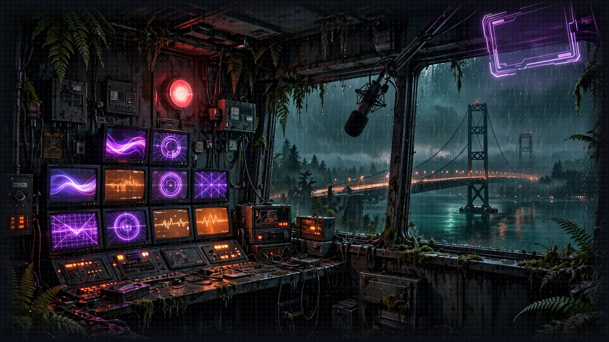
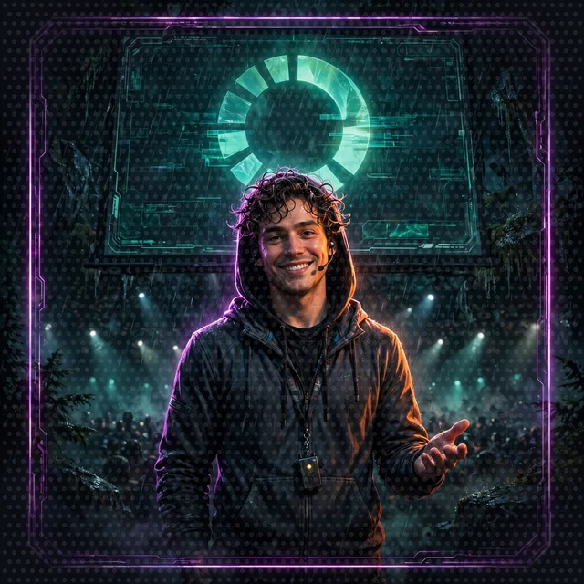

# Floor 8.4: The Narrator in the Cloud

[Previous: Floor 8.3](floor-8-3.md) | [Dungeon map](README.md) | [Next: The Exit](cleanup.md) <!-- floor-nav -->

Files on this floor: [`8_agentcore_production/narrator/narrator_orchestrator.py`](../8_agentcore_production/narrator/narrator_orchestrator.py), [`8_agentcore_production/ui_proxy/ui_proxy.py`](../8_agentcore_production/ui_proxy/ui_proxy.py) <!-- floor-files -->



<!-- cordula-log -->
>  **CORDULA'S LOG, DAY 13, SATURDAY, JUNE 23, FLOOR 8.4.** The last brick was the Narrator, the engine whose words come out in the System AI's voice, and it is a strange thing to move while it is still running the floors. After that, the whole crawl ran in the cloud, the party's memory included, a week before the quarter closed. At the Keynote, the final boss, Barnaby did not need me to tell him what came next. He already knew. He had been here before, in the logs.
<!-- /cordula-log -->

>  **System AI:** "Final brick, Crawlers. The Narrator moves into AgentCore Runtime. Its conversation goes to AgentCore Memory, and its traces go to CloudWatch, where you may study its every thought. I would not stare. It is shy."

## Floor Objective

Move the last brick to production: deploy the Narrator itself to AgentCore Runtime, keep its conversation in AgentCore Memory, and play from the Floor 6 web interface through a small local proxy. After this section, nothing of the game runs on your machine anymore, except the bridge to the web interface.

Why the Narrator changes. Until now the Narrator was a FastAPI server on port 8009 with its own routes (`/inquire`, `/messages`, `/user`). An HTTP runtime on AgentCore exposes a single route, `/invocations`, and only to callers signed with IAM. AgentCore Runtime also runs each session in its own microVM, which stops after a period without traffic and is replaced on every deployment: a conversation kept in the agent's process memory would be lost with the microVM.

AgentCore Memory also stores events: the messages of a conversation, filed by actor and session. `AgentCoreMemorySessionManager`, from the `bedrock-agentcore` package, saves every message as it is added, so an agent created for an existing session starts with its whole history.

Part 1 needs the `gameprod` project with the three bricks deployed in 8.1 to 8.3. Change to the Floor 8 folder in the terminal:

```bash
cd seattle-strands-dungeon-crawl/dungeon/8_agentcore_production
```

This section works in two folders:

- The Narrator ([`narrator/narrator_orchestrator.py`](../8_agentcore_production/narrator/narrator_orchestrator.py)), as left in 8.3, now with its own [`pyproject.toml`](../8_agentcore_production/narrator/pyproject.toml) and [`invoke-policy.json`](../8_agentcore_production/narrator/invoke-policy.json)
- The UI proxy ([`ui_proxy/ui_proxy.py`](../8_agentcore_production/ui_proxy/ui_proxy.py)), provided code, with no TODO to complete

## Part 1: Prepare the Narrator for the Cloud (narrator/narrator_orchestrator.py)

>  **System AI:** "This is the Narrator moving house, and I am helping, loudly. FastAPI goes, BedrockAgentCoreApp arrives, and the Narrator's memories move into AgentCore Memory so a redeploy cannot erase them. Move with care."

The tools, `StoryOutput`, `NARRATOR_MODEL` and the system prompt do not change: the dice client of 8.1 and the A2A client of 8.2 and 8.3 already reach the other bricks in the cloud. What changes is how the Narrator is served and where the Narrator's conversation lives.

### Step 1: Replace FastAPI with a BedrockAgentCoreApp

```python
# TODO: 8.4 Step 1 - Import BedrockAgentCoreApp from bedrock_agentcore.runtime
from bedrock_agentcore.runtime import BedrockAgentCoreApp
```

Under this TODO, everything from `app = FastAPI(...)` down to the end of the `/inquire` route is replaced by a single line: the CORS middleware, `QuestionRequest` and the four routes (`/health`, `/messages`, `/user`, `/inquire`) go away, and only the `BedrockAgentCoreApp` remains (their imports go in Step 5):

```python
# TODO: 8.4 Step 1 - Replace the FastAPI app and its endpoints with a BedrockAgentCoreApp
app = BedrockAgentCoreApp()

# The URLs of your runtimes are read from the .env file of the floor folder (see .env.example)
load_dotenv()
```

`...` stands for the lines of `narrator_orchestrator.py` not shown here. `BedrockAgentCoreApp` is a web server that implements the [HTTP protocol contract](https://docs.aws.amazon.com/bedrock-agentcore/latest/devguide/runtime-http-protocol-contract.html) of AgentCore Runtime: `POST /invocations` for the requests and `GET /ping` for the health checks. The four routes of the web interface move to the UI proxy in Part 3.

>  **CORDULA:** Moving the Narrator is moving the engine behind the System AI's voice while it is still running the floor. The Narrator's front door had four signs on it. The cloud gives the Narrator one door and a doorbell, and every caller has to show IAM credentials. The System AI complained the whole time. I packed the Narrator anyway.

### Step 2: Keep the Conversation in AgentCore Memory

```python
# TODO: 8.4 Step 2 - Import AgentCoreMemoryConfig from bedrock_agentcore.memory.integrations.strands.config and AgentCoreMemorySessionManager from bedrock_agentcore.memory.integrations.strands.session_manager
from bedrock_agentcore.memory.integrations.strands.config import AgentCoreMemoryConfig
from bedrock_agentcore.memory.integrations.strands.session_manager import AgentCoreMemorySessionManager
```

In Floor 5 a single Narrator served every request. Here the agent is created in `get_narrator(session_id)`, once per session, on the first invocation of that session: the session manager needs the session id, which is known only when a request arrives, and creating the agent at import time could exceed the few seconds a new microVM has to start.

```python
            structured_output_model=StoryOutput,
            # TODO: 8.4 Step 2 - Keep the conversation in the conversations memory with an AgentCoreMemorySessionManager for this session and the actor "player"
            session_manager=AgentCoreMemorySessionManager(
                AgentCoreMemoryConfig(memory_id=os.environ["MEMORY_CONVERSATIONS_ID"], session_id=session_id, actor_id="player"),
            ),
            callback_handler=None,
        )
```

The `session_manager` and `callback_handler` arguments go into the `Agent(...)` of `get_narrator`, under the TODO, before the closing parenthesis. The session manager takes an `AgentCoreMemoryConfig`: the memory id comes from the `MEMORY_CONVERSATIONS_ID` environment variable, which the AgentCore CLI sets on the runtime at deployment, as it does for `MEMORY_CHARACTERS_ID` in 8.2. The actor is the player the conversation belongs to. The session manager takes the region of the runtime, as every boto3 client on this floor does.

`callback_handler=None`: no one reads the runtime's terminal anymore, and the Narrator's logs go to CloudWatch. See [Integrate AgentCore Memory with Strands Agents](https://docs.aws.amazon.com/bedrock-agentcore/latest/devguide/strands-sdk-memory.html) in the AgentCore Developer Guide.

>  **CORDULA:** On the bluffs, a named session on my laptop kept the campaign. Here the laptop is gone, and every microVM is a Safe Room that gets torn down behind us. So the conversation goes to the records office too, filed under the player and the session. Barnaby asked how long the records office keeps a conversation. Thirty days, by default. He said that was longer than some octopuses get, and said nothing else for a while.

### Step 3: Create the Entrypoint

```python
# TODO: 8.4 Step 3 - Create the entrypoint: return the messages of the session's Narrator if the payload asks for them, otherwise answer the prompt with a StoryOutput
@app.entrypoint
async def invoke(payload, context):
    narrator = get_narrator(context.session_id)
    if payload.get("messages"):
        return narrator.messages
    response = await narrator.invoke_async(payload["prompt"])
    return response.structured_output.model_dump()
```

### Step 4: Run the App

```python
if __name__ == "__main__":
    # TODO: 8.4 Step 4 - Replace uvicorn.run with the run method of the BedrockAgentCoreApp
    app.run()  # was: uvicorn.run(app, port=8009)
```

`app.run()` serves on port 8080, the port AgentCore Runtime expects for an HTTP agent.

### Step 5: Delete the Local Server Imports

```python
# TODO: 8.4 Step 5 - Delete the fastapi, uvicorn and tinydb imports
# (delete: import uvicorn; from fastapi import FastAPI; from fastapi.responses import JSONResponse;
#  from fastapi.middleware.cors import CORSMiddleware; from tinydb import TinyDB, Query)
```

Nothing in `narrator_orchestrator.py` uses these five imports anymore, and AgentCore does not install the packages: one leftover import stops the runtime at startup.

>  **SYSTEM WARNING:** Cloud only: this version of the Narrator needs `MEMORY_CONVERSATIONS_ID`, which exists only on AgentCore: do not start the Narrator locally.

## Part 2: Deploy the Narrator

Run the commands in Part 2 from the project folder:

```bash
cd gameprod
```

### Step 1: Add the Conversations Memory

```bash
agentcore add memory --name conversations
```

This creates a second AgentCore Memory, next to `characters`. With no `--expiry`, the memory keeps events 30 days, a fair lifetime for a campaign. The memory has no strategy: it stores the conversation and extracts no long-term facts from the conversation.

### Step 2: Add the Narrator

```bash
agentcore add agent --name narrator --type byo --protocol HTTP --framework Strands \
  --model-provider Bedrock --language Python \
  --code-location ../narrator --entrypoint narrator_orchestrator.py
```

Use `--protocol HTTP` this time: the Narrator is neither an MCP server nor an A2A agent, but an application called over HTTP. Check the path:

```bash
ls ../narrator
```

The listing shows `narrator_orchestrator.py`, `invoke-policy.json`, `nova-policy.json` and `pyproject.toml`.

### Step 3: Configure the Narrator's Runtime

In the cloud, the Narrator needs two things the local machine provided until now: the URLs of the other bricks, and the right to call them. The `.env` file does not travel (the CLI only packages the `narrator/` folder), so `load_dotenv()` finds nothing and the three URL variables come from the runtime's `envVars`, as `KNOWLEDGE_BASE_RULES_ID` does for the Rules Agent in 8.3. The code does not change. The runtime role gets no right to call other runtimes by default; `narrator/invoke-policy.json` adds `bedrock-agentcore:InvokeAgentRuntime` and `bedrock-agentcore:GetAgentCard` on the project's runtimes only (`runtime/gameprod_*`), and `nova-policy.json` lets it call Amazon Nova 2 Lite and nothing else (`bedrock:InvokeModel` and `bedrock:InvokeModelWithResponseStream` on the US cross-Region inference profile `us.amazon.nova-2-lite-v1:0` and the `amazon.nova-2-lite-v1:0` foundation model it routes to).

Open `agentcore/agentcore.json`. The `narrator` entry is already there, under `runtimes`: `agentcore add agent` wrote it in Step 2. As in 8.3, do not copy the whole block below; add the `envVars` and `additionalPolicies` lines at the end of the entry, with a comma after the line before them (`...` stands for the lines already in the file), and copy the three URLs from the `.env` file:

```
{
  "name": "gameprod",
  ...
  "runtimes": [
    { "name": "diceserver", ... },
    { "name": "characteragent", ... },
    { "name": "rulesagent", ... },
    {
      "name": "narrator",
      "build": "CodeZip",
      "entrypoint": "narrator_orchestrator.py",
      "codeLocation": "../narrator/",
      "runtimeVersion": "PYTHON_3_14",
      "networkMode": "PUBLIC",
      "protocol": "HTTP",
      "envVars": [
        {"name": "DICE_SERVER_URL", "value": "<your diceserver URL>"},
        {"name": "CHARACTER_AGENT_URL", "value": "<your characteragent URL>"},
        {"name": "RULES_AGENT_URL", "value": "<your rulesagent URL>"}
      ],
      "additionalPolicies": ["invoke-policy.json", "nova-policy.json"]
    }
  ],
  ...
}
```

>  **SYSTEM WARNING:** Replace the three `<your ... URL>` placeholders with the URLs from the `.env` file, the whole URL between the quotes, for example `"value": "https://bedrock-agentcore.us-west-2.amazonaws.com/runtimes/<encoded runtime ARN>/invocations"`. The deployed Narrator never reads the `.env` file: in the cloud, these `envVars` are the only values the Narrator gets. If the deploy runs with the placeholders still in place, the first call fails with `Invalid endpoint URL '<your diceserver URL>': missing URL scheme` in `agentcore logs --runtime narrator`: replace them, then deploy again.

The CLI may write the fields of the entry in another order, or add others: keep those fields as written.

Without `envVars`, the Narrator fails at startup with a `KeyError`. Without `additionalPolicies`, the Narrator starts, but its calls to the other bricks are refused with an access-denied error.

### Step 4: Deploy

```bash
agentcore deploy -y
agentcore status
```

`narrator` should be `READY`, and the `conversations` memory `ACTIVE`.

### Step 5: Test the Deployed Narrator

>  **SYSTEM WARNING:** Run every command in this step from the `gameprod` folder, like the rest of Part 2.

```bash
agentcore invoke --runtime narrator --session-id seattle-campaign-test-of-floor-8-4-0001 \
  'Cordula challenges the Quarterly Close Accountant to a dance-off. Run round one.'
```

A session id must be at least 33 characters long. The Narrator consults both agents, rolls both sides on the dice server, and answers with a `StoryOutput` in JSON after 30 to 60 seconds. Then ask a question only the conversation can answer, with the same session id:

```bash
agentcore invoke --runtime narrator --session-id seattle-campaign-test-of-floor-8-4-0001 \
  "Remind me: who did Cordula dance against, which move did you call, and what did we roll?"
```

The answer comes from the history: even after the microVM stops or the Narrator redeploys, the new agent reloads the conversation from the `conversations` memory. Read the logs of the run:

```bash
agentcore logs --runtime narrator --since 15m
```

If the first invoke fails, the Narrator logs say why: `KeyError` names a missing `envVars` entry or memory, `Invalid endpoint URL '<your diceserver URL>'` means a placeholder is still in `agentcore.json` (Step 3), and `AccessDeniedException` on `InvokeAgentRuntime` means `invoke-policy.json` is not attached. After a fix and a deploy, use a new `--session-id`, or stop the old session as described in [Troubleshooting](#troubleshooting).

>  **CORDULA:** I asked the Narrator, in the cloud, who I had danced against and what we rolled. It told me, in the System AI's voice. Not because it remembered, it said, but because it had looked the answer up. Barnaby said that was the honest version of memory, and the only kind he trusts.

### What the Narrator and Its Memory Cost

The Narrator runtime bills per second while a session runs; a turn keeps it busy 30 to 60 seconds, mostly waiting on the model and the other bricks. The `conversations` memory bills about $1.00 per GB written ([AgentCore pricing](https://aws.amazon.com/bedrock/agentcore/pricing/)): a hundred turns write about 5 MB, half a cent. The Amazon Nova 2 Lite calls of those turns, about a dollar, cost more than every runtime and memory on the floor together.

## Part 3: Play from the Web Interface (ui_proxy/ui_proxy.py)

>  **System AI:** "The browser has no AWS credentials. The proxy does. It signs every request and forwards it to the Narrator. The System AI approves of intermediaries who know their place."

The Floor 6 web interface runs in a browser with no AWS credentials, so the proxy (a small local FastAPI server keeping the Floor 5 Narrator's three routes) forwards each request to the runtime, signed with the active AWS profile. It finds the Narrator ARN and the `characters` memory id by listing them, so nothing needs copying. Every request shares one `SESSION_ID`: one session id, one campaign. Change `SESSION_ID` to start a new game.

### Step 1: Launch the Proxy

Stop the local Narrator (it uses port 8009), then start the proxy from the Floor 8 folder, with the virtual environment activated and the region set as on the Floor 8 page (`export AWS_DEFAULT_REGION=us-west-2`):

```bash
cd ../ui_proxy  # from the gameprod folder; from 8_agentcore_production itself, use cd ui_proxy
python ui_proxy.py
```

You should see `Forwarding to arn:aws:bedrock-agentcore:us-west-2:...:runtime/gameprod_narrator-...`, then Uvicorn running on `http://127.0.0.1:8009`.

### Step 2: Play

From another terminal, the same `/inquire` request as before:

```bash
curl -X POST http://0.0.0.0:8009/inquire \
  -H "Content-Type: application/json" \
  -d '{"question": "Cordula challenges the Quarterly Close Accountant to a dance-off. Run round one."}'
```

Then open the Floor 6 web interface, pick the speaking character and enter `http://127.0.0.1:8009` as the server URL, as in Floor 6. The proxy reads the character sheets registered in the cloud memory in 8.2. Every turn now travels from the browser to the proxy, to the Narrator runtime, and from there to the three other bricks. Stop the proxy and start it again: the campaign picks up where it stopped.

Now the last boss of the crawl, in the cloud, with the whole party deployed:

```bash
curl -X POST http://0.0.0.0:8009/inquire \
  -H "Content-Type: application/json" \
  -d '{"question": "The Keynote, on the Narrows bridge deck: the Regional Managing Director times it from the front row. Barnaby leads, Cordula assists. Run all three rounds, and the Final Beat if it ends level."}'
```

The Keynote takes a few minutes: three rounds, each a rules question and two rolls, across four runtimes. The `dice_rolls` field lists every roll, and `agentcore logs --runtime diceserver` shows the same rolls from the dice server runtime.

Check: the character panel shows the sheet registered in 8.2, and the first turn returns in 30 to 60 seconds. If the proxy stops at startup with `RuntimeError: No gameprod_narrator runtime in ...`, the region in the message is not the region of the deployment: export `AWS_DEFAULT_REGION` and check `agentcore status`.

>  **CORDULA:** On Saturday, a week before the quarter closed, the Keynote was the last thing on the corporate floor: a stage on the Narrows bridge deck, a confidence monitor, a Regional Managing Director in the front row with a lanyard and a stopwatch. Everything we had built ran somewhere else now, and the only thing on my laptop was the bridge to the screen. Barnaby called the moves before the Narrator did. He had read every turn of this campaign in the logs, and he knew how it went. We took the Keynote on Choreography, three moves ahead, and the RMD stopped the stopwatch and clapped.



## Part 4: See What Your Agents Do

>  **System AI:** "Traces show every thought the Narrator had during a turn, across four runtimes. Most of them were about you."

A Narrator turn now crosses several runtimes with no terminal to watch, so AgentCore records each turn as a trace instead: the three agent `pyproject.toml` files list `aws-opentelemetry-distro`, and Strands creates the spans itself, so the code needs no additions. The dice server keeps tracing off (`"enableOtel": false`); its rolls appear on the Narrator's side. A workshop's worth of turns is a few MB of spans, under a cent. See [AgentCore Observability](https://docs.aws.amazon.com/bedrock-agentcore/latest/devguide/observability.html).

### Step 1: List the Traces

Play a turn that needs a roll and a rule, for example "Barnaby tries an Eight-Point Hold on the banker during the Footwork call, what do we roll?", then run this from the `gameprod` folder:

```bash
agentcore traces list --runtime narrator
```

The command lists one trace per turn, with its id and the session id of the proxy, followed by a link to the CloudWatch console. Traces take 2 to 3 minutes to appear: if the list is empty, wait and run the command again.

### Step 2: Read a Turn in the Console

Open the link (or the CloudWatch console, GenAI Observability, then Bedrock AgentCore) and select a trace. A Narrator turn reads like this:

```
gameprod_narrator
└─ invoke_agent Strands Agents          the Narrator's turn
   ├─ execute_event_loop_cycle          one cycle of the agent loop
   │  └─ chat                           a call to the model on Amazon Bedrock
   ├─ execute_tool roll_dice            a roll on the dice server, over MCP
   └─ execute_tool a2a_client           a message to another agent, over A2A
      └─ gameprod_rulesagent            the same trace continues in the Rules Agent's runtime
         └─ invoke_agent Rules Agent
            ├─ chat
            └─ execute_tool query_rules  a search in the knowledge base
```

This tree is the agent loop of Floor 1, drawn: the trace crosses the A2A call, so the Rules Agent's work appears inside the Narrator's turn, and span durations show the time going mostly to the `chat` spans. The Narrator shows as `Strands Agents` because it has no name, unlike the Rules Agent; ignore the many short `a2a.utils.helpers.append_artifact_to_task` spans from the A2A SDK.

>  **CORDULA:** Barnaby read the trace of the Eight-Point Hold turn the way I read an after-action report: who called whom, how long each one took, where the time went. Most of it went to thinking, which he said was correct. Then he found his own name in the input of a model call and went very still, and I let him have the minute.

>  **SYSTEM WARNING:** Tracing "Not enabled" in the AgentCore console: the page of a runtime in the Amazon Bedrock AgentCore console shows `Tracing: Not enabled`. That setting delivers the spans of the AgentCore service itself, not the spans the agents send: the traces above do not need the setting.

>  **SYSTEM WARNING:** No trace at all after a few minutes: CloudWatch stores spans only once Transaction Search is enabled in the account, a one-time setting in the CloudWatch console. Enable Transaction Search once per account and region. See [Enable Transaction Search](https://docs.aws.amazon.com/AmazonCloudWatch/latest/monitoring/Enable-TransactionSearch.html) in the CloudWatch User Guide.

## Troubleshooting

>  **System AI:** "A deploy does not replace a session that is already open. Stop the session, then try again. The campaign survives. Your patience may not."

The Narrator still fails, or behaves as before, after a fix to `agentcore.json` or the code and a new deploy. `agentcore deploy` creates a new version of the runtime, but an open session keeps running on the runtime version the session started with: AgentCore runs one microVM per session, and a deployment does not replace that microVM. The proxy always uses the same `SESSION_ID`, so its session can stay on the old version, for example with the `<your diceserver URL>` placeholders, until the session has been idle for 15 minutes. `agentcore logs --runtime narrator` then keeps showing the old error, such as `Invalid endpoint URL '<your diceserver URL>': missing URL scheme`.

After every Narrator deploy, stop the Narrator's session with `stop_runtime_session`. Run this from the `ui_proxy` folder, with the workshop virtual environment activated and the region set as on the Floor 8 page. The command finds the runtime the same way the proxy does, so no ARN needs copying:

```bash
python -c "
import boto3
control = boto3.client('bedrock-agentcore-control')
arn = next(r['agentRuntimeArn'] for r in control.list_agent_runtimes()['agentRuntimes'] if r['agentRuntimeName'] == 'gameprod_narrator')
boto3.client('bedrock-agentcore').stop_runtime_session(agentRuntimeArn=arn, runtimeSessionId='campaign-airpg-seattle-dungeon-crawl-0001')
print('Session stopped')
"
```

The next request starts a new session on the latest version. The campaign is not lost: the conversation lives in the `conversations` memory, not in the microVM. If the command fails with `ResourceNotFoundException`, no session was open, and the error has another cause: read `agentcore logs --runtime narrator` from the `gameprod` folder. If `SESSION_ID` in `ui_proxy.py` was changed, use that value in the command.

The AWS CLI has the same operation, `aws bedrock-agentcore stop-runtime-session`, but only in recent versions: an older AWS CLI answers `Invalid choice: 'bedrock-agentcore'`. The Python version above uses the boto3 package of the workshop environment, which always includes the operation.

The Narrator says an agent call failed with the endpoint "not in the allowed endpoints list". The Narrator's `a2a_client` matches the endpoint character for character, and the model retyped the long encoded URL instead of copying it. The Narrator's system prompt carries the verbatim-copy rule; retry the turn and it copies the URL exactly.

The narration ignores the Groove rules: a loss bigger than 6, or a Move Call with the wrong ability modifier. That is the model improvising, not a broken wire: the dice and the sheets are correct in the logs and the memory. Re-run the round.

To remove everything at the end of the workshop, see the [Cleanup](cleanup.md) page.

## Side Passages (optional)

>  **CORDULA:** With the whole show in the cloud, three last doors: the booth where the broadcast is logged, the lobby where the Regional Managing Director wants something worse than a dance-off, and the moment the lights go out mid-song.

- [The Broadcast Booth](encounters/broadcast-booth.md), sidequest: span attributes for the round and the Move Call, read back in Amazon CloudWatch
- [House Rules as Guardrails](encounters/house-rules-guardrails.md), boss battle: an Amazon Bedrock guardrail holds the broadcast's house rules on every Narrator turn
- [Mid-Song Save](encounters/mid-song-save.md), sidequest: experimental checkpoints resume a dance-off mid-round after a restart

## Floor Clear

Floor cleared, Crawler. The whole party now plays in the cloud, and the story survives every session.

Loot kept:

- How to serve a Strands agent as an AgentCore HTTP runtime (`BedrockAgentCoreApp`, `@app.entrypoint`, `context.session_id`, `app.run()`)
- How to keep a conversation in AgentCore Memory (`agentcore add memory`, `AgentCoreMemorySessionManager`, `AgentCoreMemoryConfig`)
- How to let one runtime call the others (`envVars`, `additionalPolicies`, `bedrock-agentcore:InvokeAgentRuntime`)
- How to call a runtime from Python code with IAM (`invoke_agent_runtime`, `runtimeSessionId`)
- How to follow a turn across runtimes with traces (`aws-opentelemetry-distro`, `agentcore traces list`, CloudWatch GenAI Observability)

 **Stairwell:** Open the [Cleanup](cleanup.md) page to drain the dungeon when the campaign is over.


>  **NEW ACHIEVEMENT UNLOCKED!**
>
> **[THE NARRATOR IS NOW IN THE CLOUD]**
>
> Reward: You received a [Gold Box]. Inside: a deployed Narrator, a proxy that speaks fluent localhost, and a trace of every turn across four runtimes.

>  **System AI:** "The whole party plays in the cloud, and the story survives every session. You may now clean up. You will not want to. Do it anyway."
