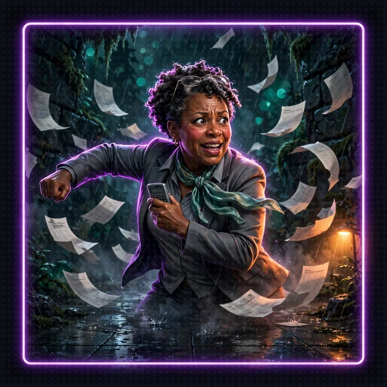
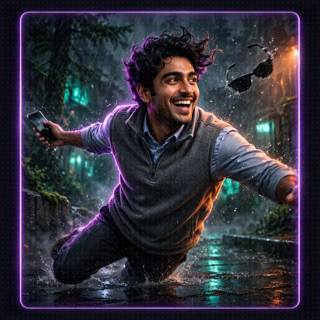
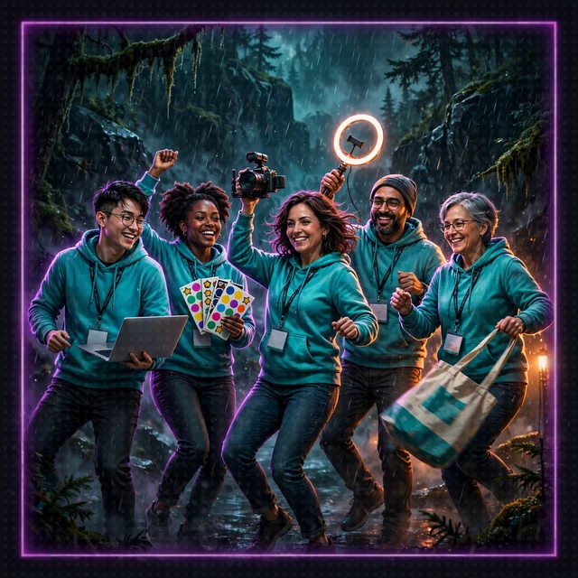
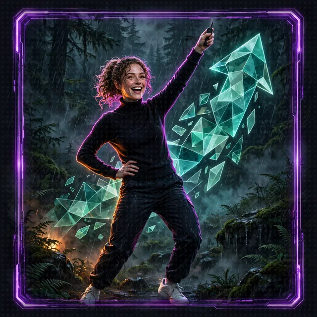
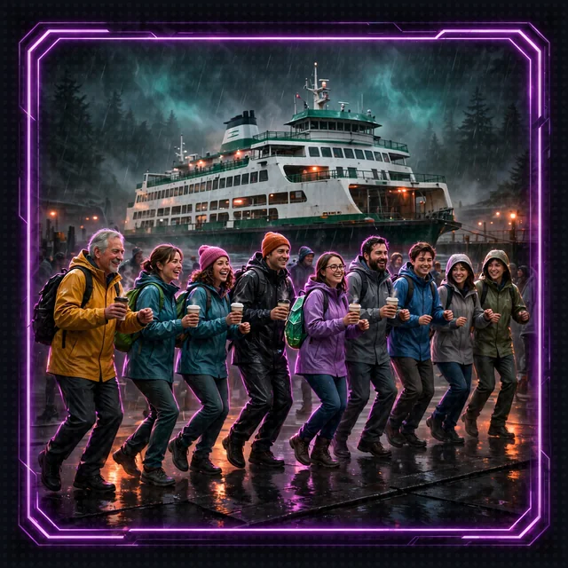
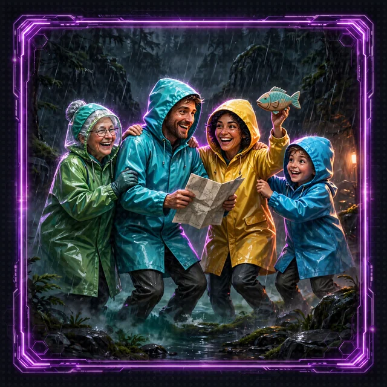
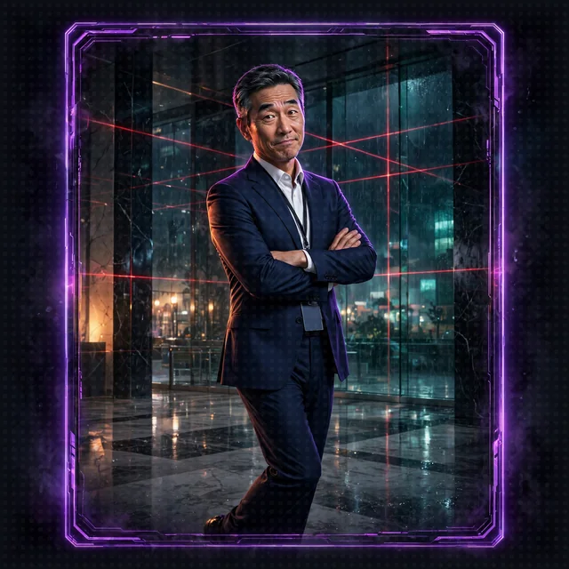
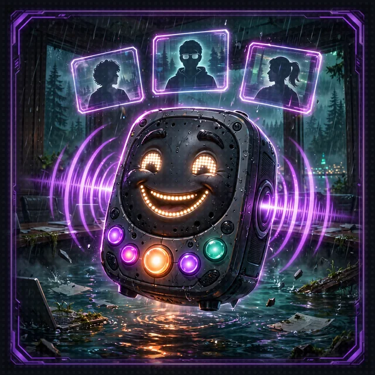
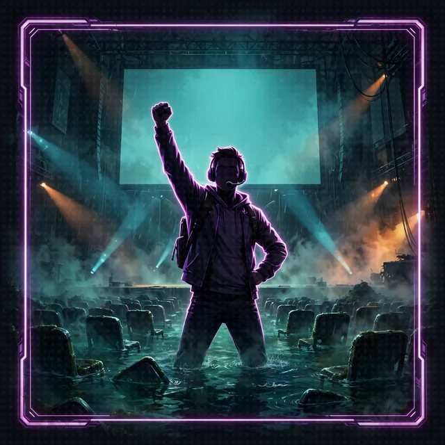

# The World: Seattle, Under the Sound

>  **System AI:** "Welcome to Seattle, Crawlers. The rain is real, the coffee is strong, and as of this morning the waterfront is a dungeon. Please keep your hands, arms and tentacles inside the floor at all times."

The crawl opens on the Seattle waterfront at 0551 on Day 1, Wednesday, June 17, when the System AI folds the ground under Pier 59 into a dungeon that runs beneath Puget Sound, under the neighborhoods and out to Tacoma and Bellevue. This page is the setting guide: the places, the living things, the opponents, and how the game treats the cultures of the region.

## Whose land this is

Seattle sits on the homelands of Coast Salish peoples, including the Duwamish, whose people are still here. The Suquamish, Muckleshoot, Tulalip, Snoqualmie and other Salish Sea nations live and govern all around the Sound. The game names the region's Indigenous traditions where each tradition matters, and credits them. The game never borrows those sacred forms for play:

- **No sacred ceremony in play.** Winter Spirit Dancing in the smokehouse is spiritual practice, private to the families and communities who hold it. Winter Spirit Dancing never appears in the game, as a mechanic or as scenery.
- **No imitation art.** Formline (Haida, Tlingit, Tsimshian, Gitxsan) and Coast Salish design (circles, crescents, trigons, purposeful negative space) are living art systems with their own protocols and their own artists. The game's gear, glyphs and loot are not drawn in those styles. To use either style, commission a Native artist and credit that artist.
- **Credit what inspired the rules.** Dance as public display of law, lineage and strength has deep roots in Northwest Coast potlatch protocol, and the competitive dance-off as a tie-breaker comes from the modern powwow circuit. Powwow culture came to Seattle with Plains and Great Basin families during the relocation era of 1952 to 1972. The crawl's dance-off borrows that one structural idea, the drum that speeds up until someone misses the final beat, and credits that source. The Crawlers dance their own styles, never Indigenous ones.
- **Learn from the source.** The Duwamish Longhouse and Cultural Center, the Daybreak Star Indian Cultural Center in Discovery Park, and the Burke Museum share Coast Salish histories in the words of the people who hold them.

## The dungeon floors

Each dungeon floor is a real Puget Sound habitat that the System AI dragged underground, lit with bioluminescence and filled with opponents.

| Dungeon floor | Biome | What grows and lives there | What the Narrator does with it |
|---|---|---|---|
| 1. Pier 59 Collapse | The Seattle Aquarium and the waterfront, folded into tide pools | Sea lettuce (*Ulva lactuca*) sheeting the logs and rocks, anemones, the aquarium's shattered tanks | The opening scramble: Cordula cuts Barnaby free from the intake screen and they walk out together |
| 2. The Eelgrass Nursery | Shallow mud and sand flats under a few feet of water | Native eelgrass (*Zostera marina*) meadows sheltering Dungeness crabs, herring eggs and young salmon | A stealth floor: dance-offs are loud, and loud wakes the crabs |
| 3. The Bull Kelp Cathedral | A towering underwater forest | Bull kelp (*Nereocystis luetkeana*) holdfasts gripping the rocks, hollow floating bulbs on stipes up to 100 feet long, sugar kelp (*Laminaria saccharina*) crinkled in the sheltered corners | A vertical floor: climb the stipes, dance on the bulbs, avoid popping a bulb |
| 4. The Ship Canal | Ballard, Fremont and Lake Union, flooded at the locks | Floating homes on cedar log floats, the Ballard brewery district, Craftsman bungalows with deep porches | Taprooms become potion shops; houseboats become platforms that sway off the beat |
| 5. The Estuary | Salt marsh where a river meets the Sound | Pickleweed (*Salicornia virginica*) whose salt-filled joints turn red in autumn, Pacific silverweed (*Argentina pacifica*) with yellow flowers and silver-backed leaves, dense meadows of Lyngby's sedge (*Carex lyngbyei*) hiding young fish | Half the floor floods with every tide: the dance floor surfaces, then drowns |
| 6. The Underground | Pioneer Square's buried storefronts and the space under the Aurora Bridge | Dripping brick, old sidewalk prisms, and the Fremont Troll, a 1990 public sculpture the System AI has opinions about | A maze of dead-end storefronts; the Troll judges every dance-off held in its shadow |
| 7. The Bluffs | Steep shoreline cliffs above the high-tide line | Pacific madrone (*Arbutus menziesii*) with twisting trunks and peeling red-orange bark, wind-bent shore pine (*Pinus contorta*), Hooker's willow (*Salix hookeriana*) at the water's edge, Nootka rose (*Rosa nutkana*) and snowberry (*Symphoricarpos albus*) holding the slopes, Puget Sound gumweed (*Grindelia integrifolia*) with sticky yellow flowers on the rocky beaches | A cliff floor: the roots hold the bluff together, and anything that tears the roots out starts a landslide |
| 8. Bellevue and the Narrows | Glass towers across Lake Washington, and the shipyards of Tacoma | Polished marble lobbies, laser-grid security, brick warehouses on Commencement Bay, the Tacoma Narrows where the giant octopus legend lives | The corporate floor: the final bosses wear lanyards |
| 9. ALMOCO, the Corrosion Cathedral (optional) | A smelter on the Tacoma shore, rebuilt at its 1970s worst | Black slag foundations, soot-caked stacks, high-gantry cranes, ultra-class haul trucks, sweet metallic fog, teal runoff | The resilience floor: the System AI learns to detect its own hallucinations |

The habitats are why the leads win. Barnaby hunts eelgrass meadows and kelp forests for a living, and Cordula has spent years of dawn debris sweeps with the Soundkeepers, paddling these shorelines by kayak.

## ALMOCO, the Corrosion Cathedral

Floor 9 is ALMOCO, the American Lead Mining & Operational Company: a fictional mid-century industrial conglomerate whose smelter stood on the Ruston shore at Point Defiance, a mile from the Narrows. The System AI rebuilt it at its 1970s worst, because, it says, the ratings were better.

The look is Techno-Gothic: a corrosion cathedral sprawled along the shoreline like a rotting iron leviathan. Black slag-concrete foundations cracked by old tremors and crusted yellow-grey with lead oxide and arsenic; walls that sweat sulfur; three soot-caked brick stacks, 500 feet tall, breathing a sweet, metallic grey fog that settles like a shroud; furnace fire flickering behind iron vents at night, so the stacks look like smoldering obelisks.

High-gantry lattice cranes stand at the water's edge like rusted praying-mantis skeletons frozen mid-strike, dripping black lubricant into the tide flats, shrieking when the wind comes up the Narrows, swinging magnet buckets of ore into the furnace hoppers without stopping. Ultra-class haul trucks over 4 meters to the bed rim rumble past: a single tire taller than Cordula, 4,000 horsepower felt half a mile off before they are seen, twin stacks that smell of burnt copper and kerosene, a 400-ton dump that lands like a thunderclap.

The fog and the runoff are game hazards. Runoff turns ditch mud a milky, glowing teal; streetlights wear halos. The lead fog is a debuff on Wisdom and on memory: in the fog the System AI misremembers and agents confabulate, and memory writes go bad. Floor 9 teaches the party to detect hallucinations, gate memory writes and refuse poisoned instructions.

Opponents are people at work, joked about for their jobs, nonlethal: the shift foreman with a quota and a clipboard, the crane operator who has not looked down since 1974, the haul truck driver on a double shift, the plant's public relations man who insists the fog is mostly steam.

**Representation note.** ALMOCO is fictional. It draws on the real history of smelting on the Tacoma shore and the [Washington State Department of Ecology's Tacoma Smelter Plume cleanup](https://ecy.wa.gov/spills-cleanup/contamination-cleanup/cleanup-sites/tacoma-smelter). The story does not tell the lead-and-violence theory and does not mention serial killers. Barnaby's home wreck lies down the Narrows from the plume, and he has opinions about it.

## The cities

| City | What it is in the crawl |
|---|---|
| Seattle | The maritime core: the waterfront, the ferries, the Ballard brewery district, Lake Union's floating homes, the Space Needle visible through every breach in the ceiling |
| Tacoma | Grit City on Commencement Bay: shipyards, brick warehouses, and the Tacoma Narrows, home of the giant octopus legend Barnaby refuses to confirm or deny |
| Bellevue | Across the floating bridges: glass towers, corporate plazas, marble floors, laser traps, and the opponents with the best health insurance |

Architecture follows the region. Northwest Regional buildings bring heavy glulam Douglas fir beams, red cedar siding, basalt foundations and floor-to-ceiling glass for the grey winter light. Safe Rooms are built in the Northwest Regional style: a fire, cedar walls, and rain on big windows.

## The opponents

The dungeon does not throw monsters at the Crawlers. It throws professionals. Every opponent wants to win a dance-off, and none of them wants to hurt anyone; they want to be right, on time and billable.

| Opponent | Where | How they dance | Weakness |
|---|---|---|---|
| Quarterly Close Accountant | Floor 1 and up | Precise, slow, perfectly on the count, accrual basis | Improvisation: they cannot dance to a beat they did not reconcile |
| Bonus-Season Investment Banker | Bellevue | Leverages every move, borrows the Crawler's own choreography | Overextension: they bet the whole round on the big finish |
| Developer Advocate Swarm | Ship Canal and up | Enthusiastic, always mid-demo, never stops offering a free tier | Live demos: the move works perfectly until someone is watching |
| Pitch-Deck Founder | The Underground | Every move is a pivot | Questions: ask about the business model and the Founder freezes |
| Ferry-Line Commuter Horde | The waterfront | Shuffling, patient, unstoppable in a crowd | Schedules: the horde leaves the floor the moment the boat docks |
| Rain-Shell Tourist Pod | Pier 59 | Synchronized pointing, umbrella choreography | Locals: one "it's not even raining" breaks their rhythm |

The bosses: the Regional Managing Director of Bellevue, the Quarterly Earnings Call (a boss that is a meeting), and the Keynote, which dances for forty-five minutes and never takes questions.

One boss is not a person at work. Monty, a reticulated python someone released into the Underground, guards the Floor 0 stairwell. Reticulated pythons are the longest snakes in the world, and Monty's geometric camouflage makes him look like whichever Python comes first on the PATH. Nobody fights him: the party beats him by knowing which Python the Crawlers are running, and the Narrator rules that he goes to a licensed reptile rescue. Barnaby, a constrictor himself, keeps his distance.

<table>
<tr>
<td></td>
<td></td>
<td></td>
</tr>
<tr>
<td></td>
<td></td>
<td></td>
</tr>
<tr>
<td></td>
<td></td>
<td></td>
</tr>
</table>

## Local flavor

- **The Ballard brewery district.** Fresh-hop season, maritime-industrial taprooms, and potions brewed on the premises. Loot uses invented brews, never real breweries' names: *Ballard Fresh-Hop Haze* (+20% Mana regeneration; anyone who sips it mid-round sways off the beat), *Ship Canal Lager* (cures Soggy), *Locks Porter* (heavy, slow, +2 Constitution for one floor).
- **Ferries.** Ferry Tokens are the crawl's currency. Every Seattle native already knows a pocket of Ferry Tokens never lasts.
- **The rain.** Wet terrain is the default. Cordula and Barnaby move better on it than anyone the System AI has ever broadcast.

## Sources

The flora and fauna come from Puget Sound shoreline field notes shared by the project; the cultural history comes from the project's own research notes on Coast Salish and Northwest Coast dance traditions and the arrival of powwow culture in urban Seattle. Verify each published claim against the institutions named in Whose land this is.
