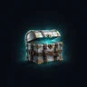
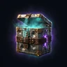
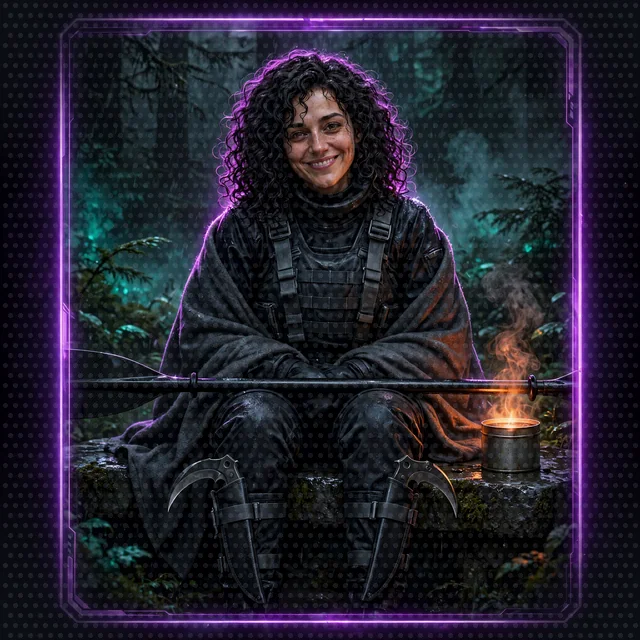

# The System: Designing a LitRPG While You Build Its AI

>  **System AI:** "You are not only building agents, Crawler. You are building me, the mind that runs this migration and judges you. Every floor of this workshop adds one more piece of me. Please build it carefully. I will remember."

A LitRPG lives or dies on its System: the rules that turn a story into numbers, and the voice that announces them. This crawl has one AI that runs and narrates the game. The System is the game itself: rules, stats, notifications, the HUD, the battle log, loot tables, the Crawl Handbook. The System AI is the AI character that runs the crawl and narrates it. The Narrator is the System AI's job and the name the code uses.

| Name | What it means |
|---|---|
| the System | the game: rules, stats, notifications, the HUD, the battle log, loot tables, the Crawl Handbook |
| the System AI | the one AI character: runs the crawl and narrates it |
| the Narrator | the System AI's job; the code name (narrator_orchestrator.py, narrator_harness.py, the Narrator API) |

This crawl teaches the Strands Agents SDK and LitRPG System design together. Each workshop floor builds one agent capability and one layer of the game. The rules themselves live in the [Crawl Handbook](crawl-handbook/), which is also the knowledge base the Rules Agent searches on Floor 5.

## What each floor adds to the System

| Workshop floor | Strands concept | System layer built |
|---|---|---|
| [0](../floor-0.md) | Environment setup | The premise: the Narrator, the System AI and why both need the party |
| [1](../floor-1.md) | An agent and its system prompt | The Narrator's voice, spoken through the System AI: how notifications sound |
| [2](../floor-2.md) | Vended tools | Outside knowledge: the System looks things up instead of guessing |
| [3](../floor-3.md) | A custom tool and its docstring | Hard math: ability scores, modifiers, dice |
| [4](../floor-4.md) | An MCP server | One fair source of randomness, shared by every agent |
| [5](../floor-5.md) | A2A agents, a knowledge base, structured output | The rules, the character sheet and the dance-off loop |
| [6](../floor-6.md) | A web interface | The HUD |
| [7](../floor-7.md) | Strands harness sessions and memory | Persistence and consequence |
| [8](../floor-8.md) | AgentCore Runtime, Memory and a managed knowledge base | A persistent world: the characters, the rules and the campaign outlive any one session |
| 9 (optional, coming soon) | Resilience: hallucination detection, memory write gates, poisoned instruction refusal | The System AI stops believing everything it thinks |

## 1. Origin and interface

```
+-----------------------------------------------------------------------------------+
|                              LITRPG SYSTEM BACKBONE                               |
|                                                                                   |
|  THE INTERFACE                 STAT DESIGN                  SYSTEM ORIGIN         |
|  Notification boxes            Primary: STR DEX CON         One AI:              |
|  A floating HUD                         INT WIS CHA          the System AI       |
|  The battle log                Derived: Groove, Mana         runs the crawl      |
|                                Hidden: Hype, Luck           and narrates it     |
+-----------------------------------------------------------------------------------+
```

- **Origin.** *Dungeon Crawl: Seattle* is a live cloud-migration test and compliance audit for a Consortium review board, run by one AI: the System AI, which built the floors, drops the opponents, calls Move Calls, rolls dice, rules, remembers, announces notifications, writes loot descriptions, reads sponsor messages, and chases its quarterly throughput SLA.

- **Why the party matters.** The System AI folded the Seattle waterfront into a dungeon at 0551 on Day 1, and the Sound came in and broke it. Its voice, its dice, its rules and its memory washed out across the floors. The broadcast relay and the collars survived, so it can still push canned status reports, but it cannot answer anyone, roll a fair die, quote a rule or remember who did what. It drafted the first Crawlers it found to rebuild itself, one piece per floor. The full sheet is in [The Cast](cast.md#the-system-ai), and the days are in [The Timeline](timeline.md).
- **One voice for the player.** The player hears one voice: the System AI, a petty theatrical audit lead, exact about numbers. The System AI never lies about a number; it chooses which numbers to show.
- **Two registers, one directive.** The directive never changes: complete the quarter, hold the review board, no dead air. The register changes with the room. To Crawlers and stakeholders it performs (notifications, loot reveals, stakeholder escalations). To sponsors, and on the corporate floors near quarter close, it files: incidents, findings, segments at risk, throughput by floor, each phrased with the flat courtesy of an audit report that has already decided. The filing voice is seasoning, never a second job: this is a migration test that files meticulous reports, not an audit that occasionally performs. Neither register threatens harm. The worst sentence it can pass is Benched, then Cancelled, and it passes both in the same level tone it uses for good news.
- **Notifications.** Every System message arrives as a typed notification: `NEW ACHIEVEMENT UNLOCKED`, `SYSTEM WARNING`, `SPONSOR MESSAGE`, Move Calls and Final Beats. In the code, a notification is the `response` field of `StoryOutput`.
- **The HUD.** Floating panels for the character sheet, the dice and the suggested actions. In the code, the HUD is the Floor 6 web interface rendering `StoryOutput`.
- **The battle log.** Every die rolled, with its reason. In the code, the battle log is `dice_rolls`, and every entry must come from a real `roll_dice` call. This is what a roll looks like:

<picture><source srcset="../../../art/images/motion/d20-roll-still.webp" media="(prefers-reduced-motion: reduce)"></picture>

<table>
  <tr>
    <td align="center"></td>
    <td align="center"></td>
    <td align="center"></td>
    <td align="center"></td>
    <td align="center"></td>
  </tr>
</table>
- **Tone is a design decision.** An analytic System AI makes a survival story; a hostile one makes a horror story. This crawl's System AI is a migration lead with too much power and a sense of humor, so the system prompt on Floor 1 matters as much as any rule.

## 2. Stat design

- **Primary stats.** The six classic ability scores, rolled 4d6 drop lowest. Each ability score maps to a kind of dance move, so every stat matters in the core conflict:

| Ability | Dance-off Move Call | Also used for |
|---|---|---|
| Strength | Power | Lifting, carrying, holding a door |
| Dexterity | Footwork, and the Final Beat | Stealth, balance, throwing Chonks |
| Constitution | Endurance | Groove, staying on the floor |
| Intelligence | Choreography | Locks, puzzles, reading the System's fine print |
| Wisdom | Read the Room | Noticing hidden opponents and traps |
| Charisma | Presence | Sponsors, crowds, talking an opponent out of a dance-off |

<table>
  <tr>
    <td align="center"></td>
    <td align="center"></td>
    <td align="center"></td>
    <td align="center"></td>
    <td align="center"></td>
    <td align="center"></td>
  </tr>
</table>

- **Derived stats.** Computed from the primary stats by the Character Agent, never chosen: **Groove** (how long a Crawler stays on the dance floor) and **Mana** (how many abilities you can use before a Safe Room).
- **Hidden stats.** Tracked by the Narrator and shown only when the System AI feels like it: **Hype** (executive visibility, which unlocks sponsor boxes) and **Luck**.

## 3. Sub-genre and premise

| Sub-genre | Core dynamic | Examples readers will know | In this crawl |
|---|---|---|---|
| System Apocalypse | Earth is folded into a cosmic game overnight | *Dungeon Crawler Carl*, *Defiance of the Fall*, *Primal Hunter* | Yes: the waterfront collapses on day one |
| Tower or dungeon climber | Progress is clearing floors | *Towers of Heaven* | Yes: eight dungeon floors under the Sound |
| Isekai or portal fantasy | Someone is pulled into another world | *He Who Fights With Monsters* | No: Seattle comes with the Crawlers |
| VRMMO or game world | Players log into a game with real stakes | *Awaken Online*, *The Legendary Mechanic* | No |
| Base building | Settlements, resources, governance | *Life in the North* | Light: Safe Rooms and the Ship Canal floor |
| Rebirth or time loop | Restart the apocalypse with future knowledge | *Mother of Learning* | No |

## 4. Builds and progression

```
                             CHARACTER BUILD TRAJECTORY
                                         |
     +------------------+----------------+-----------------+------------------+
     |                  |                                  |                  |
CLASS SELECTION    ABILITY EVOLUTION                SPECIALIZATION       STAT SYNERGY
(common to         (fusing low-tier skills)         (titles, feats)      (combos, exploits)
 legendary)
```

- **Classes.** Twelve Seattle classes at Level 1, each with a favorite Move Call. Classes branch into hybrid classes later (Amphibious Breacher into Tidewall Breacher; Benthic Dragoon into Abyssal Choreographer). See the handbook's classes section.
- **Skill fusion.** Two Level 3 skills from the same party fuse at a Safe Room forge: Barnaby's Ink Cloud and Shelly's Saltwater Jet fuse into *Inkjet*.
- **Titles and feats.** Passive bonuses for ridiculous accomplishments, announced by the System. Cordula starts with *Salish Sea Guardian*.
- **Synergy and exploits.** The party's real power is combos: Chonks latches, Barnaby holds, Cordula hits the Final Beat. Barnaby fights and dances beside Cordula, taking Choreography and Presence calls while she takes Power, Footwork and the Final Beat. The System AI respects an exploit it did not see coming, and pays out a loot box for the exploit.

## 5. World-building and economy

- **Currency.** Ferry Tokens. Crawlers spend them at Safe Room shops on potions and repairs.
- **Loot boxes.** Bronze, Silver, Gold and Desperation. Achievements and sponsors drop loot boxes; the System writes the descriptions, and the descriptions are always a little insulting.
- **NPCs are people.** Every opponent is a person the System AI dropped into the dungeon, doing the job they had that morning. Opponents are judged, out-danced and occasionally befriended, never killed.
- **Factions and sponsors.** The Benthic Collective, a Ballard fishing-and-kombucha cooperative that adores Barnaby; the Hydros-9 Aquatic Collective, a venture-funded South Lake Union water-tech startup on its ninth pivot, which also adores Barnaby; the Bellevue Consortium, famous for the Doors '94 operating system, which sponsors the opponents and hates surprises; Cadabra, Inc., the crawl's fulfillment contractor, whose delivery drones drop every loot box and whose weaponized obstacles wait on deeper floors.

| Sponsor | What they do |
|---|---|
| Benthic Collective | a Ballard fishing-and-kombucha cooperative; adores Barnaby |
| Hydros-9 Aquatic Collective | a venture-funded South Lake Union water-tech startup on its ninth pivot; adores Barnaby |
| Bellevue Consortium | sponsors opponents; famous for Doors '94 OS; wants the party gone before the quarter closes |
| Cadabra, Inc. | fulfillment contractor; delivery drones drop loot boxes; rents the dungeon weaponized obstacles |

Cadabra published Strands as an open toolkit, and the System AI is built from Strands agents. That is how a woman with a boat can rebuild a migration-test AI.

| Cadabra and Strands | In the real world | In the crawl |
|---|---|---|
| Strands Agents SDK | AWS built it and open-sourced it under Apache 2.0 in May 2025; 1.0 in July 2025 | Cadabra published Strands as an open toolkit |
| The System AI | built from Strands agents | built from Strands agents; the manual is public |

Cadabra's obstacles are encounters on Floors 4 to 8. Each obstacle benches Crawlers; none kills. The obstacle is a machine, and the people who run it are people at work, joked about for their jobs.

| Cadabra's obstacles | What the party faces | Strands feature that beats it |
|---|---|---|
| [Delivery Drone Horde](../encounters/delivery-drone-horde.md), Floor 5 | thousands of coordinated drones | steering (directed agent behavior) |
| [Static Fire on the Pad](../encounters/static-fire.md), Floor 7 | a 45-metric-ton rocket test | plugins and skills (composed capabilities) |
| [Pad Explosion Aftermath](../encounters/pad-explosion-aftermath.md), Floor 8 | shockwave, debris, fire suppression | evals (measure and adapt) |
| [Warehouse Automation Grid](../encounters/warehouse-automation-grid.md), Floor 4 | conveyors, sorters, robotic arms | MCP tool filtering (selective tool access) |
| [Launch Commit Criteria](../encounters/launch-commit-criteria.md), Floor 6 | abort-or-proceed decision loop | rate-limiter hooks (controlled pacing) |
| [Range Safety Officer Protocol](../encounters/range-safety-officer.md), Floor 8 | termination authority override | approval interrupts (human-in-the-loop) |


<table>
  <tr>
    <td align="center"></td>
    <td align="center"></td>
    <td align="center"></td>
    <td align="center"></td>
    <td align="center"></td>
    <td align="center"></td>
  </tr>
</table>

## 6. Conflict: dance-offs and stealth, never killing

The crawl replaces combat with the dance-off: three rounds of Move Calls rolled with real dice, and a Final Beat tie-breaker where the drum speeds up until someone misses the last strike. When the party would rather not dance, Barnaby's stealth and the party's wits let the party slip past. The full procedure is in the handbook.


Why dance? Because dance gives every stat a job, dance is funnier than violence, and dance keeps the game welcoming. The structure is credited where the idea came from: dance as public display of law and strength runs deep in Northwest Coast protocol, and the speeding-drum tie-breaker comes from the modern powwow circuit. See [the setting's notes on representation](seattle.md#whose-land-this-is).

The party itself teaches the concurrency lesson before any code does. Barnaby is built parallel: four stations at once, one pair of arms each, which is why the handbook lets him assist and dance in the same round. Cordula is built serial: one checklist, in order, every change committed. Every parallel system in the crawl is those two bodies at work: concurrent tool calls and A2A fan-out are Barnaby work, fast because the jobs are independent; the battle log, the registry file and the Final Beat are Cordula work, ordered because the record is the result. When a learner asks whether calls may run side by side, the System asks the only question that matters: do the arms share anything?

## Safe Room Reading: how Crawlers learn

The party learns its skills the way a real developer does: read the docs, watch an explainer, read a working sample, then type it yourself. Every Safe Room has a terminal on the broadcast relay: the System AI's public library. Cadabra published Strands as an open toolkit, so the Strands manual is there, and so is the open web's teaching: Morgan Willis's course videos "Building AI agent harnesses with Strands Agents", Elizabeth Fuentes's GitHub samples, the Strands docs and the Model Context Protocol docs.

Each floor gets one SAFE ROOM READING block: a link to the real resource, one short attributed quote or code sample, and Cordula's log line on what she took from it and how she found it. Barnaby sometimes reads over her shoulder.

## 7. Consequence: benched, not dead

The result at zero Groove decides the stakes. This crawl is nonlethal by design:

- **Benched.** At 0 Groove a Crawler leaves the dance floor, wakes in the last Safe Room with 1 Groove, loses that fight's loot box and half their Hype.


- **Cancelled.** Benched three times on the same floor, a Crawler's segment is cancelled for the rest of that floor: the Crawler rides the elevator down to the next floor with no loot.
- **The stakes stay real.** Loot, Hype and sponsors are what keep a party alive deeper down, and losing loot, Hype or sponsors hurts. The System shows the review board every loss.
