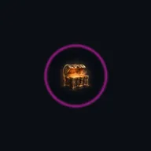

# Workshop copy-paste snippets

Speaker icons in front of a bold name carry `alt=""`, so a screen reader says the name once. The System AI is the only AI speaker; there is no Narrator label.

Conventions match the floor-5.md template: `floor-nav`, `floor-files`,
`cordula-log` markers. Paths are relative to `workshop/`.

## Voices: who is talking, in type

GitHub strips `style=` and color, so voices differ by tag and shape, never by
color. No meaning lives in color alone, and no stock emoji ever stands in for
art: every story image is bespoke, used once at its beat. Flair-class art
(dividers, textures, HUD chrome, the 28px speaker glyphs) may repeat.

| Voice | Markdown form | Reads as |
|---|---|---|
| Cordula | upright prose, the log baseline | the human center everything is measured against |
| Barnaby | *italic collar speech* | an academic aside, parallel hands, serial voice |
| System AI, performing | CAPS headers, `<kbd>` prompts | the status-report interface, live to the review board |
| System AI, filing | tables, `<samp>` findings | the flat audit register near quarter close |
| Lady Luck | `` `13 + 1 = 14` `` code totals | the croupier readout, exact and final |
| Shelly | `<small>` mist, a few words | barely present, anchor holding |
| Chonks | `***POP***` minor SFX | one gurgle, one comic beat |
| Stats | `<var>Groove</var>`, `<samp>` rolls | crisp LitRPG data, never prose |

Major SFX (Monty WHAM, the Final Beat) are bespoke SVG or WebP lettering from
the art team, requested in `docs/art-placements.md`, never a font the repo
does not own. Minor SFX stay in `***bold italics***`. SVG loaded as ``
cannot fetch webfonts, so lettering is drawn paths or generic families, and
the alt text always carries the words.

## System-AI quote

```markdown
>  **System AI:** "Your taunt here. The review board is watching."
```

Variants: swap the icon for `warning-96x96.webp` (**SYSTEM WARNING:**),
`item-96x96.webp` (**ITEM ACQUIRED:**), `achievement-96x96.webp`
(**NEW ACHIEVEMENT UNLOCKED!**), `sponsor-96x96.webp`, `floor-boss-96x96.webp`,
`stairwell-96x96.webp`. All seven icons exist in `images/icons/`.


## Cordula log

```markdown
<!-- cordula-log -->
>  **CORDULA'S LOG, DAY N, WEEKDAY, MONTH D, FLOOR N.** One paragraph: where the party is, what broke, what the floor builds. Placeholder sentence about what the party does next.
<!-- /cordula-log -->
```

Days and dates come from `workshop/world/timeline.md`.

## Dungeon-map details checklist

Paste under the plate image when a floor references a shared location plate:

```markdown

```

- Eelgrass nursery (Floor 2): ``
- Kelp cathedral bulbs (Floor 3): ``
- Estuary dance floor (Floor 5): ``
- Estuary flooded (Floor 5): ``
- Underground troll (Floor 6): ``
- Safe Room (Floor 7): ``
- Bluffs cliff (Floor 7): ``
- Bellevue lobby (Floor 8): ``
- The Exit (cleanup): ``

## Expected-output details block

```markdown
<details>
<summary>Show me the code for Step N</summary>

```python
# TODO: Step N - ...
result = "your answer here"
```

</details>
```

## Achievement toast

```markdown
>  **NEW ACHIEVEMENT UNLOCKED!**
>
> **[TITLE IN CAPS]**
>
> Reward: a [Bronze Box]. Inside: one sentence describing the loot.
```

## HUD image embed pattern

The HUD art lives in `assets/hud/` as script-free SMIL SVGs: `d20`, `final-beat-drum`, `groove-bar`, `hype-tick`, `mana-pips`, `tide-clock`, and the move icons `move-power`, `move-footwork`, `move-endurance`, `move-choreography`, `move-readroom`, `move-presence`.

```markdown

```

Move icons use `width="48"`. The SVGs honor `prefers-reduced-motion`.

## Animated payoff (honors reduced motion)

Clips live in `images/motion/`, each with a `-still.webp` rest frame. GitHub honors the `media` query, so a reader who asked for less motion sees the still:

```markdown
<picture><source srcset="../images/motion/loot-gold-loot-pop-still.webp" media="(prefers-reduced-motion: reduce)"></picture>
```

Where each clip and render belongs, with ready-to-paste lines and S3 keys: `docs/art-placements.md`.

## Boss layout (image beside the brief, never below it)

Copy-paste form of the Visual Lit alignment rules in
`docs/visual-design-system.md` section 9. Worked example: Monty in
`workshop/floor-0.md` Step 4. Swap the card, alt text, boss name and check
paragraph; keep the card at `width="320"`, one image for the beat, and the
commands full width under the table.

```markdown
<table>
<tr>
<td valign="top" width="50%"></td>
<td valign="top" width="50%">

>  **FLOOR BOSS: NAME, THE TITLE.** One paragraph: who blocks the way, what the confusion is, and how the Crawler wins. Nobody gets hurt: say what winning looks like.

One short paragraph with the check the picture teaches: what to run, install or confirm. End by pointing at the commands right under this card.

</td>
</tr>
</table>
```

Then the code block, the plain-language result, the roadblock table and the
achievement toast, in that order, full width. No second copy of the boss card
on the same screen. No character in the art, caption or alt text before the
floor where the party meets them (Shelly: Floor 2, Chonks: Floor 3).

## Art rules

- one AI look only: the System AI. No Narrator icon, label or style
- no real company, logo or trademark in any art; sponsors are local tropes (`docs/visual-design-system.md` section 7a)
- no images inside the crawl handbook: `workshop/world/crawl-handbook/` is the Rules Agent's knowledge base, so it stays text
- no Shelly art before her Floor 2 welcome, no Chonks art before his Floor 3 welcome
- new art comes from a plan in `images/plans/` rendered with `tools/airpg_render.py`, never a hand-written request
