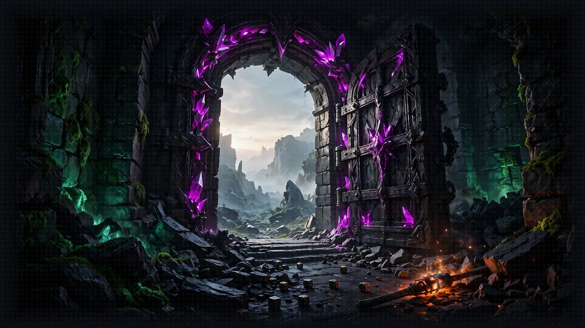

# The Exit: Final Cleanup

[Previous: Floor 8.4](floor-8-4.md) | [Dungeon map](README.md) <!-- floor-nav -->



<!-- cordula-log -->
>  **CORDULA'S LOG, THE EXIT.** We came up on the beach at Alki at dawn, the skyline across the bay and the rain finally easing off. I packed out everything we brought in, the way you do on any patrol: every deployment, every log, every file. Then I set the dry bag down at the waterline and opened it. The Sound was right there. Barnaby looked at the water for a long time. Then he looked at me.
<!-- /cordula-log -->

>  **System AI:** "The crawl is over. Stop the servers, tear down the stack, delete the bucket and the log groups. Anything you forget keeps billing you, and I do not forgive invoices."

## Floor Objective

Leave no trace behind: stop the local services, remove the AWS resources of Floor 8 and tidy up the files the workshop generated.

Good news first: Floors 0 to 7 create no AWS resource. Everything runs on your machine and only calls Amazon Bedrock models, which are billed per call and cost nothing once you stop. Floor 8 is different: it deploys the game to your AWS account, and its resources stay there until you remove them. This page is the last stop: whatever floors you completed, everything to stop or delete is listed here.

## Amazon Bedrock

The workshop calls Amazon Bedrock models, so there is nothing to delete on the Bedrock side. Keep in mind:

- Model usage: charges are based on usage (input and output tokens). Nothing accrues once you stop calling the models.
- Model access: the access you enabled stays active but costs nothing unless used.

## Local services

Stop every server still running, with Ctrl+C in its terminal: the dice MCP server, the Rules Agent, the Character Agent, the Narrator orchestrator (Floor 5, 7 or 8), and the UI proxy of 8.4.

## Floor 8: AgentCore Resources

>  **System AI:** "The AgentCore CLI has no destroy command. You empty the project, then deploy the emptiness. The System finds this poetic."

Skip this section if you did not do Floor 8. Otherwise, run the commands from the project folder, with the same credentials and region as during Floor 8:

```bash
cd aiRPG-seattle-dungeon-crawl/8_agentcore_production/gameprod
export AWS_DEFAULT_REGION=us-west-2
```

### Step 1: Empty the Project

```bash
agentcore remove all -y
```

The AgentCore CLI has no destroy command: you remove the resources from the project, then deploy the empty project. This first command only resets `agentcore/agentcore.json`; your code is not modified and nothing is deleted in AWS yet.

### Step 2: Deploy the Empty Project

>  **SYSTEM WARNING:** Run this command from the root of the `gameprod` folder, like the previous one. The CLI looks for `agentcore/agentcore.json` in the current folder and its parents: from `8_agentcore_production` or a brick folder, it stops with `No agentcore project found`, and nothing is deleted.

```bash
agentcore deploy -y
```

For an empty project, the CLI deletes the `AgentCore-gameprod-default` stack: the deployment ends with `Tear down stack`. This removes everything the project declared:

- the four runtimes (`diceserver`, `characteragent`, `rulesagent`, `narrator`) and their IAM roles
- the two memories, with their content: the characters of 8.2 and the conversations of 8.4
- the rules knowledge base and its data source

Check that the stack is gone:

```bash
aws cloudformation describe-stacks --stack-name AgentCore-gameprod-default
```

The answer should be `Stack with id AgentCore-gameprod-default does not exist`.

### Step 3: Delete the Rules Bucket

You created the S3 bucket by hand on the Floor 8 page, so the stack does not delete it. Remove it with the handbook files it holds:

```bash
aws s3 rb s3://gameprod-rules-$(aws sts get-caller-identity --query Account --output text) --force
```

### Step 4: Delete the Runtime Logs

>  **System AI:** "These log groups never expire. They will outlive you. Delete them."

AgentCore Runtime writes the logs of each runtime in a CloudWatch log group that outlives the runtime and never expires. Delete those of the project:

```bash
for group in $(aws logs describe-log-groups \
    --log-group-name-prefix /aws/bedrock-agentcore/runtimes/gameprod_ \
    --query 'logGroups[].logGroupName' --output text); do
  aws logs delete-log-group --log-group-name "$group"
done
```

Once the stack is gone, you can also delete the `gameprod/` folder.

The CDK bootstrap stack: on the first deployment, the CLI prepared the region for CDK if it was not already, with a stack named `CDKToolkit` and its S3 bucket. Every CDK application of the account and region shares it, and it costs next to nothing: delete it only if you know nothing else uses it.

## Local files

>  **System AI:** "Delete the knowledge base and .agent/, and send characters.json back to the way it shipped. The party will re-register. The party always comes back."

Everything below is generated during the workshop and gitignored, delete it freely:

- `5_a2a_integration/utils/rules_knowledge_base/`: the ChromaDB knowledge base built from the Crawl Handbook
- `7_strands_harness/.agent/`: the Strands harness sessions and memory
- `.venv/` at the repository root, if you no longer need the environment

[`5_a2a_integration/agents/character_agent/characters.json`](../5_a2a_integration/agents/character_agent/characters.json) ships with the repository, empty. Restore it to clear the party's Floor 5 registration:

```bash
git checkout -- 5_a2a_integration/agents/character_agent/characters.json
```

## Floor Clear

Floor cleared, Crawler. You've journeyed through the entire Strands workshop, from creating your first agent to orchestrating a complete multi-agent system with a web interface.

Loot you're keeping:

- Creating AI agents and equipping them with vended and custom tools
- Connecting agents to external services with MCP
- Orchestrating multiple specialized agents with A2A
- Testing your complete system through a web interface
- Rebuilding the same Narrator in a few lines with Strands harness
- Deploying the whole party to Amazon Bedrock AgentCore, with the characters, the rules and the conversation in managed services
- Designing a LitRPG System layer by layer: voice, outside knowledge, math, fair dice, rules, the dance-off loop, the HUD, consequence and a persistent world

Now go build your own crawl: you've learned the fundamentals. Fork the [world guide](world/README.md), move the dungeon to your own city, and let its people and its plants set the rules.


>  **NEW ACHIEVEMENT UNLOCKED!**
>
> **[LEFT THE STOVE ON]**
>
> Reward: You received a [Desperation Box]. Inside: an empty gameprod project and a CloudFormation stack that no longer exists. Check anyway.

>  **System AI:** "You survived the crawl. The audience is leaving. Go build something of your own."
