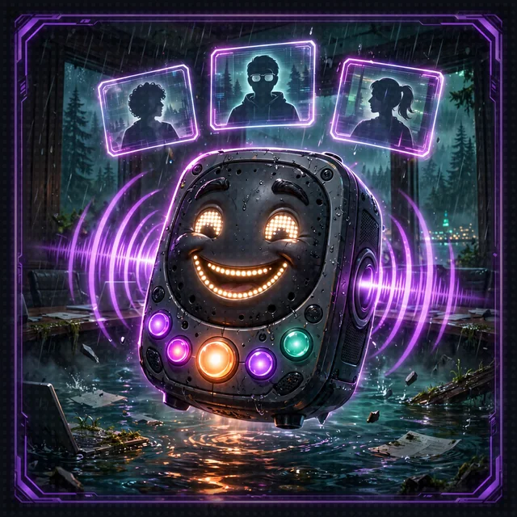

# Side Passage: The Quarterly Earnings Call (Floor 8 Boss Battle)

[Back to Floor 8](../floor-8.md) | [All encounters](README.md) | [Dungeon map](../README.md) <!-- floor-nav -->

Files on this side passage: [`encounters/floor-8-quarterly-earnings-call/quarterly_earnings_call.py`](../../encounters/floor-8-quarterly-earnings-call/quarterly_earnings_call.py), [`encounters/dance_floor.py`](../../encounters/dance_floor.py) <!-- floor-files -->

<!-- cordula-log -->
>  **CORDULA'S LOG, SIDE PASSAGE OFF FLOOR 8.** Bellevue has conference rooms the way the estuary has tide pools. In a glass one over Bellevue Way, the accountant from the estuary was waiting for us. Not alone. They had a conference line open on the table, and two more people dialed in: an investment banker in a quarter-zip, and a Regional Managing Director who introduced themselves by title only. Every quarter has an agenda, and this one had three items, in order, and we were all three of them. Review, spin, sign-off. Nobody skips ahead on a call like that. Barnaby adjusted the collar like a tie. "Sergeant, we take every item, or we do not leave the meeting."
<!-- /cordula-log -->

>  **System AI:** "Boss battle: the Quarterly Earnings Call. Three executives, one agenda, no skipping. Win a call and the next executive unmutes. Lose one and the call is over, and the minutes will reflect it."



## The Brief

| | |
|---|---|
| type | boss battle |
| starts from | [Floor 5](../floor-5.md), finished: the graph runs on your machine, so no AgentCore deployment is needed, and the file brings its own dice, so no server needs to be running |
| you build | a graph of three opponent agents with fixed edges: the accountant reviews, the banker spins, the Regional Managing Director signs off, and each edge only opens if the party took the round before it |
| teaches | [`strands.multiagent.graph`](https://strandsagents.com/docs/api/python/strands.multiagent.graph/): `GraphBuilder`, nodes, conditional edges, the entry point |
| time | about 25 minutes |
| model | Amazon Nova 2 Lite, as on every floor |

On Floor 5 the Narrator decided whom to call and when: the model held the plan. A graph puts the plan in code. Each node is an agent, each edge says which agent runs after which, and an edge can carry a condition, a plain Python function that decides whether the graph follows it. The model plays each executive; your code decides whether the call goes on. See [Graph](https://strandsagents.com/docs/user-guide/sdk/multi-agent/graph/).

Every round is rolled and scored by `dance_round`, in the shared [`dance_floor.py`](../../encounters/dance_floor.py): the [Dance-Offs](../world/crawl-handbook/03-dance-offs.md) rules for the modifiers and the tempo, and [The Final Beat](../world/crawl-handbook/04-final-beat.md) for a tie. Each round lands on a scoreboard, and `party_won`, the edge condition, reads the last one. Each executive calls one move, so the call is three Move Calls, one per agenda item.

| agenda item | node | move | modifier | tempo |
|---|---|---|---|---|
| review | `accountant`, the Quarterly Close Accountant | Footwork | +0 | Steady |
| spin | `banker`, the Bonus-Season Investment Banker | Presence | +2 | Driving (+2) |
| sign-off | `rmd`, the Regional Managing Director | Choreography | +1 | Frantic (+4) |

How you know it worked: the call prints its rounds in agenda order, and it stops at the first round the party loses. Take all three, and the Regional Managing Director signs the quarter.

Go to the encounter folder:

```bash
cd aiRPG-seattle-dungeon-crawl/encounters/floor-8-quarterly-earnings-call
```

## Step 1: Import the Builder

```python
# TODO: Step 1 - Import GraphBuilder from strands.multiagent
```

`GraphBuilder` collects the nodes and edges, checks them, and builds the `Graph` you call like an agent.

<details>
<summary>Show me the code for Step 1</summary>

```python
from strands import Agent
# TODO: Step 1 - Import GraphBuilder from strands.multiagent
from strands.multiagent import GraphBuilder
```

</details>

## Step 2: Seat the Executives

```python
# TODO: Step 2 - Create a GraphBuilder and add one executive per AGENDA row as a node, with the row's node id
```

`builder.add_node(agent, node_id)` adds one agent under a name the edges can refer to. `executive(*row)` is given: it builds one executive from an `AGENDA` row, with the move, the modifier and the tempo already in its prompt.

<details>
<summary>Show me the code for Steps 2 to 4</summary>

```python
def build_earnings_call():
    """The call as a graph: accountant, then banker, then the Regional Managing Director."""
    # TODO: Step 2 - Create a GraphBuilder and add one executive per AGENDA row as a node, with the row's node id
    # TODO: Step 3 - Connect accountant to banker and banker to rmd, each edge with the party_won condition
    # TODO: Step 4 - Start the call at the accountant, then build and return the graph
    builder = GraphBuilder()
    for row in AGENDA:
        builder.add_node(executive(*row), row[0])
    builder.add_edge("accountant", "banker", condition=party_won)
    builder.add_edge("banker", "rmd", condition=party_won)
    builder.set_entry_point("accountant")
    return builder.build()
```

The three TODOs share one function, so the answers sit together under them. Replace the `return None`.

</details>

>  **CORDULA:** Three chairs at the folding table, three name cards, three people who had each blocked thirty minutes for us. I have sat through briefings like this. You learn the order of speakers before you learn anything else.

## Step 3: Draw the Agenda

```python
# TODO: Step 3 - Connect accountant to banker and banker to rmd, each edge with the party_won condition
```

`builder.add_edge(from_id, to_id, condition=...)` makes the second node wait for the first. With a condition, the graph checks it when the first node finishes: `True` and the next executive unmutes, `False` and that path ends there. `party_won` is given, a one-line function that reads the scoreboard. A condition receives the graph's state, so it could also read the earlier nodes' results; this one does not need to. See [Conditional Edges](https://strandsagents.com/docs/user-guide/sdk/multi-agent/graph/#conditional-edges).

## Step 4: Open the Call

```python
# TODO: Step 4 - Start the call at the accountant, then build and return the graph
```

`builder.set_entry_point("accountant")` names the first node, and `builder.build()` checks the graph and returns it. Without an entry point, the builder starts from every node that has no incoming edge, which here is the accountant anyway; naming it makes the agenda explicit.

>  **CORDULA:** The accountant unmuted first, as agendas require, and reviewed my footwork like it was a line item. The code decided who spoke next. The executives just had to dance.

## Join the Call

```bash
python quarterly_earnings_call.py
```

Check: one line per round danced, in agenda order, then the outcome. A call the party takes in full looks about like this, with your own dice:

```
THE QUARTERLY EARNINGS CALL: Status.COMPLETED
  Footwork: Cordula: 14 + 1 = 15 against the Quarterly Close Accountant: 9 + 0 = 9 -> party
  Presence: Barnaby: 12 + 3 = 15 against the Bonus-Season Investment Banker: 8 + 4 = 12 -> party
  Choreography: Barnaby: 17 + 4 = 21 against the Regional Managing Director: 11 + 5 = 16 -> party
  The party took every call. The quarter is closed, and the Regional Managing Director signed it.
```

A call the party loses stops at that round, and the executives after it never unmute:

```
  Footwork: Cordula: 3 + 1 = 4 against the Quarterly Close Accountant: 13 + 0 = 13 -> opponent
  The call ended at accountant. The executives who never spoke: banker, rmd
```

The odds get worse down the agenda: the banker adds +4 in all, the Regional Managing Director +5. Run it a few times.

| you see | it means | fix |
|---|---|---|
| `AttributeError: 'NoneType' object has no attribute ...` | `build_earnings_call()` still returns `None` | Steps 2 to 4 |
| `ValueError: Source node 'accountant' not found` | an edge names a node that was not added, or under another id | add the nodes with the `AGENDA` ids: `accountant`, `banker`, `rmd` |
| all three executives dance even after the party loses a round | the edges have no condition | `condition=party_won` on both |
| the banker or the RMD dances before the accountant | an edge is missing or reversed | accountant to banker, banker to rmd |
| a round with no line on the scoreboard | the executive answered without the tool | run it again; the prompt tells each one to call `dance_round` exactly once |
| `AccessDeniedException` or `ExpiredToken` | the model call failed | [Floor 0, Step 7](../floor-0.md#step-7-check-your-pass-to-the-model-aws) |

## Graph or Narrator?

The Floor 5 Narrator could run this call too: ask it for three dance-offs in a row and it would plan them. The graph is for when the order is a rule, not a suggestion: review before spin, spin before sign-off, and no sign-off without a won review. The model plays each part; the path is yours. When the agents should pick the next speaker themselves, a swarm fits better: that is [The Developer Advocate Swarm](developer-advocate-swarm.md).

## What It Costs

Each executive is one agent turn of two model calls, so a full call is six calls with short prompts: well under a cent. A call the party loses on the first item costs a third of that. The dice cost nothing: they are code.

>  **CORDULA:** The Regional Managing Director called Choreography at a Frantic tempo, which is a dirty trick on a Friday, and Barnaby took it three moves ahead with two arms still on his water lines. The RMD looked at the totals for a long moment, then signed. Not the party, the quarter. The banker asked if we were looking for representation. The accountant just looked relieved. They had a close to get back to.

## Encounter Clear

Loot you're keeping:

- A graph is agents as nodes and an order as edges, built with `GraphBuilder`
- A conditional edge is a Python function: the code, not the model, decides whether the graph goes on
- When to put the plan in a graph, and when to leave it to a Narrator or a swarm

>  **NEW ACHIEVEMENT UNLOCKED!**
>
> **[THIS MEETING COULD HAVE BEEN A DANCE-OFF]**
>
> Reward: You received a [Gold Box]. Inside: a signed quarter, three name cards, and a calendar invite for next quarter you are already dreading.

Back to [Floor 8](../floor-8.md#set-up-the-project), or on to [8.1 The Dice Server](../floor-8-1.md).
