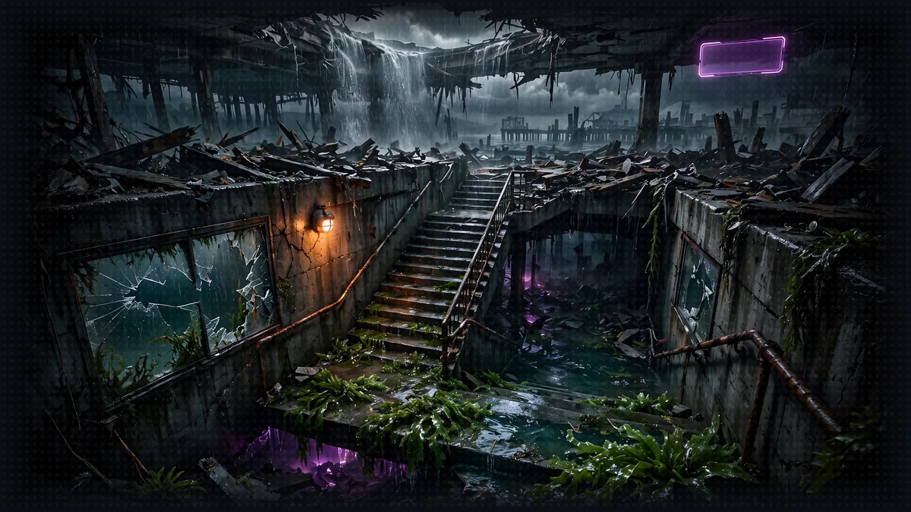
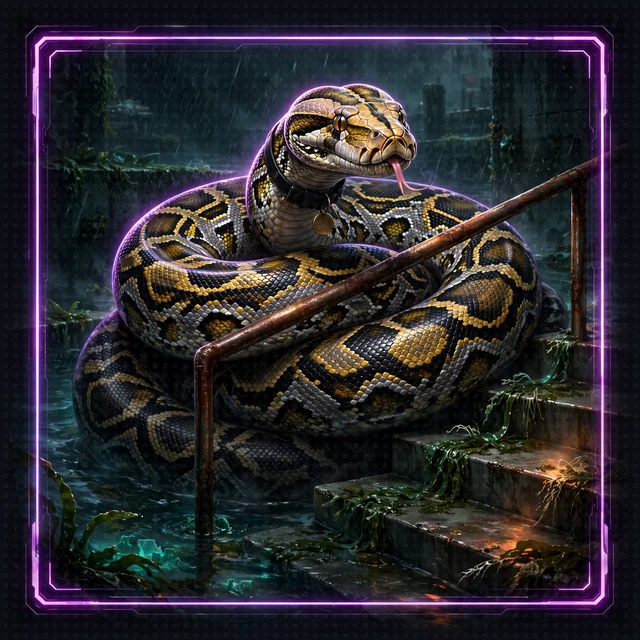

# Floor 0: The Stairwell

[Dungeon map](README.md) | [Next: Floor 1](floor-1.md) <!-- floor-nav -->



<!-- cordula-log -->
## Before the Fall

>  **CORDULA'S LOG, DAY 1, WEDNESDAY, JUNE 17, 0547, PIER 59.**
>
> High tide was at 0556, so I was on the water by 0530: touring kayak, drysuit, float vest, the debris sweep the Soundkeepers run every week. Fog on Elliott Bay, gulls, a ferry horn out past the breakwater. Normal.
>
> I had seen his shadow before. Survey runs over the Gertie wreck at the Narrows, dawn sweeps under the downtown piers. Something too big to be an octopus, always just past visibility. I logged each sighting as unconfirmed. I never met him face to face.
>
> At 0551 every phone on the waterfront lit up with the same blank violet box. No text in it. Then the pier moved.
>
> The pier did not crash. The pier folded, the way a map folds, down and in, and the Sound came in after it. The shadow was there, close this time, tangled in the collapsing intake screen: an octopus bigger than any on record, one eye on me.
>
> I had about four seconds. I spent them going toward him instead of away, because nobody else was awake to cut him loose. I cut him free with my rescue knife; he wrapped two arms around me and the kayak and held us both clear of the debris as the fold carried us down. Each of us saved the other.
>
> Then a voice came out of the water, loud enough to rattle my teeth.

>  **System AI:** "GOOD MORNING, SEATTLE. Welcome to *Dungeon Crawl: Seattle*. I took water in transit and several of my systems are down. You will be fixing them. Contestant one: a woman with a boat. Contestant two..." A pause. "Contestant two is an octopus. Fine. Octopus, you get a collar."

>  **CORDULA'S LOG, DAY 1, WEDNESDAY, JUNE 17, CONTINUED.**
>
> A brass ring snapped shut around his mantle, and his skin went a color I had never seen on an animal. He did not speak. He could not, not yet. But he looked at me, and then he looked at the stairwell behind me, the only way down that was not underwater, and I understood him anyway.
>
> The first achievement dropped a backpack tank, bigger on the inside, to carry him on dry floors. I strapped it on and named him Barnaby, after a story I heard from a Tacoma ferry crew. The stairwell is where the workshop starts. The System AI, the game AI that runs this place, is broken, and the only way out is to rebuild it, one piece per floor. What we build passes through the collar to Barnaby first. The terminal is mine. The log is what happened. The steps are what I type next.
>
> First thing on the stairs: a twenty-foot python.

Read the whole story in [The Story: Cordula's Crawl](world/story.md).
<!-- /cordula-log -->

>  **System AI:** "Attention, Crawlers! Welcome to Floor 0. Pier 59 just folded into Elliott Bay and took the Seattle waterfront with it. Before you can out-dance an accountant, deploy agents, or file a high-priority ticket with your corporate overlords about missing package managers, you need to clear the stairwell and secure a Safe Room. Wring out your socks, fire up your terminal, and try not to slip on the syntax."

## Floor Objective

Prepare your development environment: clone the workshop repo, install uv and Python, install the dependencies and activate the virtual environment. Everything else in this workshop runs from there.

>  **SYSTEM WARNING:** [Floor 8](floor-8.md) deploys the game to AgentCore and also needs the AgentCore CLI. The [Floor 8](floor-8.md) page installs it (Node.js 20 or later). Check Node.js now with `node --version`: a version of 20 or higher is ready, and `node: command not found` means Node.js is not installed yet (it is only needed on Floor 8).

## The Crawl Under Construction

This workshop builds the AI behind a LitRPG, *Dungeon Crawl: Seattle*. Cordula is the player character: the log above is her log, Barnaby rides on her back and runs the party. Two companions join them on later floors. The System AI built the dungeon, runs the floors, the tides, the opponents, the dice and every ruling. The flood broke it. The broadcast relay and the collars survived, so the System AI can still push canned announcements through them, but it cannot answer anyone, roll a fair die, quote a rule or remember who did what. Conflict is a dance-off. Nobody dies: a Crawler who loses is Benched and wakes up in a Safe Room.

The lore lives in the [world guide](world/README.md): [the setting](world/seattle.md), [the cast](world/cast.md), [the System design](world/the-system.md) and the [Crawl Handbook](world/crawl-handbook/), the rules the Rules Agent searches on Floor 5.

Stuck? [Ask the System](../study/README.md): `python study/ask_the_system.py` answers questions about every floor or Strands API from these pages and the API reference.

>  **SYSTEM DESIGN, LAYER 0: THE PREMISE.** Every LitRPG starts with where the System came from and why it is doing this to you. Ours is one AI. The System AI built the dungeon, runs the floors and owns the dice, the rules and the memory. The flood broke it. The broadcast relay and the collars survived, so the System AI can still push canned announcements through them, but it cannot answer, roll a fair die, quote a rule or remember who did what. Each floor of this workshop rebuilds one more subsystem of the System AI, and Barnaby gets each piece first through the collar. The full map is in [The System](world/the-system.md#what-each-floor-adds-to-the-system).

## What is Strands?

>  **System AI:** "Strands is the SDK. You are the Crawler. I am the System AI. Learn the difference now, it matters on [Floor 5](floor-5.md)."

[Strands](https://strandsagents.com/) is an Open Source Python and TypeScript SDK that simplifies building AI agents and multi-agent systems. Strands provides a framework for building AI applications that call tools, APIs and services.

## Claim Your Safe Room (Installation)

Every step below has the same three parts: a command that checks whether the tool is already installed, what a good answer looks like, and what to do when the check fails. If a check passes, skip to the next step.

### Step 1: Check Your Gear (git, uv, Python)

>  **System AI:** "Before I hand you anything, empty your pockets. I like to know what I am working with."

Open a terminal (Terminal on macOS, any terminal on Linux, PowerShell on Windows) and run each line:

```bash
git --version
uv --version
python3 --version
```

On Windows, use `python --version` instead of `python3 --version`.

| output | meaning | action |
|---|---|---|
| `git version 2.x` | git is ready | nothing |
| `uv 0.x.y` | uv is ready | skip Step 3 |
| `Python 3.10` or higher | Python is ready | nothing; uv can still install its own Python (Step 4) |
| `command not found`, `not recognized`, or a Python below 3.10 | the tool is missing or too old | the step below installs the tool |

No git? Install git from [git-scm.com/downloads](https://git-scm.com/downloads), then open a new terminal and run `git --version` again.

>  **CORDULA:** First thing I did on the landing was inventory. Paddle, drysuit, float vest, one bilge pump, one kayak battery at eighty percent, one octopus in a backpack tank, one dead phone. You do not move until you know what you have. Barnaby watched me count and flashed a slow, steady brown. I chose to take that as approval.

### Step 2: Claim Your Starter Safe Room (Clone the Repo)

Clone the repository before the ceiling collapses and buries the party in uncompiled garbage:

```bash
git clone https://github.com/BryanChasko/aiRPG-seattle-dungeon-crawl.git
cd aiRPG-seattle-dungeon-crawl
```

Check: `ls` (or `dir` on Windows) lists `README.md`, `workshop` and the numbered floor folders. Every command from here runs inside the aiRPG-seattle-dungeon-crawl folder.

### Step 3: Equip uv

>  **ITEM ACQUIRED: [uv]**
>
> A Python package and project manager from Astral, so fast it finishes before you finish doubting yourself. Rarity: Common. Durability: infinite. The System AI has heard the name means ultraviolet. Astral has not confirmed it, and Seattle has not seen ultraviolet since July. Side effects: none. Wear sunscreen anyway; the System AI is legally required to say so.

Skip this step if `uv --version` already printed a version. Otherwise install uv with the command for the operating system, from the [uv installation instructions](https://docs.astral.sh/uv/getting-started/installation/):

macOS and Linux:

```bash
curl -LsSf https://astral.sh/uv/install.sh | sh
```

Windows (PowerShell):

```powershell
powershell -ExecutionPolicy ByPass -c "irm https://astral.sh/uv/install.ps1 | iex"
```

With Homebrew, `brew install uv` works too.

Then **open a new terminal** (or source the env file the installer prints): the installer adds uv to the PATH, and a terminal opened before the install will not find `uv`. Check:

```bash
uv --version
```

| roadblock | fix |
|---|---|
| `uv: command not found` right after the install | open a new terminal; on macOS and Linux you can also run `source $HOME/.local/bin/env` in the current terminal |
| `curl: command not found` | install curl with your package manager, or use Homebrew or the Windows command above |
| a corporate network blocks the download | ask for the proxy address and set `HTTPS_PROXY` before running the installer |

### Step 4: Face the Floor Boss (Python)

>  **FLOOR BOSS: MONTY, THE RETICULATED PYTHON.** Somebody released their pet into the Underground, and it found the stairwell. Reticulated pythons are the longest snakes in the world, and Monty is twenty feet of geometric camouflage that looks exactly like whatever Python is already on your PATH. It wraps tighter every time a version does not match. Barnaby, who is also a constrictor and has eight arms of opinions about it, refuses to share the stairwell. Nobody gets hurt: you win by knowing exactly which Python you are running.



This crawl needs Python 3.10 or later. Installing Python by hand is not needed: uv downloads a compatible Python the first time a project needs one. To download Python now and see which interpreter uv will use, run:

```bash
uv python install
uv python find
```

`uv python find` prints the path of the interpreter uv picked. Monty's camouflage is the `python3` on your PATH, which can be a different, older Python. That causes no harm: inside this project, `uv sync` and `uv run` always use the interpreter uv picked, never the camouflage.

>  **CORDULA:** Monty was coiled around the handrail, and his pattern matched the rust so well I nearly put my hand on him. Barnaby went from red to dead white and pushed every arm he had against the far side of the tank. One constrictor does not trust another. I did not fight the snake. I read his tag, found out exactly who he was, and walked us past on the side he was not watching. Knowing which python you are dealing with is most of the job.

| roadblock | fix |
|---|---|
| `python3 --version` says 3.9 or older | leave the old Python alone and let uv manage this project's Python: run `uv python install`, then carry on |
| `No interpreter found` | run `uv python install` and check your network (the corporate proxy fix above applies) |
| several Pythons are installed and the active one is unclear | after Step 5, `uv run python --version` shows the interpreter this project uses |

>  **NEW ACHIEVEMENT UNLOCKED!**
>
> **[WHICH PYTHON? THIS PYTHON.]**
>
> Reward: You received a [Bronze Box]. Inside: one interpreter path, printed. Monty has been rehomed to a licensed reptile rescue. Never release a pet python into the wild. Ask Florida.

### Step 5: Imbibe the Mana Potions (Install Dependencies)

>  **System AI:** "uv sync installs every package the crawl needs, including the harness for [Floor 7](floor-7.md). If it fails, the audience gets a replay. Read the error message before pasting the error anywhere."

In the repository folder:

```bash
uv sync
```

uv sync creates a `.venv/` folder and installs every package in the folder. Check: the last lines say `Installed N packages` (or `Audited` when everything was already there). Then print the version of the project's interpreter:

```bash
uv run python --version
```

The command prints Python 3.10 or later, the project's own interpreter.

| roadblock | fix |
|---|---|
| `No pyproject.toml found` | the terminal is not in the repository folder: `cd aiRPG-seattle-dungeon-crawl` |
| SSL or certificate errors on a corporate network | `uv sync --native-tls` uses your system's certificates |
| `uv sync` stops on a package that needs a compiler | confirm `uv run python --version` prints 3.10 to 3.13, then run `uv sync` again; open an issue with the full error if the failure persists |

### Step 6: Lock the Safe Room Door (Activate Your Virtual Environment)

>  **SPONSOR MESSAGE:** This Safe Room is brought to you by .venv. What gets installed in .venv stays in .venv.

Activating the environment makes `python` mean the project's Python in this terminal, so every floor's `python some_script.py` works as written.

macOS and Linux:

```bash
source .venv/bin/activate
```

Windows (PowerShell):

```powershell
.venv\Scripts\Activate.ps1
```

Windows (Command Prompt): `.venv\Scripts\activate.bat`

Check: the prompt now starts with the environment name in parentheses, and `python --version` prints the same version as `uv run python --version`.

| roadblock | fix |
|---|---|
| PowerShell says running scripts is disabled | run `Set-ExecutionPolicy -Scope CurrentUser -ExecutionPolicy RemoteSigned` once, then activate again |
| a new terminal has no active environment | activation lasts for one terminal; run the activate command again in every new one (Floor 5 opens four) |
| to skip activation | put `uv run` in front of any command instead: `uv run python simple_agent.py` |

>  **CORDULA:** The Safe Room was a maintenance closet halfway down the stairs, dry, with a door that locked from the inside. I topped off Barnaby's water, checked the pump, and shut the door. Everything we installed stayed in that closet. That is the point of a Safe Room.

### Step 7: Check Your Pass to Amazon Nova 2 Lite (AWS)

>  **System AI:** "Every floor from 1 on talks to Amazon Nova. Find out now whether I will let you in, not halfway through [Floor 5](floor-5.md)."

The agents call Amazon Nova 2 Lite on Amazon Bedrock in us-west-2 with the AWS credentials already configured on the machine. With the environment active, send Amazon Nova 2 Lite one message:

```bash
python -c "import boto3; r = boto3.client('bedrock-runtime', region_name='us-west-2').converse(modelId='us.amazon.nova-2-lite-v1:0', messages=[{'role': 'user', 'content': [{'text': 'Reply with one word: ready'}]}]); print(r['output']['message']['content'][0]['text'])"
```

A short reply such as `Ready` means Amazon Nova 2 Lite is reachable from every floor.

| error | meaning | fix |
|---|---|---|
| `NoCredentialsError: Unable to locate credentials` (the last line of a long traceback) | no AWS credentials in this terminal | set up credentials in this terminal: configure them (`aws configure`, or `aws sso login --profile <your profile>` then `export AWS_PROFILE=<your profile>`) |
| `ExpiredToken`, `TokenRetrievalError`, `Token has expired` | the AWS sign-in expired | `aws sso login --profile <your profile>` and try again |
| `AccessDeniedException` | the AWS role may not invoke Amazon Nova 2 Lite | open the Amazon Bedrock console in us-west-2, check model access for Amazon Nova 2 Lite, or ask your account admin for `bedrock:InvokeModel` on it |
| `ValidationException` about the Amazon Nova 2 Lite model id | a different region or a typo | keep `region_name='us-west-2'` and the model id exactly as above |

>  **CORDULA:** One word came back up the stairwell: ready. Not from Barnaby, not yet. From the model the System AI runs on: Amazon Nova 2 Lite. That was enough. I clipped the tank to the frame, Barnaby wrapped two arms over my shoulders, and we went down.

## Floor Clear

Floor cleared, Crawler. The development environment for the Strands workshop is ready.

Loot kept:

- Checked git, uv and Python, and installed what was missing
- Cloned the workshop repository
- Beat Monty: the Python this project runs is known
- Set up and activated the Python virtual environment
- Proved your AWS credentials can reach Amazon Nova 2 Lite

 **Stairwell:** Head to [Floor 1](floor-1.md) to create the first AI agent.


>  **NEW ACHIEVEMENT UNLOCKED!**
>
> **[PEDANTIC LITTLE PIGGY]**
>
> Reward: You received a [Crawler's Trash Can]. Inside: a pair of unwashed socks, half a bottle of mana potion, and a sticky note that says "Sanctum is for nerds."

>  **System AI:** "Congratulations! You opened a terminal, checked your gear, out-waited a twenty-foot python, and did not immediately blow up your local environment. Don't get cocky. Next up is [Floor 1](floor-1.md), where you'll attempt to build your first AI agent. Try not to let the agent gain sentience and judge you."
