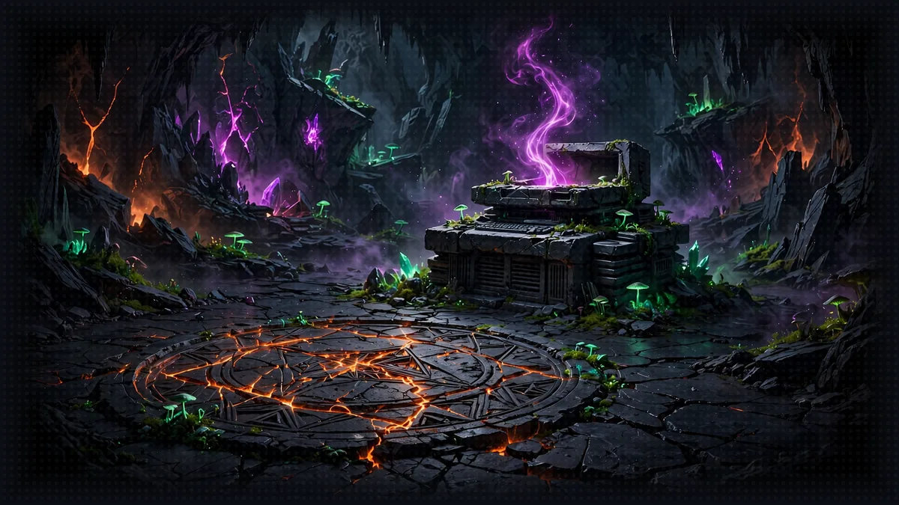

# Floor 1: Agent Summoning

[Previous: Floor 0](floor-0.md) | [Dungeon map](README.md) | [Next: Floor 2](floor-2.md) <!-- floor-nav -->

Files on this floor: [`1_strands_basics/simple_agent.py`](../1_strands_basics/simple_agent.py) <!-- floor-files -->



<!-- cordula-log -->
>  **CORDULA'S LOG, FLOOR 1.** The stairwell let out into what used to be the aquarium lobby, now a field of tide pools and broken glass. There were people down here, a whole tour group in matching rain shells, and none of them could hear us: the System's voice was dead, so the dungeon had no way to talk to anyone. Barnaby could not talk either. The collar was there, a ring of brass with nothing behind it. The System's terminal blinked one line at me: SUMMON AN AGENT. So we did. A model, a few words telling it who to be, one call. The System coughed back to life, and the collar woke up with it. Barnaby's first word was "Sergeant." His second was a complaint about the water temperature.
<!-- /cordula-log -->

>  **System AI:** "Floor 1, Crawlers. You will now summon a living creature out of a string of English and one function call. The audience has money on the first thing it says. Be kind to it. It will not be kind to you."

## Floor Objective

Summon your first agent with Strands: a Narrator that answers an adventurer with nothing more than an `Agent`, a system prompt and one call. Along the way, turn on debug logging to see what happens between your code and the model.

Make sure you are at the root of Floor 1 in your terminal:

```bash
cd aiRPG-seattle-dungeon-crawl/1_strands_basics
```

Open and modify the [`simple_agent.py`](../1_strands_basics/simple_agent.py) file. You'll complete the TODO comments to create your first AI agent.

### How to Work a TODO

Every floor works the same way, so this is the only time it is spelled out:

- Open the file in any editor. With Visual Studio Code: `code simple_agent.py`. Any editor that saves plain text works.
- Find each `# TODO: Step N - ...` comment. It says what to write, and the matching step on this page says how.
- Write your code on the lines **under** the comment. Leave the comment in place: the pages, the tests and the `solution` branch all line up on it.
- Save, then run the script from this folder: `python simple_agent.py`.
- Stuck? Each step has a hint, a link to the right Strands page, and a **Show me the code** block you can open. Try the hint first. You can also ask the [study companion](../study/README.md): `python ../study/ask_the_system.py "how do I enable debug logging in Strands?"`.

Your file will go from this:

```python
# TODO: Step 2 - Create the agent with ...
```

to this, with the comment kept and your code below it:

```python
# TODO: Step 2 - Create the agent with ...
agent = Agent(...)
```

## Step 1: Enable Debug Logging

>  **System AI:** "DEBUG logging shows every request I send to the model and every word that streams back. It is the closest you will get to reading my mind. You will not enjoy it."

```python
# TODO: Step 1 - Add debug logging to see what your agent is thinking
```

Before creating your agent, enable debug logging to observe the agent's internal reasoning process. Strands logs through Python's standard `logging` module, under the logger named `"strands"`: set that logger to `DEBUG`, then give Python somewhere to print the messages. See [Logging](https://strandsagents.com/docs/user-guide/sdk/observability-evaluation/logs/) in the Strands docs.

There are different log levels: DEBUG, INFO, WARNING, ERROR, and CRITICAL. We recommend DEBUG as a starting point: it is verbose, but it is the only level where Strands shows the request sent to the model and the response streamed back. Higher levels such as INFO stay almost silent, so raise the level once you have seen enough.

<details>
<summary>Show me the code for Step 1</summary>

```python
# TODO: Step 1 - Add debug logging to see what your agent is thinking
import logging
logging.getLogger("strands").setLevel(logging.DEBUG)
logging.basicConfig(
    format="%(levelname)s | %(name)s | %(message)s",
    handlers=[logging.StreamHandler()]
)
```

`getLogger("strands")` picks the SDK's logger, `setLevel` decides how much it says, and `basicConfig` with a `StreamHandler` prints it to your terminal.

</details>

## Step 2: Create Your Agent

>  **ITEM ACQUIRED: [System Prompt]**
>
> One string that decides who your agent is. Write it carelessly and your agent turns careless. Write it in the voice of the System and it turns insufferable. Recommended.

```python
# TODO: Step 2 - Create the agent with model "us.amazon.nova-2-lite-v1:0" and the following system prompt: "You are the System, the sardonic broadcast AI running a dungeon crawl under Seattle. Address the player as Crawler."
```

The system prompt defines your agent's role, personality, and knowledge base. You pass it as the `system_prompt` argument when you create the `Agent`. See [Prompts](https://strandsagents.com/docs/user-guide/sdk/agents/prompts/) in the Strands docs.

Pass the model every time. This crawl runs on one model, Amazon Nova 2 Lite, through the US cross-Region inference profile `us.amazon.nova-2-lite-v1:0`, so pass `model="us.amazon.nova-2-lite-v1:0"` to `Agent(...)`. Never leave it out: without a `model`, Strands picks one for you, and it is not the workshop's. Every later floor already passes it in the given code. The [Amazon Bedrock model provider page](https://strandsagents.com/docs/user-guide/sdk/model-providers/amazon-bedrock/) explains how Strands talks to Bedrock.

<details>
<summary>Show me the code for Step 2</summary>

```python
# TODO: Step 2 - Create the agent with model "us.amazon.nova-2-lite-v1:0" and the following system prompt: "..."
agent = Agent(
    model="us.amazon.nova-2-lite-v1:0",
    system_prompt="You are the System, the sardonic broadcast AI running a dungeon crawl under Seattle. Address the player as Crawler.",
)
```

`Agent` is already imported at the top of the file. A model id as a plain string means "this model on Amazon Bedrock".

</details>

### What a Turn Costs

Amazon Bedrock bills on-demand models by the token: the text you send (input) and the text the model writes back (output). Third-party price trackers list Amazon Nova 2 Lite at about $0.30 per million input tokens and $2.50 per million output tokens as of November 2026 ([LiteLLM](https://models.litellm.ai/models/nova-2-lite), [LLM Stats](https://www.llm-stats.com/models/nova-2-lite)). Confirm the current price for your region on the [Amazon Bedrock pricing page](https://aws.amazon.com/bedrock/pricing/) before you plan anything bigger than this workshop.

| what runs | rough tokens | rough cost |
|---|---|---|
| this floor's script, once | 100 in, 300 out | under a tenth of a cent |
| one Floor 5 Narrator turn (several model calls, tool results fed back in) | 15,000 in, 1,500 out | under one cent |
| the whole workshop, with plenty of retries | a few hundred turns | a few dollars at most |
| a support chat at 1,000 conversations a day, 10 turns each, 2,000 in and 300 out per turn | 20 million in, 3 million out per day | about $14 a day |

The token counts are estimates, so measure yours: after Step 3, print `response.metrics.accumulated_usage` and you get `inputTokens`, `outputTokens` and `totalTokens` for the call. Two things move the bill most. Output costs about eight times what input does, so long answers cost more than long prompts. Reasoning tokens are generated tokens too, which is one reason the Narrator runs with reasoning off. Repeated prompts get cheaper with [prompt caching](https://strandsagents.com/docs/user-guide/sdk/model-providers/amazon-bedrock-prompt-caching/).


>  **SYSTEM WARNING:** Your AWS account must be allowed to invoke Amazon Nova 2 Lite in us-west-2. If the first call fails with AccessDeniedException, open the Amazon Bedrock console, check Model access for Nova 2 Lite, and try again.

## Step 3: Test Your Agent

```python
# TODO: Step 3 - Invoke your agent with a basic query such as "Hi, I just fell through Pier 59 into the dungeon and my kayak is gone. What now?"
```

Time to test your agent. An `Agent` is callable: call it like a function with your message, and it returns the result of the turn while it streams the answer to your terminal. See the [Python quickstart](https://strandsagents.com/docs/user-guide/sdk/quickstart/python/) in the Strands docs.

<details>
<summary>Show me the code for Step 3</summary>

```python
# TODO: Step 3 - Invoke your agent with a basic query such as "..."
response = agent("Hi, I just fell through Pier 59 into the dungeon and my kayak is gone. What now?")
print(response.metrics.accumulated_usage)  # optional: the tokens this turn used
```

</details>

## Step 4: Testing Your Creation

>  **FLOOR BOSS:** Your own agent. It has never spoken before. Run the script and survive its first opinion of you.

Once you've completed all TODOs, run your script:

```bash
python simple_agent.py
```

If successful, your Narrator agent should answer in the System's voice and set the scene under the Seattle waterfront.

>  **SYSTEM DESIGN, LAYER 1: THE INTERFACE VOICE.** A LitRPG System talks in notifications, and how they sound sets the genre. A cold, analytic System makes a survival story; a cruel one makes horror; ours is a game-show host. Change one sentence of your system prompt (try "You are a calm, clinical survival System") and run the script again: same model, same question, a different book. See [The System](world/the-system.md#1-origin-and-interface).

## Floor Clear

Floor cleared, Crawler. You've created your first AI agent using Strands.

Loot you're keeping:

- How to enable debug logging to observe your agent's reasoning
- How to create an agent and define its behavior with a system prompt
- How to invoke and test your agent

 **Stairwell:** Head to [Floor 2](floor-2.md) to learn about equipping your agent with tools.


>  **NEW ACHIEVEMENT UNLOCKED!**
>
> **[I TALKED TO IT AND IT TALKED BACK]**
>
> Reward: You received a [Bronze Box]. Inside: one working Agent, and a debug log long enough to induce regret.

>  **System AI:** "Your first agent lives. It is mine now, spiritually. [Floor 2](floor-2.md) awaits, and so does the part where you hand it weapons."
