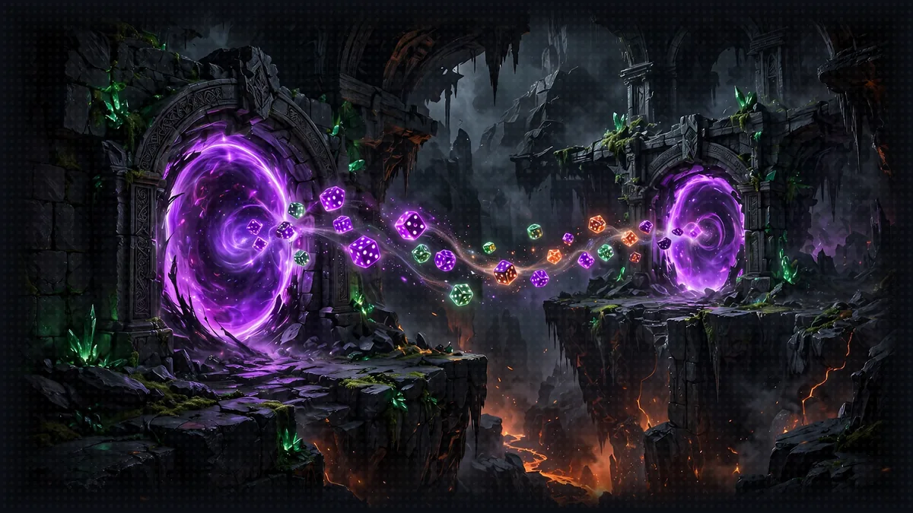

# Floor 4: The Portal Room (MCP)

[Previous: Floor 3](floor-3.md) | [Dungeon map](README.md) | [Next: Floor 5](floor-5.md) <!-- floor-nav -->

Files on this floor: [`4_mcp_integration/dice_roll_mcp_server.py`](../4_mcp_integration/dice_roll_mcp_server.py), [`4_mcp_integration/narrator_mcp_client.py`](../4_mcp_integration/narrator_mcp_client.py) <!-- floor-files -->



<!-- cordula-log -->
>  **CORDULA'S LOG, DAY 4, SATURDAY, JUNE 20, FLOOR 4.** At the Ship Canal the dungeon split in two. The Ballard Locks were glowing like portals, the dice were on the far side, and the party was on this one, with a swarm of developer advocates doing a live demo on the lock walls. I used to count salmon through the window of the fish ladder viewing room at these Locks, and now the water was glowing. Nobody can carry dice through a portal. I can put them on a server and let anyone on any side roll them. Barnaby touched a machine he had never seen, asked the machine what tools it served, and the machine listed them. He went quiet for a long time after that. I think it was the first time he talked to something that was not alive.
<!-- /cordula-log -->

>  **System AI:** "Floor 4. You will move your dice out of the agent's pocket and into a server. They are still the System AI's dice, and the System AI is not here to object. They are just somewhere else now, being rolled in public, in front of everybody."

## Floor Objective

Serve `roll_dice` through the Model Context Protocol: build an MCP server that exposes the dice service, then connect the Narrator to it with Strands' MCP client.

What is MCP? The [Model Context Protocol](https://modelcontextprotocol.io/) is an open standard that defines how an AI application talks to external tools and data sources. An MCP server exposes tools (functions with a name, a description and a JSON schema, exactly what `tool_spec` printed in Floor 3) over a standard transport: stdio for a local process, streamable HTTP for a remote one. An MCP client, such as the Narrator, connects to the server, lists its tools and calls them, without custom code for that server. In Floor 3 the `roll_dice` tool lived inside the agent's process; with MCP, `roll_dice` runs in its own server, on another machine or written in another language, and any number of agents can share it. MCP works as a universal plug between agents and tools.

In a terminal, go to the Floor 4 folder:

```bash
cd aiRPG-seattle-dungeon-crawl/4_mcp_integration
```

Build two MCP files:

- An MCP Server ([`4_mcp_integration/dice_roll_mcp_server.py`](../4_mcp_integration/dice_roll_mcp_server.py)) - exposes the dice rolling service
- An MCP Client ([`4_mcp_integration/narrator_mcp_client.py`](../4_mcp_integration/narrator_mcp_client.py)) - connects to the server and uses its tools

The `roll_dice` function is the Floor 3 function: same signature, same docstring. Only the serving method changes, from `@tool` to `@mcp.tool()`.

## Part 1: Setting Up the MCP Server (dice_roll_mcp_server.py)

>  **System AI:** "Same dice, new address. FastMCP serves roll_dice to anyone who connects. Anyone. Remember that on [Floor 8](floor-8.md), when IAM shows up."

### Step 1: Create the MCP Server

```python
# TODO: Step 1 - Import FastMCP from mcp.server
```

```python
# TODO: Step 1 - Create an MCP server on port 8002
```

Import the `FastMCP` class (the `random` and `logging` modules are already imported), then create a `FastMCP` instance on port 8002. The server needs no name: the Narrator only sees the tools the server offers, never the server itself. See [Implementing an MCP Server](https://strandsagents.com/docs/user-guide/sdk/tools/mcp-tools/#implementing-an-mcp-server) for an example.

<details>
<summary>Show me the code for Step 1</summary>

```python
# TODO: Step 1 - Import FastMCP from mcp.server
from mcp.server import FastMCP
```

```python
# TODO: Step 1 - Create an MCP server on port 8002
mcp = FastMCP(port=8002)
```

The file already holds `mcp = FastMCP(` with a commented-out `# port=` inside: add the port number, or replace the three lines with the single line above. Keep the name `mcp`: the decorator and `mcp.run(...)` below use it.

</details>

>  **CORDULA:** The Locks hum when a portal is open, a low note you feel in your fillings. Nothing physical crosses. A die thrown at the glow came back as a puddle. So the dice stay on one side, in a box with an address, and anyone who knows the address can ask for a roll. Barnaby liked that: one set of dice, rolled in the open, no pockets.

### Step 2: Expose roll_dice as an MCP Tool

```python
# TODO: Step 2 - Add the decorator to expose roll_dice as an MCP tool
```

Decorate `roll_dice` with `@mcp.tool()`. Floor 3 used the same move: there `@tool` turned the function into a tool for one agent, here `@mcp.tool()` (note the parentheses, it is called) registers it on the server for any MCP client. The function and its docstring are unchanged, so FastMCP builds the specification from the same name, the same parameters and the same docstring, and sends that specification over the network to each client that connects. One difference appears in the output: Strands moved the `Args:` lines into each parameter's description, while FastMCP keeps the whole docstring, `Args:` included, as the tool description. Amazon Nova 2 Lite receives the same facts either way. The `@mcp.tool()` decorator appears in the same [Implementing an MCP Server](https://strandsagents.com/docs/user-guide/sdk/tools/mcp-tools/#implementing-an-mcp-server) example.

<details>
<summary>Show me the code for Step 2</summary>

```python
# TODO: Step 2 - Add the decorator to expose roll_dice as an MCP tool
@mcp.tool()
def roll_dice(faces: int = 6, count: int = 1, drop_lowest: int = 0) -> dict:
```

</details>

### Step 3: Choose the Transport

>  **ITEM ACQUIRED: [streamable-http]**
>
> Turns the dice server into its own process with its own URL. Rarity: Uncommon. Pairs well with a second terminal and mild paranoia.

```python
# TODO: Step 3 - Run the MCP server with the streamable-http transport
```

In the main section, start the MCP server with the `streamable-http` transport, as in the [Streamable HTTP](https://strandsagents.com/docs/user-guide/sdk/tools/mcp-transports/#streamable-http) section of MCP Transports. MCP defines two standard transports. With stdio, the client launches the server as a child process and talks to it through stdin/stdout: simple, but the server lives and dies with that one client. With streamable HTTP, the server is an independent process listening on a URL, here `http://localhost:8002/mcp`, and any number of clients can connect over the network, from another terminal, another machine or the cloud. The Narrator needs that: it runs in a second terminal, and in Floor 5 the other agents share the same dice server.

<details>
<summary>Show me the code for Step 3</summary>

```python
if __name__ == "__main__":
    print("Starting Dice Roll MCP Server...")
    # TODO: Step 3 - Run the MCP server with the streamable-http transport
    mcp.run(transport="streamable-http")
```

</details>

### Step 4: Launch the Server

>  **SPONSOR MESSAGE:** This portal is brought to you by port 8002. Port 8002: it was free.

```bash
python dice_roll_mcp_server.py
```

The terminal prints "Starting Dice Roll MCP Server..." followed by Uvicorn running on `http://127.0.0.1:8002`. Leave this terminal open: the server must stay up while the client runs.

| you see | it means | fix |
|---|---|---|
| `ImportError: cannot import name 'FastMCP' from 'mcp.server'` | mcp 2.x is installed, which renamed the class | `uv sync` puts back the version this crawl pins (`mcp<2`) |
| `address already in use` | another process holds port 8002, usually the dice server from an earlier run | stop it with Ctrl+C in its terminal; on macOS and Linux, `lsof -i :8002` shows which process holds the port |
| the script ends at once, with no Uvicorn line | `mcp.run(...)` is missing, or sits outside `if __name__ == "__main__":` | Step 3 |

>  **CORDULA:** The box with the dice in it lit up on the far wall of the lock chamber and stayed lit. A developer advocate on the lock wall pointed at it and told her livestream it was a "reference architecture." I let her have that one.

## Part 2: Creating the MCP Client (narrator_mcp_client.py)

### Step 1: Create the MCP Client

```python
# TODO: Step 1 - Import MCPClient from strands.tools.mcp
```

```python
# TODO: Step 1 - Create an MCPClient with the url "http://localhost:8002/mcp"
```

Import `MCPClient` (`Agent` is already imported), then create an `MCPClient` that connects to the dice server: pass the server address with `url="http://localhost:8002/mcp"`. From a `url`, Strands builds the streamable HTTP transport itself, the one the dice server runs (Part 1, Step 3). See [Client Configuration](https://strandsagents.com/docs/user-guide/sdk/tools/mcp-tools/#client-configuration) on the MCP tools page.

<details>
<summary>Show me the code for Step 1</summary>

```python
from strands import Agent
# TODO: Step 1 - Import MCPClient from strands.tools.mcp
from strands.tools.mcp import MCPClient

# TODO: Step 1 - Create an MCPClient with the url "http://localhost:8002/mcp"
mcp_dice_client = MCPClient(url="http://localhost:8002/mcp")
```

Name it `mcp_dice_client`: Step 2 uses the name `mcp_dice_client`.

</details>

>  **CORDULA:** Barnaby put one arm tip against the glow, which I would not have done, and asked the box what tools it offered. The box answered: a name, a description, a list of arguments, the same promises he wrote into the docstring on the floor above. He held still for a long time. Everything he had ever talked to was alive. The box was not alive, and it understood him anyway.

### Step 2: Add MCP Tools to the Narrator

```python
# TODO: Step 2 - Add the MCP tool to the narrator agent
```

Pass `mcp_dice_client` in `tools=[...]`. No `with` block is needed: `MCPClient` is a tool provider, so when the agent receives the client this way Strands manages the connection, opening it as soon as the agent is created to list the tools and closing it when the agent shuts down. That is why the dice server must already run when the client starts: without the server, creating the agent fails with `MCPClientInitializationError`. Strands calls this the managed integration, which [Integration Approaches](https://strandsagents.com/docs/user-guide/sdk/tools/mcp-tools/#integration-approaches) recommends. The `with mcp_client:` form shown on the [MCP Transports](https://strandsagents.com/docs/user-guide/sdk/tools/mcp-transports/) page is the manual variant, required only when code calls `list_tools_sync()` or `call_tool_sync()` directly.

<details>
<summary>Show me the code for Step 2</summary>

```python
narrator = Agent(
    model="us.amazon.nova-2-lite-v1:0",  # Amazon Nova 2 Lite, US cross-Region inference profile
    system_prompt="""...Plain text only, no emoji.""",
    # TODO: Step 2 - Add the MCP tool to the narrator agent
    tools=[mcp_dice_client],
)
```

Add the comma: in the file, the closing `"""` of the system prompt has no comma after it, because it was the last argument. Add a comma before the new `tools=` line, or Python stops with `SyntaxError: invalid syntax. Perhaps you forgot a comma?`

</details>

### Step 3: Launch the Client

>  **FLOOR BOSS:** The four-ability gauntlet again, except every roll now crosses a process boundary. Watch the server terminal and count the DICE ROLL lines. The System AI already did.

Open a second terminal (the server keeps running in the first one), go to the same folder, then run:

```bash
python narrator_mcp_client.py
```

The run goes in order. The client connects to `http://localhost:8002/mcp`, Strands asks the server for its tool list and receives the `roll_dice` specification, the one Floor 3 printed, built this time by FastMCP from the `roll_dice` docstring. The client sends the same request as Floor 3: Lady Luck rolls four ability scores with 4d6 drop lowest. The difference is where the rolls happen. Watch the server terminal: every call arrives there as a log line such as `DICE ROLL: 4d6 drop 1 = [5, 2, 6, 3] -> 14`, four of them, while the narration appears in the client terminal. Same agent, same tool, but the dice now live in another process.

After the character is created, stop the client with Ctrl+C. Before Floor 5, keep the server terminal running: the Narrator will roll its dice through the same dice server.

Check: four `DICE ROLL: 4d6 drop 1 = ...` lines in the server terminal, and four totals in the client terminal that match them one for one.

| you see | it means | fix |
|---|---|---|
| `MCPClientInitializationError` | the client could not reach the server when the agent was created | start the server first (Part 1, Step 4) and keep its terminal open; see [MCPClientInitializationError](https://strandsagents.com/docs/user-guide/sdk/tools/mcp-tools/#mcpclientinitializationerror-python) |
| `SyntaxError ... Perhaps you forgot a comma?` | the comma after the system prompt | Step 2 |
| the client answers, but no `DICE ROLL` line appears in the server terminal | the Narrator has no MCP tool and invents its own rolls | check `tools=[mcp_dice_client]` |
| `404 Not Found` in the server terminal | the client URL lacks `/mcp` | `url="http://localhost:8002/mcp"` |

>  **CORDULA:** The developer advocates were mid-demo when the first roll crossed the portal, and every one of them stopped to film it. It was the solstice, the longest day of the year, and the swarm had the whole afternoon to film it. Four rolls went over, four came back, and the log on the far wall printed each one where everybody could read it. One advocate in the swarm asked if we had a QR code. We did not. The swarm dispersed to find better lighting, and the Locks let us through.

>  **SYSTEM DESIGN, LAYER 4: ONE SOURCE OF LUCK.** A LitRPG audience has to trust the dice. If every agent rolled its own, nobody could audit a dance-off, and the System AI would be one prompt away from fudging a result. One MCP server that every agent shares, logging every roll with its notation, is the battle log readers check when a Final Beat comes down to a single point. See [The System](world/the-system.md#1-origin-and-interface).

## Side Passages (optional)

>  **CORDULA:** The lock walls have a turnstile Floor 4 never showed us, and a wire under the portal nobody can see.

- [The Locks Turnstile](encounters/locks-turnstile.md), sidequest: an MCP router with an allowlist, the dice server and a tide server you write, that refuses every other server
- [Trace the Portal](encounters/trace-the-portal.md), sidequest: every MCP call as a span on the console, the one inside the server included
- [The Warehouse Automation Grid](encounters/warehouse-automation-grid.md), sidequest: MCP tool filters, so an agent sees three of Cadabra's eight warehouse tools and never the one that trips the grid

## Floor Clear

Floor cleared, Crawler. The crawl now has an MCP server and client, and the Narrator reaches a tool over MCP.

Loot kept:

- Create an MCP server that exposes a tool (FastMCP)
- Connect an MCP client to the dice server
- Add MCP tools to a Strands agent

 **Stairwell:** Head to [Floor 5](floor-5.md) for Agent-to-Agent (A2A) communication and orchestrate teams of specialized agents.


>  **NEW ACHIEVEMENT UNLOCKED!**
>
> **[OUTSOURCED YOUR LUCK]**
>
> Reward: a [Silver Box]. Inside: a FastMCP server, a client that finds it, and four log lines proving the dice roll somewhere the System AI is not.

>  **System AI:** "Different process, same cruelty. [Floor 5](floor-5.md) is where your agents start talking to each other. It never ends well for the quiet one."
