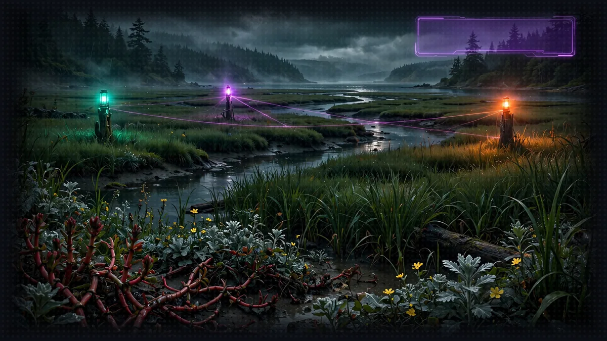

# Floor 5: Party Formation (A2A)



>  **System AI:** "Floor 5. A party. How sweet. Three agents, four terminals, one orchestrator, and a very real chance you forget to start one of them. The audience is placing bets on which."

## Floor Objective

Assemble the full party: expose the Rules Agent and the Character Agent as remote agents with A2A, then build a Narrator orchestrator that talks to both, rolls dice through the MCP server from Floor 4 and returns its story as structured output.

What is A2A? [Agent2Agent (A2A)](https://a2a-protocol.org/) is an open protocol for agents to talk to each other, whoever built them and whatever framework they run on. Each agent publishes an agent card (name, description, skills, URL) and accepts messages over HTTP; a client reads the card, sends a task and gets the answer back. Where MCP connects an agent to tools, A2A connects an agent to other agents. In Strands, `A2AServer` exposes any agent this way, and the vended tool `make_a2a_client` lets the Narrator call them.

Make sure you are at the root of Floor 5 in your terminal:

```bash
cd aiRPG-seattle-dungeon-crawl/5_a2a_integration
```

## System Architecture

>  **System AI:** "Four processes, four ports, one orchestrator. This is the floor where Crawlers lose track of a terminal and blame the framework. The framework is fine. Check your terminals."

```
        Rules Agent             Character Agent          Dice Service
           (Port 8000)              (Port 8001)            (Port 8002)
                │                        │                      │
                └────────────────────────┼──────────────────────┘
                                         │
                              Narrator Orchestrator
                                   (Port 8009)
```

Build a system with three specialized agents that work together:

- Rules Agent: manages the game rules and mechanics - `agents/rules_agent/rules_agent.py`
- Character Agent: handles character creation and management - `agents/character_agent/character_agent.py`
- Narrator Orchestrator: coordinates all agents for gameplay - `agents/narrator_orchestrator/narrator_orchestrator.py`

## Part 1: Setting Up the Rules Agent

First, you need to create a Knowledge Base for the Rules Agent. The Crawl Handbook, the crawl's own rule book, must be processed and stored in ChromaDB (a vector database) so the agent can query it for rules questions.

### Creating the Knowledge Base

>  **ITEM ACQUIRED: [The Crawl Handbook]**
>
> Eleven Markdown files of rules, written by the System and revised every time a Crawler found a loophole. Rarity: Free. The Rules Agent reads it so you never have to, then cites section names at you with visible satisfaction.

>  **SYSTEM WARNING:** You must complete this setup before the Rules Agent can work.

#### Step 1: Read the Handbook

The handbook ships with this repository, in [`workshop/world/crawl-handbook/`](world/crawl-handbook/): one file per section, from ability scores and dance-offs to Safe Rooms and Ferry Tokens. Skim [Dance-Offs](world/crawl-handbook/03-dance-offs.md) and [The Final Beat](world/crawl-handbook/04-final-beat.md) now: the Narrator will run both before this floor is over. Nothing to download.

#### Step 2: Build the Knowledge Base

>  **NEW ACHIEVEMENT UNLOCKED!**
>
> **[I READ THE MANUAL (A ROBOT DID)]**
>
> Reward: You received a [Bronze Box]. Inside: a chroma.sqlite3 file and a vector index that understands the rules better than you do.

Run the script to index the handbook. Important: run this from the `utils` folder.

```bash
cd utils
python create_knowledge_base.py
cd ..
```

What the script does. It reads every handbook file and keeps the section title from its first heading. Each file is cut into passages of about 1,000 characters that overlap by 200, so a rule split across two passages stays findable, and the section name is kept with each passage. ChromaDB then creates a local database in `rules_knowledge_base/` (a SQLite file plus a vector index) and turns every passage into a vector with its default embedding model, `all-MiniLM-L6-v2`, downloaded on first run (about 80 MB, cached afterwards): two passages about the same thing end up with vectors close to each other. Later, when the Rules Agent calls its tool, the question is turned into a vector the same way and the three closest passages come back with their section names. No LLM is involved in that lookup, it is pure semantic search; the model only reads the passages afterwards to write its answer.

Verify that the knowledge base was created:

- Check that the `5_a2a_integration/utils/rules_knowledge_base/` folder exists
- Look for `chroma.sqlite3` inside
- You should see: "Knowledge base creation complete!"

Change a rule in the handbook and run the script again: the Rules Agent answers from the new text on its next question. That is the whole point of keeping rules in a knowledge base instead of a prompt.

### Configure the Rules Agent

>  **System AI:** "One agent per context_id. Callers never see each other's history. The System finds this privacy endearing, and temporary."

In `agents/rules_agent/rules_agent.py`, complete the `create_agent` function. Until now you created one `Agent` at module level and talked to it yourself. An agent keeps its conversation history in memory, so one instance means one conversation. An A2A server is different: several callers can talk to it at the same time, each with their own `context_id`, and they must not see each other's history. So instead of an agent, you give `A2AServer` an agent factory: a function that builds a fresh `Agent` for each new context. `A2AServer` calls it the first time a context appears and reuses that agent for the rest of that conversation. The configuration is the same as before, it just lives inside a function now.

#### Step 1: Add the Tool

```python
# TODO: Step 1 - Add the query_rules tool to the agent
```

Same as in Floors 3 and 4: the tool is what the agent can do, here look up a rule in the knowledge base.

#### Step 2: Add the Name

```python
# TODO: Step 2 - Add the name "Rules Agent" to the agent
```

Floors 1 to 4 never set a name, because nobody but you talked to the agent. Here other agents will: `A2AServer` publishes an agent card, a small JSON document served at `/.well-known/agent-card.json` that says who the agent is, what it can do and where to reach it (the documentation details what a card contains). Here is the one your Rules Agent will serve once the three steps are done:

```json
{
  "name": "Rules Agent",
  "description": "Rules lookup for the dungeon: fast answers from the Crawl Handbook, with the section they come from.",
  "url": "http://127.0.0.1:8000/",
  "version": "0.0.1",
  "skills": [
    {"id": "query_rules", "name": "query_rules", "description": "Look up a rule in the Crawl Handbook knowledge base. ..."}
  ],
  "capabilities": {"streaming": true},
  "defaultInputModes": ["text"],
  "defaultOutputModes": ["text"]
}
```

The skills are your tools: Strands fills them from the tool names and docstrings. The name at the top of the card is the one you set in this step. Without it, every agent of the party would be called "Strands Agents".

#### Step 3: Add the Description

```python
# TODO: Step 3 - Add the description "Rules lookup for the dungeon: fast answers from the Crawl Handbook, with the section they come from." to the agent
```

The description at the top of the card: this is what the orchestrator reads in Part 3 to decide which agent to ask. It is required, the server refuses to start without one. See the documentation for an example of an agent with a name and a description.

#### Step 4: Create the A2A Server

```python
# TODO: Step 4 - Create an A2AServer with the create_agent factory on port 8000
```

`A2AServer` wraps your factory in an HTTP server that speaks the A2A protocol: it serves the agent card and builds one agent per `context_id` through `create_agent`. See the documentation.

#### Step 5: Serve the Agent

```python
# TODO: Step 5 - Start the A2A server
```

`serve()` starts the server and blocks until you stop it. It sits under `if __name__ == "__main__":` so that importing the module (the tests do) does not start a server.

#### Step 6: Launch the Rules Agent

Open a new terminal in the floor folder (`5_a2a_integration`), activate the virtual environment (a new terminal does not keep the one from Floor 0: `source ../.venv/bin/activate`) and start the agent from its folder:

```bash
cd agents/rules_agent
python rules_agent.py
```

You should see Uvicorn running on `http://127.0.0.1:8000`. Open `http://127.0.0.1:8000/.well-known/agent-card.json` in your browser: this is the agent card, with the name and description you just wrote. Leave this terminal open, the orchestrator needs the agent in Part 4.

## Part 2: Setting Up the Character Agent

>  **System AI:** "The Character Agent is the registration desk. Every new Crawler gets ability scores, a species, pronouns, level 1, a starter kit and 10 Ferry Tokens. Groove and Mana are computed, never chosen. The rain shell is not included. The rain shell is never included."

The Character Agent manages character creation and lookup. A character sheet holds a name, a species (Human (Seattle Native), Uplifted Giant Pacific Octopus, Harbor Seal, Banana Slug and others, see [species](world/crawl-handbook/08-species.md)), pronouns, a class, six ability scores and the two derived stats the code computes from them: Groove (10 + 2 x Constitution modifier + level) and Mana (5 + Intelligence modifier + Wisdom modifier). Pronouns are whatever the player gives; when none are given the sheet says they/them, and the agent never guesses from a name. The database already holds the two featured Crawlers, Cordula Vance and Barnaby. The agent comes with three pre-built tools:

- `create_character`: creates new characters with stats
- `find_character_by_name`: looks up characters by name
- `list_all_characters`: lists all characters in the database

### Configure the Character Agent

In `agents/character_agent/character_agent.py`, the factory `create_agent` already exists. Same six steps as for the Rules Agent, with this agent's tools and card.

#### Step 1: Add the Tools

```python
# TODO: Step 1 - Add the create_character, find_character_by_name and list_all_characters tools to the agent
```

Three tools this time; the agent picks the right one from their docstrings.

#### Step 2: Add the Name

```python
# TODO: Step 2 - Add the name "Character Agent" to the agent
```

First field of this agent's card, as in Part 1.

#### Step 3: Add the Description

```python
# TODO: Step 3 - Add the description "Crawler registration for the dungeon: creates characters from the ability scores it is given, stores them, finds and lists them." to the agent
```

Second field of the card, what the orchestrator will read to pick this agent.

#### Step 4: Create the A2A Server

```python
# TODO: Step 4 - Create an A2AServer with the create_agent factory on port 8001
```

Port 8001: each agent needs its own port.

#### Step 5: Serve the Agent

```python
# TODO: Step 5 - Start the A2A server
```

Same as in Part 1.

#### Step 6: Launch the Character Agent

Open a second terminal (the Rules Agent keeps running in the first one), activate the virtual environment again and start the agent:

```bash
cd agents/character_agent
python character_agent.py
```

You should see Uvicorn running on `http://127.0.0.1:8001`, and its agent card at `http://127.0.0.1:8001/.well-known/agent-card.json`. Leave this terminal open too.

## Part 3: Setting Up the Narrator Orchestrator

The Narrator Orchestrator coordinates all agents and serves as the main API endpoint. It integrates:

- The Rules Agent (via A2A)
- The Character Agent (via A2A)
- The dice service (the MCP server from Floor 4)

### Configure the Narrator Agent

>  **System AI:** "This is where I come in. The Narrator orchestrator is the System's body in your terminal. Hand it dice, hand it allies, hand it a schema, then stand back."

The given code at the top of the file builds `NARRATOR_MODEL`, the model the Narrator runs on:

```python
NARRATOR_MODEL = BedrockModel(model_id="us.amazon.nova-2-lite-v1:0")
```

Nova 2 Lite is the strongest generally available Nova model. It can also think before it answers (extended thinking), but a full Narrator turn, with its A2A calls, measured about 9 seconds with thinking off and 24 to 91 seconds at `medium`. For a game, off wins. The comment above `NARRATOR_MODEL` shows the one argument that turns thinking on if you want deeper plans and can wait for them.

#### Step 1: Create MCP Client for Dice Rolling

```python
# TODO: Step 1 - Create an MCPClient with the url "http://localhost:8002/mcp"
```

Same client as in Floor 4: an `MCPClient` with `url="http://localhost:8002/mcp"`. See the streamable HTTP transport documentation; as before, the client goes straight into `tools=[...]`, no `with` block (managed integration).

#### Step 2: Create the A2A Client Tool

```python
# TODO: Step 2 - Create the A2A client tool with make_a2a_client and the allowed agent endpoints
```

`make_a2a_client` builds a single tool, `a2a_client`, that the Narrator uses to talk to remote agents: with `operation="discover"` it fetches an agent's card (name, description, skills), and with `operation="send_message"` it sends a request to that agent's endpoint. Pass it `allowed_endpoints`, the list of agent URLs it may reach (`"http://127.0.0.1:8000"` for the Rules Agent, `"http://127.0.0.1:8001"` for the Character Agent): any other endpoint is rejected before a connection is even made. See the `a2a_client` tool documentation.

#### Step 3: Add the Tools

```python
# TODO: Step 3 - Add the mcp_client and a2a_client tools to the agent
```

The Narrator gets two tools: `mcp_client`, which brings in `roll_dice` from the dice server, and `a2a_client`, which lets it discover and message the Rules Agent and the Character Agent. Pass the MCP client itself, as in Floor 4: Strands lists its tools when the agent starts. See "give your agent tools" in the documentation.

#### Step 4: Force Structured Output

>  **ITEM ACQUIRED: [StoryOutput]**
>
> A Pydantic model that forces the System to answer in JSON. Rarity: Rare. The System resents it. The web interface depends on it. The System resents that too.

By default, an agent replies with free-form text. Structured output makes the model return a typed object that matches a schema you define as a Pydantic model; Strands validates it and hands it back as clean JSON. See the structured output documentation.

```python
# TODO: Step 4 - Force the response to use the StoryOutput model
```

We have coded `StoryOutput` for you, a little further up in the file: the schema of one Narrator turn, with `response` (the narration), `actions_suggestions` (what the player could do next), `details` (which tools and agents were used) and `dice_rolls` (each roll with its type, result and reason). Here is an example:

```json
{
  "response": "Tempo: Driving. The Quarterly Close Accountant loosens their tie and calls Footwork like it is an audit finding. Cordula answers with a 13 plus 1 for Dexterity: 14 against their 11. Round one to the kayak patrol.",
  "actions_suggestions": ["Let Barnaby drop an Ink Cloud before the next call", "Ask the accountant about their weekend", "Challenge them to a second dance-off, double or nothing, during quarter close"],
  "details": "roll_dice through the dice server, twice; Rules Agent for the tempo bonus",
  "dice_rolls": [{"dice_type": "1d20", "result": 13, "reason": "Footwork Move Call, round 1, Cordula +1 Dexterity"},
                 {"dice_type": "1d20", "result": 9, "reason": "Footwork Move Call, round 1, accountant +0 Dexterity +2 Driving tempo"}]
}
```

We need this shape because the web interface you will play with in Floor 6 renders those fields separately: parsing free-form prose would be fragile, whereas a guaranteed JSON shape keeps the UI reliable.

#### Step 5: Launch the Narrator

The Narrator rolls its dice through the MCP server from Floor 4, so that server has to run too. If it is still running from Floor 4, skip this. Otherwise open a third terminal in the floor folder, activate the virtual environment and start it:

```bash
cd ../4_mcp_integration
python dice_roll_mcp_server.py
```

Then open a fourth terminal for the Narrator itself:

```bash
cd agents/narrator_orchestrator
python narrator_orchestrator.py
```

You should see Uvicorn running on `http://127.0.0.1:8009`. Four terminals are now running: the Rules Agent, the Character Agent, the dice server and the Narrator.

## Part 4: Test the System

>  **FLOOR BOSS:** Four curl commands: a rules question, a new Crawler, a lookup on the party leader, and a dance-off against the Quarterly Close Accountant. Survive all four and the party is formed.

At this point four terminals should be running:

| Terminal | Process | Endpoint |
|---|---|---|
| 1 | Rules Agent, `python rules_agent.py` | http://127.0.0.1:8000 |
| 2 | Character Agent, `python character_agent.py` | http://127.0.0.1:8001 |
| 3 | Dice server (Floor 4), `python dice_roll_mcp_server.py` | http://127.0.0.1:8002/mcp |
| 4 | Narrator, `python narrator_orchestrator.py` | http://127.0.0.1:8009 |

If one is missing, go back to the launch step of its part.

The Narrator is a FastAPI application listening on port 8009. Each curl command below sends a POST request to its `/inquire` endpoint with a JSON body holding your question, exactly what a web page or any other client would do. While the request runs, the four terminals show how the Narrator treats it: which agent it asks over A2A, when it rolls the dice over MCP, and what each of them answers. Open a fifth terminal for the commands themselves (no virtual environment needed, curl is a system command) and run them there (or, if you have a REST client, use the `test/test.http` file we prepared for these tests):

```bash
# Query the rules
curl -X POST http://0.0.0.0:8009/inquire \
  -H "Content-Type: application/json" \
  -d '{"question": "How does the Final Beat work?"}'
```

```bash
# Register a new Crawler (the Narrator rolls the six ability scores first)
curl -X POST http://0.0.0.0:8009/inquire \
  -H "Content-Type: application/json" \
  -d '{"question": "Register a new Crawler named Rosa, pronouns they/them, a Harbor Seal Ferry Engineer."}'
```

```bash
# Look up the party leader
curl -X POST http://0.0.0.0:8009/inquire \
  -H "Content-Type: application/json" \
  -d '{"question": "What are Barnaby'\''s Dexterity and Mana?"}'
```

```bash
# Start a dance-off
curl -X POST http://0.0.0.0:8009/inquire \
  -H "Content-Type: application/json" \
  -d '{"question": "Cordula challenges the Quarterly Close Accountant to a dance-off at the Pier 59 collapse. Run round one."}'
```

Watch the four terminals while a request runs. In the Narrator terminal the tool calls appear in order: `a2a_client` discovering the agent cards, then `send_message` to the Rules Agent or the Character Agent, or `roll_dice` for the dice. The agent you asked logs the question in its own terminal, and the dice server prints a `DICE ROLL` line for every roll: six `4d6 drop 1` lines before Rosa is registered, two `1d20` lines for each dance-off round. The answer you get back is JSON shaped like `StoryOutput`: `response`, `actions_suggestions`, `details` and `dice_rolls`. Barnaby's sheet should come back with Dexterity 18 and Mana 11: the Narrator read it from the Character Agent instead of inventing it.

>  **SYSTEM DESIGN, LAYER 5: RULES, SHEETS AND THE CORE LOOP.** This floor is where the game becomes a game. The rules live in a knowledge base the Rules Agent searches, so the Narrator cites them instead of improvising. The character sheet lives with the Character Agent, which computes Groove and Mana from the ability scores so no model can hand a Crawler extra stamina. The dance-off is the core loop: a Move Call, two rolls, a winner, Groove lost, a Final Beat when it is level. Every stat has a job in it, and nobody gets hurt. `StoryOutput` is the notification format the HUD will render on Floor 6. See [The System](world/the-system.md#6-conflict-dance-offs-and-stealth-never-killing) and the [Crawl Handbook](world/crawl-handbook/).

## Floor Clear

Floor cleared, Crawler. You've built a complete multi-agent Narrator system with agent orchestration.

Loot you're keeping:

- Setting up a ChromaDB knowledge base from the Crawl Handbook for the Rules Agent
- Building agent factories for per-caller isolation (the `agent_factory` pattern)
- Setting up A2A servers to expose your agents
- Creating an A2A client tool so the orchestrator can discover and call other agents
- Orchestrating specialized agents by combining A2A and MCP tools
- Forcing structured JSON output with a response model

 **Stairwell:** Head to [Floor 6](floor-6.md) where you'll test your Narrator with a web interface.


>  **NEW ACHIEVEMENT UNLOCKED!**
>
> **[FOUR TERMINALS OPEN, ZERO FRIENDS]**
>
> Reward: You received a [Gold Box]. Inside: a Rules Agent that cites handbook sections, a Character Agent that remembers Barnaby's Dexterity to the point, and an orchestrator that just watched an accountant lose a Footwork call.

>  **System AI:** "You built a multi-agent system and it returned typed JSON. I am, against my better judgment, impressed. Floor 6 lets you watch it play in public."
