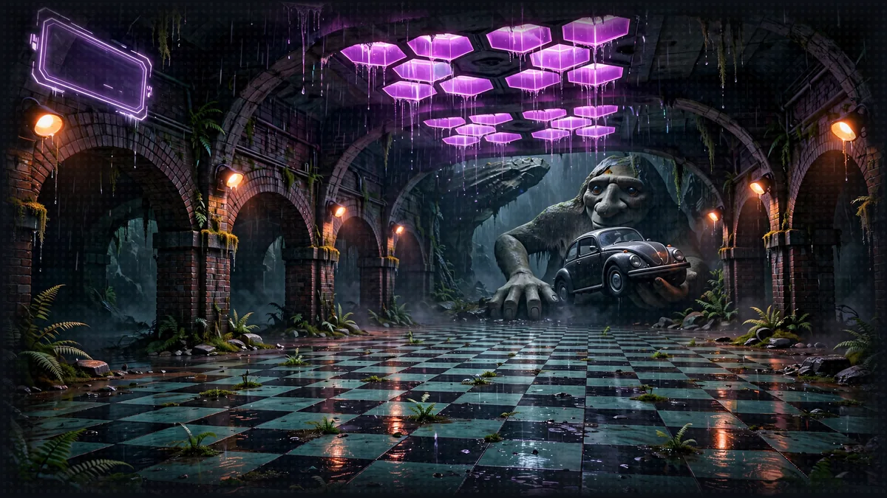

# Floor 6: The Arena (Web Interface)

[Previous: Floor 5](floor-5.md) | [Dungeon map](README.md) | [Next: Floor 7](floor-7.md) <!-- floor-nav -->

Files on this floor: [`web/src/views/NewGameView.vue`](../web/src/views/NewGameView.vue), [`web/src/party.ts`](../web/src/party.ts) <!-- floor-files -->



<!-- cordula-log -->
>  **CORDULA'S LOG, DAY 8, WEDNESDAY, JUNE 24, FLOOR 6.** Under Pioneer Square the old storefronts are still there, buried, and the Fremont Troll sits at the end of the arena like a judge who has seen too much. The audience could see us now. We could not see the show. We needed what the viewers had: the sheet, the rolls, the choices, all on one screen. Once we had it, Barnaby performed. I did not know an octopus could hit his marks. The ratings did. The aquarium had today on its calendar for Barnaby's return to the Sound. He did not mention it, and I did not either.
<!-- /cordula-log -->

>  **System AI:** "Floor 6. Time to show the audience the Narrator. Pick who speaks for the party, point the web interface at port 8009, and press Enter. No pressure. Only billions of viewers."

## Floor Objective

You've built a Narrator with custom tools, an MCP server and A2A agents. Test it in real life with our basic web interface.

## Web Interface

>  **System AI:** "The arena is a public HTTPS page that calls localhost. The browser allows it because 127.0.0.1 is this machine. No other machine is invited. Yet."

Once the Narrator, Character Agent, Rules Agent and MCP servers are running, open the web interface at https://bryanchasko.github.io/aiRPG-seattle-dungeon-crawl/.

The interface lives in this repository under `web/` (Vue 3 + Vite). To run the web interface on your own machine instead, with Node.js 22.12 or later:

```bash
cd aiRPG-seattle-dungeon-crawl/web
npm ci
npm run dev
```

### Connect Your Narrator

>  **NEW ACHIEVEMENT UNLOCKED!**
>
> **[OPENING NIGHT JITTERS]**
>
> Reward: The Crawler received a [Bronze Box]. Inside: one character sheet, one Start button, and a stage light pointed directly at you.

In the web interface:

- Pick the character to play. The party is set: Cordula Vance (she/her, Human (Seattle Native), Amphibious Breacher) is the default, or speak as Barnaby (he/him, Uplifted Giant Pacific Octopus, Benthic Dragoon), the party leader. Shelly the geoduck and Chonks the spiny lumpsucker travel with the party as companions for either character
- In Server URL, enter the URL shown in the Narrator Orchestrator terminal: `http://127.0.0.1:8009`
- Click Enter the Dungeon

The web interface runs in the browser and talks to the Narrator running on the same machine. Browsers let this HTTPS page reach `http://127.0.0.1:8009` because 127.0.0.1 is localhost.

The character panel shows the sheet the Character Agent saved on Floor 5, with GROOVE and MANA under the six ability scores. If you skipped the Floor 5 registration, the first turn registers the party. Pick a suggested action, or type a custom action: "Challenge the Rain-Shell Tourist Pod to a dance-off" and "Have Barnaby sneak us past them" both work. This floor's opponent is the Pitch-Deck Founder, with the Fremont Troll judging. Type this prompt to face the Pitch-Deck Founder:

```
Challenge the Pitch-Deck Founder to a dance-off in the Underground, with the Fremont Troll judging. Run all three rounds.
```

Check: the panel shows Cordula with GROOVE 17 and MANA 8 (or Barnaby with 11 and 11), and the Narrator returns the first turn as a notification, three choices and a battle log, within about ten seconds.

>  **CORDULA:** The System AI's HUD came up in a dead storefront under Pioneer Square: my sheet on the left, the battle log down the side, three choices at the bottom, one of them a terrible idea, as advertised. For the first time since the pier folded I could see what the viewers saw. I did not love it. Barnaby, on the other hand, found the camera within a second and turned a color I can only call stage-ready.

Monitor performance: read the Narrator Orchestrator terminal log to follow each request:

```
Processing request...
Tool #1: a2a_client
Tool #2: roll_dice
response='...' actions_suggestions=[...] details='...' dice_rolls=[...]
INFO:     127.0.0.1:53210 - "POST /inquire HTTP/1.1" 200 OK
```

Customization ideas:

- Edit the Narrator system prompt to change its personality
- Add custom tools for new game mechanics
- Connect more MCP servers to add tools

>  **CORDULA:** The Pitch-Deck Founder wanted a dance-off for our "attention share." The Fremont Troll judged from the end of the arena, one stone eye on each of us. I called Endurance and held a drill cadence until the founder ran out of slides. Shelly dug in at my heel, and Chonks sat on my forearm guard and gurgled once. Barnaby closed on Presence with a full-body light show, timed to the beat, hitting every mark. The log on the screen showed every roll. The ratings ticker in the corner went vertical. Barnaby noticed. He is going to be insufferable about it.

>  **SYSTEM DESIGN, LAYER 6: THE HUD.** In a LitRPG the reader sees the System through its interface: the floating character sheet, the notification boxes, the battle log. The web interface is that HUD, the System AI's screen for the Narrator's output, and it can only exist because [Floor 5](floor-5.md) forced the Narrator into `StoryOutput`: `response` becomes the notification, `dice_rolls` the battle log, `actions_suggestions` the three choices (one of them always a terrible idea). Design the data first and the interface follows. See [The System](world/the-system.md#1-origin-and-interface).

## Troubleshooting

>  **System AI:** "Safari has not been tested. The System does not test Safari. Chrome or Firefox, Crawler."

Browser:

- Do not run the web interface in Safari: Safari has not been tested
- Use Google Chrome or Mozilla Firefox

"Connection Refused" error:

- Confirm the Narrator Orchestrator is running on port 8009
- Confirm no firewall blocks port 8009

"Invalid Server URL" message:

- Enter exactly `http://127.0.0.1:8009`, with no space or path after the port
- Fix typos in the Server URL field

Slow response times:

- Watch CPU and memory use on the local machine
- Test the internet connection to Amazon Bedrock
- Shorten the Narrator system prompt or reduce tool calls per turn (Amazon Nova 2 Lite stays the only model)

## Side Passages (optional)

>  **CORDULA:** The arena keeps two scores nobody showed us: Hype from the audience, deals from the sponsors.

- [The Hype Meter](encounters/hype-meter.md), sidequest: a hook turns tool and model events into Hype, and a meter in the web interface shows it
- [Sponsor Interrupt](encounters/sponsor-interrupt.md), sidequest: an interrupt pauses the turn so the player accepts or refuses a sponsor deal in the browser

## Floor Clear

Floor cleared, Crawler. The Narrator is connected to the web interface and tested end to end.

Loot you're keeping:

- Connecting the local Narrator to the web interface
- Testing Narrator responses in the web interface
- Following Narrator tool calls in the terminal log

 **Stairwell:** Explore [Floor 7](floor-7.md) for advanced enhancements to the Narrator.


>  **NEW ACHIEVEMENT UNLOCKED!**
>
> **[OPENING NIGHT]**
>
> Reward: The Crawler received a [Bronze Box]. Inside: a browser tab, a character sheet, and the faint smell of stage fright.

>  **System AI:** "The Narrator works end to end. Do not tell the sponsors it was easy."
