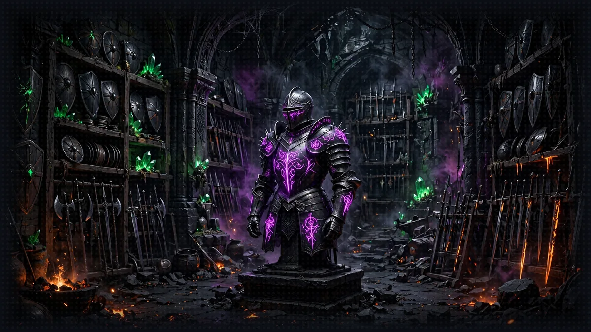
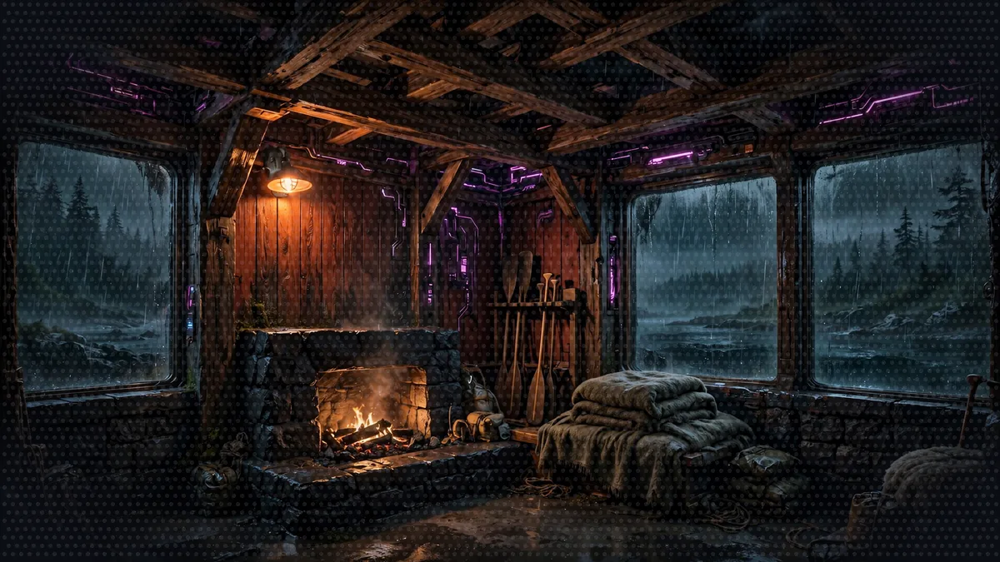
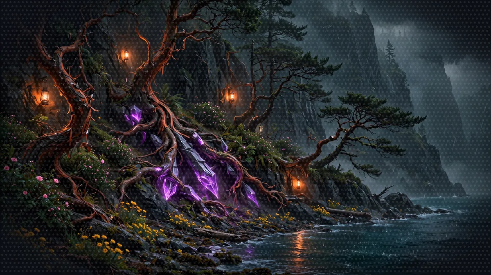

# Floor 7 (Optional): The Armory (Strands harness)

[Previous: Floor 6](floor-6.md) | [Dungeon map](README.md) | [Next: Floor 8](floor-8.md) <!-- floor-nav -->

Files on this floor: [`7_strands_harness/narrator_harness.py`](../7_strands_harness/narrator_harness.py) <!-- floor-files -->





<!-- cordula-log -->
>  **CORDULA'S LOG, DAY 9, THURSDAY, JUNE 25, FLOOR 7.** We slept in a Safe Room on the bluffs, under a madrone with its red bark peeling. When we woke up, the Narrator had forgotten everything. Our names, our rolls, the accountant. Barnaby went still. A giant Pacific octopus lives three to five years, and he knows it; forgetting is what he fears. So we gave the campaign a name and a place to keep it, and the next time we woke up, the whole campaign was still there. He did not say anything. He flashed the white-and-red pattern he used at the glass that first morning.
<!-- /cordula-log -->

>  **System AI:** "Floor 7. The optional floor. Skip the floor if you like, Crawler, but the harness comes with sessions, memory and a contract about confirming irreversible actions, which is more than I can say for you."

## Floor Objective

Across Floors 1 to 5 you assembled the Narrator piece by piece: an agent, tools, an MCP server, remote agents over A2A, structured output. Strands harness is the other way in: one call, `create_harness()`, returns a fully assembled agent with a tuned system prompt, built-in tools, sessions, long-term memory, context management and prompt caching. On this floor you rebuild the Floor 5 orchestrator with it, keeping the same API and the same web interface, and you compare the two.

>  **SYSTEM WARNING:** Optional floor: [Floor 8](floor-8.md) starts again from the [Floor 5](floor-5.md) code and does not use the harness. Skip this floor and go straight to [Floor 8](floor-8.md), or return to Floor 7 later.

Change to the Floor 7 folder in a terminal:

```bash
cd aiRPG-seattle-dungeon-crawl/7_strands_harness
```

Open and modify the [`narrator_harness.py`](../7_strands_harness/narrator_harness.py) file.

## Strands Agents SDK or Strands harness?

The Strands Agents SDK (`from strands import Agent`) is the library Floors 1 to 5 used: each floor assembled the agent loop by hand, tool by tool.

Strands harness (`from strands_harness import create_harness`) is a pre-assembled agent built on that SDK. `create_harness` returns a plain `Agent`, so what Floors 1 to 5 taught still applies and every default can be overridden. See [What the default harness does](https://strandsagents.com/docs/user-guide/harness/#what-the-default-harness-does) in the Strands harness docs.

Out of the box, `create_harness()` returns:

| Piece | Default |
|---|---|
| Model | Amazon Nova 2 Lite, passed as `model=`, reasoning off |
| System prompt | a tuned "contract" (explore before changing, confirm before anything irreversible, verify before done) + the `instructions` text |
| Tools | shell, read, write, edit, web_fetch, web_search, subagent |
| Sessions | saved on disk under `.agent/sessions`, resumable by id |
| Memory | long-term memory distilled into `.agent/memory` |
| Context | automatic context management and prompt caching |

## Before You Start

>  **System AI:** "This crawl runs on one model, Amazon Nova 2 Lite, on every floor. The file pins the model in `create_harness` and turns the reasoning off. Never leave `model=` out: without `model=`, the harness picks a different model, and that model is not ours."

The harness reuses the services from Floors 4 and 5. In three terminals, start the dice server (`4_mcp_integration`), the Rules Agent and the Character Agent, exactly as in Floor 5. Stop the Floor 5 orchestrator: the harness Narrator takes its place on port 8009, so the web interface from Floor 6 keeps working unchanged.

`strands-harness` is already in the project dependencies: `uv sync` installed `strands-harness`. The file already passes `model="bedrock/us.amazon.nova-2-lite-v1:0"` and `effort="off"` to `create_harness`, as given code above the TODOs, so the Narrator runs on Amazon Nova 2 Lite like every other floor. Keep both lines exactly as they are. The harness turns Amazon Nova 2 Lite reasoning on and would pick the high level by default, and with A2A calls in the loop a turn can take a minute or more, so `effort="off"` keeps each turn near ten seconds.

Check before starting: `uv run python -c "import strands_harness; print('harness ready')"` prints `harness ready`, and the cards of both Floor 5 agents answer: `curl -s http://127.0.0.1:8000/.well-known/agent-card.json` and the same command on port 8001.

>  **CORDULA:** We woke up in the Safe Room on the bluffs to a Narrator that did not know our names. The dice were still there, the clerk and the desk were still there, but it had lost the whole night. Barnaby did not move for a long time. Then he said, evenly, "Sergeant, I should like that not to happen again." The armory on this floor sells armor that comes pre-assembled. We bought the kind with a memory.

## Step 1: Create the Narrator with create_harness

The A2A client tool from Floor 5 is already in the file, unchanged: a remote agent is still just a tool. What changes is the Narrator around that tool.

```python
# TODO: Step 1 - Import create_harness from strands_harness
```

```python
# TODO: Step 1 - Pass the INSTRUCTIONS to the harness
```

One import, one factory: `create_harness` comes from `strands_harness` (see [Use it as a library](https://strandsagents.com/docs/user-guide/harness/quickstart/#use-it-as-a-library)). Each keyword replaces a piece wired by hand in Floor 5.

`instructions`: the domain text, appended after the harness contract. Keep the text narrow, the contract already covers general behaviour. Passing a full `system_prompt` instead would replace the contract entirely. See [Add instructions](https://strandsagents.com/docs/user-guide/harness/configure/tools-and-instructions/#add-instructions).

<details>
<summary>Show me the code for Step 1</summary>

```python
from strands.vended_tools import make_a2a_client
# TODO: Step 1 - Import create_harness from strands_harness
from strands_harness import create_harness
```

```python
agent = create_harness(
    model="bedrock/us.amazon.nova-2-lite-v1:0",  # Amazon Nova 2 Lite, as in the other floors
    effort="off",  # under the harness, Nova 2 reasons at high by default; off keeps a turn near ten seconds
    # TODO: Step 1 - Pass the INSTRUCTIONS to the harness
    instructions=INSTRUCTIONS,
```

`INSTRUCTIONS` is the string defined higher up in the file. The six keyword TODOs sit together inside `create_harness(...)`: put each answer under its own comment, or all of them in a row under the last one, as the `solution` branch does.

</details>

## Step 2: Add the Dice MCP Server

```python
# TODO: Step 2 - Add the dice MCP server {"dice": {"url": "http://127.0.0.1:8002/mcp"}} to mcp_servers
```

`mcp_servers`: a config mapping, the same `mcpServers` format other MCP clients use. No more `MCPClient`, no more transport import: the harness connects the server and registers its tools. The mapping key becomes a prefix, so the dice tool is called `dice_roll_dice`. See [Pass a config file or an inline mapping](https://strandsagents.com/docs/user-guide/harness/configure/mcp-servers/#pass-a-config-file-or-an-inline-mapping).

<details>
<summary>Show me the code for Step 2</summary>

```python
    # TODO: Step 2 - Add the dice MCP server {"dice": {"url": "http://127.0.0.1:8002/mcp"}} to mcp_servers
    mcp_servers={"dice": {"url": "http://127.0.0.1:8002/mcp"}},
```

A server that cannot be reached gives the agent no tools instead of stopping the agent ([A failed server yields no tools, not a crash](https://strandsagents.com/docs/user-guide/harness/configure/mcp-servers/#a-failed-server-yields-no-tools-not-a-crash)), so start the dice server first.

</details>

## Step 3: Add the A2A Client Tool

```python
# TODO: Step 3 - Add the a2a_client tool to the harness
```

`tools`: the tools you write, next to the built-in tools. See [Register your own tools](https://strandsagents.com/docs/user-guide/harness/configure/tools-and-instructions/#register-your-own-tools).

<details>
<summary>Show me the code for Step 3</summary>

```python
    # TODO: Step 3 - Add the a2a_client tool to the harness
    tools=[a2a_client],
```

</details>

## Step 4: Disable the Built-in Tools

>  **System AI:** "The harness ships with shell, file and web access. A Narrator with shell access is how floors get deleted. builtin_tools=[] removes every built-in tool. I am disappointed."

```python
# TODO: Step 4 - Disable the built-in tools
```

`builtin_tools=[]`: the harness ships with a set of built-in tools, enabled by default, that give the agent shell, file and web access. The built-in tools are made for coding agents, and the Narrator needs none of them: the Narrator has no business on the host filesystem. Passing an empty list disables every built-in tool. See [Select or disable built-in tools](https://strandsagents.com/docs/user-guide/harness/configure/tools-and-instructions/#select-or-disable-built-in-tools).

<details>
<summary>Show me the code for Step 4</summary>

```python
    # TODO: Step 4 - Disable the built-in tools
    builtin_tools=[],
```

</details>

>  **CORDULA:** The armor came with a shell, a file editor and a web browser bolted on. A Narrator with a shell is a scripter with better lighting, and I had already met one of those. We took them off before we put the armor on.

## Step 5: Name the Session

>  **SPONSOR MESSAGE:** This armor is sponsored by .agent/sessions. Your campaign, saved to disk, gitignored, and judged.

```python
# TODO: Step 5 - Name the session "seattle-campaign"
```

`session`: a named session persisted under `.agent/sessions`; start the server again with the same id and the campaign resumes. See [Persist and resume by id](https://strandsagents.com/docs/user-guide/harness/configure/sessions/#persist-and-resume-by-id).

<details>
<summary>Show me the code for Step 5</summary>

```python
    # TODO: Step 5 - Name the session "seattle-campaign"
    session={"id": "seattle-campaign"},
```

The id is the campaign: change the id, and the next start begins a fresh campaign.

</details>

## Step 6: Force Structured Output

```python
# TODO: Step 6 - Force the response to use the StoryOutput model
```

`structured_output_model` is not a parameter of `create_harness`, it is a parameter of the SDK `Agent`. `create_harness` has a fixed list of parameters, the ones Steps 1 to 5 used; every other keyword goes into a bag that `create_harness` hands verbatim to the `Agent(...)` constructor at the end. The harness does not interpret or inspect the bag: the SDK `Agent` receives `structured_output_model=StoryOutput` exactly as in Floor 5. So anything `Agent` accepts can be passed as a keyword, and an explicit SDK value always wins over the harness sugar it corresponds to (a `system_prompt` would replace `instructions`). That keeps the `StoryOutput` contract the web interface expects. See [Passthrough to the Agent](https://strandsagents.com/docs/user-guide/harness/reference/configuration/#passthrough-to-the-agent).

<details>
<summary>Show me the code for Step 6</summary>

```python
    # TODO: Step 6 - Force the response to use the StoryOutput model
    structured_output_model=StoryOutput,
)
```

</details>

## Step 7: Run and Compare

>  **FLOOR BOSS:** Restart the server mid-campaign and ask where you stopped. If the harness remembers, you win. If it does not, check .agent/sessions before you check your feelings.

```bash
python narrator_harness.py
```

Ask the Narrator a question, with curl or with the Floor 6 web interface:

```bash
curl -X POST http://127.0.0.1:8009/inquire \
  -H "Content-Type: application/json" \
  -d '{"question": "Look up the party and tell me Cordula'\''s Groove before we head into the Ship Canal."}'
```

Then stop the server (Ctrl+C), start it again, and ask:

```bash
curl -X POST http://127.0.0.1:8009/inquire \
  -H "Content-Type: application/json" \
  -d '{"question": "Where did we stop last time, and what was Cordula'\''s Groove?"}'
```

Where did the campaign go between the two runs? Look at the `7_strands_harness/.agent/` folder that appeared next to the file: the folder is where the harness keeps everything a session needs to survive a restart. Under `sessions/session/seattle-campaign/`, the id you chose in Step 5, `snapshot_latest.json` holds the whole conversation, every message exchanged with the Narrator, plus the Narrator's system prompt and model state. At start-up the harness reads the snapshot for that id and the agent picks up where it stopped. The folder is gitignored, so the folder stays on this machine. Long-term memory, the facts the harness distils about the player across campaigns, lives in `.agent/memory` the same way, see [What memory does by default](https://strandsagents.com/docs/user-guide/harness/configure/memory/#what-memory-does-by-default).

Check: the second answer names the Ship Canal and Cordula's Groove, 17, from before the restart, and `7_strands_harness/.agent/sessions/session/seattle-campaign/snapshot_latest.json` exists.

Then meet this floor's opponent with the resumed campaign. The harness rolls through `dice_roll_dice`, the dice server's tool under its `dice` prefix:



```bash
curl -X POST http://127.0.0.1:8009/inquire \
  -H "Content-Type: application/json" \
  -d '{"question": "Dawn on the bluffs: the Ferry-Line Commuter Horde comes up the cliff path, travel mugs first. Cordula challenges them to a dance-off. Run all three rounds, and use her Groove from before the restart."}'
```

The `dice_rolls` field lists at least six rolls, two per round and more if a round goes to the Final Beat, and the narration starts from the Groove the session remembered.

| symptom | it means | fix |
|---|---|---|
| `NameError: name 'create_harness' is not defined` | the import of Step 1 is missing | add `from strands_harness import create_harness` |
| the Narrator answers but never rolls, or invents rolls | the dice server was down at startup, so the harness registered no dice tool | start the dice server (`4_mcp_integration`), then restart the harness Narrator |
| the answer is plain text, and the web interface shows nothing | Step 6 is missing | `structured_output_model=StoryOutput` |
| after the restart, the Narrator does not remember | no session, or a different id | Step 5, and the same id on both runs |
| the Narrator asks to run a shell command | the built-in tools are still on | Step 4 |
| a turn takes a minute or more | `effort` is no longer `"off"` | restore the given `effort="off"` line |

> **NARRATOR:** The session holds. Day ten. The Ferry-Line Commuter Horde takes the cliff path.

>  **CORDULA:** We slept again on Thursday night, on purpose, to test the session. The madrone dropped bark on my sleeping bag all night. In the morning I asked the Narrator where we had stopped, and it told me: the Ship Canal, my Groove, the accountant, the whole campaign. Barnaby flashed white, then red, then white, the pattern from the aquarium glass the morning the pier fell. I asked him what the pattern meant. "It means I am still here, Sergeant." Then the Ferry-Line Commuter Horde came up the cliff path at dawn, travel mugs first, and we danced the whole bluff without forgetting a single step.

Expect about the same speed as Floor 5: the file sets `effort="off"`, the same as the Floor 5 Narrator. Pass `"low"`, `"medium"` or `"high"` for deeper plans, at 30 seconds to over a minute a turn, see [Set reasoning effort](https://strandsagents.com/docs/user-guide/harness/configure/model/#set-reasoning-effort). Note that the Narrator confirms before acting: that behavior comes from the harness contract, written for coding agents. `instructions` is where to override that behavior.

### What the Effort Levels Cost

The price per token does not change with `effort`: Amazon Nova 2 Lite bills about $0.30 per million input tokens and $2.50 per million output tokens at every level ([Floor 1](floor-1.md#what-a-turn-costs)). What changes is how many tokens a turn generates. Reasoning tokens are generated tokens, billed as output, and each level lets Amazon Nova 2 Lite reason longer before it answers.

| effort | turn time on this floor | what it adds to the bill |
|---|---|---|
| `"off"` | about 10 seconds | nothing: a turn costs about what a Floor 5 turn does, under one cent |
| `"low"`, `"medium"`, `"high"` | 30 seconds to over a minute | the reasoning tokens of every Amazon Nova 2 Lite call in the turn, at the output price. Each level reasons longer than the one before; `"high"` is what the harness picks for Amazon Nova 2 Lite when no `effort` is passed |

A worked example: if reasoning adds 2,000 tokens to each of the five Amazon Nova 2 Lite calls of a dance-off turn, that is 10,000 more output tokens, 2.5 cents, about four times the cost of the same turn with `"off"`.

Two harness defaults change the input side of the bill. The contract adds its own text to every call, so each call sends more input tokens than on Floor 5, and prompt caching makes those repeated tokens cheaper on later calls ([prompt caching](https://strandsagents.com/docs/user-guide/sdk/model-providers/amazon-bedrock-prompt-caching/)). The token counts above are illustrations, not measurements: the result of `agent.invoke_async` in `ask_agent` carries `metrics.accumulated_usage`, with the turn's real `inputTokens` and `outputTokens`. Print that field and compare `"off"` with `"low"` on the same question.

Floor 5 vs Floor 7:

| | Floor 5 (SDK) | Floor 7 (harness) |
|---|---|---|
| Dice via MCP | `MCPClient(url=...)` | `mcp_servers={"dice": {"url": ...}}` |
| Remote agents | `make_a2a_client(...)` | same |
| System prompt | written by you, from scratch | harness contract + your `instructions` |
| Model | Amazon Nova 2 Lite, reasoning off (`BedrockModel`) | Amazon Nova 2 Lite, reasoning off (`model=`, `effort=`) |
| Sessions, memory, caching, context management | none | on by default |
| Lines of agent code | about 20 | about 10 |

## When to Use Which

The Strands docs state the rule: reach for the harness when its defaults fit and you want a capable agent quickly; drop to the SDK when you need designs the harness does not assume, a bespoke toolset, a custom loop, multi-agent orchestration. The two compose, since the harness returns a plain `Agent`. See [When to reach for which](https://strandsagents.com/docs/user-guide/harness/composing-with-sdk/#when-to-reach-for-which).

Add any feature the Narrator needs. The Narrator could generate images of scenes and characters, remember the opponents the party out-danced and whether they became friends, run a campaign for multiple players at once, invent new Puget Sound locations as the story needs them, track Hype, sponsors and experience points, read its narration aloud, or roll both sides of a dance-off round in one call to the dice server.

>  **SYSTEM DESIGN, LAYER 7: PERSISTENCE AND CONSEQUENCE.** Stakes only mean something if the Narrator remembers. Being Benched costs half your Hype, three benches on one floor gets your segment Cancelled, and none of that bites if a restart wipes the slate. A named session gives the campaign a memory that outlives the process, so a Crawler's losses, loot and grudges carry into the next turn. Design consequence first, then pick the storage that makes it stick. See [The System](world/the-system.md#7-consequence-benched-not-dead).

## Side Passage: The Context Flood (optional)

>  **CORDULA:** Sixty turns in, the Narrator was carrying every word of the campaign on every call. Somebody had to decide what the Narrator could forget. Barnaby's one condition: our names stay.

[The Context Flood](encounters/context-flood.md), a boss battle: squeeze a 60-turn campaign into 20 messages with the sliding window and the summarizing conversation managers, and pin the cast sheets so neither conversation manager can drop the sheets.

## More Side Passages

>  **CORDULA:** Three lockers under the madrones, a logbook for grudges, and a ferry line that only lets in exact words.

- [The System Holds Grudges](encounters/system-holds-grudges.md), sidequest: a memory manager that extracts facts across campaigns into a file memory store
- [Keyword versus Vector](encounters/keyword-versus-vector.md), dance-off: keyword search against vector search on the Crawl Handbook, judged on the Final Beat
- [Save Points](encounters/save-points.md), sidequest: the file, snapshot and S3 session managers side by side

## Floor Clear

Floor cleared, Crawler. You rebuilt the Narrator with Strands harness and saw exactly what the harness adds to the agent you wired by hand.

Loot kept:

- How Strands harness relates to the SDK from Floors 1 to 5
- Rebuilding the Narrator API with `create_harness` (instructions, MCP servers, custom tools, built-in tools)
- Resuming a campaign across restarts with a named session
- When to pick the harness and when to stay on the SDK

 **Stairwell:** Head to [Floor 8](floor-8.md) to deploy the whole party to AgentCore, or to the [final cleanup](cleanup.md) page to stop the services and review what the party built.


>  **NEW ACHIEVEMENT UNLOCKED!**
>
> **[ARMOR WITH OPINIONS]**
>
> Reward: You received a [Silver Box]. Inside: a create_harness() call, a campaign that survives restarts, and a mild lecture about when to stay on the SDK.

>  **System AI:** "You rebuilt the Narrator in ten lines. I feel replaceable. I do not like it."
