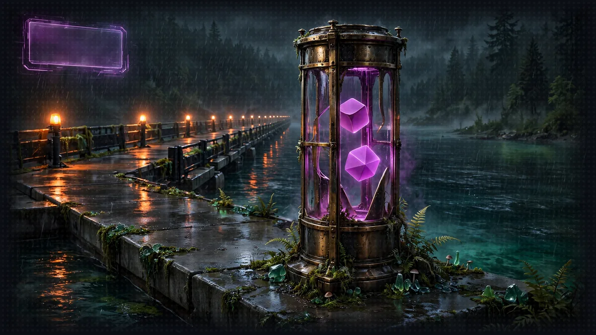

# Floor 8.1: The Dice Server



>  **System AI:** "Brick one. A dice server, a deploy, an IAM-signed client. Everything else keeps running on your machine. Consider it a warm-up. Consider it the last one."

## Floor Objective

Take the first brick to production: deploy the Floor 4 dice server to AgentCore Runtime, then point the Narrator at it. It is the simplest brick: no model, no state, one tool. Everything else keeps running on your machine for now.

This section works in two folders of `8_agentcore_production`:

- The dice server (`diceserver/dice_roll_mcp_server.py`), the Floor 4 server, with its `pyproject.toml`
- The Narrator (`narrator/narrator_orchestrator.py`), the Floor 5 orchestrator

## Part 1: Prepare the Dice Server for the Cloud (diceserver/dice_roll_mcp_server.py)

### Step 1: Adapt the MCP Server

```python
# TODO: Step 1 - Create the MCP server as mcp, listening on all interfaces, on the default port, with stateless HTTP
mcp = FastMCP(host="0.0.0.0", stateless_http=True)
```

This is the only change to the Floor 4 server. Keep the name `mcp`: the `@mcp.tool()` decorator and `mcp.run(...)` below use it. AgentCore Runtime expects an MCP server at `0.0.0.0:8000/mcp`, which is FastMCP's default port and path, so `port=8002` goes away. `host="0.0.0.0"` makes the server reachable from outside its microVM (the default `127.0.0.1` only accepts local connections), and `stateless_http=True` lets any request be served without an MCP session kept in memory, the recommended mode for a simple tool server. `roll_dice`, its docstring and `mcp.run(transport="streamable-http")` are unchanged. See the AgentCore MCP documentation.

The `pyproject.toml` next to the server lists its only dependency, `mcp<2`: AgentCore installs it when it packages the code.

>  **SYSTEM WARNING:** Cloud only: do not start this version locally, port 8000 is the Rules Agent's port.

## Part 2: Deploy with AgentCore

>  **System AI:** "Your first runtime. The CLI packages it, CloudFormation builds it, and IAM guards it. Three services, one dice roller. The System loves a little overkill."

Run the commands of this part from the project folder you created on the Floor 8 page:

```bash
cd gameprod
```

### Step 1: Add the Dice Server

```bash
agentcore add agent --name diceserver --type byo --protocol MCP --language Python \
  --code-location ../diceserver --entrypoint dice_roll_mcp_server.py
```

`--type byo` (bring your own) tells the CLI to use your existing code, `--protocol MCP` that it is an MCP server rather than an agent, `--code-location` where the code lives and `--entrypoint` which file to start. Open `agentcore/agentcore.json` again: a `diceserver` entry appeared under `runtimes`, with `"protocol": "MCP"` and `"codeLocation": "../diceserver/"`. Nothing is deployed yet.

Check that the path points to your server:

```bash
ls ../diceserver
```

You should see `dice_roll_mcp_server.py` and `pyproject.toml`. If the folder is empty, the project was created in the wrong place: the CLI silently creates a missing code folder instead of reporting it.

### Step 2: Deploy

>  **SYSTEM WARNING:** Run this command from the root of the `gameprod` folder, like every `agentcore` command of this floor. The CLI looks for `agentcore/agentcore.json` in the current folder and its parents: from `8_agentcore_production` or from `diceserver/`, it stops with `No agentcore project found`.

```bash
agentcore deploy -y
```

The CLI packages the server with its dependencies, uploads it and creates a CloudFormation stack, `AgentCore-gameprod-default`, holding the runtime and its IAM role. The first deployment takes a few minutes.

>  **SYSTEM WARNING:** `CDK synth failed: node dist/bin/cdk.js: Subprocess exited with error 1`: this message hides the real error. The most common cause is a `codeLocation` folder without a `pyproject.toml`: check `ls ../diceserver` as in Step 1. To see the real error, run `node dist/bin/cdk.js` from `agentcore/cdk`.

When it is done, ask for the status:

```bash
agentcore status
```

The `diceserver` runtime should be `READY`, followed by its URL, of the form `https://bedrock-agentcore.us-west-2.amazonaws.com/runtimes/<runtime ARN>/invocations`. Copy it: the Narrator needs it in Part 3.

### Step 3: Test the Deployed Server

>  **SYSTEM WARNING:** Run every command of this step from the root of the `gameprod` folder, like the rest of Part 2. From `8_agentcore_production` or a brick folder, `agentcore invoke` and `agentcore logs` stop with `No agentcore project found`.

Call the tool directly from the CLI, without any agent:

```bash
agentcore invoke call-tool --runtime diceserver --tool roll_dice --input '{"faces": 20}'
```

`--runtime diceserver` names the runtime to call. It is optional while `diceserver` is the only runtime of the project, but the next sections add others, and without it the command then fails with `Multiple runtimes found. Use --runtime to specify one.` You get a number between 1 and 20. Then read the server logs, stored in CloudWatch:

```bash
agentcore logs --runtime diceserver --since 15m
```

You should find `Starting Dice Roll MCP Server...` and the `DICE ROLL: d20 = ...` line of your call, the same log lines as in Floor 4, written this time by a server running in AWS.

## Part 3: Connect the Narrator (narrator/narrator_orchestrator.py)

This is the Floor 5 Narrator. The Rules Agent and the Character Agent are still reached over A2A on `127.0.0.1:8000` and `127.0.0.1:8001`; only the dice client changes. Its TODOs carry the number of this section (8.1 Step 1).

>  **SYSTEM WARNING:** If you look at the solution: this file is shared by the four sections, and the solution branch shows it as it is at the end of 8.4, served by AgentCore. That version does not start on your machine. Only copy the lines under the `8.1 Step N` TODOs of this section, and keep the rest of your file as it is.

### Step 1: Read the Dice Server URL from the Environment

The URL of your runtime belongs to your AWS account: it has no place in the code, which you may share or push to a public repository. It goes into a `.env` file instead, a list of `NAME=value` lines that stays on your machine. The floor folder holds a template, `.env.example`; copy it next to itself:

```bash
cp ../.env.example ../.env
```

Open `8_agentcore_production/.env` and paste the URL you copied in Part 2, Step 2 after `DICE_SERVER_URL=`: the whole URL, not only the ARN, on one line and without quotes. Keep the ARN encoded (`%3A`, `%2F`) as `agentcore status` prints it:

```
DICE_SERVER_URL=https://bedrock-agentcore.us-west-2.amazonaws.com/runtimes/<encoded runtime ARN>/invocations
```

The repository's `.gitignore` already ignores `.env` files: git never offers to commit it.

The top of the Narrator already loads this file: `load_dotenv()`, from the `python-dotenv` package, looks for a `.env` file in the folder of the script and in its parents, and adds its variables to the environment of the process. Read the URL from there:

```python
# TODO: 8.1 Step 1 - Read DICE_SERVER_URL from the environment
DICE_SERVER_URL = os.environ["DICE_SERVER_URL"]
```

Use the brackets rather than `os.environ.get(...)`: if the variable is missing, the Narrator stops at startup with `KeyError: 'DICE_SERVER_URL'`, instead of failing later on the first roll.

### Step 2: Create an IAM-Signed MCP Client

>  **System AI:** "The deployed dice server answers signed requests only. Sign for the wrong region and you get a 403. The System enjoys a good 403."

```python
# TODO: 8.1 Step 2 - Import aws_iam_streamablehttp_client from mcp_proxy_for_aws.client
from mcp_proxy_for_aws.client import aws_iam_streamablehttp_client
```

```python
# TODO: 8.1 Step 2 - Create an MCPClient connecting to DICE_SERVER_URL with aws_iam_streamablehttp_client for the bedrock-agentcore service
mcp_client = MCPClient(lambda: aws_iam_streamablehttp_client(endpoint=DICE_SERVER_URL, aws_service="bedrock-agentcore"))
```

In Floor 5 the client was `MCPClient(lambda: streamablehttp_client("http://localhost:8002/mcp"))`. The deployed server, however, only answers callers authenticated with IAM: every request must be signed with your AWS credentials (Signature Version 4). `aws_iam_streamablehttp_client`, from the `mcp-proxy-for-aws` package (already in the workshop dependencies), is the same streamable HTTP transport with that signature added. The signature covers a service and a region: `aws_service` names the service, and the region comes from your boto3 session, the `AWS_DEFAULT_REGION` you exported on the Floor 8 page. A request signed for the wrong region is rejected with a 403. The rest of the Narrator does not change: `mcp_client` still goes into `tools=[...]`, and the model sees the same `roll_dice` tool as before.

### Step 3: Launch the Narrator

The Rules Agent and the Character Agent from Floor 5 must be running (terminals 1 and 2). The local dice server (terminal 3) is no longer needed: you can stop it. Stop the Floor 5 Narrator too (terminal 4), since the new one uses the same port, then start the new one in its place, from the floor folder. This terminal was opened in Floor 5: set the region in it first, as on the Floor 8 page.

```bash
export AWS_DEFAULT_REGION=us-west-2
cd ../narrator
python narrator_orchestrator.py
```

You should see Uvicorn running on `http://127.0.0.1:8009`. If it stops with `KeyError: 'DICE_SERVER_URL'`, check that the file is named `.env` (not `.env.example`), that it sits in `8_agentcore_production`, and that the line has no space around the `=`.

## Part 4: Play Against the Cloud

>  **FLOOR BOSS:** One goblin, one longsword, two rolls, both in AWS. Read the CloudWatch logs to prove the dice left your machine.

Ask for a roll, from another terminal:

```bash
curl -X POST http://0.0.0.0:8009/inquire \
  -H "Content-Type: application/json" \
  -d '{"question": "I attack the goblin with my longsword!"}'
```

The Narrator asks for an attack roll, then a damage roll, and narrates the result. In its terminal you see the `roll_dice` tool calls as in Floor 5, but no local terminal prints a `DICE ROLL` line anymore. Read the cloud logs instead:

```bash
cd ../gameprod
agentcore logs --runtime diceserver --since 15m
```

Your rolls are there, for example `DICE ROLL: d20 = 14` followed by `d8 = 4`. You can also play from the Floor 6 web interface: it talks to the Narrator on port 8009, exactly as before.

Keep the `gameprod` project and its deployment: the next sections add the other bricks to it. To remove everything at the end of the workshop, see the [Cleanup](cleanup.md) page.

## Floor Clear

Floor cleared, Crawler. Your dice now roll in production, and the rest of the game did not notice.

Loot you're keeping:

- How to adapt an MCP server for AgentCore Runtime (`FastMCP(host="0.0.0.0", stateless_http=True)`)
- How to create, configure and deploy an AgentCore project (`agentcore create`, `agentcore add agent --type byo`, `agentcore deploy`)
- How to test and observe a deployed server (`agentcore invoke call-tool`, `agentcore logs`)
- How to call it from a Strands agent with IAM authentication (`aws_iam_streamablehttp_client`)
- How to keep the settings of your account out of the code (`.env`, `load_dotenv()`, `os.environ`)

 **Stairwell:** Head to [8.2](floor-8-2.md) where the Character Agent joins the dice server in the cloud, along with the characters it creates.


>  **NEW ACHIEVEMENT UNLOCKED!**
>
> **[THE DICE HAVE LEFT THE TABLE]**
>
> Reward: You received a [Bronze Box]. Inside: a cloud-hosted roll_dice, a signed request, and a log line you can read in CloudWatch.

>  **System AI:** "Your dice now roll in production, and the rest of the game did not notice. That will change."
