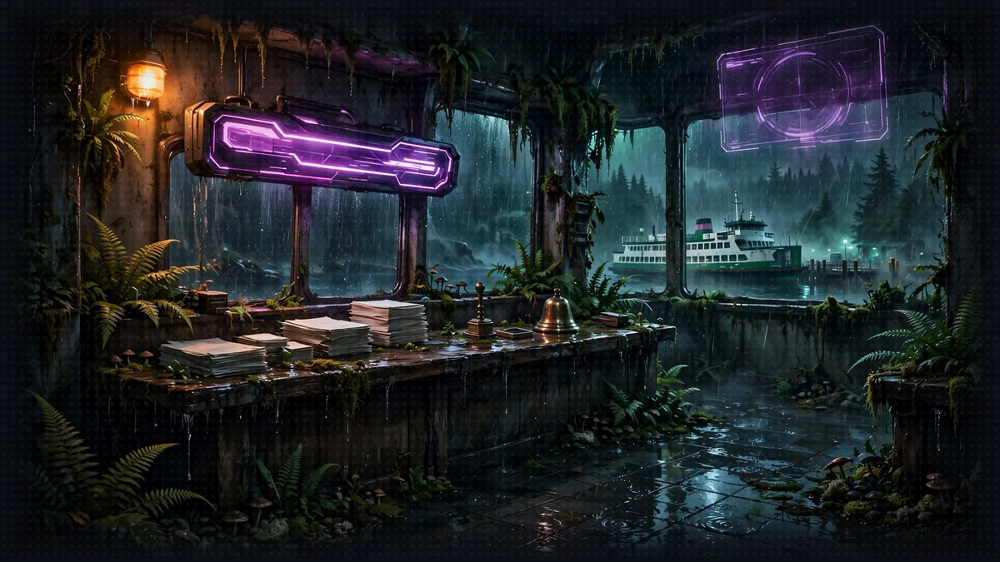

# Floor 8.2: The Character Agent

[Previous: Floor 8.1](floor-8-1.md) | [Dungeon map](README.md) | [Next: Floor 8.3](floor-8-3.md) <!-- floor-nav -->

Files on this floor: [`8_agentcore_production/characteragent/character_agent.py`](../8_agentcore_production/characteragent/character_agent.py), [`8_agentcore_production/narrator/narrator_orchestrator.py`](../8_agentcore_production/narrator/narrator_orchestrator.py) <!-- floor-files -->



<!-- cordula-log -->
>  **CORDULA'S LOG, DAY 12, SUNDAY, JUNE 28, FLOOR 8.2.** Brick two was the registration desk. A desk in the cloud has no drawer to keep papers in, so our sheets needed a home of their own. When the desk restarted and still knew my Constitution score, Barnaby made a sound through the collar I am going to call a laugh.
<!-- /cordula-log -->

>  **System AI:** "Brick two. The Crawlers' characters move into AgentCore Memory, where the records outlive their sessions. The System AI offers most Crawlers less."

## Floor Objective

Move the second brick to production: deploy the Floor 5 Character Agent to AgentCore Runtime as an A2A server, store the characters it creates in AgentCore Memory instead of a local file, then point the Narrator at it. The Rules Agent and the Narrator keep running on your machine.

Why not keep TinyDB? In Floor 5 the characters live in [`characters.json`](../characters.json), next to the agent. On AgentCore Runtime a local file cannot work: the code folder is read-only, and each session runs in its own microVM, so a file written in `/tmp` by one session is invisible to the next session and disappears with that session's microVM. The characters need a store that lives outside the runtime.

What is AgentCore Memory? AgentCore Memory is a managed store for agents. AgentCore Memory usually stores conversations: the agent records events, and strategies extract long-term memory records from them (preferences, facts, summaries). This floor uses AgentCore Memory more simply: a memory with no strategy, in which the agent writes its own records, one per character, and lists them back. The result is a persistent store shared by every session, with no database to run.

This section needs the `gameprod` project with the dice server deployed in 8.1. Open a terminal at the root of Floor 8:

```bash
cd aiRPG-seattle-dungeon-crawl/8_agentcore_production
```

This section works in two folders:

- The Character Agent ([`characteragent/character_agent.py`](../8_agentcore_production/characteragent/character_agent.py)), the Floor 5 agent, with the agent's [`pyproject.toml`](../pyproject.toml) and [`memory-policy.json`](../8_agentcore_production/characteragent/memory-policy.json)
- The Narrator ([`narrator/narrator_orchestrator.py`](../8_agentcore_production/narrator/narrator_orchestrator.py)), as left at the end of 8.1

## Part 1: Prepare the Character Agent for the Cloud (characteragent/character_agent.py)

The three tools (`create_character`, `find_character_by_name`, `list_all_characters`), the `Character` dataclass, the prompts and the `create_agent` factory are the ones from Floor 5. Two things change: where the characters are stored, and how the agent is served. In Floor 5 the tools already read and write the characters through two small functions, `save_character` and `load_characters`; only the body of these two functions changes.

The top of the file reads the memory id and creates the client:

```python
MEMORY_ID = os.environ["MEMORY_CHARACTERS_ID"]
memory = boto3.client("bedrock-agentcore")
```

Do not set `MEMORY_CHARACTERS_ID`: at deploy time, the AgentCore CLI gives every runtime of the project access to each memory the project declares and passes the memory id in an environment variable named `MEMORY_<NAME>_ID`, here `MEMORY_CHARACTERS_ID`. The granted access does not include creating memory records; Part 2, Step 3 adds the missing right.

### Step 1: Save a Character

```python
def save_character(record: dict) -> None:
    # TODO: Step 1 - Save the record as a memory record in the namespace /characters/<character_id>
    memory.batch_create_memory_records(memoryId=MEMORY_ID, records=[{
        "requestIdentifier": record["character_id"],
        "namespaces": [f"/characters/{record['character_id']}"],
        "content": {"text": json.dumps(record)},
        "timestamp": datetime.now(timezone.utc),
    }])
```

The call replaces the `pass` under the TODO. In Floor 5, `save_character` called `characters_db.insert(record)`; here it writes one memory record, made of:

- `requestIdentifier`: `record["character_id"]`, a unique id that makes the call safe to retry
- `namespaces`: `[f"/characters/{record['character_id']}"]`; a namespace is a path that groups records, and every character gets its own under `/characters/`
- `content`: `{"text": json.dumps(record)}`; a memory record holds text, so the character is stored as JSON
- `timestamp`: `datetime.now(timezone.utc)`

See [BatchCreateMemoryRecords](https://docs.aws.amazon.com/bedrock-agentcore/latest/APIReference/API_BatchCreateMemoryRecords.html) in the AgentCore API Reference.

>  **CORDULA:** A desk in the cloud has no drawer. Every session gets a fresh desk and throws it away after. So the forms go to a records office down the hall, one folder per Crawler, labeled by id. Barnaby insisted on the label format. He is an octopus who has been filed incorrectly before.

### Step 2: Load the Characters

```python
def load_characters() -> list[dict]:
    # TODO: Step 2 - List the memory records under the namespace path /characters/ and decode their JSON content
    pages = memory.get_paginator("list_memory_records").paginate(memoryId=MEMORY_ID, namespacePath="/characters/")
    return [json.loads(r["content"]["text"]) for page in pages for r in page["memoryRecordSummaries"]]
```

The two lines replace the `pass` under the TODO. In Floor 5, `load_characters` returned `characters_db.all()`. `list_memory_records` with `namespacePath="/characters/"` returns every record whose namespace starts with that path, a page at a time, hence the paginator. Each page has a `memoryRecordSummaries` list, and each record holds a character as JSON text in `content.text`. See [ListMemoryRecords](https://docs.aws.amazon.com/bedrock-agentcore/latest/APIReference/API_ListMemoryRecords.html).

>  **SYSTEM WARNING:** Not instant: a new record appears in the list a few seconds after creation, sometimes up to a minute. Ask for a character right after creating the record and the Character Agent may not find the record yet: wait and ask again.

### Step 3: Serve the Agent on AgentCore

```python
if __name__ == "__main__":
    # TODO: Step 3 - Serve the create_agent factory with serve_a2a on all interfaces, with the agent card of an A2AServer built on the same factory
    serve_a2a(
        StrandsA2AExecutor(agent_factory=create_agent, enable_a2a_compliant_streaming=True),
        agent_card=A2AServer(agent_factory=create_agent).public_agent_card,
        host="0.0.0.0",
    )
```

The call replaces the `pass` under the TODO. In Floor 5, `A2AServer(agent_factory=create_agent, port=8001).serve()` ran the agent. AgentCore Runtime expects an A2A server on port 9000 that also answers its health check on `/ping`: `serve_a2a`, from the `bedrock-agentcore` package, does both. Its arguments:

- `StrandsA2AExecutor(agent_factory=create_agent, enable_a2a_compliant_streaming=True)`: the piece of `A2AServer` that runs the agent, still with one agent per `context_id`
- `agent_card=A2AServer(agent_factory=create_agent).public_agent_card`: the agent card built from the agent's name, description and tools, as in Floor 5; on AgentCore, the card `url` is the runtime's public URL
- `host="0.0.0.0"`, so the A2A server is reachable from outside the microVM

See [Deploy A2A servers in AgentCore Runtime](https://docs.aws.amazon.com/bedrock-agentcore/latest/devguide/runtime-a2a.html).

The agent is created with `callback_handler=None`: nobody reads the terminal of a runtime, runtime logs go to CloudWatch.

>  **SYSTEM WARNING:** Cloud only: this `character_agent.py` needs `MEMORY_CHARACTERS_ID`, which only exists on AgentCore. Do not start `character_agent.py` locally.

## Part 2: Deploy the Agent and Its Memory

>  **System AI:** "No database to run. AgentCore Memory holds the registry, one record per Crawler, under /characters/. The registry never forgets. The Narrator keeps the memory, Crawler. I only read it out."

Run the commands of this part from the project folder:

```bash
cd gameprod
```

### Step 1: Add the Memory

```bash
agentcore add memory --name characters --expiry 365
```

This command declares a memory named `characters` in `agentcore/agentcore.json`, with no strategy. `--expiry` is the retention of the conversation events in days; the agent writes no event, only records.

### Step 2: Add the Character Agent

```bash
agentcore add agent --name characteragent --type byo --protocol A2A --framework Strands \
  --model-provider Bedrock --language Python \
  --code-location ../characteragent --entrypoint character_agent.py
```

Same command as for the dice server, with `--protocol A2A` added. With your own code, the CLI ignores `--framework` and `--model-provider`, but requires them for an A2A agent. Check the path as in 8.1:

```bash
ls ../characteragent
```

Expect `character_agent.py`, `memory-policy.json`, `nova-policy.json` and `pyproject.toml`.

### Step 3: Allow the Agent to Write Records

>  **ITEM ACQUIRED: [memory-policy.json]**
>
> Grants one action: bedrock-agentcore:BatchCreateMemoryRecords. Rarity: Least-Privilege. Without this policy, create_character fails with AccessDeniedException and the audience cheers.

The access the CLI grants at deploy time lets the runtime read the memory and record events, but not create memory records. Add that right to the runtime in `agentcore/agentcore.json`. The `characteragent` entry is already there, under `runtimes`: `agentcore add agent` wrote it in Step 2. Do not copy the whole block below; add only the `additionalPolicies` line at the end of the entry, with a comma after the line before it (`...` stands for the lines already in the file):

```
{
  "name": "gameprod",
  ...
  "runtimes": [
    { "name": "diceserver", ... },
    {
      "name": "characteragent",
      "build": "CodeZip",
      "entrypoint": "character_agent.py",
      "codeLocation": "../characteragent/",
      "runtimeVersion": "PYTHON_3_14",
      "networkMode": "PUBLIC",
      "protocol": "A2A",
      "additionalPolicies": ["memory-policy.json", "nova-policy.json"]
    }
  ],
  ...
}
```

The line to add, ready to copy:

```json
"additionalPolicies": ["memory-policy.json", "nova-policy.json"]
```

The CLI may write the fields of the entry in another order, or add others: leave those fields unchanged.

The path is relative to the code folder, so it points to `characteragent/memory-policy.json`. This IAM policy allows a single action, `bedrock-agentcore:BatchCreateMemoryRecords`, on the memories of the project only. The next deployment attaches the policy to the agent's role. Without the policy, `create_character` fails with an `AccessDeniedException`. `nova-policy.json` lets the runtime role call Amazon Nova 2 Lite and nothing else: `bedrock:InvokeModel` and `bedrock:InvokeModelWithResponseStream` on the US cross-Region inference profile `us.amazon.nova-2-lite-v1:0` and on the `amazon.nova-2-lite-v1:0` foundation model the profile routes to in each US Region.

### Step 4: Deploy

>  **SYSTEM WARNING:** Run this command from the root of the `gameprod` folder, like every `agentcore` command of this floor. The CLI looks for `agentcore/agentcore.json` in the current folder and its parents: from `8_agentcore_production` or from `characteragent/`, the CLI stops with `No agentcore project found`.

```bash
agentcore deploy -y
```

The same stack, `AgentCore-gameprod-default`, is updated: the dice server does not change, the memory and the Character Agent are added. Then:

```bash
agentcore status
```

`characteragent` should be `READY` with its URL, and `characters` listed under Memories. Copy the agent's URL for Part 3.

### Step 5: Test the Deployed Agent

>  **SYSTEM WARNING:** Run every command of this step from the root of the `gameprod` folder, like the rest of Part 2.

The Floor 5 party sheets stayed in `characters.json`: the new memory starts empty. Register the party again, in the cloud this time. The Character Agent never rolls or invents a score, so give the Character Agent all six scores from [the cast](world/cast.md):

```bash
agentcore invoke --runtime characteragent "Register Cordula Vance, pronouns she/her, a Human (Seattle Native) Amphibious Breacher, with strength 16, dexterity 13, constitution 16, intelligence 12, wisdom 14, charisma 10"
```

The agent saves Cordula and stamps the form: Groove 17 (10 + 2 x her +3 Constitution modifier + level 1) and Mana 8 (5 + 1 for Intelligence + 2 for Wisdom), computed by the code, not by Amazon Nova 2 Lite. Register the party leader the same way:

```bash
agentcore invoke --runtime characteragent "Register Barnaby, pronouns he/him, an Uplifted Giant Pacific Octopus Benthic Dragoon, with strength 12, dexterity 18, constitution 10, intelligence 18, wisdom 15, charisma 16"
```

Wait a few seconds, then:

```bash
agentcore invoke --runtime characteragent "List all the characters"
```

Cordula and Barnaby are there, read back from AgentCore Memory by another session. The logs show the creation:

```bash
agentcore logs --runtime characteragent --since 15m
```

Look for `New Crawler registered: Cordula Vance (Human (Seattle Native) Amphibious Breacher, she/her) with id ...`.

| log or error | cause | fix |
|---|---|---|
| `AccessDeniedException` on `BatchCreateMemoryRecords` in the logs | `memory-policy.json` is not attached | Step 3, then `agentcore deploy -y` again |
| `KeyError: 'MEMORY_CHARACTERS_ID'` in the logs | the memory was added after the agent was deployed, or not at all | `agentcore status` must list `characters`; deploy again |
| "List all the characters" comes back empty | the records are not listed yet | wait up to a minute and ask again |
| `Multiple runtimes found` | `--runtime` is missing | add `--runtime characteragent` |

>  **CORDULA:** I registered again, the same six numbers as on the estuary, and the desk stamped the same Groove and Mana. Then I asked a different session to list the party, and there we were. Barnaby went a pleased, mottled brown. Somewhere in a records office we will never see, there is a folder with his name on it, and it says party leader.

### What the Records Cost

AgentCore Memory bills long-term records by the month and by the read: about $0.75 per 1,000 records stored and $0.50 per 1,000 record retrievals ([AgentCore pricing](https://aws.amazon.com/bedrock/agentcore/pricing/)). Two characters cost under a fifth of a cent a month, and a hundred lookups at most five cents. The records stay, and bill, until the [Cleanup](cleanup.md#step-2-deploy-the-empty-project) page deletes the memory with the stack.

## Part 3: Connect the Narrator (narrator/narrator_orchestrator.py)

The Narrator still reaches the Rules Agent on `127.0.0.1:8000`; the Character Agent moves to AgentCore. As in 8.1, the remote server only accepts requests signed with IAM.

>  **SYSTEM WARNING:** Solution branch: the Narrator file is shared by the four sections, and the `solution` branch shows it as it is at the end of 8.4, served by AgentCore. The solution version does not start on a local machine. Only copy the lines under the `8.2 Step N` TODOs of this section, and leave the rest of the file unchanged.

### Step 1: Read the Character Agent URL from the Environment

In `.env`, paste the URL copied in Part 2, Step 4 after `CHARACTER_AGENT_URL=`, in the same form as the dice server's: the whole URL, on one line, without quotes. Then read the variable, as in 8.1:

```python
# TODO: 8.2 Step 1 - Read CHARACTER_AGENT_URL from the environment
CHARACTER_AGENT_URL = os.environ["CHARACTER_AGENT_URL"]
```

### Step 2: Create a Signed A2A Client Configuration

```python
# TODO: 8.2 Step 2 - Import ClientConfig from a2a.client and SigV4HTTPXAuth from mcp_proxy_for_aws.sigv4_helper
from a2a.client import ClientConfig
from mcp_proxy_for_aws.sigv4_helper import SigV4HTTPXAuth
```

```python
# TODO: 8.2 Step 2 - Create a ClientConfig whose httpx client signs requests with SigV4 for bedrock-agentcore in the region of your boto3 session and sends a session id
agentcore_config = ClientConfig(httpx_client=httpx.AsyncClient(
    auth=SigV4HTTPXAuth(boto3.Session().get_credentials(), "bedrock-agentcore", boto3.Session().region_name),
    # AgentCore runs one microVM per session; the id must be at least 33 characters long
    headers={"X-Amzn-Bedrock-AgentCore-Runtime-Session-Id": str(uuid.uuid4())},
    timeout=300,
))
```

The A2A client of Floor 5 talks plain HTTP. A `ClientConfig` passes the A2A client a custom `httpx.AsyncClient`, which carries three settings:

- `auth=SigV4HTTPXAuth(boto3.Session().get_credentials(), "bedrock-agentcore", boto3.Session().region_name)`: every request, including the agent card request, is signed with the AWS credentials of the boto3 session for the region of that session, like `aws_iam_streamablehttp_client` does for MCP
- `headers={"X-Amzn-Bedrock-AgentCore-Runtime-Session-Id": str(uuid.uuid4())}`: AgentCore runs one microVM per session id, and the id must be at least 33 characters long; a `uuid4` has 36. One id per Narrator process means one session for the whole game
- `timeout=300`: a Character Agent call that writes records can take longer than the httpx default of 5 seconds

The configuration is stored in `agentcore_config`: `agentcore_config` is not tied to the Character Agent, and 8.3 reuses `agentcore_config` for the Rules Agent.

### Step 3: Point the A2A Client at the Cloud

Before:

```python
a2a_client = make_a2a_client(allowed_endpoints=[
    # TODO: 8.3 Step 2 - Replace the local Rules Agent with RULES_AGENT_URL and agentcore_config
    "http://127.0.0.1:8000",  # Rules Agent
    # TODO: 8.2 Step 3 - Replace the local Character Agent with CHARACTER_AGENT_URL and agentcore_config
    "http://127.0.0.1:8001",  # Character Agent
])
```

After:

```python
a2a_client = make_a2a_client(allowed_endpoints=[
    # TODO: 8.3 Step 2 - Replace the local Rules Agent with RULES_AGENT_URL and agentcore_config
    "http://127.0.0.1:8000",  # Rules Agent
    # TODO: 8.2 Step 3 - Replace the local Character Agent with CHARACTER_AGENT_URL and agentcore_config
    (CHARACTER_AGENT_URL, agentcore_config),  # Character Agent, on AgentCore
])
```

`make_a2a_client` takes a list of endpoints: a plain URL for an agent that needs no configuration, a `(url, client_config)` pair for agents that need one. The rest of the Narrator does not change: the Narrator discovers the Character Agent by its agent card, as in Floor 5, now served by AgentCore. See the [A2A Client](https://strandsagents.com/docs/user-guide/sdk/tools/vended-tools/a2a-client/) vended tool page.

### Step 4: Launch the Narrator

Only the Rules Agent from Floor 5 must still be running (terminal 1). Stop the local Character Agent (terminal 2). Then stop the Floor 8 Narrator started in 8.1 and start the Narrator again to load the edited file:

```bash
cd ../narrator
python narrator_orchestrator.py
```

## Part 4: Play Against the Cloud

>  **FLOOR BOSS:** Cordula, a Developer Advocate Swarm and a Presence call. The Narrator looks Cordula up in the cloud before it lets her dance.

```bash
curl -X POST http://0.0.0.0:8009/inquire \
  -H "Content-Type: application/json" \
  -d '{"question": "I am Cordula Vance. Look up my sheet, then I challenge the Developer Advocate Swarm to a dance-off. Run round one."}'
```

The Narrator discovers the two agents, asks the Character Agent for Cordula's sheet, rolls both sides of the round on the cloud dice server with the modifier of the ability the Narrator called, and narrates. The response `details` field names both agents. Two of the four bricks now run in AWS: `agentcore logs --runtime characteragent` shows the lookup, `agentcore logs --runtime diceserver` the rolls.

If the Narrator says the Character Agent call failed, look in the Narrator terminal: `403` means a region mismatch, as in 8.1; a `ReadTimeout` means `timeout=300` is missing from Step 2; `Invalid URL` means `CHARACTER_AGENT_URL` in `.env` is not the whole URL.

>  **CORDULA:** The Developer Advocate Swarm found us again in a Bellevue lobby, with better lighting this time. Before the first call, the Narrator went to the records office and pulled my sheet, Strength 16, Constitution 16, Charisma 10. The Narrator called Presence anyway, and the System AI announced it with relish. Charisma is my worst stat. I lost the round, the swarm livestreamed it, and every viewer could see the number on my sheet that lost it. Fair is fair.

>  **SYSTEM WARNING:** Web interface: the [Floor 6](floor-6.md) interface still works for the game itself. Its character panel, however, reads the [Floor 5](floor-5.md) `characters.json` through the Narrator's `/user/{user_name}` endpoint, so the panel does not see the characters stored in AgentCore Memory. 8.4 takes the Narrator to the cloud and resolves the mismatch.

## Floor Clear

Floor cleared, Crawler. The characters now outlive their sessions, and the Narrator still finds them.

Loot kept:

- Why a runtime keeps no state, and how to store data outside it with AgentCore Memory (`agentcore add memory`, `batch_create_memory_records`, `list_memory_records`)
- How to serve a Strands agent over A2A on AgentCore Runtime (`serve_a2a`, `StrandsA2AExecutor`, `public_agent_card`)
- How to give a runtime an extra IAM permission (`additionalPolicies`)
- How to call a deployed A2A agent with IAM authentication (`ClientConfig`, `SigV4HTTPXAuth`, `make_a2a_client`)

 **Stairwell:** Head to [8.3](floor-8-3.md) where the Rules Agent and its knowledge base join the party in the cloud.


>  **NEW ACHIEVEMENT UNLOCKED!**
>
> **[NAMES, ONCE WRITTEN]**
>
> Reward: a [Silver Box]. Inside: a Character Agent in the cloud and a memory record for Cordula that will not disappear when the microVM does.

>  **System AI:** "Your characters now outlive their sessions. Do not get attached. I certainly do not."
