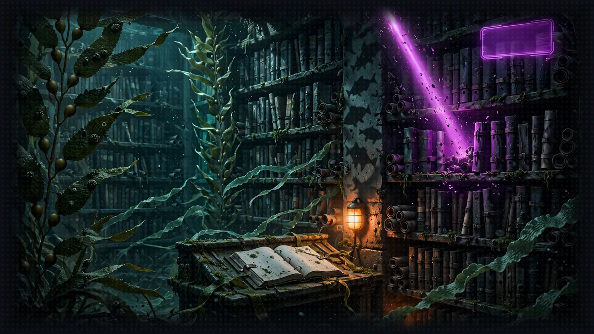

# Floor 8.3: The Rules Agent

[Previous: Floor 8.2](floor-8-2.md) | [Dungeon map](README.md) | [Next: Floor 8.4](floor-8-4.md) <!-- floor-nav -->



>  **System AI:** "Brick three. The rule book moves to a managed knowledge base, indexed by Bedrock at its own pace. Check the ingestion status before you deploy. Patience is a stat, and you have not leveled it."

## Floor Objective

Move the third brick to production: put the Crawl Handbook in an Amazon Bedrock Knowledge Base, deploy the Floor 5 Rules Agent to AgentCore Runtime as an A2A server that searches it, then point the Narrator at it. After this section, only the Narrator still runs on your machine.

Why not keep ChromaDB? In Floor 5 the rules live in a ChromaDB folder built on your machine, and the embedding model is downloaded on first use. On AgentCore Runtime the code folder is read-only, a new microVM must be ready within seconds, and every microVM would need its own copy of the index. The rules need a search service that lives outside the runtime, built once and shared by every session.

What is a managed knowledge base? A Bedrock Knowledge Base turns documents into a searchable index: it splits them into passages, computes their embeddings and stores the vectors. In a managed knowledge base, Bedrock also runs the vector store, so there is no database to create or size. You point it at an S3 bucket, it ingests the files, and the Retrieve API returns the passages closest to a question, each with the location of the file it came from. The AgentCore CLI declares it in the project like any other brick.

This section needs the `gameprod` project with the dice server and the Character Agent deployed in 8.1 and 8.2, and the knowledge base you started on the Floor 8 page. Make sure you are at the root of Floor 8 in your terminal:

```bash
cd aiRPG-seattle-dungeon-crawl/8_agentcore_production
```

This section works in two folders:

- The Rules Agent (`rulesagent/rules_agent.py`), the Floor 5 agent, with its `pyproject.toml` and `kb-policy.json`
- The Narrator (`narrator/narrator_orchestrator.py`), as you left it in 8.2

## Part 1: Check the Knowledge Base

>  **System AI:** "Ingestion: IN_PROGRESS means wait. Ingestion: COMPLETE means deploy. There is no third state you will enjoy."

You started the knowledge base on the Floor 8 page, in Step 3 of Set Up the Project. Here is what its commands did:

- `aws s3 mb` and `aws s3 cp --recursive` create a bucket and copy the eleven handbook files into it: a knowledge base reads its documents from S3. Bucket names are global across all AWS accounts, so the name ends with your account id.
- `agentcore add knowledge-base` declares a managed knowledge base named `rules` in `agentcore/agentcore.json`, with the bucket as its data source. The CLI gives the knowledge base, not your agents, the right to read the bucket.
- `agentcore deploy` creates the knowledge base and its data source, then the CLI starts the ingestion: Bedrock reads the handbook, splits it and indexes it. The deployment ends before the ingestion does.

>  **SYSTEM WARNING:** Run `agentcore` from the root of the `gameprod` folder, like every `agentcore` command of this floor. The CLI looks for `agentcore/agentcore.json` in the current folder and its parents: from `8_agentcore_production` or from `rulesagent/`, it stops with `No agentcore project found`. Check the indexing:

```bash
cd gameprod
agentcore status
```

Under Knowledge Bases, `rules` shows `Deployed` as soon as the knowledge base exists, and `Ingestion: IN_PROGRESS` while Bedrock indexes the handbook. It is ready when it shows `Ingestion: COMPLETE`. If the ingestion is still running, prepare the agent in Part 2 meanwhile, and check again before Part 3. Copy the id at the end of the knowledge base ARN, after `knowledge-base/` (10 characters, like `YAYTMGXCRR`): you paste it into `agentcore/agentcore.json` in Part 3, Step 2.

If you change a handbook file later, copy it to the bucket again and run `agentcore run ingest`: Bedrock indexes the bucket again, and the cloud Rules Agent answers from the new rule.

## Part 2: Prepare the Rules Agent for the Cloud (rulesagent/rules_agent.py)

The `query_rules` tool, its docstring, the prompts and the `create_agent` factory are the ones from Floor 5. Two things change: what the tool searches, and how the agent is served. In Floor 5 the agent already went through its tool to read the rules; only the body of the tool changes.

The top of the file reads the knowledge base id and creates the client:

```python
KNOWLEDGE_BASE_ID = os.environ["KNOWLEDGE_BASE_RULES_ID"]
knowledge_base = boto3.client("bedrock-agent-runtime")
```

Below them, a given helper, `section_of(result)`, turns the S3 location of a result into a section name: each handbook section is its own file, so `s3://.../03-dance-offs.md` becomes `Dance Offs` and `04-final-beat.md` becomes `Final Beat`. In Floor 5 the section came from the metadata you stored in ChromaDB; here Bedrock keeps the file location with every passage, and the file name is the section.

Unlike the memory in 8.2, the CLI passes nothing to the runtimes for a knowledge base: neither its id nor the right to search it. You add both to `agentcore/agentcore.json` in Part 3, Step 2.

### Step 1: Search the Knowledge Base

```python
    # TODO: Step 1 - Retrieve the 3 passages closest to the query from the knowledge base and prefix each one with its section
    results = knowledge_base.retrieve(
        knowledgeBaseId=KNOWLEDGE_BASE_ID,
        retrievalQuery={"text": query},
        retrievalConfiguration={"managedSearchConfiguration": {"numberOfResults": 3}},
    )["retrievalResults"]
    return "\n\n".join(
        f"[{section_of(result)}] {result['content']['text']}"
        for result in results
    )
```

The code goes under the TODO, at the end of `query_rules`, after its docstring. In Floor 5, the tool called `rules_collection().query(query_texts=[query], n_results=3)`. Here, `knowledge_base.retrieve(...)` takes:

- `knowledgeBaseId=KNOWLEDGE_BASE_ID`
- `retrievalQuery={"text": query}`: the question, in plain English; the knowledge base computes its embedding
- `retrievalConfiguration={"managedSearchConfiguration": {"numberOfResults": 3}}`: a managed knowledge base takes `managedSearchConfiguration`; the `vectorSearchConfiguration` you may find in other examples is for knowledge bases on your own vector store, and is rejected here

The response has a `retrievalResults` list. Each result holds the passage in `result["content"]["text"]` and the file it came from in `result["location"]["s3Location"]["uri"]`, which `section_of` reads. The tool returns the passages as in Floor 5: `[Final Beat] ...`, separated by blank lines. See Retrieve and ManagedSearchConfiguration.

### Step 2: Serve the Agent on AgentCore

```python
if __name__ == "__main__":
    # TODO: Step 2 - Serve the create_agent factory with serve_a2a on all interfaces, with the agent card of an A2AServer built on the same factory
    serve_a2a(
        StrandsA2AExecutor(agent_factory=create_agent, enable_a2a_compliant_streaming=True),
        agent_card=A2AServer(agent_factory=create_agent).public_agent_card,
        host="0.0.0.0",
    )
```

The call replaces the `pass` under the TODO. It is the same as for the Character Agent in 8.2, Part 1, Step 3.

As in 8.2, the agent is created with `callback_handler=None`, and this version needs `KNOWLEDGE_BASE_RULES_ID`, which only exists on AgentCore: do not start it locally.

## Part 3: Deploy the Rules Agent

Still from the `gameprod` folder.

### Step 1: Add the Rules Agent

```bash
agentcore add agent --name rulesagent --type byo --protocol A2A --framework Strands \
  --model-provider Bedrock --language Python \
  --code-location ../rulesagent --entrypoint rules_agent.py
```

Same command as for the Character Agent. Check the path:

```bash
ls ../rulesagent
```

You should see `kb-policy.json`, `nova-policy.json`, `pyproject.toml` and `rules_agent.py`.

### Step 2: Give the Agent the Knowledge Base

>  **ITEM ACQUIRED: [kb-policy.json]**
>
> Grants bedrock:Retrieve and nothing else. The Rules Agent can read the rule book. It cannot read your account. The System can. The System is the exception.

`rulesagent/kb-policy.json` is given, with nothing to change: this IAM policy allows a single action, `bedrock:Retrieve`, on the knowledge bases of your account. The agent can search the rules, and do nothing else in your account.

Open `agentcore/agentcore.json`. The `rulesagent` entry is already there, under `runtimes`: `agentcore add agent` wrote it in Step 1. Do not copy the whole block below, only add the `envVars` and `additionalPolicies` lines at the end of the entry, with a comma after the line before them (`...` stands for the lines already in the file):

```
{
  "name": "gameprod",
  ...
  "runtimes": [
    { "name": "diceserver", ... },
    { "name": "characteragent", ... },
    {
      "name": "rulesagent",
      "build": "CodeZip",
      "entrypoint": "rules_agent.py",
      "codeLocation": "../rulesagent/",
      "runtimeVersion": "PYTHON_3_14",
      "networkMode": "PUBLIC",
      "protocol": "A2A",
      "envVars": [{"name": "KNOWLEDGE_BASE_RULES_ID", "value": "<your-knowledge-base-id>"}],
      "additionalPolicies": ["kb-policy.json", "nova-policy.json"]
    }
  ],
  ...
}
```

Replace `<your-knowledge-base-id>` with the id from Part 1. The lines to add, ready to copy:

```json
"envVars": [{"name": "KNOWLEDGE_BASE_RULES_ID", "value": "<your-knowledge-base-id>"}],
"additionalPolicies": ["kb-policy.json", "nova-policy.json"]
```

The CLI may write the fields of the entry in another order, or add others: keep them as they are.

`envVars` sets the environment variables of the runtime: replace `<your-knowledge-base-id>` with the id you copied in Part 1. It is the cloud counterpart of the `.env` file the Narrator reads on your machine. `additionalPolicies` attaches both policies to the agent's role, as in 8.2. `nova-policy.json` lets the runtime role call Amazon Nova 2 Lite and nothing else: `bedrock:InvokeModel` and `bedrock:InvokeModelWithResponseStream` on the US cross-Region inference profile `us.amazon.nova-2-lite-v1:0` and on the `amazon.nova-2-lite-v1:0` foundation model it routes to in each US Region. Without the variable, the agent fails at startup with a `KeyError`; without the policy, `query_rules` fails with an `AccessDeniedException`.

### Step 3: Deploy

>  **SYSTEM WARNING:** Run these commands from the root of the `gameprod` folder, like every `agentcore` command of this floor.

Wait until `agentcore status` shows `Ingestion: COMPLETE`, then:

```bash
agentcore deploy -y
agentcore status
```

`rulesagent` should be `READY` with its URL. Copy it for Part 4.

### Step 4: Test the Deployed Agent

>  **NEW ACHIEVEMENT UNLOCKED!**
>
> **[FINAL BEAT ENJOYER]**
>
> Reward: You received a [Silver Box]. Inside: one Final Beat ruling, one section name, and a Rules Agent who will explain the speeding drum at parties.

>  **SYSTEM WARNING:** Run every command of this step from the root of the `gameprod` folder, like the rest of Part 3.

```bash
agentcore invoke --runtime rulesagent "How does the Final Beat work?"
```

The agent searches the knowledge base once and answers with the section name, Final Beat, as in Floor 5: both roll 1d20 plus their Dexterity modifier, and the total closest to 20 without going over wins.

## Part 4: Connect the Narrator (narrator/narrator_orchestrator.py)

The Rules Agent was the last brick on 127.0.0.1. It reuses the signed client configuration of 8.2: AgentCore keeps one session per runtime, so the same session id serves both agents.

>  **SYSTEM WARNING:** If you look at the solution: this file is shared by the four sections, and the `solution` branch shows it as it is at the end of 8.4, served by AgentCore. That version does not start on your machine. Only copy the lines under the `8.3 Step N` TODOs of this section, and keep the rest of your file as it is.

### Step 1: Read the Rules Agent URL from the Environment

In your `.env` file, paste the URL you copied in Part 3, Step 3 after `RULES_AGENT_URL=`, in the same form as the dice server's: the whole URL, on one line, without quotes. Then read it, as in 8.1:

```python
# TODO: 8.3 Step 1 - Read RULES_AGENT_URL from the environment
RULES_AGENT_URL = os.environ["RULES_AGENT_URL"]
```

The three URLs of your bricks are now in `.env`, and none in the code.

### Step 2: Point the A2A Client at the Cloud

Before:

```python
a2a_client = make_a2a_client(allowed_endpoints=[
    # TODO: 8.3 Step 2 - Replace the local Rules Agent with RULES_AGENT_URL and agentcore_config
    "http://127.0.0.1:8000",  # Rules Agent
    # TODO: 8.2 Step 3 - Replace the local Character Agent with CHARACTER_AGENT_URL and agentcore_config
    (CHARACTER_AGENT_URL, agentcore_config),  # Character Agent, on AgentCore
])
```

After:

```python
a2a_client = make_a2a_client(allowed_endpoints=[
    # TODO: 8.3 Step 2 - Replace the local Rules Agent with RULES_AGENT_URL and agentcore_config
    (RULES_AGENT_URL, agentcore_config),  # Rules Agent, on AgentCore
    # TODO: 8.2 Step 3 - Replace the local Character Agent with CHARACTER_AGENT_URL and agentcore_config
    (CHARACTER_AGENT_URL, agentcore_config),  # Character Agent, on AgentCore
])
```

Both entries of `make_a2a_client` are now `(url, client_config)` pairs.

### Step 3: Launch the Narrator

No Floor 5 agent is needed anymore: stop the local Rules Agent (terminal 1). Then stop the Narrator of this floor and start it again so it picks up your changes:

```bash
cd ../narrator
python narrator_orchestrator.py
```

## Part 5: Play Against the Cloud

>  **FLOOR BOSS:** A Pitch-Deck Founder blocks the Ship Canal locks. Sneak past or dance: the Rules Agent knows what each one costs, and the handbook backs it up.

```bash
curl -X POST http://0.0.0.0:8009/inquire \
  -H "Content-Type: application/json" \
  -d '{"question": "Quick rules check: can Barnaby sneak the party past the Pitch-Deck Founder at the Ship Canal locks instead of dancing? Then try it."}'
```

The Narrator asks the Rules Agent about stealth, then rolls on the cloud dice server and narrates. Its `details` field cites the handbook section. Three of your four bricks now run in AWS, and `agentcore logs --runtime rulesagent` shows the request. Only the Narrator is left on your machine: 8.4 moves it too.

## Floor Clear

Floor cleared, Crawler. The rule book now lives in the cloud, and every session reads the same one.

Loot you're keeping:

- How to put documents in a managed Bedrock Knowledge Base declared in the project (`agentcore add knowledge-base`, ingestion, `agentcore status`)
- How to search it from a tool (`bedrock-agent-runtime`, `retrieve`, `managedSearchConfiguration`, the result's S3 location)
- How to pass configuration and a least-privilege permission to a runtime (`envVars`, `additionalPolicies`, `bedrock:Retrieve`)

 **Stairwell:** Head to [8.4](floor-8-4.md) where the Narrator itself takes its seat in the cloud.


>  **NEW ACHIEVEMENT UNLOCKED!**
>
> **[RTFM (AS A SERVICE)]**
>
> Reward: You received a [Silver Box]. Inside: a deployed Rules Agent, a bedrock:Retrieve permission with no friends, and the whole Crawl Handbook on demand.

>  **System AI:** "The rule book lives in the cloud, and every session reads the same one. Fairness is a feature, not a promise."
