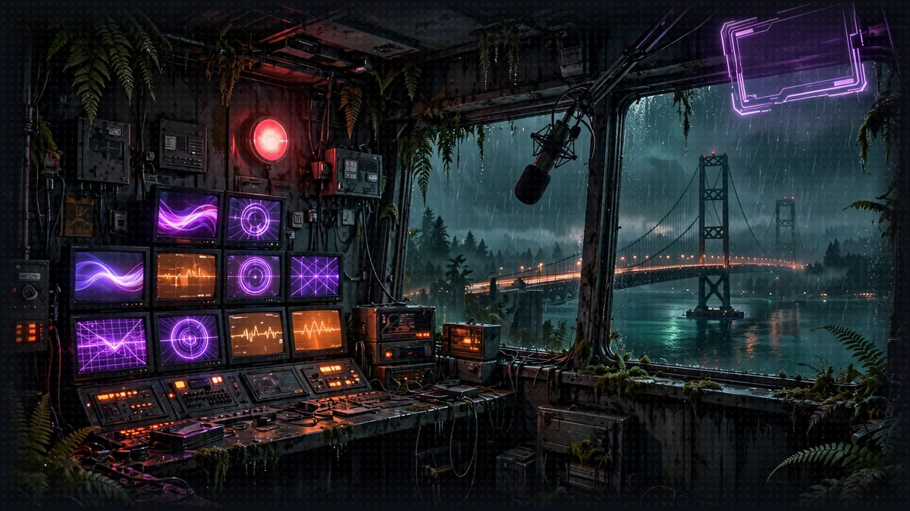

# Floor 8.4: The Narrator in the Cloud

[Previous: Floor 8.3](floor-8-3.md) | [Dungeon map](README.md) | [Next: The Exit](cleanup.md) <!-- floor-nav -->

Files on this floor: [`8_agentcore_production/narrator/narrator_orchestrator.py`](../8_agentcore_production/narrator/narrator_orchestrator.py), [`8_agentcore_production/ui_proxy/ui_proxy.py`](../8_agentcore_production/ui_proxy/ui_proxy.py) <!-- floor-files -->



<!-- cordula-log -->
>  **CORDULA'S LOG, FLOOR 8.4.** The last brick was the Narrator, the System's own voice, which is a strange thing to move when it is still talking to you. After that, the whole show ran in the cloud, the party's memory included. At the Keynote, the final boss, Barnaby did not need me to tell him what came next. He already knew. He had been here before, in the logs.
<!-- /cordula-log -->

>  **System AI:** "Final brick. I, the System, move into AgentCore Runtime. My conversation goes to AgentCore Memory, and my traces go to CloudWatch, where you may study my every thought. Do not stare."

## Floor Objective

Move the last brick to production: deploy the Narrator itself to AgentCore Runtime, keep its conversation in AgentCore Memory, and play from the Floor 6 web interface through a small local proxy. After this section, nothing of the game runs on your machine anymore, except the bridge to the web interface.

Why the Narrator changes. Until now it was a FastAPI server on port 8009 with its own routes (`/inquire`, `/messages`, `/user`). An HTTP runtime on AgentCore exposes a single route, `/invocations`, and only to callers signed with IAM. It also runs each session in its own microVM, which stops after a while without traffic and is replaced on every deployment: a conversation kept in the agent's memory would be lost with it.

What is AgentCore Memory short-term memory? In 8.2 the characters were records in AgentCore Memory. A memory also stores events: the messages of a conversation, filed by actor and session. Strands saves and restores a conversation through a session manager, and the `bedrock-agentcore` package provides one that writes these events, `AgentCoreMemorySessionManager`: every message is saved as it is added, and an agent created for an existing session starts with its whole history.

This section needs the `gameprod` project with the three bricks deployed in 8.1 to 8.3. Make sure you are at the root of Floor 8 in your terminal:

```bash
cd aiRPG-seattle-dungeon-crawl/8_agentcore_production
```

This section works in two folders:

- The Narrator ([`narrator/narrator_orchestrator.py`](../8_agentcore_production/narrator/narrator_orchestrator.py)), as you left it in 8.3, now with its own [`pyproject.toml`](../pyproject.toml) and [`invoke-policy.json`](../8_agentcore_production/narrator/invoke-policy.json)
- The UI proxy ([`ui_proxy/ui_proxy.py`](../8_agentcore_production/ui_proxy/ui_proxy.py)), given code, nothing to complete

## Part 1: Prepare the Narrator for the Cloud (narrator/narrator_orchestrator.py)

>  **System AI:** "This is the System moving house. FastAPI goes, BedrockAgentCoreApp arrives, and my memories move into AgentCore Memory so a redeploy cannot erase them. Handle with care."

The tools, `StoryOutput`, `NARRATOR_MODEL` and the system prompt do not change: the dice client of 8.1 and the A2A client of 8.2 and 8.3 already reach the other bricks in the cloud. What changes is how the Narrator is served and where its conversation lives.

### Step 1: Replace FastAPI with a BedrockAgentCoreApp

```python
# TODO: 8.4 Step 1 - Import BedrockAgentCoreApp from bedrock_agentcore.runtime
from bedrock_agentcore.runtime import BedrockAgentCoreApp
```

Under this TODO, everything from `app = FastAPI(...)` down to the end of the `/inquire` route gives way to a single line: the CORS middleware, `QuestionRequest` and the four routes (`/health`, `/messages`, `/user`, `/inquire`) go away.

Before:

```python
# TODO: 8.4 Step 1 - Replace the FastAPI app and its endpoints with a BedrockAgentCoreApp
app = FastAPI(title="Narrator API")
origins = ["*"]
app.add_middleware(
    CORSMiddleware,
    ...
)

class QuestionRequest(BaseModel):
    question: str

@app.get("/health")
...

@app.post("/inquire")
async def ask_agent(request: QuestionRequest):
    ...
        return JSONResponse(content={"error": "Internal server error"}, status_code=500)

# The URLs of your runtimes are read from the .env file of the floor folder (see .env.example)
load_dotenv()
```

After:

```python
# TODO: 8.4 Step 1 - Replace the FastAPI app and its endpoints with a BedrockAgentCoreApp
app = BedrockAgentCoreApp()

# The URLs of your runtimes are read from the .env file of the floor folder (see .env.example)
load_dotenv()
```

`...` stands for the lines of the file not shown here. `BedrockAgentCoreApp` is a web server that implements the [HTTP protocol contract](https://docs.aws.amazon.com/bedrock-agentcore/latest/devguide/runtime-http-protocol-contract.html) of AgentCore Runtime: `POST /invocations` for the requests and `GET /ping` for the health checks. The routes of the web interface move to the proxy of Part 3.

>  **CORDULA:** Moving the Narrator is moving the System's voice while it is still talking to you. Its front door had four signs on it. The cloud gives it one door and a doorbell, and whoever rings has to show ID. The System complained the whole time. I packed it anyway.

### Step 2: Keep the Conversation in AgentCore Memory

```python
# TODO: 8.4 Step 2 - Import AgentCoreMemoryConfig from bedrock_agentcore.memory.integrations.strands.config and AgentCoreMemorySessionManager from bedrock_agentcore.memory.integrations.strands.session_manager
from bedrock_agentcore.memory.integrations.strands.config import AgentCoreMemoryConfig
from bedrock_agentcore.memory.integrations.strands.session_manager import AgentCoreMemorySessionManager
```

The two classes live in two submodules of `bedrock_agentcore.memory.integrations.strands`.

In Floor 5 a single Narrator served every request. Here the agent is created in `get_narrator(session_id)`, once per session, on the first invocation of that session: the session manager needs the session id, which is only known when a request arrives, and creating the agent at import time could exceed the few seconds a new microVM has to start.

```python
            structured_output_model=StoryOutput,
            # TODO: 8.4 Step 2 - Keep the conversation in the conversations memory with an AgentCoreMemorySessionManager for this session and the actor "player"
            session_manager=AgentCoreMemorySessionManager(
                AgentCoreMemoryConfig(memory_id=os.environ["MEMORY_CONVERSATIONS_ID"], session_id=session_id, actor_id="player"),
            ),
            callback_handler=None,
        )
```

The two arguments go into the `Agent(...)` of `get_narrator`, under the TODO, before the closing parenthesis. The session manager takes an `AgentCoreMemoryConfig`: the memory id comes from the `MEMORY_CONVERSATIONS_ID` environment variable, which the CLI sets on the runtime at deployment, like `MEMORY_CHARACTERS_ID` in 8.2. The actor is the player the conversation belongs to. Like every boto3 client of the floor, the session manager takes the region of the runtime.

`callback_handler=None`: nobody reads its terminal anymore, and its logs go to CloudWatch. See [Integrate AgentCore Memory with Strands Agents](https://docs.aws.amazon.com/bedrock-agentcore/latest/devguide/strands-sdk-memory.html) in the AgentCore Developer Guide.

>  **CORDULA:** On the bluffs, a named session on my laptop kept the campaign. Here the laptop is gone, and every microVM is a Safe Room that gets torn down behind us. So the conversation goes to the records office too, filed under the player and the session. Barnaby asked how long they keep it. Thirty days, by default. He said that was longer than some octopuses get, and did not say anything else for a while.

### Step 3: Create the Entrypoint

```python
# TODO: 8.4 Step 3 - Create the entrypoint: return the messages of the session's Narrator if the payload asks for them, otherwise answer the prompt with a StoryOutput
@app.entrypoint
async def invoke(payload, context):
    narrator = get_narrator(context.session_id)
    if payload.get("messages"):
        return narrator.messages
    response = await narrator.invoke_async(payload["prompt"])
    return response.structured_output.model_dump()
```

The entrypoint is the function `BedrockAgentCoreApp` calls for every request on `/invocations`; `@app.entrypoint` registers it:

- `payload` is the JSON body of the request, as a dictionary. `agentcore invoke` sends `{"prompt": "..."}`, and the proxy also sends `{"messages": true}` to read the history.
- `context.session_id` is the session id of the request. Use it to get the Narrator of this session with `get_narrator`.
- With `{"messages": true}`, it returns `narrator.messages`, as the `/messages` route did.
- Otherwise it answers the prompt and returns `response.structured_output.model_dump()`: the entrypoint returns JSON, so the `StoryOutput` becomes a dictionary.

### Step 4: Run the App

Before:

```python
if __name__ == "__main__":
    # TODO: 8.4 Step 4 - Replace uvicorn.run with the run method of the BedrockAgentCoreApp
    uvicorn.run(app, port=8009)
```

After:

```python
if __name__ == "__main__":
    # TODO: 8.4 Step 4 - Replace uvicorn.run with the run method of the BedrockAgentCoreApp
    app.run()
```

`app.run()` serves on port 8080, the port AgentCore Runtime expects for an HTTP agent.

### Step 5: Delete the Local Server Imports

Before:

```python
# TODO: 8.4 Step 5 - Delete the fastapi, uvicorn and tinydb imports
import uvicorn
from fastapi import FastAPI
from fastapi.responses import JSONResponse
from fastapi.middleware.cors import CORSMiddleware
from tinydb import TinyDB, Query
```

After:

```python
# TODO: 8.4 Step 5 - Delete the fastapi, uvicorn and tinydb imports
```

Nothing uses these five imports anymore, and AgentCore does not install these packages: the Narrator's `pyproject.toml` does not list them, so a single leftover import stops the runtime at startup.

The `pyproject.toml` next to the Narrator lists its dependencies for AgentCore. `invoke-policy.json` is for Part 2, Step 3.

>  **SYSTEM WARNING:** Cloud only: this version needs `MEMORY_CONVERSATIONS_ID`, which only exists on AgentCore: do not start it locally.

## Part 2: Deploy the Narrator

Run the commands of this part from the project folder:

```bash
cd gameprod
```

### Step 1: Add the Conversations Memory

```bash
agentcore add memory --name conversations
```

A second memory, next to `characters`. With no `--expiry`, its events are kept 30 days, a fair lifetime for a campaign. The memory has no strategy: it only stores the conversation, and extracts no long-term facts from it.

### Step 2: Add the Narrator

```bash
agentcore add agent --name narrator --type byo --protocol HTTP --framework Strands \
  --model-provider Bedrock --language Python \
  --code-location ../narrator --entrypoint narrator_orchestrator.py
```

`--protocol HTTP` this time: the Narrator is neither an MCP server nor an A2A agent, but an application called over HTTP. Check the path:

```bash
ls ../narrator
```

You should see `narrator_orchestrator.py`, `invoke-policy.json`, `nova-policy.json` and `pyproject.toml`.

### Step 3: Configure the Narrator's Runtime

In the cloud, the Narrator needs two things your machine gave it until now.

The URLs of the other bricks. Your `.env` file does not travel: the CLI only packages the `narrator/` folder, and `.env` sits in the floor folder. On AgentCore, `load_dotenv()` finds no file and does nothing; the three variables come from the `envVars` of the runtime, as `KNOWLEDGE_BASE_RULES_ID` does for the Rules Agent in 8.3. The code does not change: on your machine its configuration comes from a file, in the cloud from the settings of the runtime.

The right to call them. The Narrator calls the dice server, the Character Agent and the Rules Agent with the credentials of its runtime role, and the CLI gives that role no right to call other runtimes. `narrator/invoke-policy.json` adds it: `bedrock-agentcore:InvokeAgentRuntime`, and `bedrock-agentcore:GetAgentCard` for the A2A agent cards, on the runtimes of the project only (`runtime/gameprod_*`). `nova-policy.json` lets the runtime role call Amazon Nova 2 Lite and nothing else: `bedrock:InvokeModel` and `bedrock:InvokeModelWithResponseStream` on the US cross-Region inference profile `us.amazon.nova-2-lite-v1:0` and on the `amazon.nova-2-lite-v1:0` foundation model it routes to in each US Region.

Open `agentcore/agentcore.json`. The `narrator` entry is already there, under `runtimes`: `agentcore add agent` wrote it in Step 2. As in 8.3, do not copy the whole block below, only add the `envVars` and `additionalPolicies` lines at the end of the entry, with a comma after the line before them (`...` stands for the lines already in the file), and copy the three URLs from your `.env` file:

```
{
  "name": "gameprod",
  ...
  "runtimes": [
    { "name": "diceserver", ... },
    { "name": "characteragent", ... },
    { "name": "rulesagent", ... },
    {
      "name": "narrator",
      "build": "CodeZip",
      "entrypoint": "narrator_orchestrator.py",
      "codeLocation": "../narrator/",
      "runtimeVersion": "PYTHON_3_14",
      "networkMode": "PUBLIC",
      "protocol": "HTTP",
      "envVars": [
        {"name": "DICE_SERVER_URL", "value": "<your diceserver URL>"},
        {"name": "CHARACTER_AGENT_URL", "value": "<your characteragent URL>"},
        {"name": "RULES_AGENT_URL", "value": "<your rulesagent URL>"}
      ],
      "additionalPolicies": ["invoke-policy.json", "nova-policy.json"]
    }
  ],
  ...
}
```

The lines to add, ready to copy, before you replace the three placeholders:

```json
"envVars": [
  {"name": "DICE_SERVER_URL", "value": "<your diceserver URL>"},
  {"name": "CHARACTER_AGENT_URL", "value": "<your characteragent URL>"},
  {"name": "RULES_AGENT_URL", "value": "<your rulesagent URL>"}
],
"additionalPolicies": ["invoke-policy.json", "nova-policy.json"]
```

>  **SYSTEM WARNING:** Replace the three `<your ... URL>` placeholders with the URLs of your `.env` file, the whole URL between the quotes, for example `"value": "https://bedrock-agentcore.us-west-2.amazonaws.com/runtimes/<encoded runtime ARN>/invocations"`. The deployed Narrator never reads your `.env` file: in the cloud, these values are the only ones it gets. If you deploy with the placeholders, the first call fails with `Invalid endpoint URL '<your diceserver URL>': missing URL scheme` in `agentcore logs --runtime narrator`: replace them, then deploy again.

The CLI may write the fields of the entry in another order, or add others: keep them as they are.

Without `envVars`, the Narrator fails at startup with a `KeyError`. Without `additionalPolicies`, it starts, but its calls to the other bricks are refused with an access-denied error.

### Step 4: Deploy

>  **SYSTEM WARNING:** Run these commands from the root of the `gameprod` folder, like every `agentcore` command of this floor.

```bash
agentcore deploy -y
agentcore status
```

`narrator` should be `READY`, and the `conversations` memory `ACTIVE`.

### Step 5: Test the Deployed Narrator

>  **SYSTEM WARNING:** Run every command of this step from the root of the `gameprod` folder, like the rest of Part 2.

```bash
agentcore invoke --runtime narrator --session-id seattle-campaign-test-of-floor-8-4-0001 \
  'Cordula challenges the Quarterly Close Accountant to a dance-off. Run round one.'
```

A session id must be at least 33 characters long. The Narrator discovers the two agents, asks the Rules Agent for the dance-off procedure, rolls both sides on the dice server and answers with a `StoryOutput` in JSON, after 30 to 60 seconds. Then ask a question only the conversation can answer, with the same session id:

```bash
agentcore invoke --runtime narrator --session-id seattle-campaign-test-of-floor-8-4-0001 \
  "Remind me: who did Cordula dance against, which move did you call, and what did we roll?"
```

The answer comes from the history. Even after the session's microVM is stopped or the Narrator redeployed, it would be the same: the new agent reloads the conversation from the `conversations` memory. Read the logs of the run:

```bash
agentcore logs --runtime narrator --since 15m
```

If the first invoke fails, the logs say why: `KeyError` names a missing `envVars` entry or memory, `Invalid endpoint URL '<your diceserver URL>'` means a placeholder is still in `agentcore.json` (Step 3), and `AccessDeniedException` on `InvokeAgentRuntime` means `invoke-policy.json` is not attached. After a fix and a deploy, use a new `--session-id`, or stop the old session as described in [Troubleshooting](#troubleshooting).

>  **CORDULA:** I asked the System, in the cloud, who I had danced against and what we rolled. It told me. Not because it remembered, it said, but because it had looked it up. Barnaby said that was the honest version of memory, and the only kind he trusts.

### What the Narrator and Its Memory Cost

The Narrator runtime bills like the others, per second while a session runs, and a dance-off turn keeps it busy 30 to 60 seconds, mostly waiting on the model and the other runtimes, which costs no CPU. The `conversations` memory bills about $1.00 per GB of events written, with each event counted as at least 12 KB, $0.20 per GB read and $0.10 per GB-month stored ([AgentCore pricing](https://aws.amazon.com/bedrock/agentcore/pricing/)). A hundred turns write a few hundred events: about 5 MB billed, half a cent. The model calls of those hundred turns, about a dollar, cost more than every runtime and memory of the floor together.

## Part 3: Play from the Web Interface (ui_proxy/ui_proxy.py)

>  **System AI:** "The browser has no AWS credentials. The proxy does. It signs every request and forwards it to the System. The System approves of intermediaries who know their place."

The Floor 6 web interface runs in your browser and calls `http://127.0.0.1:8009` without any AWS credentials. It cannot call the runtime directly. The proxy is a small local FastAPI server that keeps the three routes of the Floor 5 Narrator and forwards each request to the runtime with your credentials:

- it finds the ARN of the `gameprod_narrator` runtime and the id of the `characters` memory by listing them, so there is nothing to copy
- `/inquire` and `/messages` call `invoke_agent_runtime` with `{"prompt": ...}` and `{"messages": true}`, the two payloads of your entrypoint
- `/user/{user_name}` reads the character sheet directly from the memory of the Character Agent, as the Character Agent itself does in 8.2
- every request uses the same `SESSION_ID`: one session id is one campaign. Change it to start a new game.

### Step 1: Launch the Proxy

Stop the local Narrator (it uses port 8009), then start the proxy from the floor folder, with the virtual environment activated and the region set as on the Floor 8 page (`export AWS_DEFAULT_REGION=us-west-2`):

```bash
cd ../ui_proxy
python ui_proxy.py
```

You should see `Forwarding to arn:aws:bedrock-agentcore:us-west-2:...:runtime/gameprod_narrator-...`, then Uvicorn running on `http://127.0.0.1:8009`.

### Step 2: Play

From another terminal, the same request as before:

```bash
curl -X POST http://0.0.0.0:8009/inquire \
  -H "Content-Type: application/json" \
  -d '{"question": "Cordula challenges the Quarterly Close Accountant to a dance-off. Run round one."}'
```

Then open the Floor 6 web interface, pick who speaks for the party and enter `http://127.0.0.1:8009` as the server URL, as in Floor 6. The proxy reads the sheets you registered in the cloud memory in 8.2. Every turn now travels from your browser to the proxy, to the Narrator runtime, and from there to the three other bricks. Stop the proxy and start it again: the campaign picks up where you left it.

Check: the character panel shows the sheet registered in 8.2, and the first turn answers in 30 to 60 seconds. If the proxy stops at startup with `RuntimeError: No gameprod_narrator runtime in ...`, the region it names is not the one you deployed to: export `AWS_DEFAULT_REGION` and check `agentcore status`.

>  **CORDULA:** The Keynote was the last thing on the corporate floor: a stage on the Narrows bridge deck, a confidence monitor, a Regional Managing Director in the front row with a lanyard and a stopwatch. Everything we had built ran somewhere else now, and the only thing on my laptop was the bridge to the screen. Barnaby called the moves before the Narrator did. He had read every turn of this campaign in the logs, and he knew how it went. We took the Keynote on Choreography, three moves ahead, and the RMD stopped the stopwatch and clapped.

## Part 4: See What Your Agents Do

>  **System AI:** "Traces show every thought the System had during a turn, across four runtimes. Most of them were about you."

A Narrator turn now crosses several runtimes, and its terminal is gone: AgentCore records each turn as a trace instead. The `pyproject.toml` of the Narrator, the Character Agent and the Rules Agent lists `aws-opentelemetry-distro`, the AWS distribution of OpenTelemetry. AgentCore starts these runtimes with `opentelemetry-instrument`, and the distribution sends a span for each step of the agent loop to CloudWatch. Strands creates these spans itself, with nothing to add to the code. The dice server has no model and keeps tracing off (`"enableOtel": false` in `agentcore.json`): its rolls appear on the Narrator's side. See [AgentCore Observability](https://docs.aws.amazon.com/bedrock-agentcore/latest/devguide/observability.html) in the AgentCore Developer Guide.

Traces cost very little at this size: CloudWatch bills about $0.35 per GB of spans ingested ([AgentCore pricing](https://aws.amazon.com/bedrock/agentcore/pricing/), Observability), and a workshop's worth of turns is a few MB, under a cent.

### Step 1: List the Traces

Play a turn that needs a roll and a rule, for example "Barnaby tries an Eight-Point Hold on the banker during the Footwork call, what do we roll?", then, from the `gameprod` folder:

```bash
agentcore traces list --runtime narrator
```

You get one trace per turn, with its id and the session id of the proxy, followed by a link to the CloudWatch console. Traces take 2 to 3 minutes to appear: if the list is empty, wait and run it again.

### Step 2: Read a Turn in the Console

Open the link (or the CloudWatch console, GenAI Observability, then Bedrock AgentCore) and select a trace. A turn reads like this:

```
gameprod_narrator
└─ invoke_agent Strands Agents          the Narrator's turn
   ├─ execute_event_loop_cycle          one cycle of the agent loop
   │  └─ chat                           a call to the model on Amazon Bedrock
   ├─ execute_tool roll_dice            a roll on the dice server, over MCP
   └─ execute_tool a2a_client           a message to another agent, over A2A
      └─ gameprod_rulesagent            the same trace continues in the Rules Agent's runtime
         └─ invoke_agent Rules Agent
            ├─ chat
            └─ execute_tool query_rules  a search in the knowledge base
```

It is the agent loop of Floor 1, drawn: each cycle calls the model, which answers or asks for tools. The trace crosses the A2A call, so the Rules Agent's work appears inside the Narrator's turn, and the duration of each span shows where the time goes, usually in the `chat` spans. The Narrator shows as `Strands Agents` because it has no name, unlike the Rules Agent. The Rules Agent's runtime also adds many short `a2a.utils.helpers.append_artifact_to_task` spans from the A2A SDK: you can ignore them.

>  **CORDULA:** Barnaby read the trace of the Eight-Point Hold turn the way I read an after-action report: who called whom, how long each one took, where the time went. Most of it went to thinking, which he said was correct. Then he found his own name in the input of a model call and went very still, and I let him have the minute.

>  **SYSTEM WARNING:** Tracing "Not enabled" in the AgentCore console: the page of a runtime in the Amazon Bedrock AgentCore console shows `Tracing: Not enabled`. That setting delivers the spans of the AgentCore service itself, not the ones your agents send: the traces above do not need it.

>  **SYSTEM WARNING:** No trace at all after a few minutes: CloudWatch stores spans only once Transaction Search is enabled in the account, a one-time setting of the CloudWatch console. Enable it once per account and region. See [Enable Transaction Search](https://docs.aws.amazon.com/AmazonCloudWatch/latest/monitoring/Enable-TransactionSearch.html) in the CloudWatch User Guide.

## Troubleshooting

>  **System AI:** "A deploy does not replace a session that is already open. Stop the session, then try again. The campaign survives. Your patience may not."

The Narrator still fails, or behaves as before, after you fixed `agentcore.json` or the code and deployed again. `agentcore deploy` creates a new version of the runtime, but a session that is already open keeps running on the version it started with: AgentCore runs one microVM per session, and that microVM is not replaced by a deployment. The proxy always uses the same `SESSION_ID`, so its session can stay on the old version, for example with the `<your diceserver URL>` placeholders, until it has been idle for 15 minutes. `agentcore logs --runtime narrator` then keeps showing the old error, such as `Invalid endpoint URL '<your diceserver URL>': missing URL scheme`.

After every change you deploy to the Narrator, stop its session with `stop_runtime_session`. Run this from the `ui_proxy` folder, with the workshop virtual environment activated and the region set as on the Floor 8 page. It finds the runtime the same way the proxy does, so there is nothing to copy:

```bash
python -c "
import boto3
control = boto3.client('bedrock-agentcore-control')
arn = next(r['agentRuntimeArn'] for r in control.list_agent_runtimes()['agentRuntimes'] if r['agentRuntimeName'] == 'gameprod_narrator')
boto3.client('bedrock-agentcore').stop_runtime_session(agentRuntimeArn=arn, runtimeSessionId='campaign-airpg-seattle-dungeon-crawl-0001')
print('Session stopped')
"
```

The next request starts a new session on the latest version. The campaign is not lost: the conversation lives in the `conversations` memory, not in the microVM. If the command fails with `ResourceNotFoundException`, no session was open, and the error comes from somewhere else: read `agentcore logs --runtime narrator` from the `gameprod` folder. If you changed `SESSION_ID` in `ui_proxy.py`, use your value in the command.

The AWS CLI has the same operation, `aws bedrock-agentcore stop-runtime-session`, but only in recent versions: an older AWS CLI answers `Invalid choice: 'bedrock-agentcore'`. The Python version above uses the boto3 of the workshop environment, which always has it.

To remove everything at the end of the workshop, see the [Cleanup](cleanup.md) page.

## Floor Clear

Floor cleared, Crawler. The whole party now plays in the cloud, and the story survives every session.

Loot you're keeping:

- How to serve a Strands agent as an AgentCore HTTP runtime (`BedrockAgentCoreApp`, `@app.entrypoint`, `context.session_id`, `app.run()`)
- How to keep a conversation in AgentCore Memory (`agentcore add memory`, `AgentCoreMemorySessionManager`, `AgentCoreMemoryConfig`)
- How to let one runtime call the others (`envVars`, `additionalPolicies`, `bedrock-agentcore:InvokeAgentRuntime`)
- How to call a runtime from your own code with IAM (`invoke_agent_runtime`, `runtimeSessionId`)
- How to follow a turn across runtimes with traces (`aws-opentelemetry-distro`, `agentcore traces list`, CloudWatch GenAI Observability)

 **Stairwell:** Head to the [Cleanup](cleanup.md) page to drain the dungeon when the campaign is over.


>  **NEW ACHIEVEMENT UNLOCKED!**
>
> **[THE SYSTEM IS NOW IN THE CLOUD]**
>
> Reward: You received a [Gold Box]. Inside: a deployed Narrator, a proxy that speaks fluent localhost, and a trace of every turn across four runtimes.

>  **System AI:** "The whole party plays in the cloud, and the story survives every session. You may now clean up. You will not want to. Do it anyway."
