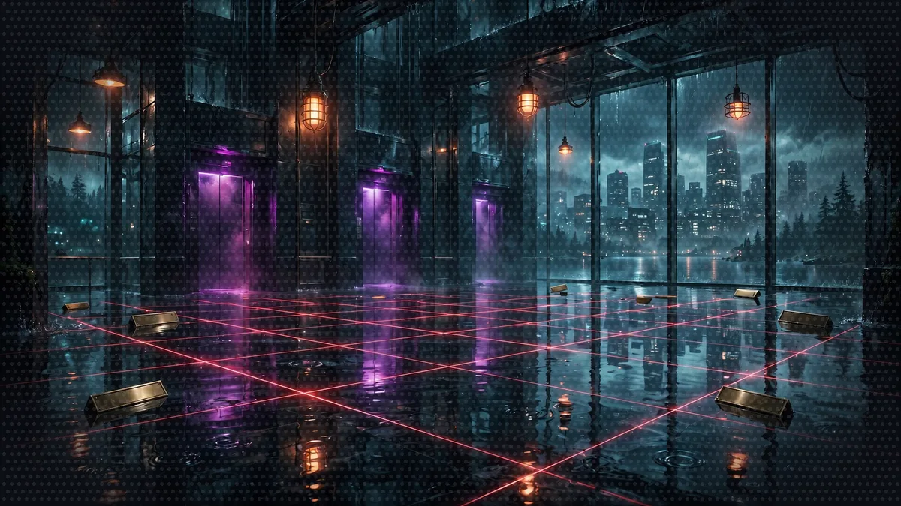

# Floor 8: Production (AgentCore)

[Previous: Floor 7](floor-7.md) | [Dungeon map](README.md) | [Next: Floor 8.1](floor-8-1.md) <!-- floor-nav -->

Files on this floor: [`8_agentcore_production/.env.example`](../8_agentcore_production/.env.example) <!-- floor-files -->


<!-- cordula-log -->
>  **CORDULA'S LOG, DAY 11, SATURDAY, JUNE 27, FLOOR 8.** The last floor is the corporate one: glass towers across Lake Washington, lanyards on a Saturday, a Regional Managing Director who wants us gone by end of quarter, and, past all of it, the Tacoma Narrows, where the old giant octopus legend lives. Everything we built so far stops the moment someone closes a laptop. Down here the game has to keep running on its own. So we moved the game, one piece at a time, into the cloud: the dice, the registration desk, the rule book, the Narrator itself. Barnaby insisted on doing it in order. He has always respected a checklist.
>
>  **BARNABY:** Order, Sergeant. One does not deploy a Narrator before its dice, and one does not deploy a rule book before its reader. The checklist is a kindness. I am being kind.
<!-- /cordula-log -->

>  **SAFE ROOM READING:** [Video 14: Deploying Agents to the Cloud](https://www.youtube.com/watch?v=ZpXWGjISMs8) by Morgan Willis. "[AgentCore] is a collection of components for building, deploying, and operating AI agents in production."
>
>  **CORDULA:** The broadcast relay has a public library now. The video walks through the same AgentCore deploy the floor uses, and Barnaby watched it twice before he let me type the first command. He calls it "checking the homework."

## Floor Objective

Take your game to production, one brick at a time: the dice server, the Character Agent, the Rules Agent and finally the Narrator move to [Amazon Bedrock AgentCore](https://aws.amazon.com/bedrock/agentcore/). Each section of this floor moves one brick to the cloud while the others keep running on your machine, so the game keeps working at every step.

What is AgentCore Runtime? AgentCore Runtime is a managed AWS service that hosts agents and MCP servers. Hand AgentCore Runtime your code. AgentCore Runtime packages the code, runs each session in its own isolated microVM, scales with the load, authenticates every caller with IAM and sends the logs to Amazon CloudWatch. AgentCore Runtime needs no server, no container and no load balancer from you. The AgentCore CLI (`agentcore`) drives each step from the terminal: create a project, declare what to deploy, deploy, test, read the logs.

The plan. Everything lives in a single AgentCore project named `gameprod`, created on this page. Each section adds one brick to the project, and each brick has its own folder in `8_agentcore_production`:

| Section | Brick | Folder |
|---|---|---|
| [8.1](floor-8-1.md) The Dice Server | the Floor 4 MCP server | `diceserver/` |
| [8.2](floor-8-2.md) The Character Agent | the Floor 5 A2A agent, its characters in AgentCore Memory | `characteragent/` |
| [8.3](floor-8-3.md) The Rules Agent | the Floor 5 A2A agent, its rules in a knowledge base | `rulesagent/` |
| [8.4](floor-8-4.md) The Narrator in the Cloud | the Floor 5 orchestrator, its conversation in AgentCore Memory | `narrator/`, `ui_proxy/` |

The Narrator ([`narrator/narrator_orchestrator.py`](../8_agentcore_production/narrator/narrator_orchestrator.py)) is the one file you come back to in every section: each time a brick moves to the cloud, the Narrator is pointed at it. Its TODOs therefore carry the number of their section (8.1 Step 1, 8.2 Step 1...). The code is the code you already wrote, with a few lines changed. This floor builds on Floors 4 to 6 only: Floor 7 (Strands harness) is not needed.

The code to write is given. Under each TODO, the sections show the code to paste, with the TODO line above it so you can see where it goes; keep the TODO in your file. When a step replaces or deletes code, a Before / After pair shows the change. The explanation under each block says why the code looks the way it does.

>  **SYSTEM WARNING:** Where to run this floor: Floor 8 deploys real resources to your own AWS account: IAM roles, CloudFormation stacks and AgentCore resources. Use credentials allowed to create IAM roles, CloudFormation stacks and AgentCore resources. The commands use `us-west-2`; any AgentCore region works: set the region in the export of Step 1.

## What Floor 8 Costs

Floors 0 to 7 bill only for Amazon Nova 2 Lite calls. Floor 8 also leaves resources in your account until the [Cleanup](cleanup.md) page removes them. Most resources bill only when used; a few bill a little for as long as they exist. The rates below are the us-west-2 list prices as of November 2026, from the [AgentCore pricing page](https://aws.amazon.com/bedrock/agentcore/pricing/), the [Amazon Bedrock pricing page](https://aws.amazon.com/bedrock/pricing/) (Managed Knowledge Bases) and the [CloudWatch pricing page](https://aws.amazon.com/cloudwatch/pricing/). The AgentCore Runtime rates are also quoted in the AWS sample [Cost and Reliability](https://aws-samples.github.io/sample-ac-central/docs/operate/cost-and-reliability/) guide. Check the rates for your region before starting.

| resource | section | how it bills | this workshop, roughly |
|---|---|---|---|
| AgentCore Runtime, four runtimes | 8.1 to 8.4 | per second: $0.0895 per vCPU-hour of CPU used and $0.00945 per GB-hour of memory, from the start of a session until the session stops. CPU drops to zero while the agent waits for Amazon Nova 2 Lite or a tool, and a session stops after 15 minutes without a request | an idle 0.5 GB session for its last 15 minutes: about a tenth of a cent. An afternoon of play: a few cents |
| Amazon Nova 2 Lite | every section | per token, as on [Floor 1](floor-1.md#what-a-turn-costs) | under one cent a turn; a dollar or two for the whole floor |
| AgentCore Memory, `characters` | 8.2 | $0.75 per 1,000 memory records a month, $0.50 per 1,000 record retrievals | two records: under a fifth of a cent a month |
| AgentCore Memory, `conversations` | 8.4 | $1.00 per GB of events written, each event billed as at least 12 KB; $0.20 per GB read; $0.10 per GB-month stored | 400 events: 4.8 MB billed, half a cent |
| Bedrock Managed Knowledge Base, `rules` | 8 and 8.3 | $5.00 per GB of raw data a month; $1.00 per 1,000 Retrieve calls; parsing and embeddings included | 13 KB of handbook: under a hundredth of a cent a month. 100 rules questions: 10 cents |
| S3 bucket for the handbook | 8 and 8.3 | storage and requests | under a cent |
| CloudWatch Logs and traces | 8.1 to 8.4 | $0.50 per GB of logs ingested, $0.03 per GB-month stored; $0.35 per GB of spans | a few MB: under a cent, but the runtime log groups never expire |

The worked examples: 0.5 GB x 0.25 hour x $0.00945 = $0.0012 for an idle session, and 13 KB x $5.00 per GB = $0.00006 a month for the handbook. The token counts and event counts are estimates for one learner playing a few dozen turns. A whole run of Floor 8 should stay under five dollars, most of it Amazon Nova 2 Lite calls. Your real numbers show up in [AWS Cost Explorer](https://docs.aws.amazon.com/cost-management/latest/userguide/ce-what-is.html), grouped by service, about a day later.

Nothing here has a monthly minimum, and nothing bills by the hour while idle except storage. That is not a reason to keep the resources: the [Cleanup](cleanup.md) page removes every row of this table.

## Set Up the Project

>  **System AI:** "SEVERITY-1 OPEN, Crawlers. Q2 migration window: the dice, the registry, the rule book, the Narrator, moved off your laptop and into the cloud before the quarter closes June 30."

>  **System AI:** "Everything from here costs money in somebody's AWS account. Possibly yours. Set AWS_DEFAULT_REGION in every terminal. The System will not remind you twice. The System has now reminded you twice."

Open a terminal at the root of Floor 8:

```bash
cd aiRPG-seattle-dungeon-crawl/8_agentcore_production
```

### Step 1: Install the AgentCore CLI

>  **ITEM ACQUIRED: [agentcore CLI 0.31.1]**
>
> Rarity: Pinned. Version 1.0 renames commands. Stay on 0.31.1 for the whole floor or explain yourself to the review board.


The CLI needs Node.js 20 or later. Install the version the crawl targets:

```bash
npm install -g @aws/agentcore@0.31.1
agentcore --version
```

`agentcore --version` should print `0.31.1`. The CLI evolves quickly and version 1.0 renames commands, so stay on 0.31.1 for the whole floor. The CLI uses your usual AWS credentials, like the agents of the previous floors. Set the region once, in every terminal you use for this floor:

```bash
export AWS_DEFAULT_REGION=us-west-2
```

The CLI deploys to the region in `AWS_DEFAULT_REGION`, and the code of the floor never names a region: boto3, the AWS SDK for Python, reads `AWS_DEFAULT_REGION`, and every client of the floor takes its region from that variable. `AWS_DEFAULT_REGION` takes precedence over the region of your AWS profile; without the variable, the CLI deploys to the region of your profile, and the Narrator looks for your runtimes there. Once deployed, the agents get the region of their runtime from AgentCore.

Check: `agentcore --version` prints `0.31.1`, and `aws sts get-caller-identity` prints your account id. If `agentcore` is not found, open a new terminal: npm puts global commands on your PATH, and a terminal opened before the install does not see the commands. If `npm install -g` fails with `EACCES`, npm installs global packages in a system folder on your machine: use a Node.js version manager such as nvm, or set an npm prefix in your home folder.

>  **CORDULA:** Barnaby made me read the version number out loud, twice, and write it on the back of my hand. "We will not upgrade mid-operation, Sergeant." I did not argue. I have watched a firmware update brick a landing craft on a beach.

### Step 2: Create the Project

Run this command from `8_agentcore_production`, the folder that holds `diceserver/` and `narrator/`:

```bash
agentcore create --project-name gameprod --no-agent
```

`--no-agent` creates an empty project: we will add our own code instead of a generated template. The new `gameprod/` folder sits next to the brick folders. Open `gameprod/agentcore/agentcore.json`: that file describes everything the project deploys, and it is empty for now. The `gameprod/agentcore/cdk/` folder holds the infrastructure code the CLI generates; never edit that folder.

### Step 3: Start the Knowledge Base

>  **SPONSOR MESSAGE:** Bedrock indexing is brought to you by patience: a few minutes in your own account, longer in a sandbox with a low embedding quota. Start it now and go deploy some dice.

In 8.3, the Rules Agent searches the Crawl Handbook in an Amazon Bedrock knowledge base. Bedrock needs time to index the handbook: the handbook is eleven small Markdown files, so a few minutes, longer in an account with a low embedding quota. Start the indexing now: it runs in the background while you work through 8.1 and 8.2. Here, run the commands only; 8.3 explains the commands.

The handbook is the one the Floor 5 knowledge base was built from, in `workshop/world/crawl-handbook/`. Run the commands from `8_agentcore_production`:

```bash
cd gameprod
BUCKET=gameprod-rules-$(aws sts get-caller-identity --query Account --output text)
aws s3 mb s3://$BUCKET
aws s3 cp ../../workshop/world/crawl-handbook/ s3://$BUCKET/ --recursive
agentcore add knowledge-base --name rules --description "Crawl Handbook" --source s3://$BUCKET/
agentcore deploy -y
```

`aws s3 cp --recursive` should list eleven uploads, one per handbook section. The files go into a new S3 bucket, the project declares a knowledge base that reads that bucket, and `agentcore deploy` creates the knowledge base in a few minutes. When the deployment ends, the knowledge base shows `Deployed` but is not ready yet: Bedrock keeps indexing the handbook. No need to wait: 8.3 checks the indexing.

These commands create resources in your AWS account: an S3 bucket and a knowledge base. Remove both at the end of the workshop, as described on the [Cleanup](cleanup.md) page.

Check: `agentcore status` lists `rules` under Knowledge Bases as `Deployed`, with `Ingestion: IN_PROGRESS` or `COMPLETE`. If `aws s3 mb` fails with `BucketAlreadyExists`, the name is taken: bucket names are global, so add a suffix to `BUCKET` and keep the suffix for the Cleanup page. If `agentcore deploy` fails, read [8.1, Part 2, Step 2](floor-8-1.md#step-2-deploy): the warnings in that section cover the usual errors.

>  **CORDULA:** We dropped the rule book into a bucket and walked away from the bucket, and that felt wrong. Bellevue is the kind of floor where the paperwork takes longer than the work. Barnaby called the handbook a "long-lead item" and moved on to the dice.

The project is ready: head to [8.1 The Dice Server](floor-8-1.md) to deploy the project's first brick.

## Cadabra on the Narrows (optional)

>  **CORDULA:** Cadabra fired an engine on its pad across the Narrows, and its range software wants the last word on our run.

- [Pad Explosion Aftermath](encounters/pad-explosion-aftermath.md), sidequest: evals: score the System AI's incident reports against a pad sheet, then adapt the prompt until every case passes
- [Range Safety Officer Protocol](encounters/range-safety-officer.md), boss battle: interrupts raised from inside a tool, a two-key termination and a standing order, answered by id

## Boss Battle: The Quarterly Earnings Call (optional)



>  **CORDULA:** Bellevue has conference rooms the way the estuary has tide pools. In one of them, a calendar invite for Monday shows the accountant from Floor 5, a banker and the Regional Managing Director, and we are the only item on the agenda.

[The Quarterly Earnings Call](encounters/quarterly-earnings-call.md): the accountant reviews, the banker spins, the Regional Managing Director signs off. A Strands graph with fixed edges and a condition on each one: the call only continues if the party took the last round. The encounter starts from the Floor 5 code and runs on your machine: play it before, during or after the deployments of this floor.

>  **SYSTEM DESIGN, LAYER 8: A PERSISTENT WORLD.** A LitRPG world exists whether or not the reader is looking. On your laptop, the System ends when you close the terminal. On AgentCore, the dice, the registry, the rules and the Narrator each run on their own, the characters live in AgentCore Memory, the rules in a managed knowledge base, and every turn leaves a trace. That is the difference between a game you run and a world that runs: Cordula's sheet is still there tomorrow, and so is the accountant's grudge. See [The System](world/the-system.md#what-each-floor-adds-to-the-system).

>  **NEW ACHIEVEMENT UNLOCKED!**
>
> **[WE DEPLOYED ON A SATURDAY]**
>
> Reward: You received a [Gold Box]. Inside: an empty AgentCore project, a knowledge base quietly indexing in the background, and a sense of foreboding.

>  **System AI:** "The project exists. Deploy the first brick, then the next. I will be watching your CloudFormation events."
