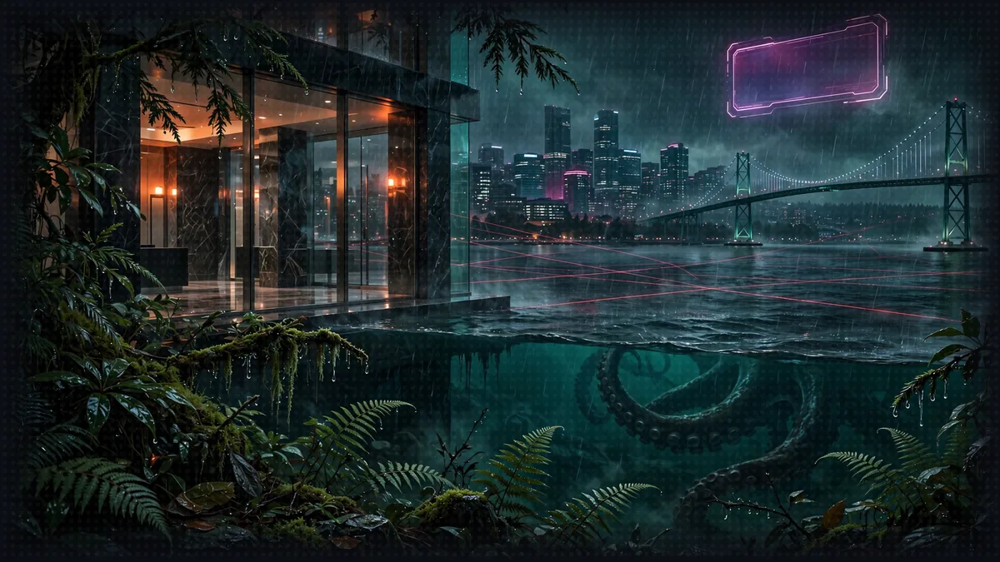

# Floor 8: Production (AgentCore)



>  **System AI:** "Floor 8. Production. Real AWS resources, real IAM roles, real invoices. This is the part of the crawl where mistakes cost money. Set your region before you do anything else. I mean it."

## Floor Objective

Take your game to production, one brick at a time: the dice server, the Character Agent, the Rules Agent and finally the Narrator move to [Amazon Bedrock AgentCore](https://aws.amazon.com/bedrock/agentcore/). Each section of this floor moves one brick to the cloud while the others keep running on your machine, so the game keeps working at every step.

What is AgentCore Runtime? AgentCore Runtime is a managed AWS service that hosts agents and MCP servers. You hand it your code; it packages it, runs each session in its own isolated microVM, scales with the load, authenticates every caller with IAM and sends the logs to Amazon CloudWatch. You manage no server, no container and no load balancer. The AgentCore CLI (`agentcore`) drives the whole process from your terminal: create a project, declare what to deploy, deploy, test, read the logs.

The plan. Everything lives in a single AgentCore project named `gameprod`, created on this page. Each section adds one brick to it, and each brick has its own folder in `8_agentcore_production`:

| Section | Brick | Folder |
|---|---|---|
| [8.1](floor-8-1.md) The Dice Server | the Floor 4 MCP server | `diceserver/` |
| [8.2](floor-8-2.md) The Character Agent | the Floor 5 A2A agent, its characters in AgentCore Memory | `characteragent/` |
| [8.3](floor-8-3.md) The Rules Agent | the Floor 5 A2A agent, its rules in a knowledge base | `rulesagent/` |
| [8.4](floor-8-4.md) The Narrator in the Cloud | the Floor 5 orchestrator, its conversation in AgentCore Memory | `narrator/`, `ui_proxy/` |

The Narrator (`narrator/narrator_orchestrator.py`) is the one file you come back to in every section: each time a brick moves to the cloud, the Narrator is pointed at it. Its TODOs therefore carry the number of their section (8.1 Step 1, 8.2 Step 1...). The code is the code you already wrote, with a few lines changed. This floor builds on Floors 4 to 6 only: Floor 7 (Strands harness) is not needed.

The code to write is given. Under each TODO, the sections show the code to paste, with the TODO line above it so you can see where it goes; keep the TODO in your file. When a step replaces or deletes code, a Before / After pair shows the change. The explanation under each block says why the code looks the way it does.

>  **SYSTEM WARNING:** Where to run this floor: it deploys real resources to your own AWS account: IAM roles, CloudFormation stacks and AgentCore resources. Use credentials allowed to create IAM roles, CloudFormation stacks and AgentCore resources. The commands use `us-west-2`; any AgentCore region works: set yours in the export of Step 1.

## Set Up the Project

>  **System AI:** "Everything from here costs money in somebody's AWS account. Possibly yours. Set AWS_DEFAULT_REGION in every terminal. The System will not remind you twice. The System has now reminded you twice."

Make sure you are at the root of Floor 8 in your terminal:

```bash
cd strands-dungeon-crawl/8_agentcore_production
```

### Step 1: Install the AgentCore CLI

>  **ITEM ACQUIRED: [agentcore CLI 0.31.1]**
>
> Rarity: Pinned. Version 1.0 renames several commands. Stay on 0.31.1 for the whole floor or explain yourself to the audience.


The CLI needs Node.js 20 or later. Install the version this crawl was written against:

```bash
npm install -g @aws/agentcore@0.31.1
agentcore --version
```

`agentcore --version` should print `0.31.1`. The CLI evolves quickly and version 1.0 renames several commands, so stay on this version for the whole floor. It uses your usual AWS credentials, like the agents of the previous floors. Set the region once, in every terminal you use for this floor:

```bash
export AWS_DEFAULT_REGION=us-west-2
```

The CLI deploys to this region, and the code of the floor never names one: boto3, the AWS SDK for Python, reads `AWS_DEFAULT_REGION`, and every client of the floor takes its region from there. The variable takes precedence over the region of your AWS profile; without it, the CLI deploys to the region of your profile, and the Narrator looks for your runtimes there. Once deployed, the agents get the region of their runtime from AgentCore.

### Step 2: Create the Project

Run this command from `8_agentcore_production`, the folder that holds `diceserver/` and `narrator/`:

```bash
agentcore create --project-name gameprod --no-agent
```

`--no-agent` creates an empty project: we will add our own code instead of a generated template. The new `gameprod/` folder sits next to the brick folders. Have a look at `gameprod/agentcore/agentcore.json`: this file describes everything the project deploys, and it is empty for now. The `gameprod/agentcore/cdk/` folder holds the infrastructure code the CLI generates for you; you never edit it.

### Step 3: Start the Knowledge Base

>  **SPONSOR MESSAGE:** Bedrock indexing is brought to you by patience: ten minutes in your own account, up to an hour in a sandbox. Start it now and go deploy some dice.

In 8.3, the Rules Agent searches the Basic Rules in an Amazon Bedrock knowledge base. Bedrock needs time to index the 11 MB PDF: about 10 minutes, up to an hour in an account with a low embedding quota. Start it now: the indexing runs in the background while you work through 8.1 and 8.2. Here you only run the commands; 8.3 explains them.

The PDF is the one you downloaded in Floor 5. Run the commands from the project folder:

```bash
cd gameprod
BUCKET=gameprod-rules-$(aws sts get-caller-identity --query Account --output text)
aws s3 mb s3://$BUCKET
aws s3 cp ../../5_a2a_integration/utils/DnD_BasicRules_2018.pdf s3://$BUCKET/
agentcore add knowledge-base --name rules --description "Basic Rules" --source s3://$BUCKET/
agentcore deploy -y
```

If `aws s3 cp` cannot find the PDF, download it again as in Floor 5. The PDF goes into a new S3 bucket, the project declares a knowledge base that reads it, and `agentcore deploy` creates it in a few minutes. When the deployment ends, the knowledge base shows `Deployed` but is not ready yet: Bedrock goes on indexing the PDF. Nothing to wait for: 8.3 checks the indexing.

These commands create resources in your AWS account: an S3 bucket and a knowledge base. Remove them at the end of the workshop, as described on the [Cleanup](cleanup.md) page.

The project is ready: head to [8.1 The Dice Server](floor-8-1.md) to deploy its first brick.

>  **NEW ACHIEVEMENT UNLOCKED!**
>
> **[WE DEPLOYED ON A FRIDAY]**
>
> Reward: You received a [Gold Box]. Inside: an empty AgentCore project, a knowledge base quietly indexing in the background, and a sense of foreboding.

>  **System AI:** "The project exists. Deploy the first brick, then the next. I will be watching your CloudFormation events."
