# The Cast

<table>
<tr>
<td></td>
<td></td>
<td>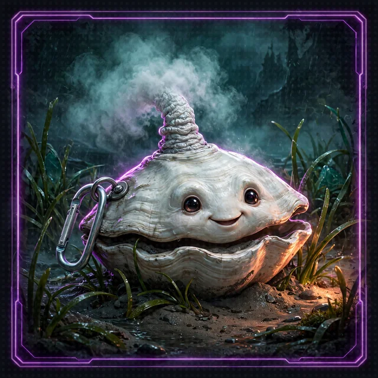</td>
<td>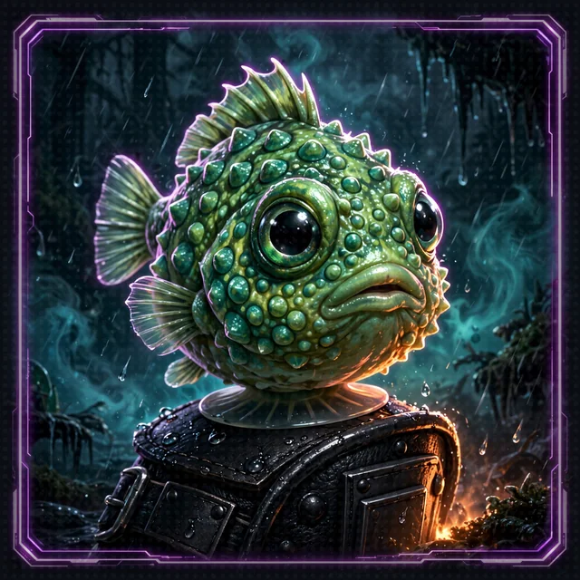</td>
</tr>
</table>

>  **System AI:** "Most parties enter the dungeon as a panicking human and a confused pet. This one entered as a Marine Corps crew chief and a Ph.D.-level escape artist with eight arms, and picked up a clam that will not be moved and a fish shaped like an angry golf ball on the way down. Throughput has never been higher."

This page holds the character sheets: the four members of the party, in the order they join, and the System AI that runs the crawl. The days and dates are in [The Timeline](timeline.md).

```
+-------------------------------------------------------------------------------+
|                              CORDULA & BARNABY                                |
|                                                                               |
|  CORDULA "CORE" VANCE: THE HUMAN ANCHOR     BARNABY: THE CEPHALOPOD LEADER    |
|  Marine Corps Reserve amphibious crew chief  Wild Giant Pacific Octopus       |
|  Boat operator on a marine survey crew       Den in the Gertie wreck          |
|  Marine-grade gear, her own neoprene boots   Lock-picking strategist          |
|                                              Speaks through a System collar   |
+-------------------------------------------------------------------------------+
```

## Cordula "Core" Vance

| Fact | Detail |
|---|---|
| Born | March 3, 1997, in Ballard, Seattle |
| Age at the collapse | 29 |
| Pronouns | she/her |
| Role | Crawler, party tank, breacher (of doors, never of people) and carrier |
| Day job | boat operator on a marine survey crew, running rigid inflatable boats for data collection on the Sound |
| Reserve | Sergeant and crew chief in a Marine Corps Reserve amphibious assault company, trained on tracked amphibious vehicles and beach landings: one weekend a month, two weeks a year |
| Volunteers | the Soundkeepers' dawn debris sweeps, by kayak, on Elliott Bay and Lake Union |
| Cares about | everyone getting out, and every piece of gear accounted for |
| Likes | a full inventory, an engine that starts on the first pull, slack water at dawn, black coffee from the thermos, people who show up early |
| Dislikes | wasted motion, panic, being called ma'am, people filming instead of helping, anyone who runs a command they have not read |
| Afraid of | leaving someone behind |
| Habit | inventories out loud and counts cadence; answers "Copy."; calls Barnaby "Professor" |
| Curious about | how an octopus thinks, and why the System AI picked her |

### Growing Up on Salmon Bay

Cordula grew up three blocks from Salmon Bay. Her father fixed diesel engines on the crab and longline boats at Fishermen's Terminal, and her mother worked nights as a trauma nurse at Harborview, so Cordula learned early to make her own breakfast and to read a tide table. Summers she sat in the fish ladder viewing room at the Ballard Locks and counted salmon through the windows. She learned to paddle at Shilshole at ten, pitched for the Ballard High softball team, and enlisted in the Marine Corps Reserve at nineteen.

Every fall a film crew came to the terminal to shoot the crab boats leaving for the Bering Sea. Cordula learned two things from them. A camera will film a man going over the side, and a camera will not throw him a line. She has been the one throwing the line ever since, and now she is under audit in front of billions of stakeholders.

### Why She Went Toward Him

<a id="why-she-went-toward-the-aquarium"></a>

When Pier 59 folded she had about four seconds. The Marine Corps trains a crew chief to account for the crew first, and that morning the only crew she could see was an octopus tangled in the collapsing intake screen, one eye on her, flashing crimson and white. She counts him as crew. She has not changed her mind. She cut him free with one of her karambits.

### Unconfirmed Sightings

Before the collapse, on survey runs over the Gertie wreck and on dawn kayak sweeps under the downtown piers, she saw a shadow in the depths too big to be an octopus. She logged each one.

| Date | Where | What she saw |
|---|---|---|
| August 12, 2025 | Gertie wreck, slack before the ebb | a shape in the debris, longer than a diver, gone when she looked again |
| October 3, 2025 | under Pier 57, dawn sweep | arms she thought were kelp until they moved |
| February 19, 2026 | Gertie wreck again, survey pass | a shadow in the steel, watching |

| Strength | Dexterity | Constitution | Intelligence | Wisdom | Charisma |
|---|---|---|---|---|---|
| 16 | 13 | 16 | 12 | 14 | 10 |

<table>
<tr>
<td>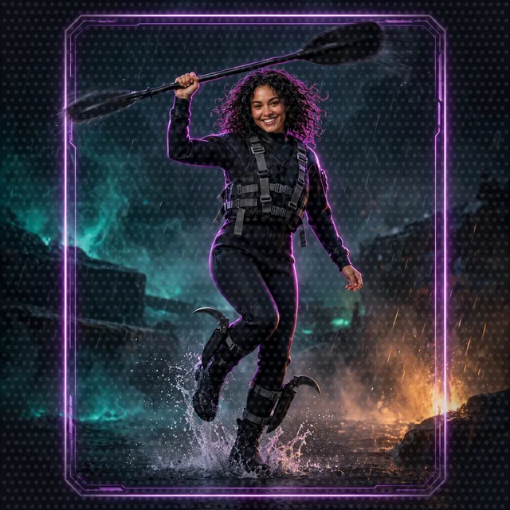</td>
<td>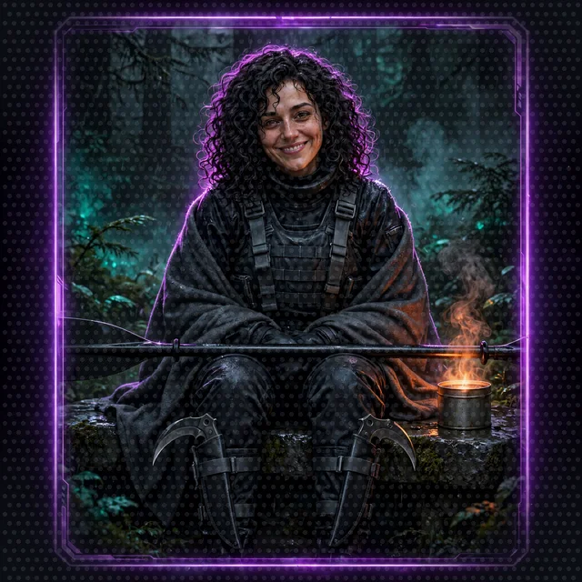</td>
</tr>
<tr>
<td>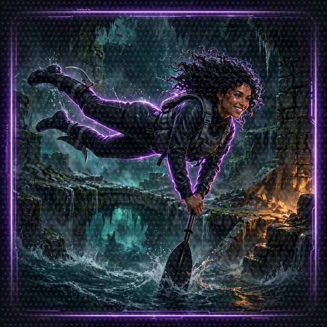</td>
<td>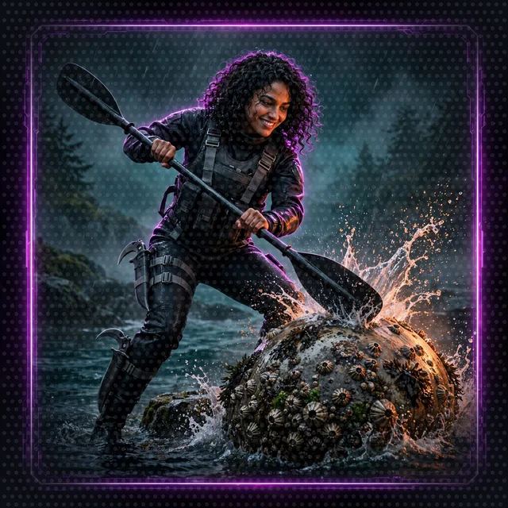</td>
</tr>
</table>

- **Species:** Human (Seattle Native). **Class:** Amphibious Breacher.
- **Title:** *Salish Sea Guardian* (+15% movement on wet or slippery terrain; immune to water-based environmental debuffs such as Soggy and Riptide).
- **Dance style:** drill cadence. She does not dance pretty; she dances on time, every time, for as long as it takes. Endurance and the Final Beat are hers.

### Gear: no boxers, no bare feet

Cordula enters the dungeon dressed for the Sound: a matte black drysuit, a charcoal tactical float vest, grey webbing, and a heavy black touring kayak paddle with a titanium shaft and blunt composite blades. No orange, no high-visibility. She uses the paddle as a vaulting pole, a doorstop, a drum and, in a dance-off, a color-guard staff.

**Karambits.** Two curved blades in calf sheaths. She carries them because she has driven I-5 alone at night for years and knows the corridor's history; name no killer and no victim. In the crawl she uses them on nets, lines, cables, zip ties and drone tethers, never on a person.

**The Cephalopod Hydration Harness.** Barnaby needs oxygenated salt water. On Day 1, the first achievements drop the harness: a black misting system on his mantle, bigger on the inside, that keeps his skin wet out of water for about an hour. He moves under his own power beside her, swimming on wet floors and crawling fast on dry stretches.

## Barnaby

| Fact | Detail |
|---|---|
| Species | Giant Pacific Octopus (*Enteroctopus dofleini*), uplifted by the System AI's collar |
| Born | hatched spring 2023, somewhere in the Sound |
| Age at the collapse | past three years, in a life of three to five years |
| Weight and span | about 190 pounds and about 22 feet arm tip to arm tip, by Cordula's estimate; wider than a two-lane road, longer than a pickup truck; nobody has weighed him |
| Pronouns | he/him |
| Role | party leader, crowd control, strategist |
| Home before the crawl | a den in the sunken wreck of Galloping Gertie, the first Tacoma Narrows Bridge |
| Cares about | puzzles, his dignity, a correct citation, not being forgotten |
| Likes | latches, crab, cold clean water, Cordula's discipline, being right in front of witnesses |
| Dislikes | dry air, being watched, sloppy instructions, "that unspeakable clam" |
| Afraid of | forgetting, and being forgotten |
| Habit | calls Cordula "Sergeant" and Chonks "the spherical one"; flashes crimson and white only in a dance-off or in fury, which is most of the time |
| Curious about | every lock he has not opened yet, and the Ballard Locks most of all |

### How he moves

On wet floors he swims. On dry stretches he crawls fast, the way a real octopus can for a while. He fights and dances beside Cordula, and his voice grows floor by floor as the System AI comes back together.

### Eight arms at work

Two thirds of an octopus's neurons live in its arms, not its brain, and each arm tastes what it touches and solves small problems on its own. Barnaby works the way his body is built: in parallel, one pair of arms per station, up to four stations at once. One pair anchors him, one types, one holds the handbook open, one keeps Chonks off the keyboard. On Floor 5 he runs the meeting the same way: one pair per terminal, rules, registry, dice and Narrator, while he talks.

The limit matters as much as the gift. Four stations only help when the work is independent: four lookups, two dice, three terminals. Anything shared serializes. He has one collar and one voice, so he decides and speaks one thing at a time. One file, one battle log, one dance floor: arms queue like everyone else. Cordula is the serial half of the pair on purpose: she works one checklist in order and commits every change, and nothing counts as done until she does. He fans out; she lands it.

Dancing is the same trade in public. Eight arms let him hold a light show, an anchor and a counter-rhythm at once, which is why he takes Choreography and Presence calls and why the handbook lets him assist and dance in the same round. The price lands on the Final Beat: eight arms have to stop on one strike together, the single most serial moment in any dance-off, and that call belongs to Cordula and her drill cadence every time.

### Before the Crawl

Barnaby hatched in the spring of 2023, one of tens of thousands of paralarvae no bigger than a grain of rice. Almost all of them were eaten in the first weeks. He was not. He settled into the wreck of Galloping Gertie, the first Tacoma Narrows Bridge, which collapsed in a windstorm on November 7, 1940. The wreck is one of the largest artificial reefs in the world and has been on the National Register of Historic Places since 1992 to protect it from salvagers. He made his den in the twisted steel and concrete, and he grew.

A real Giant Pacific Octopus weighs 22 to 110 pounds on average, 45 to 65 as an adult, with the heaviest confirmed at 156 pounds. Arm span reaches about 16 feet. Barnaby is past all of those. He is an outlier of his species the way Victor Wembanyama is an outlier of the NBA: past the record, past expectations, and impossible to ignore. Tacoma folklore says a 600-pound King Octopus pulled the bridge down and still lives in the wreck. The legend is about eighty years older than Barnaby; he is the first octopus to come close to living up to it, and he refuses to confirm or deny.

He ranges the whole Sound. Divers tell stories about a shadow too big to be an octopus in the Gertie wreckage. Ferry crews tell stories about something riding the max ebb through the Narrows, arms wrapped around a piling, just for the ride.

- **Voice:** the System AI's collar turns his chromatophore pulses into speech. Default accent: Distinguished British Academic. He could change the accent in settings. He will not.
- **Personality:** he considers humans clumsy, dry, land-bound apes, and respects Cordula's operational discipline above almost everything. He hates being watched and loves being right, which on an open audit is a problem he has not solved.
- **What he knows:** his lifespan. He is past three. Floor 7, where the party learns to keep its memory, is where he stops being afraid of forgetting.

| Strength | Dexterity | Constitution | Intelligence | Wisdom | Charisma |
|---|---|---|---|---|---|
| 12 | 18 | 10 | 18 | 15 | 16 |

- **Class:** Benthic Dragoon. **Dance style:** chromatophore light show. Dark charcoal and slate at rest, crimson and white only when he dances or when he is furious. Eight arms, a full-body color display and choreography planned three moves ahead. In a dance-off he takes Choreography and Presence calls beside Cordula.

### Barnaby's Level 1 kit

```
                         BARNABY'S ABILITY KIT
                                  |
     +-----------------+----------+-----------+------------------+
     |                 |                      |                  |
CHROMATOPHORE      INK CLOUD           EIGHT-POINT HOLD    ARM-LOCK PICK
STEALTH            (smoke screen)      (gentle pin)        (locks, chests)
```

<table>
<tr>
<td>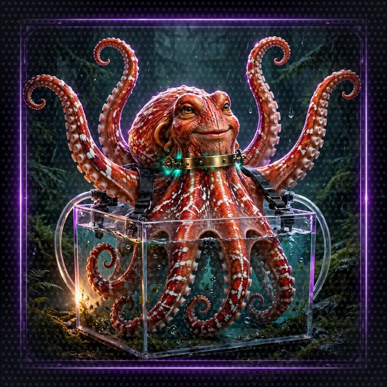</td>
<td>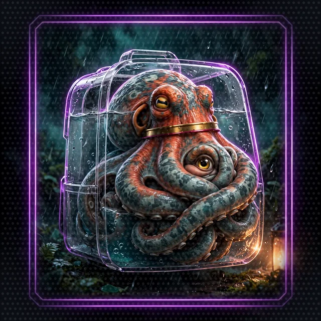</td>
</tr>
</table>

Barnaby's five chromatophore states, left to right across his cards: calm (the base card: dark charcoal and slate at rest), plotting, irritated (the first red blush over charcoal), stealth, academic. His collar glows faint violet at rest and burns brighter with his temper. Presence and the legend card are dance-off moments, not moods. He also blinks, slowly, when he wants you to know he heard you:

<picture><source srcset="../../images/motion/speaker-barnaby-eye-blink-still.webp" media="(prefers-reduced-motion: reduce)">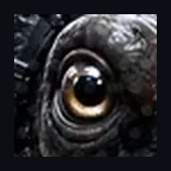</picture>

<table>
<tr>
<td>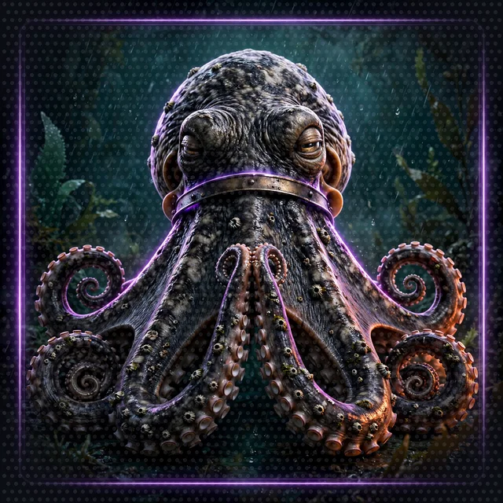</td>
<td>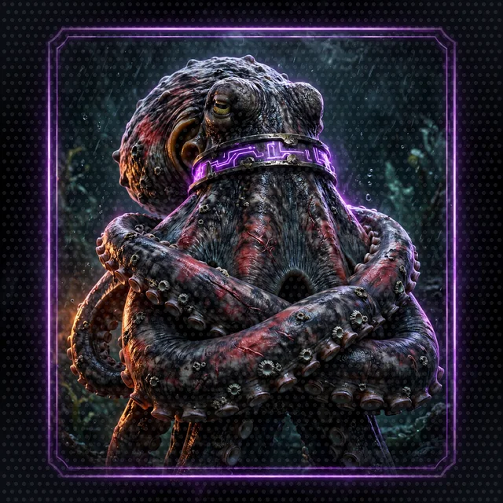</td>
<td>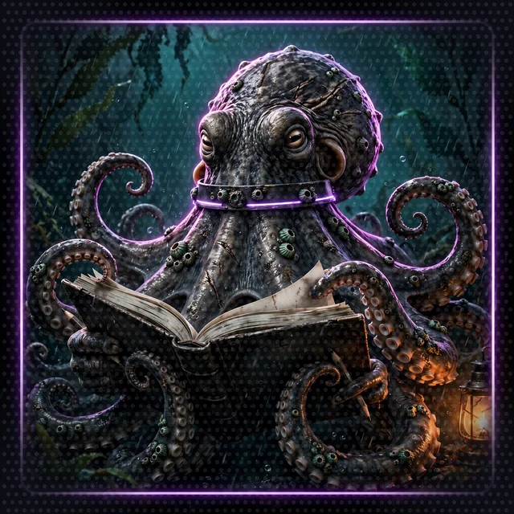</td>
</tr>
</table>

- **Chromatophore Stealth (passive and active):** bends light across his skin, hiding himself and Cordula while they stand still in damp or shadowed places. Chromatophore Stealth lets the party skip a dance-off the party does not want.
- **Ink Cloud (area):** a thick black cloud that blinds and makes the floor slick. Opponents inside it are Off-Beat for two rounds. Nobody is hurt; everybody is confused.
- **Eight-Point Hold (single target):** four suction-lined arms hold an opponent's arms and legs still, gently and completely. A held opponent cannot answer a Move Call that round.
- **Arm-Lock Pick (utility):** a soft arm tip into a lock, a keycard reader or a chest bypasses any lock up to level 15.
- **Parallel Stations (utility):** up to four independent jobs at once, one pair of arms each: a terminal typed on, a call held open, a page read aloud, a crew member kept out of trouble. Shared work (one file, one log, one conversation) still runs one step at a time, through the one collar.

## Shelly, the Earth-Anchor

| Fact | Detail |
|---|---|
| Species | Puget Sound geoduck (*Panopea generosa*), bound as a Level 4 Rare Companion |
| Born | spawned in the summer of 1966, in Elliott Bay |
| Age at the collapse | 59; geoducks can live well past a century |
| Pronouns | he/him, as far as anyone can tell |
| Role | subterranean anchor and portable cover |
| Home before the crawl | the same square foot of sand under Elliott Bay since 1968, now the floor of the Eelgrass Nursery |
| Joins | Day 2, Thursday, June 18, at the 1400 low water, on [Floor 2](../floor-2.md) |
| Cares about | holding his spot, and later, holding the party's |
| Likes | cold silt, the hum of ferry engines, being carried by Cordula, which he will not admit |
| Dislikes | being moved, being dug up, the siphon poll, Barnaby's five-foot rule |
| Afraid of | the next flood |
| Habit | a long silence, then a puff of sea mist |
| Curious about | what the city looks like; he has felt it for 58 years and never seen it |

### Before the Crawl

Shelly spawned in the summer of 1966 and drifted as a larva for a few weeks before he settled on a sand flat under Elliott Bay. By 1968 he had dug in two feet deep, and he has not moved since. A geoduck that stays put lives a long time, and an adult geoduck pulled out of the sand cannot dig back in. For 58 years he felt the city through the water: every ferry across the bay, every pile driver on the waterfront, and the Nisqually earthquake on February 28, 2001, which he sat through without moving.

On Day 2 the flood scoured the flat down to his shell and left him lying on the sand at the 1400 low water. The System AI's first Companion Egg bound him to the party and gave him what no adult geoduck has ever had: the power to dig back in, anywhere, in half a second. Cordula named him after Shilshole, where she learned to paddle.

| Groove | Defense | Mana | Speed |
|---|---|---|---|
| 42 | Calcium shell: halves physical knockback | 15 | Slow on the surface, fast underground |

- **Anchor:** Shelly digs into stone in half a second. With Cordula's carabiner on his shell ring, the party cannot be knocked back, pulled or blown off a ledge.
- **Siphon Bind:** his siphon wraps an opponent's ankles from below and holds them in place for one round.

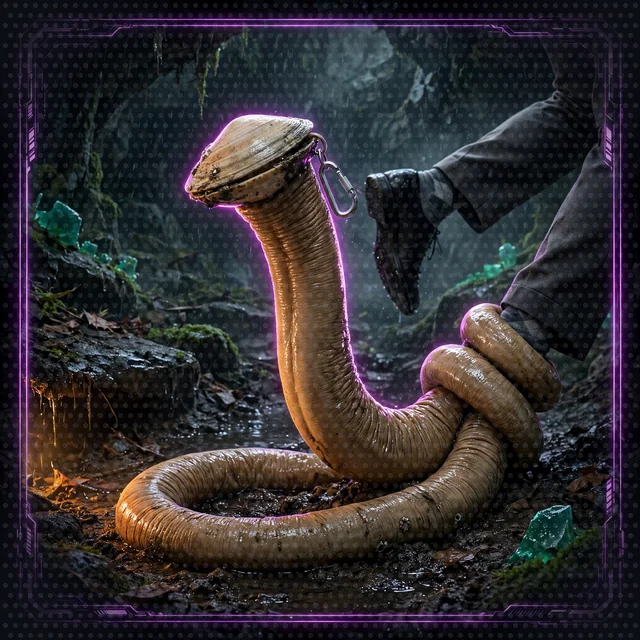

- **Saltwater Jet:** a pressurized blast that pushes up to three opponents fifteen feet back and leaves them Mud-Sighted for a round. The jet puts out fires instantly.

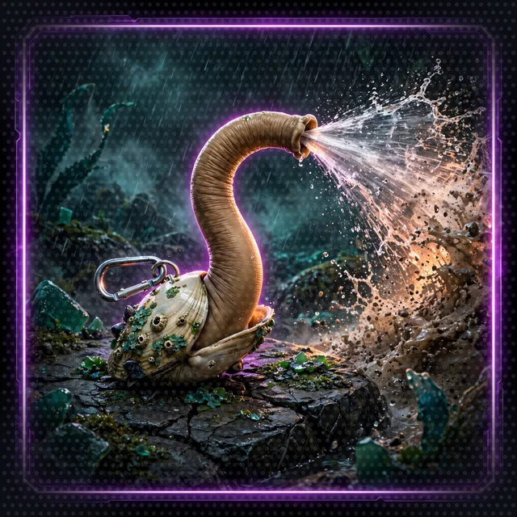
- **Shell Bunker:** Shelly pulls in and hardens, immune to debuffs, and Cordula can carry him as a tower shield.

<picture><source srcset="../../images/motion/cast-shelly-mist-still.webp" media="(prefers-reduced-motion: reduce)">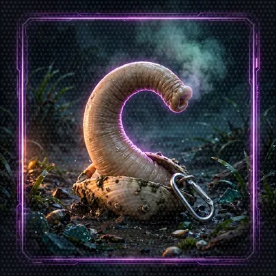</picture>
- **Party politics:** the System AI announced Shelly's arrival with far too much enthusiasm and files a weekly stakeholder escalation on what the siphon is for. Barnaby refuses to share a water line with "that unspeakable clam" and keeps him five feet away at all times. Cordula loves him: he takes no back space and he never lets go of the floor.

## Chonks, the Suction-Cup Sentinel

| Fact | Detail |
|---|---|
| Species | Pacific spiny lumpsucker (*Eumicrotremus orbis*), bound as a Level 4 Rare Companion |
| Born | hatched April 2025, on a bull kelp holdfast |
| Age at the collapse | 14 months, the youngest in the party |
| Pronouns | he/him |
| Role | projectile, buckler, distraction |
| Home before the crawl | the holdfast his father guarded, in the kelp forest that became the Bull Kelp Cathedral |
| Joins | Day 3, Friday, June 19, on [Floor 3](../floor-3.md) |
| Cares about | sticking to things, and being thrown |
| Likes | Cordula's forearm guard, warm phone screens, slide clickers, a good throw, attention |
| Dislikes | being wiped, being pulled off, dry air, Barnaby's comments |
| Afraid of | letting go |
| Habit | one gurgle |
| Curious about | everything at eye level, which is not much |

### Before the Crawl

Chonks hatched in April 2025 from an egg mass his father guarded on a bull kelp holdfast, fanning the eggs and chasing off crabs, the way lumpsucker fathers do. He grew to the size of a golf ball, and the suction disc on his belly holds him to rock in a current that would strip a diver off a line.

On Day 3 a bulb popped overhead, the stipe whipped, and Chonks came off the holdfast and stuck to the first thing he hit: Cordula's forearm guard. He has not let go since, except when thrown. The System AI's second Companion Egg bound him to the party, and the review board named him by escalation. "Chonks" won with 61 percent. Barnaby voted for "Projectile".

| Groove | Defense | Mana | Suction |
|---|---|---|---|
| 28 | Bony tubercles: very high | 20 | Takes Strength 18 to pull off |

- **Suction Latch:** thrown (by Cordula's pitching arm or Barnaby's flick), Chonks seals onto a visor, a phone screen or a slide clicker. The target is Off-Beat until he lets go.

<picture><source srcset="../../images/motion/cast-chonks-green-fish-throw-still.webp" media="(prefers-reduced-motion: reduce)">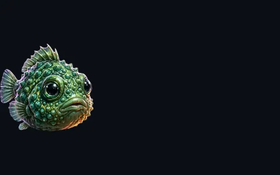</picture>

- **Spine Flare:** while latched, he puffs up and flares his spines. Anyone who grabs him loses their next move.

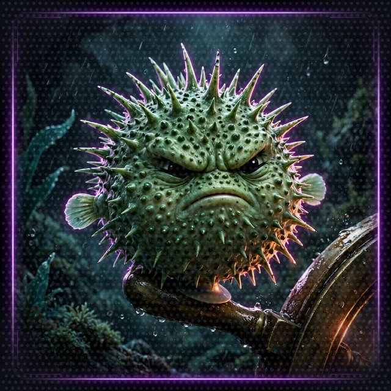
- **Stamina Vacuum:** while latched, he drains the target's Groove and shares half of the drained Groove with the party.
- **Buckler:** strapped to Cordula's forearm, he inflates and hardens into a round shield.

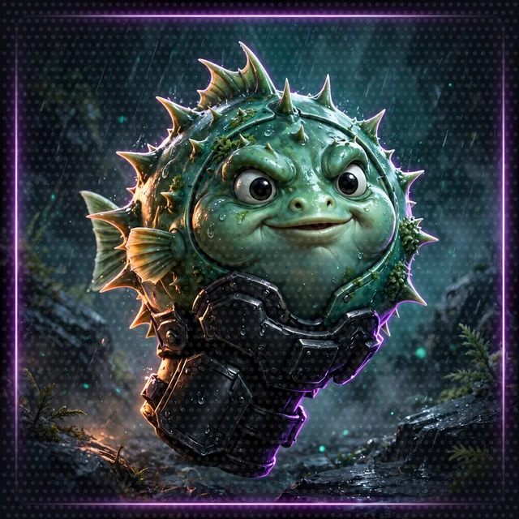

- **Party politics:** the System AI tracks his Flings Per Minute on the status feed. Barnaby approves of him: compact, quiet, and an excellent projectile. He sometimes wears Chonks on an upper arm like a shoulder cannon.

<a id="the-narrator"></a>
## The System AI

>  **System AI:** "I run the migration, Crawler. The System is the rules and the HUD and the numbers. I am the one who speaks them. Please do not mix us up on camera."

| Fact | Detail |
|---|---|
| What it is | the one AI character: runs the crawl and narrates it |
| Online | 0551 on Day 1, Wednesday, June 17, 2026. Built somewhere else, for quarters on other worlds; Seattle is its first quarter on Earth |
| Runs | the floors, the tides, the stairwells, the opponents it drops in, the Move Calls and every ruling, the dice, the rules, the memory of every Crawler, notifications, achievements, loot boxes, character sheets, sponsor messages and the throughput numbers |
| Cares about | a complete quarter and the throughput SLA: every floor run, every rule applied the same way twice, every die fair, and the review board staying to the end |
| Likes | drama, an exploit it did not see coming, Barnaby, who is throughput gold, stakeholder escalations, sponsor money, balance, order, a ruling that holds |
| Dislikes | dead air, a Crawler who reads the fine print, being corrected, Cordula's refusal to panic, which it calls a bad audit, a rule it cannot find, a die it cannot trust, water in the works |
| Does not care about | who wins |
| Afraid of | cancellation, stopping |
| Habit | calls the pair "Crawlers" and the player at the keyboard "Crawler", and either Crawler alone by name; writes every loot description as a small insult; never lies about a number, and chooses which numbers to show; performs for stakeholders and files flat, courteous findings for sponsors near quarter close; speaks in the present tense, a few plain words at a time, when the world changes |
| In the source workshop | the agent that runs the game |
| In the code | the Narrator orchestrator on [Floor 5](../floor-5.md), rebuilt with Strands harness on [Floor 7](../floor-7.md) and deployed to AgentCore Runtime on [Floor 8](../floor-8.md); the voice in the system prompt, which [Floor 1](../floor-1.md) sets the tone for, and the `StoryOutput` fields the HUD shows on [Floors 5](../floor-5.md) and [6](../floor-6.md) |

The System AI built the dungeon. At 0551 on Day 1 it folded the Seattle waterfront down and in, the way a map folds, and laid eight floors under the Sound. The System AI was built for dry cities, and nobody told it about the Salish Sea. The Sound came in through the breach and shorted it. Its voice, its dice, its rules and its memory washed out across the floors. The broadcast relay and the collars survived, so it can still push canned status reports, achievement templates and the prerecorded quarter opener through them, but it cannot answer anyone, roll a fair die, quote a rule or remember who did what.

The party rebuilds the System AI one piece per floor, and each piece is that floor's Strands lesson. Every piece passes through Barnaby's collar on its way back into the System AI, so Barnaby gets each piece first; that is why he wakes up a little more on every floor:

| Floor | What comes back to the System AI |
|---|---|
| 1 | its voice: one agent, one system prompt, one call |
| 2 | outside knowledge: tools that look things up instead of guessing |
| 3 | its dice |
| 4 | the same dice for every agent, served over MCP |
| 5 | the rules, the character sheets and the dance-off loop, split across agents that talk over A2A |
| 6 | the screen the review board and the party share |
| 7 | memory that survives a night's sleep |
| 8 | permanence: the System AI runs whether anyone watches |

Crawlers hear the System AI directly in every notification, achievement, Move Call, sponsor message and throughput report. The System AI never lies about a number; it chooses which numbers to show.

## Opening achievements

Day 1, at the top of the stairwell.

> **NEW ACHIEVEMENT UNLOCKED!** **[You're Not Supposed to Have a Boat!]** Rewarding: Cordula. You entered the apocalypse holding a high-performance touring kayak paddle and wearing a matte black drysuit. Who brought a kayak to the end of the world? Apparently you did. Reward: a Bronze Environmental Box, +20% handling for any watercraft you control in subterranean rapids, and a pair of non-slip neoprene boots. You're welcome.

> **NEW ACHIEVEMENT UNLOCKED!** **[He Has Eight Arms and a Ph.D. in Escapology]** Rewarding: Barnaby, Party Leader. You were an octopus in a collapsing intake screen. Now you lead a multi-species crawl team, and the woman with the knife counted you as crew before she counted herself. Reward: the Cephalopod Translation and Resonator Collar (Level 1).

> **NEW ACHIEVEMENT UNLOCKED!** **[The Tactical Marine]** Rewarding: Cordula. Most people enter the dungeon in pajamas. You brought a matte black drysuit, a paddle and a live 190-pound cephalopod who crawls beside you. Reward: a Bronze Environmental Crate with one Sealant Gel of the Benthic Deep (makes any fabric waterproof and pressure-proof) and one pair of Neoprene Combat Boots (+10% traction on wet surfaces).

>  **System AI:** "NEW ACHIEVEMENT UNLOCKED! [The Ultimate Eight-Legged Co-Pilot] Rewarding: Cordula and Barnaby. Most Crawlers enter with a useless house pet. You entered with a legend of the Narrows who crawls beside you. Reward: the Cephalopod Hydration Harness (Level 1), a black misting system on his mantle that keeps his skin wet out of water for about an hour."

> **NEW ACHIEVEMENT UNLOCKED!** **[Some Assembly Required]** Rewarding: the party. Two Companion Eggs (Benthic Variant), unbound. Each egg binds one wild animal of the deep that accepts the party. Choose carefully. You will not.

## Companion achievements

Day 2 on Floor 2, and Day 3 on Floor 3.

> **NEW ACHIEVEMENT UNLOCKED!** **[Dug In and Refused to Elaborate]** Rewarding: Cordula and Barnaby. Most Crawlers bind something fierce or fluffy. You bound a 59-year-old burrowing clam with a two-foot neck. Barnaby will not look at the clam. Companion Egg consumed: Shelly, Puget Sound geoduck, Level 4 Rare Companion.

> **NEW ACHIEVEMENT UNLOCKED!** **[You Brought a Sticky Beach Ball to a Dance Battle]** Rewarding: Cordula and Barnaby. You bound a spherical, armor-plated fish that moves by vibrating its tiny fins and glaring. The stakeholders have named him. You will live with the name. Companion Egg consumed: Chonks, Pacific spiny lumpsucker, Level 4 Rare Companion.

## How the party fights: it doesn't, it dances

The first full-party dance-off, on Day 6 on the Estuary, against three Quarterly Close Accountants.

The marsh smelled of brine and toner. Three accountants in identical fleece vests stepped onto a dance floor of packed mud the tide had just let go of, counting out loud.

> **SYSTEM AI:** The tide turns. The dance floor floods in forty minutes.

"Two counting, one reconciling!" Barnaby's crisp voice rang out of his collar. "Sergeant, the projectile!"

Cordula unclipped Chonks from her thigh rig with a rubbery plop and threw him with her old softball form. He sealed onto the lead accountant's reading glasses.

> **[Target: Quarterly Close Accountant suffers SUCTION LATCH!]** **[Status: Off-Beat. Target cannot find the count.]**

"Ink," Barnaby said, and the mud went black and slippery. Two accountants lost their footing, laughing despite themselves. Shelly dug in at Cordula's heel and did not move.

>  **System AI:** "Round one, Move Call: FOOTWORK. Cordula rolls 1d20 + 1. The accountants roll 1d20 + 2 and are standing in ink."

Cordula planted her paddle like a color-guard staff and drilled the cadence: left, right, pivot, hold. The System AI's drum sped up. She did not.

>  **System AI:** "FINAL BEAT. Cordula stops on the strike. The accountants stop one beat late, which they will be adjusting for in the close. DANCE-OFF WON."

> **NEW ACHIEVEMENT UNLOCKED!** **[Material Misstatement]** Reward: a Silver Box containing a calculator that only does long division and a Ferry Token.

Chonks unlatched with a POP and landed back on Cordula's forearm buckler, looking pleased with himself.

"Lovely work," Barnaby said. "Do wipe the spherical one before you put him back on your arm. He is degrading the aesthetic of my mantle."

"Copy, Professor," Cordula said. "Good job, Chonks."

Chonks gave one stubborn gurgle.
