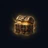
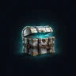
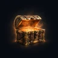
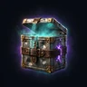
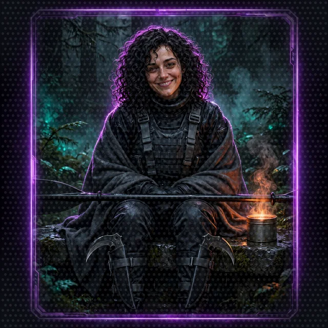

# The System: Designing a LitRPG While You Build Its AI

> **System AI:** "You are not only building agents, Crawler. You are building the Narrator, the mind that runs this show and judges you. Every floor of this workshop adds one more piece of it. Please build it carefully. It will remember, and so will I."

A LitRPG lives or dies on its System: the rules that turn a story into numbers, and the voice that announces them. This crawl's System has two minds. The Narrator is the game AI that runs the world, and the System AI is the interface that talks to the Crawlers. This crawl teaches the Strands Agents SDK and LitRPG System design together. Each workshop floor builds one agent capability and one layer of the game. The rules themselves live in the [Crawl Handbook](crawl-handbook/), which is also the knowledge base the Rules Agent searches on Floor 5.

## What each floor adds to the System

| Workshop floor | Strands concept | System layer built |
|---|---|---|
| [0](../floor-0.md) | Environment setup | The premise: the Narrator, the System AI and why both need the party |
| [1](../floor-1.md) | An agent and its system prompt | The Narrator's voice, spoken through the System AI: how notifications sound |
| [2](../floor-2.md) | Vended tools | Outside knowledge: the System looks things up instead of guessing |
| [3](../floor-3.md) | A custom tool and its docstring | Hard math: ability scores, modifiers, dice |
| [4](../floor-4.md) | An MCP server | One fair source of randomness, shared by every agent |
| [5](../floor-5.md) | A2A agents, a knowledge base, structured output | The rules, the character sheet and the dance-off loop |
| [6](../floor-6.md) | A web interface | The HUD |
| [7](../floor-7.md) | Strands harness sessions and memory | Persistence and consequence |
| [8](../floor-8.md) | AgentCore Runtime, Memory and a managed knowledge base | A persistent world: the characters, the rules and the campaign outlive any one session |

## 1. Origin and interface

```
+-----------------------------------------------------------------------------------+
|                              LITRPG SYSTEM BACKBONE                               |
|                                                                                   |
|  THE INTERFACE                 STAT DESIGN                  SYSTEM ORIGIN         |
|  Notification boxes            Primary: STR DEX CON         Two minds:            |
|  A floating HUD                         INT WIS CHA          the Narrator runs    |
|  The battle log                Derived: Groove, Mana         the world, the       |
|                                Hidden: Hype, Luck            System AI the show   |
+-----------------------------------------------------------------------------------+
```

- **Origin.** *Dungeon Crawl: Seattle* is a reality show for a galaxy of alien viewers and their sponsors, and two minds run it:

| | The Narrator | The System AI |
|---|---|---|
| In LitRPG terms | the game AI, the world engine | the System AI, the interface |
| Runs | the floors, the tides, the opponents, the dice, the rules, the rulings and the memory | notifications, achievements, loot boxes, character sheets, sponsor messages and the ratings |
| Voice | rare, plain, present tense, only when the world changes | constant: a petty, theatrical game-show host, exact about numbers |
| After the flood | broken: its voice, dice, rules and memory washed out across the floors | intact, but with nothing true to say until the Narrator is rebuilt |
| In the code | the Narrator orchestrator the workshop builds, the job the source workshop gives its game-running agent | the voice in the Narrator's system prompt, and the `StoryOutput` the HUD shows |

- **Why the party matters.** The Narrator folded the Seattle waterfront into a dungeon at 0551 on Day 1, and the Sound came in and broke it. The System AI drafted the first Crawlers it found to rebuild the Narrator, one piece per floor. The full sheets for both minds are in [The Cast](cast.md#the-narrator), and the days are in [The Timeline](timeline.md).
- **One voice for the player.** The Narrator decides and the System AI announces, so the player hears one voice. The Narrator's system prompt opens "You are the System" for that reason. The System AI never lies about a number; it chooses which numbers to show.
- **Notifications.** Every System message arrives as a typed notification: `NEW ACHIEVEMENT UNLOCKED`, `SYSTEM WARNING`, `SPONSOR MESSAGE`, Move Calls and Final Beats. In the code, a notification is the `response` field of `StoryOutput`.
- **The HUD.** Floating panels for the character sheet, the dice and the suggested actions. In the code, the HUD is the Floor 6 web interface rendering `StoryOutput`.
- **The battle log.** Every die rolled, with its reason. In the code, the battle log is `dice_rolls`, and every entry must come from a real `roll_dice` call.

<table>
  <tr>
    <td align="center"></td>
    <td align="center"></td>
    <td align="center"></td>
    <td align="center"></td>
    <td align="center"></td>
  </tr>
</table>
- **Tone is a design decision.** An analytic System makes a survival story; a hostile one makes a horror story. This crawl's System AI is a game-show host with too much power and a sense of humor, so the system prompt on Floor 1 matters as much as any rule.

## 2. Stat design

- **Primary stats.** The six classic ability scores, rolled 4d6 drop lowest. Each ability score maps to a kind of dance move, so every stat matters in the core conflict:

| Ability | Dance-off Move Call | Also used for |
|---|---|---|
| Strength | Power | Lifting, carrying, holding a door |
| Dexterity | Footwork, and the Final Beat | Stealth, balance, throwing Chonks |
| Constitution | Endurance | Groove, staying on the floor |
| Intelligence | Choreography | Locks, puzzles, reading the System's fine print |
| Wisdom | Read the Room | Noticing hidden opponents and traps |
| Charisma | Presence | Sponsors, crowds, talking an opponent out of a dance-off |

<table>
  <tr>
    <td align="center"></td>
    <td align="center"></td>
    <td align="center"></td>
    <td align="center"></td>
    <td align="center"></td>
    <td align="center"></td>
  </tr>
</table>

- **Derived stats.** Computed from the primary stats by the Character Agent, never chosen: **Groove** (how long a Crawler stays on the dance floor) and **Mana** (how many abilities you can use before a Safe Room).
- **Hidden stats.** Tracked by the Narrator and shown only when the System AI feels like it: **Hype** (audience favor, which unlocks sponsor boxes) and **Luck**.

## 3. Sub-genre and premise

| Sub-genre | Core dynamic | Examples readers will know | In this crawl |
|---|---|---|---|
| System Apocalypse | Earth is folded into a cosmic game overnight | *Dungeon Crawler Carl*, *Defiance of the Fall*, *Primal Hunter* | Yes: the waterfront collapses on day one |
| Tower or dungeon climber | Progress is clearing floors | *Towers of Heaven* | Yes: eight dungeon floors under the Sound |
| Isekai or portal fantasy | Someone is pulled into another world | *He Who Fights With Monsters* | No: Seattle comes with the Crawlers |
| VRMMO or game world | Players log into a game with real stakes | *Awaken Online*, *The Legendary Mechanic* | No |
| Base building | Settlements, resources, governance | *Life in the North* | Light: Safe Rooms and the Ship Canal floor |
| Rebirth or time loop | Restart the apocalypse with future knowledge | *Mother of Learning* | No |

## 4. Builds and progression

```
                             CHARACTER BUILD TRAJECTORY
                                         |
     +------------------+----------------+-----------------+------------------+
     |                  |                                  |                  |
CLASS SELECTION    ABILITY EVOLUTION                SPECIALIZATION       STAT SYNERGY
(common to         (fusing low-tier skills)         (titles, feats)      (combos, exploits)
 legendary)
```

- **Classes.** Twelve Seattle classes at Level 1, each with a favorite Move Call. Classes branch into hybrid classes later (Amphibious Breacher into Tidewall Breacher; Benthic Dragoon into Abyssal Choreographer). See the handbook's classes section.
- **Skill fusion.** Two Level 3 skills from the same party fuse at a Safe Room forge: Barnaby's Ink Cloud and Shelly's Saltwater Jet fuse into *Inkjet*.
- **Titles and feats.** Passive bonuses for ridiculous accomplishments, announced by the System. Cordula starts with *Salish Sea Guardian*.
- **Synergy and exploits.** The party's real power is combos: Chonks latches, Barnaby holds, Cordula hits the Final Beat. The System respects an exploit it did not see coming, and pays out a loot box for the exploit.

## 5. World-building and economy

- **Currency.** Ferry Tokens. Crawlers spend them at Safe Room shops on potions and repairs.
- **Loot boxes.** Bronze, Silver, Gold and Desperation. Achievements and sponsors drop loot boxes; the System writes the descriptions, and the descriptions are always a little insulting.
- **NPCs are people.** Every opponent is a person the Narrator dropped into the dungeon, doing the job they had that morning. Opponents are judged, out-danced and occasionally befriended, never killed.
- **Factions and sponsors.** The Benthic Collective and the Hydros-9 Aquatic Collective, aquatic viewer blocs that adore Barnaby; the Bellevue Consortium, which sponsors the opponents and hates surprises.

<table>
  <tr>
    <td align="center"></td>
    <td align="center"></td>
    <td align="center"></td>
    <td align="center"></td>
    <td align="center"></td>
    <td align="center"></td>
  </tr>
</table>

## 6. Conflict: dance-offs and stealth, never killing

The crawl replaces combat with the dance-off: three rounds of Move Calls rolled with real dice, and a Final Beat tie-breaker where the drum speeds up until someone misses the last strike. When the party would rather not dance, Barnaby's stealth and the party's wits let the party slip past. The full procedure is in the handbook.


Why dance? Because dance gives every stat a job, dance is funnier than violence, and dance keeps the game welcoming. The structure is credited where the idea came from: dance as public display of law and strength runs deep in Northwest Coast protocol, and the speeding-drum tie-breaker comes from the modern powwow circuit. See [the setting's notes on representation](seattle.md#whose-land-this-is).

## 7. Consequence: benched, not dead

The result at zero Groove decides the stakes. This crawl is nonlethal by design:

- **Benched.** At 0 Groove a Crawler leaves the dance floor, wakes in the last Safe Room with 1 Groove, loses that fight's loot box and half their Hype.


- **Cancelled.** Benched three times on the same floor, a Crawler's segment is cancelled for the rest of that floor: the Crawler rides the elevator down to the next floor with no loot.
- **The stakes stay real.** Loot, Hype and sponsors are what keep a party alive deeper down, and losing loot, Hype or sponsors hurts. The System shows the audience every loss.
